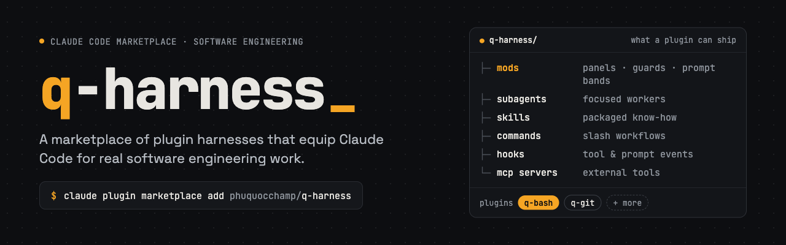

# q-harness



> A marketplace of plugin harnesses that equip Claude Code for real software engineering work, by [**phuquocchamp**](https://github.com/phuquocchamp)

This repository is a Claude Code plugin **marketplace** named `q-harness`. Each plugin lives in its own folder under `plugins/` and is installed, enabled and versioned on its own. A plugin can ship any mix of components:

| Component | What it adds |
|-----------|--------------|
| Mods | TypeScript running inside Claude Code: panels, guards, bands above the prompt |
| Subagents | Focused workers Claude can hand a task to |
| Skills | Packaged know-how Claude loads when a task calls for it |
| Commands | Slash-command workflows |
| Hooks | Handlers on tool and prompt events |
| MCP servers | External tools and data sources |

## Plugins

| Plugin | Version | Components | Description |
|--------|---------|------------|-------------|
| [`q-bash`](plugins/q-bash/README.md) | 0.3.0 | mod | Draws each Bash call as a bordered panel with git badges, timing, test summaries and diffs; guards destructive commands, keeps a command history, tracks the files Claude reads and changes, and sums up each turn above the prompt. |
| [`q-git`](plugins/q-git/README.md) | 0.1.0 | mod | Shows the repository status above the prompt and keeps a timeline of the session's commits, pushes and PRs. |

## Use case 1: Install from GitHub (users)

You only want to use the plugins. Nothing to clone.

**One step**, at the prompt of a Claude Code terminal session:

```text
/plugin install q-bash --marketplace phuquocchamp/q-harness
```

Answer `y` to add the marketplace, then pick a scope (`user`, `project` or `local`).

**Or two steps**, from your shell:

```bash
claude plugin marketplace add phuquocchamp/q-harness   # GitHub shorthand; a git URL also works
claude plugin install q-bash@q-harness                 # -s user|project|local, default user
```

Then run `/reload-plugins` in an open session (or start a new one). Check the result with `claude plugin list` or `/plugin`.

Install more plugins from the same marketplace with `claude plugin install <plugin>@q-harness`.

### Stay up to date and remove

```bash
claude plugin marketplace update q-harness   # fetch the latest marketplace from GitHub
claude plugin update q-bash                  # then restart or /reload-plugins
claude plugin disable q-bash                 # turn off without removing (enable to turn back on)
claude plugin uninstall q-bash               # remove the plugin
claude plugin marketplace remove q-harness   # remove the marketplace
```

## Use case 2: Clone and develop (contributors)

You want to change an existing plugin or add a new one, and try it in a real session.

### 1. Clone and check

```bash
git clone git@github.com:phuquocchamp/q-harness.git   # or https://github.com/phuquocchamp/q-harness.git
cd q-harness
claude plugin validate .                              # marketplace + every plugin must pass
```

Requirements: Claude Code with plugin support (`claude plugin --help` should list `validate`, `test` and `tag`). Node is only needed for the optional type-check (`npx`).

> If you already installed `q-harness` from GitHub (use case 1), remove it first so the GitHub copy and your working copy do not both load:
> `claude plugin uninstall q-bash && claude plugin marketplace remove q-harness`

### 2. Load a plugin while you edit

Pick one of two ways. Both read the files from your working copy.

**A. Load one plugin folder directly (fastest loop).** No install, nothing to clean up:

```bash
claude --plugin-dir ./plugins/q-bash                                  # saving a file reloads the mod
claude --plugin-dir ./plugins/q-bash --plugin-dir ./plugins/<other>   # repeat the flag for several
claude --debug --plugin-dir ./plugins/q-bash                          # also logs skipped hooks / refused trees
```

**B. Add the clone as a local marketplace (tests the real install flow).** Use this to check what a user gets from use case 1:

```bash
claude plugin marketplace add ./           # adds "q-harness" from this folder
claude plugin install q-bash@q-harness     # or pick specific plugins: <plugin>@q-harness
claude plugin list                         # "Read from:" points at your clone
```

Because each marketplace entry's `source` is a relative path (`./plugins/q-bash`), Claude Code reads the plugin straight from your clone. After editing, run `/reload-plugins` in the session. No reinstall or version bump is needed.

Clean up when you are done:

```bash
claude plugin uninstall q-bash
claude plugin marketplace remove q-harness
```

### 3. Test

```bash
claude plugin validate ./plugins/q-bash      # manifest, state contract, what it hooks and calls
claude plugin test ./plugins/q-bash          # run tests/*.test.ts
npx -p typescript tsc -p plugins/q-bash      # optional type-check
```

Then try it by hand: start a session with way A or B, ask Claude to run a Bash command, and check the panel.

### 4. Add a new plugin

1. Create `plugins/<name>/` with `.claude-plugin/plugin.json` and its components. See [Adding a plugin](docs/guides/adding-a-plugin.md), and [Developing a mod](docs/guides/developing-a-mod.md) for a mod.
2. Register it in `.claude-plugin/marketplace.json`:

   ```json
   { "name": "<name>", "source": "./plugins/<name>", "description": "..." }
   ```

3. Run `claude plugin validate .`, load it with way A or B, and add a row to the [Plugins](#plugins) table.

### 5. Release

Bump `version` in `plugins/<name>/.claude-plugin/plugin.json`, commit, then tag and push:

```bash
claude plugin tag plugins/<name> --dry-run   # prints <name>--v<version>
claude plugin tag plugins/<name> --push
```

Users pick it up with `claude plugin marketplace update q-harness` and `claude plugin update <name>`. Details in [Marketplace and release](docs/guides/marketplace.md).

## Project structure

```
.
├── .claude-plugin/
│   └── marketplace.json          # The marketplace: lists every plugin and its folder
├── .claude/                      # Claude Code settings and rules for working on this repo
├── plugins/                      # One folder per plugin; only these folders are shipped
│   ├── q-git/                    # Plugin with a mod (same layout as q-bash)
│   └── q-bash/                   # Plugin with a mod
│       ├── .claude-plugin/plugin.json
│       ├── hooks/hooks.json      # { "modules": ["./register.tsx"] } makes it a mod
│       ├── hooks/register.tsx    # every hook lives here
│       ├── hooks/lib.ts          # pure helpers (no $), imported by register.tsx
│       ├── types/index.d.ts
│       ├── tests/*.test.ts
│       ├── tsconfig.json
│       └── README.md
├── docs/
│   ├── guides/                   # How-to guides (see Docs below)
│   ├── images/                   # README banner and other images
│   └── playground/               # Scratch notes
└── TODOS.md                      # Ideas for upcoming plugins
```

Files at the repository root (`README.md`, `docs/`, `TODOS.md`, `.claude/`) are never installed. Everything a user receives must be inside the plugin's folder. A plugin can also ship `skills/`, `agents/`, `commands/` and `.mcp.json`; see [Adding a plugin](docs/guides/adding-a-plugin.md).

## Docs

| Guide | Covers |
|-------|--------|
| [Adding a plugin](docs/guides/adding-a-plugin.md) | Plugin types (mod, skills, agents, commands, MCP), folder layout, registering it in the marketplace |
| [Developing a mod](docs/guides/developing-a-mod.md) | The files a mod needs, loading, type-checking, testing, debugging |
| [Marketplace and release](docs/guides/marketplace.md) | Installing from the local folder or GitHub, publishing, versioning and tagging |
| [Command cheat sheet](docs/guides/commands.md) | Every command, grouped: create, run, check, test, marketplace, install, release |
