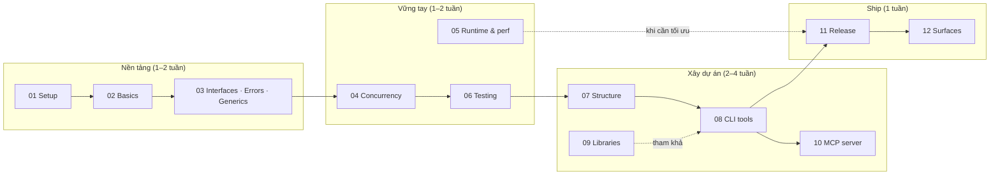

# Go Handbook: từ cơ bản đến xây dựng DevOps CLI và MCP server

Bộ tài liệu này phục vụ một mục tiêu cụ thể: dùng Go để xây các tool **dễ dùng cho cả agent lẫn người** cho Bitbucket (Cloud và DC), Jenkins và Kubernetes. Kiến trúc tham khảo là GitHub CLI (`gh`). Mỗi tool có một core dùng chung, permission chia tier (READ / WRITE / DESTRUCTIVE / ADMIN), và được phân phối ra nhiều bề mặt: CLI, Agent Skills, MCP và các bề mặt khác.

- **Phiên bản tham chiếu:** Go **1.27.3** (stable, phát hành 2026-10-19). Bản trước còn được hỗ trợ là 1.26.x.
- **Quy ước:** phần giải thích viết bằng tiếng Việt. Code, tên định danh và comment viết bằng tiếng Anh.
- **Cập nhật:** 2026-11-09.

## Mục lục

| # | File | Nội dung | Mức |
|---|------|----------|-----|
| 01 | [01-setup-toolchain.md](01-setup-toolchain.md) | Cài đặt, `go env`, module, `go.work`, directive `tool` (1.24+), `GOTOOLCHAIN`, editor, golangci-lint v2 | Cơ bản |
| 02 | [02-language-basics.md](02-language-basics.md) | Kiểu dữ liệu, slice/map, struct, method, defer/panic, range-over-int và range-over-func | Cơ bản |
| 03 | [03-types-interfaces-errors-generics.md](03-types-interfaces-errors-generics.md) | Interface, embedding, error wrapping, `errors.AsType` (1.26), generics, `iter.Seq` | Trung cấp |
| 04 | [04-concurrency.md](04-concurrency.md) | Goroutine, channel, `context`, `errgroup`, `WaitGroup.Go` (1.25), rate limit, polling, phát hiện leak | Trung cấp |
| 05 | [05-advanced-runtime-performance.md](05-advanced-runtime-performance.md) | Escape analysis, GC, `GOMEMLIMIT`, pprof, `b.Loop`, PGO, flight recorder, startup của CLI | Nâng cao |
| 06 | [06-testing-quality.md](06-testing-quality.md) | Table test, httpmock, golden, fuzz, `synctest`, testscript, coverage, lint, govulncheck | Nâng cao |
| 07 | [07-project-structure.md](07-project-structure.md) | Package và module, `internal/`, `cmd/`, monorepo, chiều phụ thuộc, **cây thư mục của dự án** | Kiến trúc |
| 08 | [08-building-cli-tools.md](08-building-cli-tools.md) | Từng bước dựng CLI kiểu gh: exit code, iostreams, Factory, HTTP chain, `--json/--jq`, **tier gate** | Tooling |
| 09 | [09-key-libraries.md](09-key-libraries.md) | Catalog thư viện: stdlib, cobra, charm, keyring, gojq, client-go, MCP go-sdk, test, lint, release | Tham khảo |
| 10 | [10-mcp-server-go.md](10-mcp-server-go.md) | MCP server với go-sdk v1.8: tool có kiểu, annotation lấy từ tier, `gated()`, stdio và HTTP, OAuth | Tooling |
| 11 | [11-build-release-ship.md](11-build-release-ship.md) | ldflags, build reproducible, GoReleaser v2, ký số, cosign, attestation, SBOM, krew, CI release | Ship |
| 12 | [12-delivery-surfaces.md](12-delivery-surfaces.md) | 13 bề mặt phân phối từ một core, ma trận enforcement, lộ trình P0–P4, anti-pattern | Chiến lược |

## Lộ trình học

Nếu bạn đã biết Go, có thể đọc theo **đường tắt**: 07 → 08 → 10 → 11 → 12. Khi gặp khái niệm chưa rõ thì quay lại 03, 04 hoặc 06.

## Quy ước dùng chung giữa các chương

- **Module path mẫu:** `example.com/devx`, một `go.mod` cho cả ba binary `bbx`, `jkx`, `kubectl-guard` (xem 07 §6.2).
- **Core dùng chung:** chương 07 và 08 đặt core tại `internal/clikit/*` (`tier`, `cmdutil`, `httpx`, `iostreams`, `output`, `exitcode`...). Chương 10 và 12 gọi khối này là `pkg/core` cho ngắn gọn. Khi code thật, hãy dùng `internal/clikit/...`. Chỉ đưa vào `pkg/` những phần thực sự công khai làm SDK (12 §3.6).
- **Exit code:** 0 ok · 1 lỗi chung · 2 sai usage · 3 không tìm thấy · 4 chưa xác thực · 5 vượt tier hoặc thiếu quyền · 6 xung đột · 7 lỗi tạm thời, nên thử lại · 8 đang chờ.
- **Lỗi trên stderr** được in dạng JSON khi không có TTY, khi phát hiện agent, hoặc khi đặt `DEVX_ERROR_FORMAT=json`. Trên terminal của người dùng thì in dạng text.
- **Tier:** lệnh không có annotation được coi là ADMIN. Lệnh `help` và `completion` là READ. Gate được kiểm tra trong `PersistentPreRunE` của root, cùng với `cobra.EnableTraverseRunHooks = true` (xem 08 §11).

## Trạng thái kiểm chứng

| Phần | Cách kiểm chứng |
|------|-----------------|
| Skeleton trong 07 và 08 | Đã chạy `go vet`, `go test` và chạy thật với go1.27.3 trong một module nháp |
| Phiên bản và tính năng ngôn ngữ (01–06) | Đối chiếu release notes trên go.dev và pkg.go.dev. Snippet chưa được compile |
| API go-sdk trong 10 | Đối chiếu Context7, pkg.go.dev và source v1.8.0. Snippet chưa được compile |
| GoReleaser, cosign, attestation (11) | Đối chiếu tài liệu chính thức. Chưa chạy release thật |
| Gọi generic method (1.27) trong 03 | **Chưa xác nhận** cú pháp gọi, file 03 đã ghi chú điểm này |

Trước khi đưa vào dự án thật, nên chạy `go vet ./...` và `golangci-lint run` trên mọi đoạn code bạn chép.

## Tài liệu liên quan

- Bản phân tích gh CLI và thiết kế Bitbucket/Jenkins/K8s (artifact): https://claude.ai/artifact/4dTXaenuYhVzHitrT9oYRa
- Go release history: https://go.dev/doc/devel/release
- Effective Go: https://go.dev/doc/effective_go
- Organizing a Go module: https://go.dev/doc/modules/layout
- Command Line Interface Guidelines: https://clig.dev
