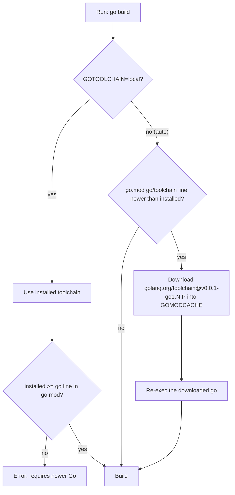
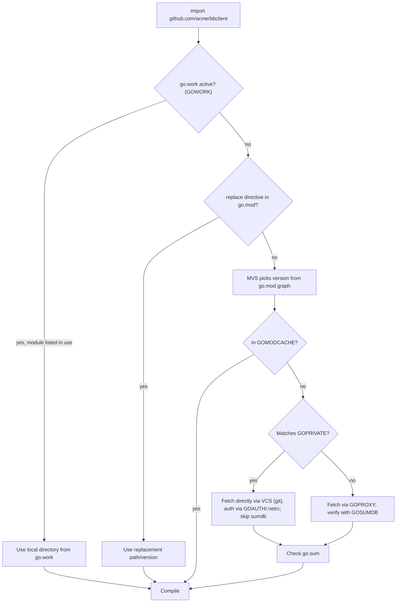

# 01 — Cài đặt & Toolchain Go

> Phiên bản tham chiếu: **Go 1.27.3** (bản stable mới nhất, phát hành 2026-10-19, theo https://go.dev/doc/devel/release).
> Mọi tính năng "hiện đại" trong tài liệu này đều ghi rõ phiên bản Go đã giới thiệu nó.

## Tại sao quan trọng cho dự án CLI

Chúng ta sẽ xây một họ công cụ (`qcli` cho Bitbucket/Jenkins/Kubernetes và các MCP server đi kèm) theo kiến trúc của `gh`. Những công cụ này:

- được phát hành dưới dạng **một file binary tĩnh** cho macOS/Linux/Windows — toolchain Go phải được pin chính xác để build tái lập (reproducible);
- được AI agent gọi trong CI và trên máy dev — nên `go vet`, linter, formatter phải chạy giống hệt nhau ở mọi nơi;
- gồm nhiều module (CLI, MCP server, thư viện client dùng chung) — cần hiểu `go.mod`, `go.work`, `GOPRIVATE` để không "vỡ" khi lấy module nội bộ từ Bitbucket.

Thiết lập đúng ngay từ đầu giúp tránh cả một lớp lỗi "máy tôi chạy được".

---

## 1. Cài đặt Go

### 1.1 macOS

```bash
# Option A: Homebrew (simple, auto-updates with brew upgrade)
brew install go
go version            # go version go1.27.3 darwin/arm64

# Option B: official .pkg installer from https://go.dev/dl/
# installs into /usr/local/go and adds /usr/local/go/bin to PATH via /etc/paths.d
```

Homebrew tiện nhưng có thể "nhảy" phiên bản khi bạn `brew upgrade`. Với dự án này, điều đó **không sao** vì phiên bản dùng để build được quyết định bởi `go.mod` (xem mục 2 — `GOTOOLCHAIN`).

### 1.2 Linux (tarball chính thức)

```bash
VERSION=1.27.3
ARCH=amd64            # or arm64
curl -LO "https://go.dev/dl/go${VERSION}.linux-${ARCH}.tar.gz"
# Never untar on top of an old install: remove it first
sudo rm -rf /usr/local/go
sudo tar -C /usr/local -xzf "go${VERSION}.linux-${ARCH}.tar.gz"

# ~/.profile or ~/.zshrc
export PATH="$PATH:/usr/local/go/bin:$(go env GOPATH)/bin"
```

Tarball chính thức cũng dùng được trên macOS (`darwin-arm64`, `darwin-amd64`). Nên kiểm tra SHA256 trên trang https://go.dev/dl/.

### 1.3 Windows

```powershell
# Option A: MSI installer from https://go.dev/dl/ (adds Go to PATH)
# Option B: winget
winget install GoLang.Go
go version
```

Trên Windows, `GOPATH` mặc định là `%USERPROFILE%\go`, binary cài bằng `go install` nằm trong `%USERPROFILE%\go\bin` — hãy thêm thư mục này vào `PATH`.

### 1.4 Kiểm tra sau khi cài

```bash
go version
go env GOROOT GOPATH GOBIN GOMODCACHE GOTOOLCHAIN
```

---

## 2. Nhiều phiên bản Go: directive `go`, `toolchain` và `GOTOOLCHAIN`

Từ **Go 1.21**, Go tự quản lý toolchain. Bạn hiếm khi cần `gvm`/`asdf`.

- Dòng `go 1.N` trong `go.mod` là **phiên bản tối thiểu bắt buộc** và cũng là **phiên bản ngôn ngữ** dùng để biên dịch module (quyết định tính năng ngôn ngữ nào được bật, ví dụ loop variable per-iteration của 1.22).
- Dòng `toolchain go1.N.P` (tuỳ chọn) gợi ý toolchain *ưu tiên* khi build module này.
- Biến môi trường `GOTOOLCHAIN` kiểm soát việc có được phép tự tải toolchain khác hay không.

| Giá trị `GOTOOLCHAIN` | Ý nghĩa |
|---|---|
| `auto` (mặc định, tương đương `local+auto`) | Dùng toolchain local; nếu `go.mod` đòi bản mới hơn thì tự tải về module cache |
| `local` | Luôn dùng toolchain đã cài; báo lỗi nếu `go.mod` đòi bản mới hơn |
| `go1.27.3` | Luôn dùng đúng bản này (tải về nếu cần) |
| `go1.27.3+auto` | Mặc định dùng 1.27.3, nhưng cho phép nâng lên nếu `go.mod` yêu cầu |
| `path` / `go1.27.3+path` | Như `auto` nhưng chỉ tìm toolchain trong `PATH`, không tải về |

```text
// go.mod
module github.com/acme/qcli

go 1.27.0

toolchain go1.27.3
```



### 2.1 Cài song song phiên bản cụ thể (để thử nghiệm)

```bash
# Wrapper binaries from golang.org/dl
go install golang.org/dl/go1.26.0@latest
go1.26.0 download
go1.26.0 version

# Or simply force a toolchain for one command
GOTOOLCHAIN=go1.26.0 go test ./...
```

### 2.2 Nâng phiên bản cho module

```bash
go get go@1.27.3          # bump the `go` line (minimum version)
go get toolchain@go1.27.3 # bump the `toolchain` line
go get toolchain@none     # remove the toolchain line
```

> **Lưu ý Go 1.26+:** `go mod init` **không** ghi phiên bản toolchain hiện tại mà ghi bản minor *trước đó* — toolchain `1.N.X` ghi `go 1.(N-1).0`. Với Go 1.27.3, `go mod init` tạo `go 1.26.0`, nghĩa là các tính năng ngôn ngữ của 1.27 (ví dụ generic method) **bị tắt** cho tới khi bạn chạy `go get go@1.27.0`. Mục đích: module mới mặc định tương thích với bản Go cũ hơn một chút.

---

## 3. `go env` — đọc và ghi cấu hình

```bash
go env                    # all settings
go env GOPATH GOPROXY     # selected keys
go env -json | jq .GOOS   # machine-readable
go env -w GOPRIVATE='bitbucket.acme.internal/*'   # persist into go env file
go env -u GOPRIVATE       # unset a persisted value
go env GOENV              # where -w writes (e.g. ~/Library/Application Support/go/env)
```

Các biến quan trọng cho dự án:

| Biến | Vai trò trong dự án CLI |
|---|---|
| `GOPATH` | Gốc workspace cũ; hiện chủ yếu chứa `pkg/mod` (cache) và `bin` |
| `GOBIN` | Nơi `go install` đặt binary (mặc định `$GOPATH/bin`) |
| `GOMODCACHE` | Cache module (read-only), mặc định `$GOPATH/pkg/mod` |
| `GOPROXY` | Mặc định `https://proxy.golang.org,direct` |
| `GOPRIVATE` | Pattern module nội bộ — bỏ qua proxy và checksum DB công khai |
| `GONOSUMDB`, `GONOPROXY` | Tinh chỉnh chi tiết hơn `GOPRIVATE` |
| `GOAUTH` (Go 1.24+) | Cách xác thực khi tải module private (`go help goauth`) |
| `GOFLAGS` | Flag mặc định cho mọi lệnh, ví dụ `-trimpath` |
| `CGO_ENABLED` | Đặt `0` để build binary tĩnh hoàn toàn |
| `GOOS`, `GOARCH` | Cross-compile: `GOOS=windows GOARCH=amd64 go build` |

---

## 4. GOPATH vs Modules

Trước Go 1.11, mọi code phải nằm trong `$GOPATH/src/...`. Hiện nay **module mode là mặc định** (từ Go 1.16 `GO111MODULE=on` mặc định). Bạn có thể đặt project ở bất cứ đâu; `GOPATH` chỉ còn là chỗ chứa cache và binary.

Đừng bao giờ đặt `GO111MODULE=off` hay cố tạo cấu trúc `src/github.com/...` thủ công — đó là tài liệu cũ.

---

## 5. Lệnh `go mod`

```bash
go mod init github.com/acme/qcli   # create go.mod (module path = import path)
go get github.com/spf13/cobra@latest
go get github.com/spf13/cobra@v1.10.1   # pin a specific version (illustrative)
go get example.com/pkg@none        # remove a dependency
go mod tidy                        # add missing, remove unused requires; update go.sum
go mod tidy -diff                  # Go 1.23+: print diff, exit non-zero if not tidy (great for CI)
go mod why -m golang.org/x/net     # why is this module needed?
go mod graph | grep cobra          # full requirement graph
go list -m -u all                  # list modules with available upgrades
go mod download                    # warm the cache (CI layer caching)
go mod verify                      # verify cache matches go.sum
```

Một số điểm cần biết:

- `go.sum` chứa hash mật mã của mọi module — **luôn commit** cùng `go.mod`.
- Go dùng **Minimal Version Selection (MVS)**: chọn phiên bản *thấp nhất* thoả mãn mọi yêu cầu, không phải bản mới nhất. Build vì vậy rất ổn định.
- Module major `v2+` phải có hậu tố trong path: `github.com/acme/qcli/v2`.
- Directive `replace` dùng để trỏ tạm vào bản local/fork; directive `exclude`, `retract` hiếm khi cần.
- Go 1.25 thêm directive `ignore` trong `go.mod` để bỏ qua thư mục khi khớp pattern `./...` (ví dụ thư mục `node_modules` của UI đi kèm).
- Go 1.27: với module khai báo `go 1.27`+, `go mod tidy` gộp các block `require` trùng thành tối đa hai block (direct và indirect).

### 5.1 Module resolution — Go tìm code ở đâu



### 5.2 Module private trên Bitbucket

```bash
go env -w GOPRIVATE='bitbucket.acme.internal/*'
# Use SSH instead of HTTPS for git fetches
git config --global url."ssh://git@bitbucket.acme.internal:7999/".insteadOf "https://bitbucket.acme.internal/scm/"
```

Với Bitbucket Server/Data Center, Go cần trang trả về thẻ `<meta name="go-import">` hoặc bạn dùng path có đuôi `.git` (ví dụ `bitbucket.acme.internal/scm/devops/bbclient.git`). Cách đơn giản nhất cho team nội bộ thường là một Go module proxy (Athens, Artifactory) và `GOPROXY=https://goproxy.acme.internal,direct`.

---

## 6. Workspace với `go.work` (Go 1.18+)

Khi bạn phát triển đồng thời `qcli` và thư viện `bbclient` trong hai module khác nhau, `go.work` cho phép build với code local mà **không sửa `go.mod`** bằng `replace`.

```text
devops/
├── go.work
├── qcli/          (module github.com/acme/qcli)
├── qmcp/          (module github.com/acme/qmcp — MCP server)
└── bbclient/      (module github.com/acme/bbclient)
```

```bash
cd devops
go work init ./qcli ./qmcp ./bbclient
go work use ./jenkinsclient     # add another module later
go work sync                    # push workspace versions back into each go.mod
GOWORK=off go build ./...       # build as CI will (ignore workspace)
```

```text
// go.work
go 1.27.0

use (
	./bbclient
	./qcli
	./qmcp
)
```

Khuyến nghị: **không commit `go.work`** nếu các module được phát hành độc lập — CI phải build đúng như người dùng `go install` sẽ build. Thêm `go.work` và `go.work.sum` vào `.gitignore`, và chạy CI với `GOWORK=off`.

---

## 7. Pin công cụ dev bằng directive `tool` (Go 1.24+)

Trước Go 1.24 người ta dùng file `tools.go` với blank import. Từ **Go 1.24**, `go.mod` có directive `tool`:

```bash
go get -tool honnef.co/go/tools/cmd/staticcheck@latest
go get -tool golang.org/x/tools/cmd/stringer@latest
go get -tool golang.org/x/tools/cmd/goimports@latest

go tool staticcheck ./...      # run the version pinned in go.mod
go tool stringer -type=Tier ./internal/gate
go get tool                    # upgrade all tools (the `tool` meta-pattern)
go install tool                # install all tools into GOBIN
```

```text
// go.mod (excerpt)
tool (
	golang.org/x/tools/cmd/goimports
	golang.org/x/tools/cmd/stringer
	honnef.co/go/tools/cmd/staticcheck
)
```

Lợi ích: phiên bản tool nằm trong `go.mod`/`go.sum`, mọi dev và CI chạy cùng bản; `go generate` có thể gọi `//go:generate go tool stringer -type=Tier`.

Nhược điểm: dependency của tool lẫn vào module graph của bạn. Với **golangci-lint**, tài liệu chính thức khuyến nghị cài **binary release** thay vì `go install`/`tool` (để tránh xung đột dependency và đảm bảo build đã được kiểm thử). Hãy pin version của nó trong CI và Makefile.

---

## 8. Format, vet, lint

### 8.1 `gofmt` và `goimports`

```bash
gofmt -l .            # list files that are not formatted (use in CI)
gofmt -w .            # rewrite in place
go tool goimports -w -local github.com/acme ./   # also fix imports, group local ones last
```

Format trong Go là **không thương lượng** — mọi code phải qua `gofmt`. Go 1.27 thay đổi nhẹ thuật toán căn cột của `gofmt`, nên lần đầu chạy lại trên code cũ có thể thấy diff khoảng trắng nhỏ — commit riêng diff đó.

### 8.2 `go vet`

```bash
go vet ./...
```

`go vet` chạy các analyzer bắt lỗi thực sự (không phải style): sai format `Printf`, copy `sync.Mutex`, struct tag hỏng, unreachable code... Một số analyzer mới đáng chú ý:

- Go 1.23: `stdversion` — dùng symbol stdlib mới hơn phiên bản `go` của file.
- Go 1.24: `tests` — khai báo test/benchmark/example sai.
- Go 1.25: `waitgroup` (gọi `wg.Add` sai chỗ), `hostport` (dùng `fmt.Sprintf("%s:%d")` thay vì `net.JoinHostPort` — hỏng với IPv6).
- Go 1.27: `printf` cảnh báo khi wrap **con trỏ tới kiểu error** bằng `%w`; `go test` chạy `stdversion` mặc định.

`go test` tự động chạy một tập con của vet.

### 8.3 `go fix` — modernizers (Go 1.26+)

Go 1.26 viết lại `go fix` thành nơi chứa các "modernizer": tự động cập nhật code sang idiom mới (ví dụ dùng `min`/`max`, `slices.Contains`, range over int...). Nó cũng hỗ trợ directive `//go:fix inline` để tự động migrate API của chính bạn.

```bash
go fix -diff ./...    # preview (check `go help fix` for exact flags on your version)
go fix ./...
```

### 8.4 staticcheck và golangci-lint v2

`staticcheck` là bộ phân tích tĩnh chất lượng cao nhất; golangci-lint là "meta-linter" chạy song song nhiều linter (bao gồm staticcheck). **golangci-lint v2** (2025) đổi format config: bắt buộc `version: "2"`, formatter tách sang mục `formatters`, exclusion dùng `linters.exclusions.presets`.

```yaml
# .golangci.yml — golangci-lint v2.x
version: "2"

run:
  timeout: 5m

linters:
  default: standard        # errcheck, govet, ineffassign, staticcheck, unused
  enable:
    - bodyclose            # unclosed http.Response.Body (matters for API clients)
    - errorlint            # wrong error comparisons, missing %w
    - misspell
    - revive
    - gosec
    - noctx                # http requests without context
  settings:
    govet:
      enable-all: true
      disable:
        - fieldalignment
  exclusions:
    presets:
      - comments
      - std-error-handling
      - common-false-positives

formatters:
  enable:
    - gofmt
    - goimports
  settings:
    goimports:
      local-prefixes:
        - github.com/acme
```

```bash
golangci-lint run ./...
golangci-lint fmt          # v2: run configured formatters
golangci-lint migrate      # convert a v1 config to v2
```

---

## 9. Editor

### 9.1 gopls (language server chính thức)

`gopls` cung cấp autocomplete, go-to-definition, rename, code action, và chạy analyzer khi gõ. VS Code và GoLand đều dùng/hỗ trợ nó (GoLand dùng engine riêng nhưng tương đương). Cài/cập nhật:

```bash
go install golang.org/x/tools/gopls@latest
```

### 9.2 VS Code

Cài extension **Go** (`golang.go`), sau đó chạy lệnh "Go: Install/Update Tools".

```jsonc
// .vscode/settings.json
{
  "go.useLanguageServer": true,
  "go.lintTool": "golangci-lint",          // check the extension docs for the v2 option name
  "go.lintFlags": ["--fast-only"],
  "[go]": {
    "editor.formatOnSave": true,
    "editor.codeActionsOnSave": { "source.organizeImports": "explicit" }
  },
  "gopls": {
    "ui.semanticTokens": true,
    "ui.diagnostic.staticcheck": true,
    "formatting.local": "github.com/acme"
  }
}
```

### 9.3 GoLand

GoLand có sẵn formatter, refactor, debugger (Delve). Bật: *Settings → Tools → Actions on Save → Reformat code + Optimize imports*, và *Go → Linters* trỏ tới `.golangci.yml`. Debug với Delve (`go install github.com/go-delve/delve/cmd/dlv@latest`) cho cả VS Code.

---

## 10. Task runner: Makefile hoặc Taskfile

```makefile
# Makefile
BIN      := bin/qcli
VERSION  ?= $(shell git describe --tags --always --dirty)
LDFLAGS  := -s -w -X github.com/acme/qcli/internal/build.Version=$(VERSION)

.PHONY: build test lint fmt tidy check

build:
	CGO_ENABLED=0 go build -trimpath -ldflags "$(LDFLAGS)" -o $(BIN) ./cmd/qcli

test:
	go test -race -count=1 ./...

lint:
	golangci-lint run ./...

fmt:
	golangci-lint fmt

tidy:
	go mod tidy -diff

check: tidy lint test
```

Lưu ý: Makefile bắt buộc dùng **tab** để thụt lệnh.

```yaml
# Taskfile.yml (https://taskfile.dev) — cross-platform, friendlier on Windows
version: "3"

vars:
  VERSION:
    sh: git describe --tags --always --dirty

tasks:
  build:
    env: { CGO_ENABLED: "0" }
    cmds:
      - go build -trimpath -ldflags "-s -w -X github.com/acme/qcli/internal/build.Version={{.VERSION}}" -o bin/qcli ./cmd/qcli
  test:
    cmds: [go test -race -count=1 ./...]
  lint:
    cmds: [golangci-lint run ./...]
  check:
    deps: [lint, test]
```

Chọn **Taskfile** nếu team có dev Windows; chọn Makefile nếu chỉ macOS/Linux và muốn zero-dependency.

---

## 11. direnv — biến môi trường theo thư mục

CLI DevOps cần nhiều biến (URL Bitbucket/Jenkins, kubeconfig test). `direnv` nạp `.envrc` khi `cd` vào thư mục.

```bash
# .envrc (commit this one; keep secrets in .envrc.local which is gitignored)
export GOPRIVATE='bitbucket.acme.internal/*'
export GOFLAGS='-trimpath'
export QCLI_CONFIG_DIR="$PWD/.qcli-dev"     # isolate dev config from your real ~/.config
export KUBECONFIG="$PWD/testdata/kind.kubeconfig"
PATH_add bin
source_env_if_exists .envrc.local
```

```bash
brew install direnv
echo 'eval "$(direnv hook zsh)"' >> ~/.zshrc
direnv allow
```

Tách `QCLI_CONFIG_DIR` giúp test token/permission tier mà không đụng cấu hình thật.

---

## 12. Walkthrough: project đầu tiên

### 12.1 Khởi tạo

```bash
mkdir qcli && cd qcli
git init
go mod init github.com/acme/qcli
go get go@1.27.0                    # Go 1.26+ init writes the previous minor; bump it
go get github.com/spf13/cobra@latest
```

### 12.2 Bố cục thư mục (giống `gh`)

```text
qcli/
├── cmd/qcli/main.go            # tiny: build Factory, run root command, map error -> exit code
├── internal/
│   ├── build/build.go          # Version, Date set via -ldflags
│   └── gate/                   # permission tiers READ/WRITE/DESTRUCTIVE/ADMIN
├── pkg/
│   ├── cmd/
│   │   ├── root/root.go
│   │   ├── factory/default.go  # lazy Factory (HttpClient, Config, IOStreams...)
│   │   └── pr/list/list.go     # Options + runF + run pattern
│   ├── cmdutil/                # Factory struct, typed errors, flag helpers
│   └── iostreams/
├── .golangci.yml
├── Makefile
└── go.mod
```

`internal/` không thể bị import từ module khác — dùng cho code bạn không muốn cam kết API. `pkg/` (theo `gh`) chứa phần có thể tái sử dụng bởi MCP server.

### 12.3 Code tối thiểu

```go
// internal/build/build.go
package build

// Version is overridden at link time: -ldflags "-X github.com/acme/qcli/internal/build.Version=v0.1.0"
var Version = "dev"
```

```go
// cmd/qcli/main.go
package main

import (
	"fmt"
	"os"

	"github.com/spf13/cobra"

	"github.com/acme/qcli/internal/build"
)

func main() {
	root := &cobra.Command{
		Use:           "qcli",
		Short:         "DevOps CLI for Bitbucket, Jenkins and Kubernetes",
		Version:       build.Version,
		SilenceUsage:  true, // do not print usage on every runtime error
		SilenceErrors: true, // we print errors ourselves (and pick the exit code)
	}

	root.AddCommand(&cobra.Command{
		Use:   "hello",
		Short: "Print a greeting",
		Args:  cobra.NoArgs,
		RunE: func(cmd *cobra.Command, args []string) error {
			_, err := fmt.Fprintln(cmd.OutOrStdout(), "hello from qcli")
			return err
		},
	})

	if err := root.Execute(); err != nil {
		fmt.Fprintln(os.Stderr, "error:", err)
		os.Exit(1)
	}
}
```

### 12.4 Chạy, build, kiểm tra

```bash
go run ./cmd/qcli hello
go build -o bin/qcli ./cmd/qcli && ./bin/qcli --version
go vet ./...
go mod tidy -diff
GOOS=linux GOARCH=amd64 CGO_ENABLED=0 go build -o bin/qcli-linux ./cmd/qcli   # cross-compile
go version -m bin/qcli    # embedded build info: module versions, VCS revision, flags
```

`go version -m` đọc build info nhúng sẵn trong binary (module, commit VCS, `-trimpath`...). Bạn cũng có thể đọc nó ở runtime qua `runtime/debug.ReadBuildInfo()` để hiện `qcli version` mà không cần `-ldflags`.

### 12.5 Commit những gì

Commit: `go.mod`, `go.sum`, `.golangci.yml`, `Makefile`/`Taskfile.yml`, `.envrc`, `.vscode/settings.json` (tuỳ team).
Không commit: `bin/`, `go.work`, `go.work.sum`, `.envrc.local`, `vendor/` (trừ khi team chọn vendoring có chủ đích).

---

## Lỗi thường gặp

1. **Tưởng toolchain cài đặt quyết định phiên bản ngôn ngữ.** Sai — dòng `go` trong `go.mod` quyết định. Cài Go 1.27 nhưng `go.mod` ghi `go 1.21` thì loop variable vẫn dùng ngữ nghĩa cũ (chung một biến cho mọi vòng lặp) và range-over-func sẽ báo lỗi.
2. **`go mod init` trên Go 1.26+ ghi phiên bản cũ hơn** → tính năng mới "không hoạt động". Chạy `go get go@1.27.0`.
3. **CI tự tải toolchain không mong muốn** do `GOTOOLCHAIN=auto` và `toolchain` line mới hơn image CI. Hoặc pin image đúng bản, hoặc đặt `GOTOOLCHAIN=local` để fail rõ ràng.
4. **Quên `GOPRIVATE`** → `go get` module Bitbucket nội bộ bị lỗi `410 Gone` / `verifying module: ... not found` vì proxy và sumdb công khai không thấy repo private.
5. **Commit `go.work`** → CI build bằng code local thay vì phiên bản trong `go.mod`, che giấu lỗi tương thích.
6. **Không commit `go.sum`** hoặc sửa tay `go.mod` rồi quên `go mod tidy`.
7. **Cài golangci-lint bằng `go install`** → dependency của linter xung đột/khác bản đã kiểm thử. Dùng binary release và pin version.
8. **Dùng config golangci-lint v1 với binary v2** → lỗi parse; chạy `golangci-lint migrate`.
9. **Untar Go mới đè lên `/usr/local/go` cũ** → file cũ còn sót gây lỗi biên dịch khó hiểu. Luôn `rm -rf` trước.
10. **`CGO_ENABLED=1` mặc định trên máy dev** → binary link động với libc; chạy trong container `scratch`/`distroless` bị lỗi. Release luôn `CGO_ENABLED=0` (trừ khi thực sự cần cgo).
11. **Quên `$(go env GOPATH)/bin` trong `PATH`** → `gopls`, `dlv`, binary `go install` "không tìm thấy".

---

## Checklist

- [ ] `go version` hiển thị 1.27.x; `go env GOTOOLCHAIN` là `auto` (dev) / chiến lược rõ ràng cho CI.
- [ ] `go.mod` có `go 1.27.0` (sau `go get go@1.27.0`) và tuỳ chọn `toolchain go1.27.3`.
- [ ] `GOPRIVATE` trỏ tới host Bitbucket nội bộ; xác thực git/GOAUTH hoạt động.
- [ ] Tool dev (`staticcheck`, `stringer`, `goimports`) pin bằng directive `tool`; golangci-lint v2 pin qua binary.
- [ ] `.golangci.yml` có `version: "2"`, formatter nằm trong `formatters`.
- [ ] Editor: gopls, format on save, organize imports, `local` prefix `github.com/acme`.
- [ ] `make check` (hoặc `task check`) chạy `go mod tidy -diff`, lint, `go test -race`.
- [ ] Build release: `CGO_ENABLED=0 go build -trimpath -ldflags "-s -w -X ...Version=..."`.
- [ ] `go.work` (nếu dùng) nằm trong `.gitignore`; CI chạy `GOWORK=off`.
- [ ] `.envrc` cô lập config dev (`QCLI_CONFIG_DIR`, `KUBECONFIG`).

---

## Tài liệu tham khảo

- Cài đặt Go: https://go.dev/doc/install
- Danh sách release & lịch sử phiên bản: https://go.dev/doc/devel/release
- Go toolchains (`GOTOOLCHAIN`, `toolchain`): https://go.dev/doc/toolchain
- Go Modules Reference: https://go.dev/ref/mod
- Tutorial workspaces: https://go.dev/doc/tutorial/workspaces
- Release notes: https://go.dev/doc/go1.23 · https://go.dev/doc/go1.24 · https://go.dev/doc/go1.25 · https://go.dev/doc/go1.26 · https://go.dev/doc/go1.27
- Module private & GOPRIVATE: https://go.dev/ref/mod#private-modules
- `cmd/go` docs: https://pkg.go.dev/cmd/go
- gopls: https://go.dev/gopls/
- VS Code Go: https://github.com/golang/vscode-go
- staticcheck: https://staticcheck.dev/
- golangci-lint v2 config & migration: https://golangci-lint.run/docs/configuration/ · https://golangci-lint.run/docs/product/migration-guide/
- Taskfile: https://taskfile.dev/
- direnv: https://direnv.net/
- Cobra: https://github.com/spf13/cobra
