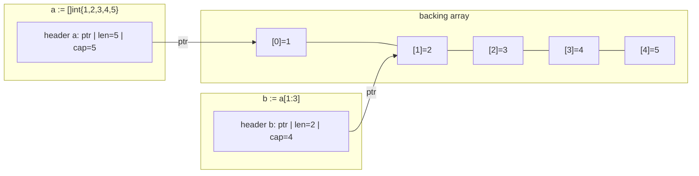
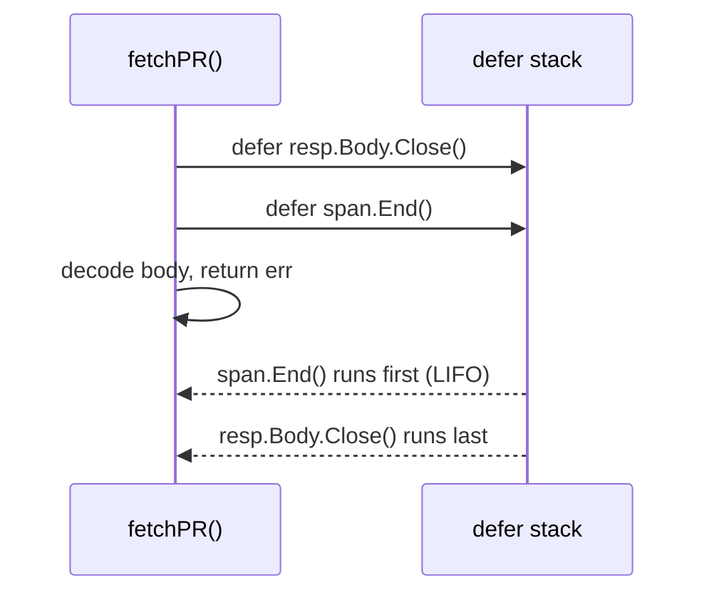

# 02 — Ngôn ngữ Go: những phần cơ bản

> Phiên bản tham chiếu: **Go 1.27.3**. Các tính năng mới được ghi kèm phiên bản, ví dụ *(Go 1.22+)*.
> Nhớ rằng phiên bản **ngôn ngữ** được quyết định bởi dòng `go` trong `go.mod` của module, không phải bởi toolchain bạn đã cài (xem file 01).
> Quy ước snippet: các đoạn ngắn là *trích đoạn câu lệnh* (có thể để biến chưa dùng cho gọn); chỉ các khối `func`/`package` đầy đủ mới là code biên dịch độc lập.

## Tại sao quan trọng cho dự án CLI

Một CLI kiểu `gh` gồm rất nhiều thứ nhỏ: parse flag, gọi REST API của Bitbucket/Jenkins/Kubernetes, biến đổi slice/map dữ liệu, in bảng hoặc JSON, dọn tài nguyên bằng `defer`. Phần lớn bug "khó hiểu" ở các dự án Go mới đều đến từ vài điểm cơ bản:

- slice dùng chung backing array (aliasing) làm hỏng dữ liệu đã trả về;
- map ghi khi chưa khởi tạo → panic;
- `nil` slice vs empty slice → `--json` in ra `null` thay vì `[]` (agent parse sai);
- pointer receiver vs value receiver làm thay đổi "biến mất";
- `defer` trong vòng lặp giữ hàng trăm `resp.Body` mở.

File này đi qua ngôn ngữ cơ bản với ví dụ lấy từ chính bối cảnh CLI.

---

## 1. Package, import, visibility

Mỗi thư mục là **một package**. Tên package là định danh ngắn, viết thường, không gạch dưới (`iostreams`, `cmdutil`, không phải `io_streams`). Package `main` có hàm `main()` là entry point.

```go
package list // directory pkg/cmd/pr/list

import (
	"context"
	"fmt"
	"net/http"

	"github.com/spf13/cobra"

	"github.com/acme/qcli/pkg/cmdutil"
	bb "github.com/acme/qcli/pkg/bitbucket" // import alias
)
```

Quy ước nhóm import: stdlib → thư viện ngoài → module nội bộ (goimports với `-local github.com/acme` tự làm).

**Visibility dựa vào chữ cái đầu**:

| Tên | Phạm vi |
|---|---|
| `ListOptions`, `NewCmdList` | Exported — dùng được từ package khác |
| `listRun`, `defaultLimit` | Unexported — chỉ trong package |

Không có `public`/`private`. Ngoài ra, thư mục `internal/` chặn import từ ngoài cây thư mục cha của nó — dùng cho code không muốn cam kết API.

Một số import đặc biệt:

```go
import _ "embed"            // blank import: run init() side effects / enable directives
import . "fmt"              // dot import: avoid it (only acceptable in some tests)
```

`init()` chạy tự động khi package được nạp. Tránh dùng `init()` cho logic có side effect (đọc config, gọi mạng) — CLI khó test và khởi động chậm. Factory lazy (mục 6) là cách đúng.

---

## 2. Biến và zero value

```go
var limit int                 // zero value: 0
var name string               // ""
var verbose bool              // false
var client *http.Client       // nil
var labels []string           // nil slice (len 0, usable with append)
var headers map[string]string // nil map (read OK, write PANICS)

host := "bitbucket.acme.internal" // short declaration, only inside functions
a, b := 1, "x"
```

**Zero value có nghĩa** là triết lý thiết kế của Go: một `bytes.Buffer`, `sync.Mutex`, `strings.Builder` khai báo xong là dùng được ngay. Hãy thiết kế struct `Options` sao cho zero value là mặc định hợp lý.

### Shadowing với `:=`

```go
var cfg *Config
if useFile {
	cfg, err := loadConfig() // BUG: declares NEW cfg and err inside the if block
	_ = cfg
	_ = err
}
// cfg is still nil here
```

Sửa: khai báo `var err error` ở ngoài rồi dùng `cfg, err = loadConfig()`. Analyzer `shadow` (bật qua golangci-lint: `govet` với `enable-all`) phát hiện được.

---

## 3. Kiểu cơ bản và chuyển đổi

| Nhóm | Kiểu |
|---|---|
| Boolean | `bool` |
| Số nguyên | `int`, `int8..int64`, `uint`, `uint8..uint64`, `uintptr` |
| Alias | `byte` = `uint8`, `rune` = `int32` |
| Số thực/phức | `float32`, `float64`, `complex64`, `complex128` |
| Chuỗi | `string` (bất biến, chuỗi byte UTF-8) |

Go **không chuyển kiểu ngầm định**:

```go
var replicas int32 = 3
var n int = int(replicas)        // explicit conversion required
pct := float64(done) / float64(total) * 100

s := strconv.Itoa(42)            // int -> "42"
v, err := strconv.Atoi("42")     // "42" -> int, with error
d, err := time.ParseDuration("30s")
```

`string(65)` cho ra `"A"` (rune), **không** phải `"65"` — `go vet` cảnh báo trường hợp này.

Builtin `min`, `max` *(Go 1.21+)* và `clear` *(Go 1.21+)*:

```go
limit = min(limit, 100)   // cap page size
clear(cache)              // delete all keys of a map / zero all elements of a slice
```

---

## 4. Hằng số và `iota`

```go
const defaultLimit = 30                  // untyped constant: adapts to context
const requestTimeout = 30 * time.Second  // typed (time.Duration)
```

Hằng untyped có độ chính xác tuỳ ý và tự "thích nghi" kiểu khi dùng. `iota` tăng dần trong một block `const` — hoàn hảo cho **permission tier**:

```go
package gate

import "fmt"

// Tier is the permission level a command requires. Order matters: higher = more dangerous.
type Tier int

const (
	TierRead        Tier = iota // 0
	TierWrite                   // 1
	TierDestructive             // 2
	TierAdmin                   // 3
)

func (t Tier) String() string {
	switch t {
	case TierRead:
		return "READ"
	case TierWrite:
		return "WRITE"
	case TierDestructive:
		return "DESTRUCTIVE"
	case TierAdmin:
		return "ADMIN"
	}
	return fmt.Sprintf("Tier(%d)", int(t))
}

// Allows reports whether a granted tier covers the required one.
func Allows(granted, required Tier) bool { return granted >= required }
```

Có thể sinh `String()` tự động: `//go:generate go tool stringer -type=Tier` (stringer pin bằng directive `tool`, Go 1.24+).

Mẹo: nếu zero value không nên là một tier hợp lệ (để bắt lỗi "quên gán"), bắt đầu bằng `TierUnknown Tier = iota`. Ở đây ta *muốn* zero value là READ (an toàn nhất).

---

## 5. Điều khiển luồng

```go
// if with an init statement: err is scoped to the if/else
if err := validate(opts); err != nil {
	return err
}

// switch: no fallthrough by default, cases can list several values
switch strings.ToLower(format) {
case "json":
	return printJSON(out, items)
case "table", "":
	return printTable(out, items)
default:
	return fmt.Errorf("unknown format %q", format)
}

// tagless switch = clean if/else-if chain
switch {
case resp.StatusCode == http.StatusNotFound:
	return ErrNotFound
case resp.StatusCode >= 500:
	return fmt.Errorf("server error: %s", resp.Status)
}
```

`for` là vòng lặp duy nhất:

```go
for i := 0; i < 3; i++ {}      // classic
for attempt < maxRetries {}    // while
for {}                         // infinite (break/return to leave)
for i := range 3 { _ = i }     // Go 1.22+: range over int -> 0,1,2
```

Label để thoát vòng lặp lồng nhau:

```go
outer:
	for _, ns := range namespaces {
		for _, pod := range pods[ns] {
			if pod == target {
				break outer
			}
		}
	}
```

---

## 6. Hàm

### 6.1 Nhiều giá trị trả về và named results

```go
func parseRepo(s string) (workspace, slug string, err error) {
	ws, sl, ok := strings.Cut(s, "/")
	if !ok || ws == "" || sl == "" {
		return "", "", fmt.Errorf("invalid repo %q, want WORKSPACE/SLUG", s)
	}
	return ws, sl, nil
}
```

Quy ước: `error` luôn là giá trị trả về **cuối cùng**. Named result hữu ích cho tài liệu và để `defer` sửa giá trị trả về (mục 11); tránh "naked return" trong hàm dài.

### 6.2 Variadic

```go
func joinPath(parts ...string) string { return strings.Join(parts, "/") }

joinPath("rest", "api", "1.0")
segments := []string{"projects", "DEV", "repos"}
joinPath(segments...) // spread a slice
```

### 6.3 Hàm là giá trị, closure

Hàm là first-class value. Đây là nền của pattern **Options + runF + run** trong `gh`: test thay `runF` để kiểm tra Options đã parse đúng mà không gọi API.

```go
type ListOptions struct {
	Limit int
	State string
}

func NewCmdList(runF func(*ListOptions) error) *cobra.Command {
	opts := &ListOptions{}
	cmd := &cobra.Command{
		Use: "list",
		RunE: func(cmd *cobra.Command, args []string) error {
			if runF != nil {
				return runF(opts) // test hook
			}
			return listRun(opts)
		},
	}
	cmd.Flags().IntVarP(&opts.Limit, "limit", "L", 30, "Maximum number of items")
	cmd.Flags().StringVar(&opts.State, "state", "open", "Filter by state")
	return cmd
}

func listRun(opts *ListOptions) error { return nil }
```

Closure "bắt" biến bên ngoài theo **tham chiếu**. Factory lazy dùng closure + cache:

```go
func lazyClient(newClient func() (*http.Client, error)) func() (*http.Client, error) {
	var (
		c   *http.Client
		err error
		mu  sync.Mutex
	)
	return func() (*http.Client, error) {
		mu.Lock()
		defer mu.Unlock()
		if c == nil && err == nil {
			c, err = newClient() // built only on first use
		}
		return c, err
	}
}
```

(`sync.OnceValues` *(Go 1.21+)* làm việc này gọn hơn: `sync.OnceValues(newClient)` trả về `func() (*http.Client, error)`.)

---

## 7. Array vs slice

**Array** có độ dài là một phần của kiểu (`[4]int` khác `[5]int`), được copy khi gán. Hiếm dùng trực tiếp.

**Slice** là một header nhỏ gồm 3 trường: con trỏ tới backing array, `len`, `cap`. Gán/truyền slice chỉ copy header — **backing array được chia sẻ**.



`b` nhìn thấy phần tử `[1]` và `[2]`, nhưng `cap(b) = 4` vì nó còn "chỗ" tới hết backing array.

```go
s := make([]string, 0, 50) // len 0, cap 50: preallocate when size is known
s = append(s, "a")         // ALWAYS assign the result of append
fmt.Println(len(s), cap(s)) // 1 50
```

### 7.1 Tăng trưởng của `append`

Khi `len == cap`, `append` cấp phát backing array mới lớn hơn, copy dữ liệu sang, và trả về header trỏ tới mảng mới. Hệ số tăng là **chi tiết implementation** (gần gấp đôi với slice nhỏ, giảm dần với slice lớn, có làm tròn theo size class) — đừng viết code dựa vào con số cụ thể.

```go
var ids []int
for i := range 10 { // Go 1.22+
	ids = append(ids, i)
	fmt.Println(len(ids), cap(ids)) // cap jumps: implementation-defined
}
```

### 7.2 Aliasing — bug kinh điển

```go
a := []int{1, 2, 3, 4}
b := a[:2]        // len 2, cap 4 — shares a's array
b = append(b, 99) // fits in cap: writes into a[2]!
fmt.Println(a)    // [1 2 99 4]
```

Ví dụ thực tế: hàm trả về `items[:n]` cho caller, caller `append` vào → ghi đè dữ liệu nội bộ của bạn. Cách phòng:

```go
// Full slice expression a[low:high:max] limits cap, so append must reallocate
b := a[:2:2]
b = append(b, 99) // a is untouched

// Or return an independent copy
out := slices.Clone(items[:n]) // Go 1.21+
dst := make([]int, len(src))
copy(dst, src)
```

### 7.3 nil slice vs empty slice và `--json`

```go
var a []string        // nil:   json.Marshal -> null
b := []string{}       // empty: json.Marshal -> []
fmt.Println(len(a) == 0, a == nil, len(b) == 0, b == nil) // true true true false
```

Agent đọc `--json` thường mong `[]`. Khi xuất JSON, khởi tạo `items := []Item{}` hoặc chuẩn hoá trước khi marshal. Trong code thường, luôn kiểm tra `len(s) == 0` thay vì `s == nil`.

### 7.4 Gói `slices` *(Go 1.21+)*

```go
slices.Contains(states, "OPEN")
slices.Index(names, "main")
slices.Sort(names)
slices.SortFunc(prs, func(a, b PR) int { return cmp.Compare(b.ID, a.ID) }) // desc
slices.Reverse(names)
names = slices.Compact(names) // drop consecutive duplicates (sort first)
all := slices.Concat(page1, page2, page3) // Go 1.22+
```

Chi tiết về generics/`cmp` ở file 03.

---

## 8. Map

```go
m := map[string]int{"open": 3}   // literal
counts := make(map[string]int)   // empty, writable
counts["merged"]++               // missing key reads as zero value

n, ok := counts["declined"]      // comma-ok: distinguish "absent" from 0
if !ok { /* ... */ }

delete(counts, "open")
clear(counts)                    // Go 1.21+: remove all entries
```

Đặc điểm cần nhớ:

- **Ghi vào nil map → panic** (`assignment to entry in nil map`). Đọc thì an toàn.
- **Thứ tự duyệt ngẫu nhiên** (cố ý). Output CLI phải ổn định → sort key:

```go
for _, k := range slices.Sorted(maps.Keys(labels)) { // Go 1.23+: maps.Keys returns an iterator
	fmt.Fprintf(out, "%s=%s\n", k, labels[k])
}
```

- Map **không an toàn** khi nhiều goroutine ghi đồng thời — runtime có thể crash với `concurrent map writes`. Dùng `sync.Mutex` (hoặc `sync.Map` cho trường hợp đặc thù).
- Phần tử map không addressable: `m["a"].Field = 1` không biên dịch nếu value là struct; dùng `map[string]*T` hoặc lấy ra, sửa, gán lại.
- Map là kiểu tham chiếu: truyền vào hàm thì hàm sửa được nội dung.

---

## 9. String, rune, byte

`string` là chuỗi **byte** bất biến, quy ước mã hoá UTF-8. `len(s)` là số byte, không phải số ký tự.

```go
s := "Việt"
fmt.Println(len(s))                    // 6 bytes ("ệ" takes 3 bytes)
fmt.Println(utf8.RuneCountInString(s)) // 4 runes

for i, r := range s { // range over string yields runes and their byte offset
	fmt.Printf("%d:%c ", i, r) // 0:V 1:i 2:ệ 5:t
}

b := []byte(s)   // copy into mutable bytes
r := []rune(s)   // decode to code points
```

Cắt chuỗi `s[:3]` cắt theo byte — có thể cắt đôi một ký tự UTF-8. Khi truncate cột bảng trong CLI, hãy làm theo rune (hoặc theo độ rộng hiển thị, ví dụ thư viện `github.com/mattn/go-runewidth`).

Hàm hữu ích trong `strings`:

```go
before, after, found := strings.Cut("DEV/my-repo", "/") // Go 1.18+
strings.HasPrefix(ref, "refs/heads/")
strings.TrimPrefix(ref, "refs/heads/")
strings.EqualFold("Open", "OPEN") // case-insensitive compare
strings.Fields("  a  b ")          // ["a" "b"]

for line := range strings.Lines(logText) { // Go 1.24+: iterator, lines keep their "\n"
	_ = line
}
for part := range strings.SplitSeq("a,b,c", ",") { // Go 1.24+: no intermediate slice
	_ = part
}
dir, file, ok := strings.CutLast("a/b/c.yaml", "/") // Go 1.27+: cut around the last separator
```

Ghép chuỗi trong vòng lặp: dùng `strings.Builder` (hoặc `bytes.Buffer`), tránh `s += x` lặp lại.

```go
var sb strings.Builder
for _, name := range names {
	sb.WriteString(name)
	sb.WriteByte('\n')
}
out := sb.String()
```

---

## 10. Struct

```go
type PullRequest struct {
	ID        int       `json:"id"`
	Title     string    `json:"title"`
	State     string    `json:"state"`
	Author    User      `json:"author"`
	Reviewers []User    `json:"reviewers"`
	ClosedAt  time.Time `json:"closedAt,omitzero"` // Go 1.24+: omit zero time.Time
	Draft     bool      `json:"draft,omitempty"`
}

type User struct {
	Name string `json:"name"`
}

pr := PullRequest{ID: 42, Title: "Fix pipeline"} // always use field names
p := &PullRequest{ID: 43}                         // pointer to a new struct
p.Title = "x"                                     // auto-dereference
```

- Struct tag điều khiển `encoding/json`. `omitempty` **không** bỏ qua `time.Time` zero hay struct rỗng; `omitzero` *(Go 1.24+)* thì có (dùng `IsZero()` nếu kiểu định nghĩa).
- Go 1.27: `encoding/json` nay chạy trên implementation v2 bên dưới; API v1 giữ nguyên, nhưng **nội dung thông báo lỗi có thể khác** — đừng so sánh chuỗi lỗi JSON trong test.
- Struct so sánh được bằng `==` nếu mọi field so sánh được (không chứa slice/map/func).
- Struct ẩn danh tiện cho test table và payload một lần:

```go
payload := struct {
	Message string `json:"message"`
}{Message: "deploy started"}
```

Con trỏ tới giá trị cho field tuỳ chọn (rất hay gặp với API Kubernetes):

```go
type ScaleSpec struct {
	Replicas *int32 `json:"replicas,omitempty"` // nil = "not set", distinct from 0
}

r := int32(3)
spec := ScaleSpec{Replicas: &r}           // works on every version
spec2 := ScaleSpec{Replicas: new(int32(3))} // Go 1.26+: new accepts an expression
```

---

## 11. Method: value receiver vs pointer receiver

```go
type Counter struct{ n int }

func (c Counter) Value() int { return c.n } // value receiver: works on a copy
func (c *Counter) Inc()      { c.n++ }      // pointer receiver: mutates the original

var c Counter
c.Inc()               // Go takes &c automatically because c is addressable
fmt.Println(c.Value()) // 1
```

Quy tắc chọn:

| Dùng pointer receiver khi | Dùng value receiver khi |
|---|---|
| Method thay đổi receiver | Kiểu nhỏ, bất biến (`Tier`, `time.Time`) |
| Struct lớn (tránh copy) | Map/func/chan (đã là tham chiếu) |
| Struct chứa `sync.Mutex` (không được copy) | |
| Một method đã dùng pointer → **dùng nhất quán cho tất cả** | |

Method set: `*T` có cả method value-receiver lẫn pointer-receiver; `T` chỉ có method value-receiver. Hệ quả: nếu `Close()` có pointer receiver thì chỉ `*T` thoả mãn interface `io.Closer` (chi tiết ở file 03).

Bug thường gặp — value receiver làm thay đổi "biến mất":

```go
type Options struct{ Limit int }

func (o Options) SetDefaults() { o.Limit = 30 } // BUG: modifies a copy
func (o *Options) Fix()        { o.Limit = 30 } // correct
```

Method có thể gắn cho **mọi kiểu định nghĩa trong cùng package**, kể cả kiểu hàm — đây là cách `http.HandlerFunc` và RoundTripper middleware hoạt động (file 03).

---

## 12. `defer`, `panic`, `recover`

`defer` lên lịch gọi hàm khi hàm bao quanh return (kể cả khi panic). Thứ tự **LIFO**; **đối số được đánh giá ngay lúc defer**.



```go
func fetchPR(ctx context.Context, c *http.Client, url string) (pr PullRequest, err error) {
	req, err := http.NewRequestWithContext(ctx, http.MethodGet, url, nil)
	if err != nil {
		return PullRequest{}, err
	}
	resp, err := c.Do(req)
	if err != nil {
		return PullRequest{}, err
	}
	defer resp.Body.Close() // only after checking err (resp is nil on error)

	if resp.StatusCode != http.StatusOK {
		return PullRequest{}, fmt.Errorf("GET %s: %s", url, resp.Status)
	}
	err = json.NewDecoder(resp.Body).Decode(&pr)
	return pr, err
}
```

Defer sửa named result — ví dụ không bỏ qua lỗi của `Close()` khi ghi file:

```go
func writeConfig(path string, data []byte) (err error) {
	f, err := os.Create(path)
	if err != nil {
		return err
	}
	defer func() {
		if cerr := f.Close(); cerr != nil && err == nil {
			err = cerr // surface close errors (e.g. disk full on flush)
		}
	}()
	_, err = f.Write(data)
	return err
}
```

`panic` dành cho lỗi lập trình/không thể phục hồi (index out of range, invariant hỏng), **không** dùng cho lỗi nghiệp vụ (404, token hết hạn) — những lỗi đó là `error`. `recover` chỉ có tác dụng **bên trong hàm được defer**. Ở tầng ngoài cùng của CLI/MCP server, có thể chặn panic để in báo lỗi gọn và trả exit code thay vì stack trace thô:

```go
func safeRun(run func() error) (err error) {
	defer func() {
		if r := recover(); r != nil {
			err = fmt.Errorf("internal error: %v\n%s", r, debug.Stack())
		}
	}()
	return run()
}
```

Với MCP server phục vụ nhiều request, recover theo từng request handler để một tool call lỗi không giết cả server. Lưu ý: `recover` không bắt được panic xảy ra ở **goroutine khác**.

---

## 13. `range`

| Biểu thức | Giá trị lặp |
|---|---|
| `range slice/array` | index, phần tử (copy) |
| `range string` | byte offset, rune |
| `range map` | key, value (thứ tự ngẫu nhiên) |
| `range channel` | phần tử tới khi channel đóng |
| `range 10` *(Go 1.22+)* | 0..9 |
| `range seq` với `seq` là `func(yield func(...) bool)` *(Go 1.23+)* | giá trị do iterator yield |

```go
for i, pr := range prs {
	pr.Title = "x" // modifies the COPY, not prs[i]
	prs[i].Title = strings.TrimSpace(prs[i].Title) // modify through the index
	_ = i
}

for range 3 { // Go 1.22+: repeat 3 times, no variable needed
	retry()
}
```

### 13.1 Loop variable per-iteration *(Go 1.22+)*

Từ Go 1.22 (khi `go.mod` có `go 1.22` trở lên), **mỗi vòng lặp có biến riêng**. Code sau trước 1.22 in ra phần tử cuối nhiều lần; nay đúng như mong đợi:

```go
var wg sync.WaitGroup
for _, repo := range repos {
	wg.Go(func() { // sync.WaitGroup.Go: Go 1.25+
		sync1(repo) // each goroutine sees its own repo (Go 1.22+ semantics)
	})
}
wg.Wait()
```

(Trước Go 1.25, viết `wg.Add(1); go func() { defer wg.Done(); ... }()`.)

### 13.2 Range over function *(Go 1.23+)*

```go
// pages yields pages of results from a paginated API until exhausted or the loop breaks.
func pages(fetch func(page int) ([]string, bool)) iter.Seq[[]string] {
	return func(yield func([]string) bool) {
		for page := 1; ; page++ {
			items, more := fetch(page)
			if !yield(items) || !more {
				return // stop when the consumer breaks or there is no next page
			}
		}
	}
}

for items := range pages(fetchRepos) {
	if done(items) {
		break // yield returns false -> the iterator stops fetching
	}
}
```

Chi tiết `iter.Seq`/`iter.Seq2` và cách dùng cho pagination Bitbucket ở file 03.

---

## Lỗi thường gặp

1. **Bỏ quên kết quả `append`**: `append(s, x)` không gán lại → mất dữ liệu khi slice phải cấp phát lại.
2. **Aliasing slice**: trả về `buf[:n]` rồi caller `append` ghi đè dữ liệu → dùng `slices.Clone` hoặc `s[a:b:b]`.
3. **Ghi vào nil map** → panic. Luôn `make` hoặc dùng literal; trong struct, khởi tạo trong constructor.
4. **Dựa vào thứ tự duyệt map** → output CLI và snapshot test không ổn định. Sort key.
5. **`nil` slice in ra `null`** trong `--json` → khởi tạo `[]T{}`.
6. **Shadowing với `:=`** trong `if`/`for` làm biến ngoài vẫn nil.
7. **Value receiver cho method cần sửa state**; hoặc trộn lẫn receiver khiến kiểu không thoả interface.
8. **`defer resp.Body.Close()` trước khi kiểm tra `err`** → nil pointer panic. Và `defer` trong vòng lặp dài → tài nguyên chỉ giải phóng khi hàm return; tách thân vòng lặp ra hàm riêng.
9. **`len(s)` của string là số byte** — truncate cột bảng bằng byte có thể cắt hỏng ký tự tiếng Việt/emoji.
10. **Sửa `v` trong `for _, v := range slice`** tưởng là sửa phần tử — thực ra sửa bản copy.
11. **Code cần Go 1.22+ semantics nhưng `go.mod` ghi bản cũ** → loop variable vẫn dùng chung, `range 10` không biên dịch.
12. **Dùng `panic` cho lỗi nghiệp vụ** (HTTP 404, thiếu quyền) — hãy trả `error` để tầng ngoài map ra exit code.
13. **Copy struct chứa `sync.Mutex`** (value receiver, gán) — `go vet` (`copylocks`) báo lỗi; dùng pointer.

---

## Checklist

- [ ] Tên package ngắn, viết thường; exported chỉ những gì cần thiết; code nội bộ đặt trong `internal/`.
- [ ] Zero value của `Options` là mặc định hợp lý; không có `init()` làm I/O.
- [ ] Mọi `append` được gán lại; slice trả ra ngoài không alias dữ liệu nội bộ.
- [ ] Map được khởi tạo trước khi ghi; output duyệt map được sort.
- [ ] JSON output dùng `[]T{}` cho danh sách rỗng; field thời gian tuỳ chọn dùng `omitzero` (Go 1.24+).
- [ ] Receiver nhất quán (pointer nếu bất kỳ method nào cần sửa/struct lớn/chứa mutex).
- [ ] `defer Close()` đặt ngay sau khi kiểm tra lỗi; không defer trong vòng lặp dài.
- [ ] Panic được recover ở top-level CLI và từng handler MCP; lỗi nghiệp vụ là `error`.
- [ ] `go.mod` khai báo `go` ≥ 1.23 nếu dùng range-over-func, ≥ 1.22 nếu dựa vào loopvar/range int.
- [ ] Permission tier định nghĩa bằng `iota` có `String()` và so sánh thứ tự.

---

## Tài liệu tham khảo

- A Tour of Go: https://go.dev/tour/
- The Go Programming Language Specification: https://go.dev/ref/spec
- Effective Go: https://go.dev/doc/effective_go
- Go Slices: usage and internals: https://go.dev/blog/slices-intro
- Arrays, slices (and strings): the mechanics of `append`: https://go.dev/blog/slices
- Strings, bytes, runes and characters in Go: https://go.dev/blog/strings
- Go maps in action: https://go.dev/blog/maps
- Defer, Panic, and Recover: https://go.dev/blog/defer-panic-and-recover
- Fixing for loops in Go 1.22: https://go.dev/blog/loopvar-preview
- Range over function types: https://go.dev/blog/range-functions
- Go Code Review Comments: https://go.dev/wiki/CodeReviewComments
- Release notes: https://go.dev/doc/go1.22 · https://go.dev/doc/go1.23 · https://go.dev/doc/go1.24 · https://go.dev/doc/go1.25 · https://go.dev/doc/go1.26 · https://go.dev/doc/go1.27
- `gh` CLI source (Options/runF pattern): https://github.com/cli/cli/tree/trunk/pkg/cmd
