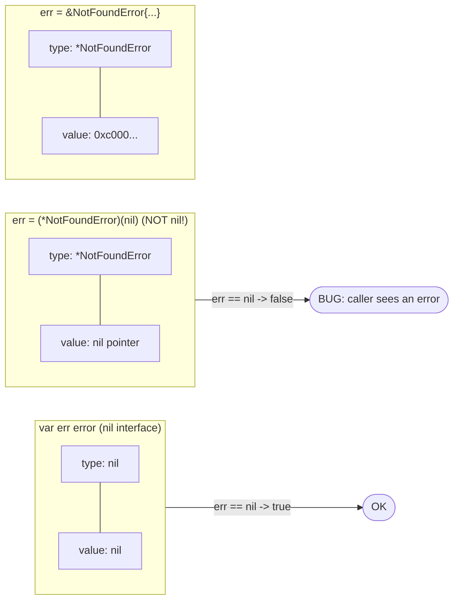
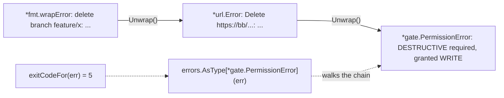
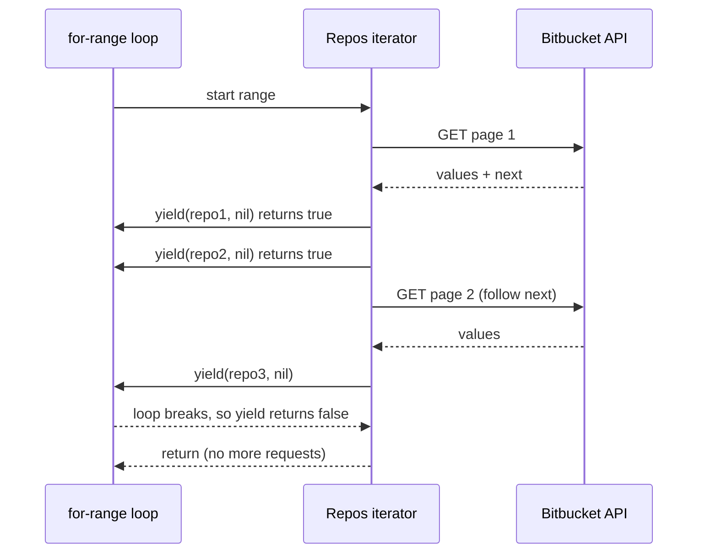

# 03 — Kiểu, Interface, Error, Generics & Iterator

> Phiên bản tham chiếu: **Go 1.27.3**. Snippet dùng tính năng mới có comment `// requires go 1.NN in go.mod`.
> Phiên bản ngôn ngữ do dòng `go` trong `go.mod` quyết định — cài Go 1.27 nhưng `go.mod` ghi `go 1.25` thì generic method (1.27) sẽ **không** biên dịch.
> Quy ước snippet: các đoạn ngắn là *trích đoạn câu lệnh* (có thể để biến chưa dùng cho gọn); chỉ các khối `func`/`package` đầy đủ mới là code biên dịch độc lập.

## Tại sao quan trọng cho dự án CLI

Kiến trúc kiểu `gh` gần như được dựng hoàn toàn trên các khái niệm trong file này:

| Khái niệm | Xuất hiện ở đâu trong `qcli` / MCP server |
|---|---|
| Interface nhỏ, implicit | `http.RoundTripper` middleware, `io.Writer` trong `iostreams`, fake client trong test |
| Kiểu hàm có method | `RoundTripperFunc`, `Middleware func(http.RoundTripper) http.RoundTripper` |
| Embedding | Decorator cho transport, fake chỉ implement vài method |
| Type switch / assertion | Phân loại lỗi, kiểm tra interface tuỳ chọn (`ExitCode() int`) |
| Error wrapping + typed error | Map lỗi → exit code (0/1/2/4 như `gh`), lỗi permission gate, lỗi HTTP 401/403/404 |
| Generics | `Page[T]`, helper sort/filter, client `GetJSON[T]` |
| Iterator `iter.Seq2` | Phân trang API Bitbucket/Jenkins/Kubernetes không cần nạp hết vào bộ nhớ |

Agent gọi CLI dựa vào **exit code và JSON** để quyết định bước tiếp theo — nên thiết kế error type chặt chẽ quan trọng không kém code nghiệp vụ.

---

## 1. Interface

### 1.1 Thoả mãn ngầm định (implicit satisfaction)

Một kiểu thoả mãn interface nếu nó có đủ method — **không cần** khai báo `implements`.

```go
// Defined by the consumer (the printer), not by the producer.
type Printer interface {
	Print(w io.Writer, items []PullRequest) error
}

type tablePrinter struct{ wide bool }

func (p tablePrinter) Print(w io.Writer, items []PullRequest) error {
	for _, pr := range items {
		if _, err := fmt.Fprintf(w, "#%d\t%s\n", pr.ID, pr.Title); err != nil {
			return err
		}
	}
	return nil
}

type PullRequest struct {
	ID    int
	Title string
}

// Compile-time assertion: fails the build if tablePrinter stops satisfying Printer.
var _ Printer = tablePrinter{}
```

### 1.2 Interface nhỏ, định nghĩa ở phía dùng

"The bigger the interface, the weaker the abstraction." Interface chuẩn mạnh nhất của Go chỉ có 1 method: `io.Reader`, `io.Writer`, `http.RoundTripper`, `fmt.Stringer`, `error`.

Trong CLI, đừng tạo interface `BitbucketClient` 40 method ở package client. Hãy để **mỗi command** khai báo đúng phần nó cần:

```go
// pkg/cmd/pr/list: only what this command uses — trivial to fake in tests.
type prLister interface {
	ListPullRequests(ctx context.Context, repo string, state string) ([]PullRequest, error)
}
```

### 1.3 "Accept interfaces, return structs"

```go
// Good: accepts the narrow behavior it needs, returns a concrete type.
func NewClient(httpClient *http.Client, baseURL string) *Client {
	return &Client{http: httpClient, baseURL: baseURL}
}

func Render(w io.Writer, v any) error { /* ... */ return nil }
```

Trả về struct cụ thể giúp caller thấy đủ method/field, và bạn thêm method mà không phá ai. Ngoại lệ hợp lý: trả về `error`, hoặc khi thực sự có nhiều implementation ẩn sau (ví dụ `Config` đọc từ file hay từ env).

### 1.4 Interface value = cặp (type, value) và bẫy nil-interface

Một biến interface lưu **hai** thứ: kiểu động và giá trị động. Nó chỉ `== nil` khi **cả hai** đều nil.



```go
type NotFoundError struct{ Resource string }

func (e *NotFoundError) Error() string { return e.Resource + " not found" }

func findBad(ok bool) error {
	var nf *NotFoundError // typed nil pointer
	if !ok {
		nf = &NotFoundError{Resource: "pipeline"}
	}
	return nf // BUG: when ok is true this returns a NON-nil error interface
}

func findGood(ok bool) error {
	if !ok {
		return &NotFoundError{Resource: "pipeline"}
	}
	return nil // return the untyped nil literal
}
```

Quy tắc: hàm trả về `error` thì **không bao giờ** trả về biến có kiểu con trỏ cụ thể; luôn `return nil` tường minh.

### 1.5 Kiểu hàm implement interface — nền tảng của middleware

Method có thể gắn cho kiểu hàm. Đây chính là cách `http.HandlerFunc` hoạt động, và cách `gh` xây chuỗi RoundTripper (auth header, user-agent, logging, cache):

```go
package api

import "net/http"

// RoundTripperFunc adapts a plain function to http.RoundTripper.
type RoundTripperFunc func(*http.Request) (*http.Response, error)

func (f RoundTripperFunc) RoundTrip(r *http.Request) (*http.Response, error) { return f(r) }

// Middleware decorates a transport.
type Middleware func(http.RoundTripper) http.RoundTripper

func WithHeader(name, value string) Middleware {
	return func(next http.RoundTripper) http.RoundTripper {
		return RoundTripperFunc(func(req *http.Request) (*http.Response, error) {
			req = req.Clone(req.Context()) // a RoundTripper must not mutate the caller's request
			req.Header.Set(name, value)
			return next.RoundTrip(req)
		})
	}
}

// Chain applies mws so that mws[0] is the outermost layer.
func Chain(base http.RoundTripper, mws ...Middleware) http.RoundTripper {
	for i := len(mws) - 1; i >= 0; i-- {
		base = mws[i](base)
	}
	return base
}
```

```go
client := &http.Client{
	Transport: api.Chain(http.DefaultTransport,
		api.WithHeader("User-Agent", "qcli/"+build.Version),
		api.WithHeader("Authorization", "Bearer "+token),
	),
}
```

---

## 2. Embedding & composition

Go không có kế thừa. **Embedding** đưa field/method của kiểu nhúng lên kiểu ngoài ("promoted").

### 2.1 Interface embedding

```go
type Reader interface{ Read(p []byte) (int, error) }
type Closer interface{ Close() error }
type ReadCloser interface { // same shape as io.ReadCloser
	Reader
	Closer
}
```

### 2.2 Struct embedding để decorate

```go
// countingTransport counts requests; everything else is delegated to the embedded transport.
type countingTransport struct {
	http.RoundTripper // embedded interface: RoundTrip is promoted
	count             atomic.Int64
}

func (t *countingTransport) RoundTrip(r *http.Request) (*http.Response, error) {
	t.count.Add(1)
	return t.RoundTripper.RoundTrip(r) // call the embedded implementation explicitly
}
```

### 2.3 Embedding interface trong fake (test)

```go
// fakeJenkins implements only TriggerBuild; any other method of JenkinsAPI panics
// (nil embedded interface) — making unexpected calls loud in tests.
type fakeJenkins struct {
	JenkinsAPI
	triggered []string
}

func (f *fakeJenkins) TriggerBuild(ctx context.Context, job string) (int, error) {
	f.triggered = append(f.triggered, job)
	return 1, nil
}
```

Lưu ý: embedding làm **toàn bộ** method của kiểu nhúng trở thành public API của kiểu ngoài. Nhúng `sync.Mutex` vào struct exported sẽ lộ `Lock/Unlock` cho caller — hãy dùng field có tên (`mu sync.Mutex`).

---

## 3. Type assertion & type switch

```go
var w io.Writer = os.Stdout

f, ok := w.(*os.File) // comma-ok: never panics
if ok {
	fmt.Println("writing to fd", f.Fd())
}

s := w.(fmt.Stringer) // single-value form PANICS if w is not a Stringer — avoid in production code
_ = s
```

Kiểm tra **interface tuỳ chọn** — idiom rất phổ biến (stdlib dùng cho `io.WriterTo`, `http.Flusher`):

```go
// isTerminal reports whether w is a terminal, if it can tell.
func isTerminal(w io.Writer) bool {
	type fder interface{ Fd() uintptr }
	if f, ok := w.(fder); ok {
		return term.IsTerminal(int(f.Fd())) // golang.org/x/term
	}
	return false
}
```

Type switch:

```go
func describe(v any) string {
	switch x := v.(type) {
	case nil:
		return "null"
	case string:
		return strconv.Quote(x)
	case int, int64:
		return fmt.Sprint(x) // x is `any` when a case lists several types
	case fmt.Stringer:
		return x.String()
	case error:
		return "error: " + x.Error()
	default:
		return fmt.Sprintf("%T", x)
	}
}
```

**Với error, không dùng type assertion/switch trực tiếp** (`err.(*HTTPError)`) — nó không nhìn xuyên qua lớp wrap. Dùng `errors.As`/`errors.AsType` (mục 4).

---

## 4. Error handling

### 4.1 Error là giá trị

```go
type error interface{ Error() string }
```

Quy ước: kiểm tra ngay, thêm ngữ cảnh, trả lên trên. Message viết thường, không dấu chấm cuối (sẽ được nối chuỗi: `list PRs: GET /repositories: 401 Unauthorized`).

```go
prs, err := client.ListPullRequests(ctx, repo, "OPEN")
if err != nil {
	return fmt.Errorf("list pull requests for %s: %w", repo, err)
}
```

### 4.2 Sentinel error

```go
package cmdutil

import "errors"

var (
	ErrCancel   = errors.New("cancelled")       // user pressed Ctrl-C / answered "no"
	ErrSilent   = errors.New("silent error")    // already printed, just exit 1
	ErrNotFound = errors.New("not found")
)
```

So sánh bằng `errors.Is(err, ErrNotFound)`, **không** dùng `err == ErrNotFound` (hỏng khi đã wrap) và **tuyệt đối không** so sánh `err.Error()` chuỗi.

### 4.3 Wrapping: `%w`, `errors.Is`, `errors.As`, `errors.AsType`, `errors.Join`

| API | Phiên bản | Dùng để |
|---|---|---|
| `fmt.Errorf("...: %w", err)` | 1.13 | Wrap, giữ chuỗi lỗi |
| `errors.Is(err, target)` | 1.13 | So sánh với sentinel qua mọi lớp wrap |
| `errors.As(err, &target)` | 1.13 | Lấy ra error có kiểu cụ thể |
| `errors.Join(errs...)`, nhiều `%w` trong một `Errorf` | 1.20 | Gộp nhiều lỗi (cây lỗi) |
| `errors.AsType[E error](err) (E, bool)` | **1.26** | Phiên bản generic của `As`: type-safe, nhanh hơn, gọn hơn |

`%v` chỉ nối chuỗi — **cắt đứt** chuỗi wrap. Chỉ dùng `%v` khi bạn cố ý giấu lỗi bên dưới khỏi API (không muốn caller phụ thuộc vào nó).

Ví dụ chuỗi wrap thực tế: permission gate chạy trong RoundTripper chặn một request `DELETE`; `http.Client.Do` bọc lỗi trong `*url.Error` (có `Unwrap`), command wrap thêm ngữ cảnh:



### 4.4 Custom error type

```go
package gate

import "fmt"

// PermissionError is returned when an operation needs a higher tier than granted.
type PermissionError struct {
	Op       string
	Required Tier
	Granted  Tier
}

func (e *PermissionError) Error() string {
	return fmt.Sprintf("%s requires %s permission (granted: %s); re-run with --allow=%s",
		e.Op, e.Required, e.Granted, e.Required)
}
```

(`Tier` và method `String()` định nghĩa ở file 02.)

Error type mang dữ liệu có cấu trúc để caller (và MCP server) trả về cho agent một thông điệp **có thể hành động** — ví dụ cần cờ gì để chạy lại.

Error type có thể tự định nghĩa `Is` để khớp sentinel theo logic riêng:

```go
// HTTPError describes a non-2xx API response.
type HTTPError struct {
	StatusCode int
	Method     string
	URL        string
	Message    string
}

func (e *HTTPError) Error() string {
	return fmt.Sprintf("%s %s: HTTP %d: %s", e.Method, e.URL, e.StatusCode, e.Message)
}

// Is lets errors.Is(err, cmdutil.ErrNotFound) match any 404.
func (e *HTTPError) Is(target error) bool {
	return target == cmdutil.ErrNotFound && e.StatusCode == http.StatusNotFound
}
```

`errors.AsType` *(Go 1.26+)* so với `errors.As`:

```go
// requires go 1.26 in go.mod
if he, ok := errors.AsType[*HTTPError](err); ok && he.StatusCode == http.StatusUnauthorized {
	return &AuthError{Host: hostOf(he.URL), Err: err}
}

// pre-1.26 equivalent
var he *HTTPError
if errors.As(err, &he) && he.StatusCode == http.StatusUnauthorized {
	return &AuthError{Host: hostOf(he.URL), Err: err}
}
```

### 4.5 Gộp lỗi với `errors.Join` *(Go 1.20+)*

Hữu ích khi validate flag: báo **tất cả** lỗi một lần cho agent thay vì từng lỗi.

```go
func (o *DeployOptions) Validate() error {
	var errs []error
	if o.Namespace == "" {
		errs = append(errs, errors.New("--namespace is required"))
	}
	if o.Replicas < 0 {
		errs = append(errs, fmt.Errorf("--replicas must be >= 0, got %d", o.Replicas))
	}
	return errors.Join(errs...) // nil when errs is empty
}
```

`errors.Is/As` duyệt cả cây lỗi (mọi nhánh của `Join`).

### 4.6 Typed error → exit code (giống `gh`)

`gh` công bố exit code: **0** thành công, **1** lỗi chung, **2** bị huỷ, **4** cần xác thực; từng command có thể định nghĩa thêm. Ta giữ nguyên các mã này và thêm mã riêng cho permission gate (quy ước của dự án, không phải của `gh`):

| Exit | Ý nghĩa | Lỗi nguồn |
|---|---|---|
| 0 | OK | `nil` |
| 1 | Lỗi chung | mọi lỗi khác, `ErrSilent` |
| 2 | Huỷ | `ErrCancel`, `context.Canceled` (Ctrl-C) |
| 4 | Cần xác thực | `*AuthError` |
| 5 | Thiếu quyền tier (quy ước `qcli`) | `*gate.PermissionError` |

```go
package main

import (
	"context"
	"errors"

	"github.com/acme/qcli/internal/gate"
	"github.com/acme/qcli/pkg/cmdutil"
)

const (
	exitOK         = 0
	exitError      = 1
	exitCancel     = 2
	exitAuth       = 4
	exitPermission = 5
)

// exitCodeFor maps an error returned by the root command to a process exit code.
// requires go 1.26 in go.mod (errors.AsType)
func exitCodeFor(err error) int {
	switch {
	case err == nil:
		return exitOK
	case errors.Is(err, cmdutil.ErrCancel), errors.Is(err, context.Canceled):
		return exitCancel
	}
	if _, ok := errors.AsType[*cmdutil.AuthError](err); ok {
		return exitAuth
	}
	if _, ok := errors.AsType[*gate.PermissionError](err); ok {
		return exitPermission
	}
	// Any error may opt in to a custom code by implementing ExitCode() int.
	var coder interface{ ExitCode() int }
	if errors.As(err, &coder) {
		return coder.ExitCode()
	}
	return exitError
}
```

`cmdutil.AuthError` định nghĩa tương tự `PermissionError` (field `Host`, `Err`, method `Error()` và `Unwrap() error { return e.Err }`). Trong `main`: `os.Exit(exitCodeFor(err))` — và chỉ gọi `os.Exit` ở `main` (nó bỏ qua mọi `defer`).

Tương tự `gh` có `FlagError` (lỗi cú pháp flag → in thêm usage). Với MCP server, cùng các error type này được chuyển thành tool result `isError: true` kèm `Error()` — một nguồn sự thật cho cả CLI và MCP.

### 4.7 Xử lý lỗi một lần

Hoặc **log/in**, hoặc **return** — không làm cả hai (sẽ in lỗi trùng lặp). Trong CLI, chỉ `main` in lỗi ra stderr; tầng dưới chỉ wrap và return.

---

## 5. Generics *(Go 1.18+)*

### 5.1 Type parameter và constraint

```go
// Map transforms each element; T and U are inferred from the arguments.
func Map[T, U any](in []T, f func(T) U) []U {
	out := make([]U, 0, len(in))
	for _, v := range in {
		out = append(out, f(v))
	}
	return out
}

titles := Map(prs, func(p PullRequest) string { return p.Title })
```

Constraint là interface, có thể chứa **type set**:

```go
// ~int matches int and any type whose underlying type is int (e.g. gate.Tier).
type Integer interface {
	~int | ~int8 | ~int16 | ~int32 | ~int64
}

func Clamp[T Integer](v, lo, hi T) T { return max(lo, min(v, hi)) } // min/max builtins: Go 1.21+
```

| Constraint | Ý nghĩa |
|---|---|
| `any` | Mọi kiểu |
| `comparable` | Dùng được `==`, `!=` (làm key map) |
| `cmp.Ordered` *(Go 1.21+)* | Dùng được `<`, `>` (số, string) |
| `interface{ ~string }` | Mọi kiểu có underlying type là string |

### 5.2 Kiểu generic

```go
// Page is one page of a paginated API response.
type Page[T any] struct {
	Values []T    `json:"values"`
	Next   string `json:"next,omitempty"`
}

// Set is a generic type alias — requires go 1.24 in go.mod.
type Set[T comparable] = map[T]struct{}
```

Go 1.26 cho phép kiểu generic tham chiếu chính nó trong danh sách type parameter (ví dụ `type Adder[A Adder[A]] interface{ Add(A) A }`) — hữu ích cho thư viện, hiếm khi cần trong CLI.

### 5.3 Gói `cmp`, `slices`, `maps`

```go
// cmp.Or (Go 1.22+): first non-zero value — perfect for flag > env > config > default
limit := cmp.Or(opts.Limit, envLimit, cfg.DefaultLimit, 30)

// Multi-key sort: state ascending, then ID descending
slices.SortFunc(prs, func(a, b PullRequest) int {
	return cmp.Or(
		cmp.Compare(a.State, b.State),
		cmp.Compare(b.ID, a.ID),
	)
})

i, found := slices.BinarySearchFunc(sorted, 42, func(p PullRequest, id int) int {
	return cmp.Compare(p.ID, id)
})

idx := slices.IndexFunc(pods, func(p Pod) bool { return p.Phase == "Failed" })
open := slices.DeleteFunc(slices.Clone(prs), func(p PullRequest) bool { return p.State != "OPEN" })

keys := slices.Sorted(maps.Keys(labels))   // Go 1.23+: iterator -> sorted slice
vals := slices.Collect(maps.Values(labels)) // Go 1.23+
merged := maps.Clone(defaults)
maps.Copy(merged, overrides)                // overrides win
```

(Ví dụ trên giả định `PullRequest` có thêm field `State string`.)

### 5.4 Generic method *(Go 1.27+)*

Trước Go 1.27, method **không** thể có type parameter riêng — rất nhiều tài liệu cũ vẫn ghi như vậy. Từ **Go 1.27**, method được khai báo type parameter:

```go
// requires go 1.27 in go.mod
func (c *Client) GetJSON[T any](ctx context.Context, path string) (T, error) {
	var out T
	req, err := http.NewRequestWithContext(ctx, http.MethodGet, c.baseURL+path, nil)
	if err != nil {
		return out, err
	}
	resp, err := c.http.Do(req)
	if err != nil {
		return out, err
	}
	defer resp.Body.Close()
	if resp.StatusCode/100 != 2 {
		return out, &HTTPError{StatusCode: resp.StatusCode, Method: req.Method, URL: req.URL.String(), Message: resp.Status}
	}
	err = json.NewDecoder(resp.Body).Decode(&out)
	return out, err
}

page, err := c.GetJSON[Page[Repo]](ctx, "/2.0/repositories/acme")
```

> Lưu ý: release notes 1.27 chỉ minh hoạ phần *khai báo* generic method; cú pháp gọi với khởi tạo tường minh `c.GetJSON[Page[Repo]](...)` ở trên theo spec 1.27 — hãy kiểm tra lại với `go vet`/gopls khi nâng cấp, vì chưa được xác minh bằng compiler trong tài liệu này.

Giới hạn (theo release notes 1.27): **method trong interface vẫn không có type parameter**, và **generic method không thể dùng để implement method của interface**. Vì vậy đừng thiết kế interface `prLister` dựa trên `GetJSON[T]`; interface vẫn phải dùng method cụ thể.

Trước 1.27 (hoặc khi muốn tương thích bản cũ), dùng hàm package-level:

```go
func GetJSON[T any](ctx context.Context, c *Client, path string) (T, error) { /* same body */ }
```

### 5.5 Khi nào KHÔNG dùng generics

- **Hành vi khác nhau theo kiểu** → dùng interface (method). Generics dành cho *cùng một thuật toán* trên nhiều kiểu.
- **Chỉ có một kiểu thực tế** → viết code cụ thể; thêm type parameter khi xuất hiện kiểu thứ hai.
- Chỉ để **tránh viết `io.Reader`**: `func Read[R io.Reader](r R)` không có lợi gì hơn `func Read(r io.Reader)`.
- Khi nó làm API khó đọc: `Client[Req, Resp, Opt any]` cho client Jenkins thường là thiết kế quá mức.
- Cần mở rộng qua interface (mock/fake) → nhớ giới hạn ở 5.4: generic method không thoả interface.

Dùng generics tốt nhất cho: container (`Set`, `Page[T]`), helper thuật toán (`Map`, `Filter`, sort theo key), iterator adapter, decode JSON có kiểu.

---

## 6. Iterator: `iter.Seq` và `iter.Seq2` *(Go 1.23+)*

Gói `iter` định nghĩa:

```go
type Seq[V any] func(yield func(V) bool)
type Seq2[K, V any] func(yield func(K, V) bool)
```

`range` gọi hàm iterator; mỗi lần thân vòng lặp chạy xong, `yield` trả `true`; nếu vòng lặp `break`/`return`, `yield` trả `false` và iterator **phải dừng ngay**.



### 6.1 Phân trang API bằng `iter.Seq2[T, error]`

Bitbucket Cloud trả về `{"values": [...], "next": "<url>"}`. Iterator cho phép command xử lý từng repo, dừng sớm khi đủ `--limit`, mà không tải hết mọi trang:

```go
// requires go 1.23 in go.mod
func (c *Client) Repos(ctx context.Context, workspace string) iter.Seq2[Repo, error] {
	return func(yield func(Repo, error) bool) {
		next := c.baseURL + "/2.0/repositories/" + url.PathEscape(workspace)
		for next != "" {
			var page Page[Repo]
			if err := c.getJSON(ctx, next, &page); err != nil {
				yield(Repo{}, err) // report the error once, then stop
				return
			}
			for _, r := range page.Values {
				if !yield(r, nil) {
					return // consumer stopped: do not fetch more pages
				}
			}
			next = page.Next
		}
	}
}
```

Phía dùng:

```go
n := 0
for repo, err := range client.Repos(ctx, "acme") {
	if err != nil {
		return fmt.Errorf("list repos: %w", err)
	}
	fmt.Fprintln(out, repo.Slug)
	n++
	if n >= opts.Limit {
		break // the iterator stops issuing HTTP requests
	}
}
```

### 6.2 Adapter generic

```go
// Filter returns the elements of seq for which keep returns true.
// requires go 1.23 in go.mod
func Filter[V any](seq iter.Seq[V], keep func(V) bool) iter.Seq[V] {
	return func(yield func(V) bool) {
		for v := range seq {
			if keep(v) && !yield(v) {
				return
			}
		}
	}
}

// Take yields at most n elements.
func Take[V any](seq iter.Seq[V], n int) iter.Seq[V] {
	return func(yield func(V) bool) {
		if n <= 0 {
			return
		}
		i := 0
		for v := range seq {
			if !yield(v) {
				return
			}
			i++
			if i >= n {
				return
			}
		}
	}
}

names := slices.Collect(Take(Filter(slices.Values(all), isOpen), 10))
```

Nguồn iterator có sẵn trong stdlib: `slices.All`, `slices.Values`, `slices.Backward`, `maps.All`, `maps.Keys`, `maps.Values` *(Go 1.23)*; `strings.Lines`, `strings.SplitSeq`, `strings.FieldsSeq` *(Go 1.24)*; `reflect.Type.Fields`/`Methods` *(Go 1.26)*. Tiêu thụ: `slices.Collect`, `slices.Sorted`, `slices.AppendSeq`, `maps.Collect`, `maps.Insert`.

### 6.3 Pull iterator

Khi cần lấy từng phần tử theo nhịp riêng (ví dụ ghép hai luồng), dùng `iter.Pull`:

```go
next, stop := iter.Pull(slices.Values(jobs))
defer stop() // always release the iterator
for {
	job, ok := next()
	if !ok {
		break
	}
	_ = job
}
```

Phần lớn trường hợp `for range` là đủ; `Pull` dùng khi thật sự cần.

---

## 7. Gắn tất cả lại: một command điển hình

```go
// pkg/cmd/branch/delete — Options + runF + run, using interfaces, typed errors and the gate.
type DeleteOptions struct {
	IO      *iostreams.IOStreams
	Client  func() (branchDeleter, error) // lazy, from the Factory
	Granted gate.Tier
	Repo    string
	Branch  string
}

type branchDeleter interface {
	DeleteBranch(ctx context.Context, repo, branch string) error
}

func deleteRun(ctx context.Context, opts *DeleteOptions) error {
	if !gate.Allows(opts.Granted, gate.TierDestructive) {
		return &gate.PermissionError{Op: "branch delete", Required: gate.TierDestructive, Granted: opts.Granted}
	}
	c, err := opts.Client()
	if err != nil {
		return err
	}
	if err := c.DeleteBranch(ctx, opts.Repo, opts.Branch); err != nil {
		if errors.Is(err, cmdutil.ErrNotFound) {
			return fmt.Errorf("branch %q does not exist in %s: %w", opts.Branch, opts.Repo, err)
		}
		return fmt.Errorf("delete branch %s: %w", opts.Branch, err)
	}
	fmt.Fprintf(opts.IO.Out, "Deleted branch %s\n", opts.Branch)
	return nil
}
```

Test chỉ cần một fake 1 method, kiểm tra exit code bằng `exitCodeFor(err)`.

---

## Lỗi thường gặp

1. **Trả về typed nil pointer qua `error`** → `err != nil` dù "không có lỗi". Luôn `return nil`.
2. **So sánh lỗi bằng `==` hoặc bằng chuỗi `err.Error()`** → hỏng khi có wrap hoặc khi message đổi (Go 1.27 đổi message lỗi của `encoding/json` vì chạy trên v2). Dùng `errors.Is/As/AsType`.
3. **Dùng `%v` thay vì `%w`** → mất chuỗi wrap, exit code mapping không còn thấy `AuthError`.
4. **Wrap con trỏ tới error type có value receiver**: nếu `type E struct{}` có `func (E) Error()`, thì `fmt.Errorf("...: %w", &E{})` khiến `errors.As(err, &e)` với `var e E` thất bại. Go 1.27 `go vet` (`printf`) cảnh báo trường hợp này. Chọn **một** dạng (thường là pointer receiver + luôn dùng `&E{}`) và nhất quán.
5. **Type assertion trên error** (`err.(*HTTPError)`) → không xuyên qua wrap. Dùng `errors.AsType`.
6. **Vừa log vừa return lỗi** → stderr in trùng lặp, agent khó parse.
7. **Interface khổng lồ ở phía producer** → fake trong test phải implement hàng chục method. Định nghĩa interface nhỏ ở phía consumer.
8. **Nhúng `sync.Mutex` hoặc kiểu nội bộ vào struct exported** → lộ method ngoài ý muốn.
9. **Lạm dụng generics** khi interface hoặc code cụ thể đủ dùng; hoặc kỳ vọng generic method (1.27) implement được interface — không được.
10. **Iterator tiếp tục gọi `yield` sau khi nó trả `false`** → runtime panic. Luôn `if !yield(v) { return }`.
11. **Iterator nuốt lỗi** → dùng `iter.Seq2[T, error]` và dừng sau khi yield lỗi.
12. **Dùng tính năng mới mà `go.mod` khai báo bản cũ**: `errors.AsType` cần `go 1.26`, generic method cần `go 1.27`, range-over-func cần `go 1.23`. Go 1.27 `go test` chạy analyzer `stdversion` mặc định và sẽ báo symbol stdlib mới hơn phiên bản của file.
13. **Gọi `os.Exit` ngoài `main`** → bỏ qua `defer`, khó test. Trả error, để `main` map exit code.

---

## Checklist

- [ ] Interface nhỏ, đặt ở package dùng nó; có `var _ I = (*T)(nil)` cho implementation quan trọng.
- [ ] Constructor nhận interface/kiểu hẹp, trả về `*Struct` cụ thể.
- [ ] Hàm trả về `error` không bao giờ trả typed nil.
- [ ] Middleware HTTP dùng `RoundTripperFunc` + `Chain`; clone request trước khi sửa.
- [ ] Sentinel error trong `cmdutil` (`ErrCancel`, `ErrSilent`, `ErrNotFound`); error type có cấu trúc (`HTTPError`, `AuthError`, `PermissionError`) với message có thể hành động.
- [ ] Mọi chỗ wrap dùng `%w`; kiểm tra bằng `errors.Is` / `errors.AsType` (Go 1.26+).
- [ ] Exit code 0/1/2/4 giống `gh`; mã thêm (5 = permission) được tài liệu hoá trong `qcli help exit-codes`.
- [ ] Validate flag trả `errors.Join` để báo mọi lỗi cùng lúc.
- [ ] Generics chỉ cho container/thuật toán/decode; không dùng generic method trong thiết kế interface.
- [ ] Pagination dùng `iter.Seq2[T, error]`, dừng khi `yield` trả `false`.
- [ ] `go.mod` khai báo `go` đủ mới cho tính năng đã dùng (1.23 iterator, 1.26 `AsType`, 1.27 generic method).

---

## Tài liệu tham khảo

- Go spec — Interface types, Type parameters: https://go.dev/ref/spec#Interface_types · https://go.dev/ref/spec#Type_parameter_declarations
- Effective Go — Interfaces & embedding: https://go.dev/doc/effective_go#interfaces_and_types
- Go FAQ — Why is my nil error value not equal to nil?: https://go.dev/doc/faq#nil_error
- Working with Errors in Go 1.13: https://go.dev/blog/go1.13-errors
- Error handling and Go: https://go.dev/blog/error-handling-and-go
- Package `errors` (incl. `AsType`): https://pkg.go.dev/errors
- An Introduction to Generics: https://go.dev/blog/intro-generics
- When To Use Generics: https://go.dev/blog/when-generics
- Package `iter`: https://pkg.go.dev/iter · Range over function types: https://go.dev/blog/range-functions
- Packages `slices`, `maps`, `cmp`: https://pkg.go.dev/slices · https://pkg.go.dev/maps · https://pkg.go.dev/cmp
- Release notes: https://go.dev/doc/go1.20 · https://go.dev/doc/go1.21 · https://go.dev/doc/go1.22 · https://go.dev/doc/go1.23 · https://go.dev/doc/go1.24 · https://go.dev/doc/go1.26 · https://go.dev/doc/go1.27
- `gh` exit codes: https://cli.github.com/manual/gh_help_exit-codes
- `gh` source — `cmdutil` errors & factory: https://github.com/cli/cli/tree/trunk/pkg/cmdutil
- Bitbucket Cloud REST pagination: https://developer.atlassian.com/cloud/bitbucket/rest/intro/#pagination
