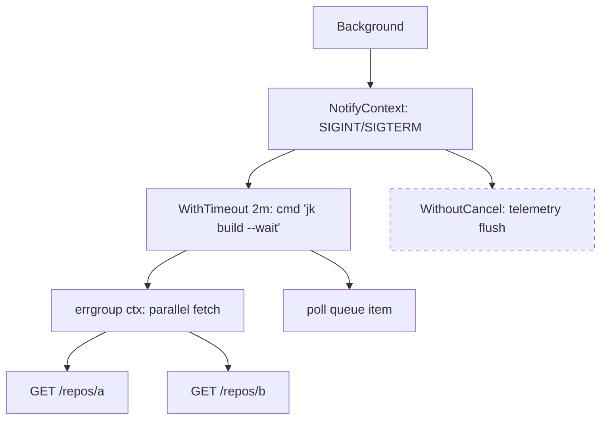
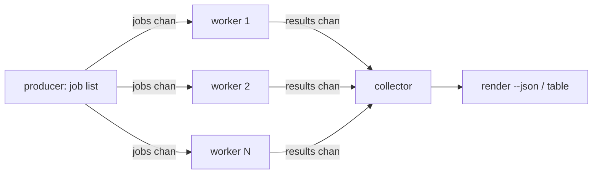
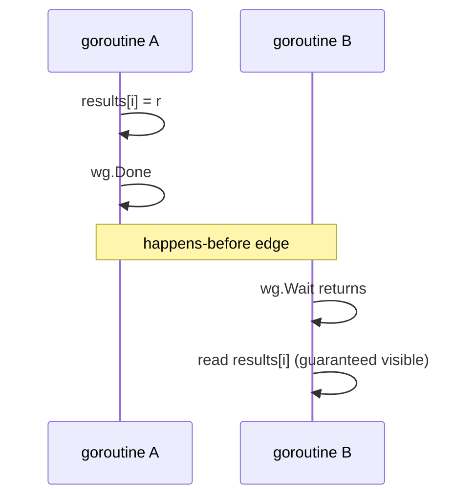

# 04 — Concurrency trong Go cho DevOps CLI

> Phạm vi: goroutine, channel, `select`, `sync`, `sync/atomic`, `context`, `errgroup`, rate limiting, các pattern thực chiến (worker pool, fan-out/fan-in, pipeline, gọi API song song có backoff 429, poll Jenkins queue, stream log, k8s watch), goroutine leak, race detector, memory model.
>
> Phiên bản tham chiếu: Go **1.27.3** / **1.26.10** là hai bản stable mới nhất trên go.dev/dl tại thời điểm viết (2026-11-09). Mỗi tính năng "hiện đại" đều ghi rõ phiên bản xuất hiện.

## Tại sao quan trọng cho dự án CLI

CLI kiểu `gh` không phải server, nhưng concurrency vẫn xuất hiện khắp nơi:

- **Update check chạy nền**: `gh` khởi chạy một goroutine kiểm tra phiên bản mới song song với lệnh chính, rồi chỉ in thông báo nếu goroutine trả kết quả kịp lúc lệnh kết thúc.
- **Gọi API song song**: liệt kê pull request trên 30 repo Bitbucket, lấy trạng thái 50 job Jenkins, đọc pod trên nhiều namespace — tuần tự thì chậm, song song không giới hạn thì bị 429 (rate limit).
- **Chờ/poll**: Jenkins trả về *queue item* chứ không phải build ngay; CLI phải poll đến khi build bắt đầu, rồi stream log tiến dần.
- **Watch**: `kubectl get pods -w` là một stream dài hạn, phải xử lý reconnect và hủy bằng Ctrl+C.
- **MCP server**: server MCP chạy lâu, nhận nhiều request đồng thời — mọi shared state phải an toàn với race.

Sai concurrency trong CLI biểu hiện thành: lệnh treo không thoát, Ctrl+C không có tác dụng, output bị xen lẫn, panic "send on closed channel", hoặc bị ban token vì spam API.

---

## 1. Goroutine

Goroutine là hàm chạy đồng thời, được runtime lập lịch lên các OS thread (M:N scheduler). Stack khởi đầu nhỏ (vài KB) và tự giãn, nên tạo hàng nghìn goroutine là bình thường — nhưng **mỗi goroutine phải có đường thoát rõ ràng**.

```go
go func() {
    // runs concurrently; main does not wait for it
}()
```

Quy tắc vàng:

1. Trước khi viết `go`, trả lời: *goroutine này kết thúc khi nào, và ai chờ nó?*
2. `main` return ⇒ toàn bộ goroutine bị giết, không chạy `defer`.
3. Panic trong goroutine không được `recover` ở goroutine cha — nó làm sập cả process.

**Biến vòng lặp (Go 1.22+)**: từ Go 1.22, mỗi vòng `for` tạo biến mới cho mỗi iteration (khi `go.mod` khai báo `go 1.22` trở lên). Không còn cần `i := i` trước khi capture vào closure.

```go
for _, repo := range repos {
    go func() {
        fetch(repo) // safe since Go 1.22: each iteration has its own repo
    }()
}
```

`GOMAXPROCS` (Go 1.25+): trên Linux, mặc định tôn trọng cgroup CPU limit (container-aware) và runtime cập nhật định kỳ nếu limit thay đổi. Trước 1.25, cần thư viện như `automaxprocs`. Với CLI thường không cần quan tâm; với MCP server chạy trong pod k8s thì đây là cải thiện miễn phí.

---

## 2. Channel

Channel là ống dẫn có kiểu để goroutine giao tiếp: "Don't communicate by sharing memory; share memory by communicating."

### 2.1 Unbuffered vs buffered

| Loại | Khai báo | Gửi block khi | Dùng cho |
|---|---|---|---|
| Unbuffered | `make(chan T)` | chưa có người nhận | đồng bộ hóa (handoff) |
| Buffered | `make(chan T, n)` | buffer đầy | tách tốc độ producer/consumer, "fire and forget" có giới hạn |

```go
// Buffered size 1: the sender never blocks, even if nobody reads the result.
// This is exactly what an update-check goroutine needs.
updateCh := make(chan *ReleaseInfo, 1)
```

### 2.2 Close semantics

- Chỉ **sender** được `close`. Close channel đã close ⇒ panic. Gửi vào channel đã close ⇒ panic.
- Nhận từ channel đã close ⇒ trả về zero value ngay lập tức; dùng `v, ok := <-ch` để biết (`ok == false`).
- `for v := range ch` kết thúc khi channel được close và rỗng.
- Close là **broadcast**: mọi receiver đều được đánh thức — đây là cơ chế của `ctx.Done()`.

```go
func produce(ctx context.Context, pages []string) <-chan string {
    out := make(chan string)
    go func() {
        defer close(out) // the producer owns the channel, so it closes it
        for _, p := range pages {
            select {
            case out <- p:
            case <-ctx.Done():
                return
            }
        }
    }()
    return out
}
```

Trả về `<-chan T` (receive-only) để compiler cấm consumer close/gửi.

### 2.3 Nil channel

Gửi/nhận trên nil channel **block mãi mãi**. Nghe như bug, nhưng trong `select` đây là kỹ thuật để *tắt một case*:

```go
// Merge two streams until both are closed.
func merge(a, b <-chan Event, out chan<- Event) {
    defer close(out)
    for a != nil || b != nil {
        select {
        case e, ok := <-a:
            if !ok {
                a = nil // disable this case
                continue
            }
            out <- e
        case e, ok := <-b:
            if !ok {
                b = nil
                continue
            }
            out <- e
        }
    }
}
```

### 2.4 Bảng tóm tắt hành vi

| Thao tác | nil | open | closed |
|---|---|---|---|
| `ch <- v` | block mãi | block/gửi | **panic** |
| `<-ch` | block mãi | block/nhận | zero value, `ok=false` |
| `close(ch)` | **panic** | ok | **panic** |

---

## 3. `select`

`select` chờ nhiều thao tác channel; nếu nhiều case sẵn sàng, chọn **ngẫu nhiên** (không ưu tiên theo thứ tự). `default` làm cho select non-blocking.

```go
select {
case rel := <-updateCh:
    if rel != nil {
        fmt.Fprintf(ios.ErrOut, "A new release is available: %s\n", rel.Version)
    }
case <-time.After(500 * time.Millisecond):
    // don't delay CLI exit for a slow update check
}
```

**Timer (Go 1.23+)**: Timer/Ticker không còn được tham chiếu sẽ được GC ngay cả khi chưa `Stop`, và channel của timer giờ là unbuffered (cap 0) — nên `time.After` trong vòng `select` lặp không còn "rò" timer như trước. Hành vi mới chỉ áp dụng khi `go.mod` khai báo `go 1.23` trở lên; GODEBUG `asynctimerchan=1` để quay lại hành vi cũ — và theo release notes Go 1.27, setting này **đã bị gỡ bỏ** (timer channel luôn unbuffered). Với vòng lặp nóng, vẫn nên dùng một `time.Ticker`/`time.Timer` tái sử dụng cho rõ ràng.

---

## 4. Package `sync`

### 4.1 Mutex & RWMutex

```go
type tokenCache struct {
    mu     sync.RWMutex
    tokens map[string]string // host -> token
}

func (c *tokenCache) Get(host string) (string, bool) {
    c.mu.RLock()
    defer c.mu.RUnlock()
    t, ok := c.tokens[host]
    return t, ok
}

func (c *tokenCache) Set(host, tok string) {
    c.mu.Lock()
    defer c.mu.Unlock()
    c.tokens[host] = tok
}
```

- Không copy struct chứa mutex sau khi dùng (`go vet` copylocks bắt lỗi này) — truyền pointer.
- `RWMutex` chỉ đáng khi đọc chiếm áp đảo và critical section không quá ngắn; nếu không, `Mutex` thường nhanh hơn.
- Không giữ lock khi gọi network I/O.

### 4.2 Once, OnceFunc, OnceValue, OnceValues (Go 1.21+)

Đây là xương sống của **lazy Factory** kiểu `gh`: `HttpClient`, `Config`, `BaseRepo` chỉ được khởi tạo khi lệnh thực sự cần.

```go
type Factory struct {
    IOStreams  *iostreams.IOStreams
    HttpClient func() (*http.Client, error)
    Config     func() (Config, error)
}

func New(appVersion string) *Factory {
    f := &Factory{IOStreams: iostreams.System()}
    // OnceValues (Go 1.21): runs once, caches both results, safe for concurrent use.
    f.Config = sync.OnceValues(loadConfig)
    f.HttpClient = sync.OnceValues(func() (*http.Client, error) {
        cfg, err := f.Config()
        if err != nil {
            return nil, err
        }
        return newHTTPClient(cfg, appVersion), nil
    })
    return f
}
```

Lưu ý: nếu hàm trong `OnceValue(s)` panic, mọi lần gọi sau sẽ panic lại với cùng giá trị. Lỗi (`error`) cũng được cache — nếu muốn retry sau lỗi, đừng dùng Once.

### 4.3 WaitGroup và `WaitGroup.Go` (Go 1.25+)

```go
// Classic form (all versions)
var wg sync.WaitGroup
for _, ns := range namespaces {
    wg.Add(1) // Add BEFORE starting the goroutine
    go func() {
        defer wg.Done()
        listPods(ctx, ns)
    }()
}
wg.Wait()

// Go 1.25+: WaitGroup.Go does Add(1) + go + Done for you.
var wg2 sync.WaitGroup
for _, ns := range namespaces {
    wg2.Go(func() { listPods(ctx, ns) })
}
wg2.Wait()
```

Go 1.25 cũng thêm vet analyzer `waitgroup` báo `wg.Add` đặt sai chỗ (bên trong goroutine). Go 1.27 có modernizer `go fix` tên `waitgroupgo` (đổi tên từ `waitgroup`) để chuyển code cũ sang `wg.Go`.

`WaitGroup` không thu lỗi — khi cần lỗi + hủy, dùng `errgroup` (mục 7).

### 4.4 sync.Map, sync.Cond

- `sync.Map`: chỉ nên dùng cho cache "ghi một lần, đọc nhiều" hoặc key rời nhau giữa goroutine. Mặc định dùng `map` + `Mutex`.
- `sync.Cond`: hiếm khi cần; channel thường rõ ràng hơn.

---

## 5. `sync/atomic`

Typed atomics (Go 1.19+): `atomic.Int64`, `atomic.Bool`, `atomic.Pointer[T]`… an toàn hơn hàm `atomic.AddInt64` vì không thể vô tình truy cập không-atomic.

```go
type progress struct {
    fetched atomic.Int64
    failed  atomic.Int64
}

func (p *progress) String() string {
    return fmt.Sprintf("%d fetched, %d failed", p.fetched.Load(), p.failed.Load())
}

// Hot-swappable config for a long-running MCP server.
var current atomic.Pointer[ServerConfig]

func reload(c *ServerConfig) { current.Store(c) }
func cfg() *ServerConfig     { return current.Load() }
```

Atomic chỉ đảm bảo từng thao tác đơn lẻ; nếu cần cập nhật nhiều field nhất quán, dùng mutex.

---

## 6. `context`

`context.Context` mang **cancellation, deadline và request-scoped values** xuyên qua call stack. Trong CLI, root context đến từ tín hiệu OS:

```go
func main() {
    // signal.NotifyContext (Go 1.16). Since Go 1.26 the context is canceled
    // with a cause that identifies the received signal.
    ctx, stop := signal.NotifyContext(context.Background(), os.Interrupt, syscall.SIGTERM)
    defer stop()

    code := run(ctx) // cobra: rootCmd.ExecuteContext(ctx)
    os.Exit(code)
}
```

Trong cobra, dùng `cmd.ExecuteContext(ctx)` và trong `RunE` lấy `cmd.Context()`; truyền xuống `Options` rồi tới mọi HTTP request bằng `http.NewRequestWithContext`.

### 6.1 Cây hủy (cancellation tree)



Hủy một node ⇒ mọi node con bị hủy; con không bao giờ hủy được cha. `WithoutCancel` cắt đứt liên kết hủy nhưng giữ values.

### 6.2 Các hàm tạo context và phiên bản

| API | Phiên bản | Ghi chú |
|---|---|---|
| `WithCancel`, `WithDeadline`, `WithTimeout`, `WithValue` | 1.7 | cơ bản |
| `WithCancelCause`, `Cause` | **1.20** | hủy kèm lý do (`error`) |
| `WithDeadlineCause`, `WithTimeoutCause` | **1.21** | lý do khi hết hạn |
| `WithoutCancel` | **1.21** | giữ values, bỏ cancel |
| `AfterFunc` | **1.21** | chạy hàm khi ctx bị hủy |

```go
ctx, cancel := context.WithTimeoutCause(parent, 2*time.Minute,
    errors.New("jenkins build did not start within 2m"))
defer cancel()

if err := waitForBuild(ctx, queueURL); err != nil {
    // ctx.Err() is just DeadlineExceeded; Cause gives the human-readable reason.
    return fmt.Errorf("%w (cause: %v)", err, context.Cause(ctx))
}
```

`AfterFunc` hữu ích để đóng một tài nguyên blocking không nhận context (ví dụ một `io.ReadCloser` của log stream):

```go
stop := context.AfterFunc(ctx, func() { _ = body.Close() }) // unblocks Read on cancel
defer stop()
```

`WithoutCancel`: ghi audit log/telemetry sau khi lệnh bị Ctrl+C mà vẫn mang trace ID:

```go
flushCtx, cancel := context.WithTimeout(context.WithoutCancel(ctx), 2*time.Second)
defer cancel()
_ = telemetry.Flush(flushCtx)
```

### 6.3 Context values — dùng tiết kiệm

Chỉ cho dữ liệu *request-scoped* xuyên API boundary (request ID, trace span, permission tier của MCP caller). **Không** dùng để truyền dependency (đó là việc của Factory) hay tham số tùy chọn.

```go
type ctxKey struct{} // unexported key type prevents collisions

func WithTier(ctx context.Context, t Tier) context.Context {
    return context.WithValue(ctx, ctxKey{}, t)
}

func TierFrom(ctx context.Context) (Tier, bool) {
    t, ok := ctx.Value(ctxKey{}).(Tier)
    return t, ok
}
```

Quy ước: `ctx` là tham số đầu tiên, không lưu context trong struct (trừ trường hợp đặc biệt), luôn `defer cancel()`.

---

## 7. `errgroup` (golang.org/x/sync)

`errgroup.Group` = WaitGroup + lỗi đầu tiên + (tùy chọn) hủy context + giới hạn song song. API (x/sync v0.24.0 trên pkg.go.dev): `WithContext`, `Go`, `TryGo`, `SetLimit`, `Wait`.

```go
func fetchAllRepos(ctx context.Context, c *bitbucket.Client, slugs []string) ([]Repo, error) {
    g, ctx := errgroup.WithContext(ctx)
    g.SetLimit(8) // at most 8 in-flight requests; Go blocks when the limit is reached

    results := make([]Repo, len(slugs)) // index-addressed: no mutex needed
    for i, slug := range slugs {
        g.Go(func() error {
            r, err := c.GetRepo(ctx, slug)
            if err != nil {
                return fmt.Errorf("repo %s: %w", slug, err)
            }
            results[i] = r
            return nil
        })
    }
    if err := g.Wait(); err != nil {
        return nil, err // first error; ctx was canceled for the others
    }
    return results, nil
}
```

Điểm cần nhớ:

- `ctx` trả về bị hủy khi một goroutine trả lỗi **hoặc** khi `Wait` return — đừng dùng nó sau `Wait`.
- Ghi vào `results[i]` riêng biệt là an toàn; `append` vào slice chung thì **không**.
- Nếu muốn thu *mọi* lỗi thay vì lỗi đầu tiên: mỗi goroutine trả `nil`, ghi lỗi vào `errs[i]`, cuối cùng `errors.Join(errs...)` (Go 1.20).
- `TryGo` cho phép bỏ qua việc khi pool đầy (ít dùng trong CLI).

---

## 8. Semaphore & rate limiting

- **Giới hạn đồng thời** (bao nhiêu request đang bay): `errgroup.SetLimit`, channel-semaphore `make(chan struct{}, n)`, hoặc `golang.org/x/sync/semaphore.Weighted` (có trọng số, `Acquire(ctx, n)` tôn trọng context).
- **Giới hạn tốc độ** (bao nhiêu request/giây): `golang.org/x/time/rate.Limiter` (token bucket).

Hai thứ khác nhau — API Bitbucket Cloud/Jenkins thường cần cả hai.

```go
// Shared limiter injected as an http.RoundTripper middleware,
// so every command gets it for free via Factory.HttpClient.
type rateLimitedTransport struct {
    next    http.RoundTripper
    limiter *rate.Limiter
}

func (t *rateLimitedTransport) RoundTrip(req *http.Request) (*http.Response, error) {
    if err := t.limiter.Wait(req.Context()); err != nil { // blocks; honors ctx
        return nil, err
    }
    return t.next.RoundTrip(req)
}

// 10 req/s with bursts of 5
client := &http.Client{Transport: &rateLimitedTransport{
    next:    http.DefaultTransport,
    limiter: rate.NewLimiter(rate.Limit(10), 5),
}}
```

---

## 9. Pattern thực chiến

### 9.1 Update check nền kiểu `gh`

```go
func runWithUpdateCheck(ctx context.Context, ios *iostreams.IOStreams, run func() error) error {
    updateCh := make(chan *ReleaseInfo, 1) // buffered: goroutine never blocks
    checkCtx, cancel := context.WithTimeout(ctx, 3*time.Second)
    defer cancel()

    go func() {
        rel, err := checkForUpdate(checkCtx) // must respect checkCtx
        if err != nil {
            rel = nil // update check failures are never fatal
        }
        updateCh <- rel
    }()

    err := run()

    // Only wait briefly; never hold the user's terminal hostage.
    select {
    case rel := <-updateCh:
        if rel != nil && ios.IsStderrTTY() {
            fmt.Fprintf(ios.ErrOut, "\nA new release is available: %s\n", rel.Version)
        }
    case <-time.After(200 * time.Millisecond):
    }
    return err
}
```

Buffer size 1 + context timeout ⇒ goroutine luôn kết thúc, không leak, kể cả khi ta không đọc kết quả. Tắt khi stdout không phải TTY hoặc khi biến môi trường kiểu `XX_NO_UPDATE_NOTIFIER` được đặt — agent gọi CLI không cần thông báo này.

### 9.2 Worker pool



```go
func jobStatuses(ctx context.Context, c *jenkins.Client, jobs []string, n int) map[string]Status {
    in := make(chan string)
    out := make(chan jobResult)

    var wg sync.WaitGroup
    for range n { // range over int: Go 1.22
        wg.Go(func() { // Go 1.25
            for name := range in {
                st, err := c.LastBuildStatus(ctx, name)
                select {
                case out <- jobResult{name, st, err}:
                case <-ctx.Done():
                    return
                }
            }
        })
    }

    go func() { // feeder
        defer close(in)
        for _, j := range jobs {
            select {
            case in <- j:
            case <-ctx.Done():
                return
            }
        }
    }()

    go func() { wg.Wait(); close(out) }() // close results when all workers finish

    res := make(map[string]Status, len(jobs))
    for r := range out {
        if r.err == nil {
            res[r.name] = r.status
        }
    }
    return res
}
```

Với phần lớn trường hợp CLI, `errgroup` + `SetLimit` ngắn hơn và ít lỗi hơn worker pool tự viết. Tự viết khi cần stream kết quả dần ra output.

### 9.3 Fan-out/fan-in & pipeline

Pipeline = chuỗi stage nối bằng channel, mỗi stage sở hữu và close channel output của mình:

```go
// stage 1: list pages -> stage 2: fetch PRs per repo -> stage 3: filter
repos := listRepos(ctx, client)            // <-chan Repo
prs := fetchPRs(ctx, client, repos, 6)     // fan-out to 6 goroutines, fan-in to one chan
open := filter(ctx, prs, func(p PR) bool { return p.State == "OPEN" })
for pr := range open {
    printer.Add(pr)
}
```

Mọi stage đều `select` trên `ctx.Done()` khi gửi; nếu không, consumer dừng sớm (ví dụ `--limit 10`) sẽ khiến producer block mãi ⇒ leak.

### 9.4 Phân trang Bitbucket song song

Bitbucket Cloud trả `next` URL (cursor), nên trang phải đi tuần tự *trong một repo*; song song hóa ở cấp **repo**. Nếu API cho biết tổng số trang (`size` + `pagelen`), có thể fetch các trang 2..N song song sau khi biết trang 1.

```go
func listAllPRs(ctx context.Context, c *bitbucket.Client, ws string, repos []string) ([]PR, error) {
    g, ctx := errgroup.WithContext(ctx)
    g.SetLimit(4)
    perRepo := make([][]PR, len(repos))
    for i, r := range repos {
        g.Go(func() error {
            next := fmt.Sprintf("repositories/%s/%s/pullrequests?pagelen=50", ws, r)
            for next != "" { // sequential pages within one repo
                var page bitbucket.Page[PR]
                if err := c.GetJSON(ctx, next, &page); err != nil {
                    return err
                }
                perRepo[i] = append(perRepo[i], page.Values...)
                next = page.Next
            }
            return nil
        })
    }
    if err := g.Wait(); err != nil {
        return nil, err
    }
    return slices.Concat(perRepo...), nil // slices.Concat: Go 1.22
}
```

### 9.5 Gọi API song song có backoff khi 429

Đặt retry trong **RoundTripper** để mọi lệnh đều được hưởng; tôn trọng header `Retry-After` (giây hoặc HTTP-date), exponential backoff + jitter khi không có header, và luôn tôn trọng context.

```go
type retryTransport struct {
    next       http.RoundTripper
    maxRetries int
}

func (t *retryTransport) RoundTrip(req *http.Request) (*http.Response, error) {
    for attempt := 0; ; attempt++ {
        resp, err := t.next.RoundTrip(req)
        if err != nil || attempt >= t.maxRetries ||
            (resp.StatusCode != http.StatusTooManyRequests && resp.StatusCode != http.StatusServiceUnavailable) {
            return resp, err
        }
        // Only safe to replay requests without a body or with GetBody set.
        if req.Body != nil && req.GetBody == nil {
            return resp, nil
        }
        wait := retryAfter(resp.Header.Get("Retry-After"), attempt)
        resp.Body.Close()

        timer := time.NewTimer(wait)
        select {
        case <-req.Context().Done():
            timer.Stop()
            return nil, context.Cause(req.Context())
        case <-timer.C:
        }
        if req.GetBody != nil {
            body, err := req.GetBody()
            if err != nil {
                return nil, err
            }
            req = req.Clone(req.Context())
            req.Body = body
        }
    }
}

func retryAfter(h string, attempt int) time.Duration {
    if secs, err := strconv.Atoi(h); err == nil && secs >= 0 {
        return time.Duration(secs) * time.Second
    }
    if t, err := http.ParseTime(h); err == nil {
        return max(time.Until(t), 0) // built-in max: Go 1.21
    }
    base := time.Duration(1<<min(attempt, 5)) * 250 * time.Millisecond
    return base + rand.N(base/2) // math/rand/v2 (Go 1.22): generic N
}
```

Kết hợp: `limiter` (mục 8) để *phòng* 429, `retryTransport` để *chữa* 429, `errgroup.SetLimit` để giới hạn số request đồng thời. Chỉ retry request idempotent (GET, hoặc POST có idempotency key).

### 9.6 Poll Jenkins queue item đến khi build bắt đầu

`POST /job/<name>/build` (hoặc `buildWithParameters`) trả `201` với header `Location: .../queue/item/<id>/`. Poll `<Location>api/json` cho đến khi JSON có `executable` (chứa `number`, `url`) hoặc `cancelled: true`.

```go
type queueItem struct {
    Cancelled  bool   `json:"cancelled"`
    Why        string `json:"why"`
    Executable *struct {
        Number int    `json:"number"`
        URL    string `json:"url"`
    } `json:"executable"`
}

func waitForBuildStart(ctx context.Context, c *jenkins.Client, queueURL string) (buildURL string, err error) {
    ticker := time.NewTicker(2 * time.Second)
    defer ticker.Stop()
    for {
        var qi queueItem
        if err := c.GetJSON(ctx, queueURL+"api/json", &qi); err != nil {
            return "", err
        }
        switch {
        case qi.Cancelled:
            return "", errors.New("queue item was cancelled")
        case qi.Executable != nil:
            return qi.Executable.URL, nil
        }
        // qi.Why explains the wait, e.g. "Waiting for next available executor"
        select {
        case <-ctx.Done():
            return "", context.Cause(ctx)
        case <-ticker.C:
        }
    }
}
```

Gọi với `context.WithTimeoutCause` (mục 6.2) để lỗi timeout nói rõ lý do cho agent.

### 9.7 Stream log tiến dần (Jenkins progressiveText)

Jenkins: `GET <build>/logText/progressiveText?start=N` trả đoạn log mới, header `X-Text-Size` là offset tiếp theo, `X-More-Data: true` khi build còn chạy.

```go
func streamLog(ctx context.Context, c *http.Client, buildURL string, w io.Writer) error {
    start := "0"
    for {
        req, err := http.NewRequestWithContext(ctx, http.MethodGet,
            buildURL+"logText/progressiveText?start="+start, nil)
        if err != nil {
            return err
        }
        resp, err := c.Do(req)
        if err != nil {
            return err
        }
        _, err = io.Copy(w, resp.Body)
        resp.Body.Close()
        if err != nil {
            return err
        }
        if size := resp.Header.Get("X-Text-Size"); size != "" {
            start = size
        }
        if resp.Header.Get("X-More-Data") != "true" {
            return nil // build finished
        }
        select {
        case <-ctx.Done():
            return context.Cause(ctx)
        case <-time.After(time.Second):
        }
    }
}
```

Với output `--json` cho agent, nên stream dạng NDJSON (một object/dòng) thay vì buffer toàn bộ log.

### 9.8 Kubernetes watch

Với client-go, `Watch` trả `watch.Interface` có `ResultChan()`. Server có thể đóng watch bất kỳ lúc nào; khi `resourceVersion` quá cũ, nhận `410 Gone` ⇒ phải **list lại** để lấy `resourceVersion` mới. Trong thực tế nên dùng `cache.NewSharedInformer`/`watchtools.UntilWithSync` thay vì tự viết; đoạn dưới minh họa cơ chế.

```go
func watchPods(ctx context.Context, cs kubernetes.Interface, ns string, out chan<- watch.Event) error {
    rv := ""
    for {
        if rv == "" {
            list, err := cs.CoreV1().Pods(ns).List(ctx, metav1.ListOptions{})
            if err != nil {
                return err
            }
            rv = list.ResourceVersion
        }
        w, err := cs.CoreV1().Pods(ns).Watch(ctx, metav1.ListOptions{ResourceVersion: rv})
        if err != nil {
            return err
        }
        rv = drain(ctx, w, out, rv) // returns "" on 410 Gone to force a relist
        w.Stop()
        if ctx.Err() != nil {
            return context.Cause(ctx)
        }
    }
}

func drain(ctx context.Context, w watch.Interface, out chan<- watch.Event, rv string) string {
    for {
        select {
        case <-ctx.Done():
            return rv
        case ev, ok := <-w.ResultChan():
            if !ok {
                return rv // server closed the watch; resume from last rv
            }
            if ev.Type == watch.Error {
                if st, ok := ev.Object.(*metav1.Status); ok && st.Code == http.StatusGone {
                    return "" // expired resourceVersion: relist
                }
                return rv
            }
            if m, err := meta.Accessor(ev.Object); err == nil {
                rv = m.GetResourceVersion()
            }
            select {
            case out <- ev:
            case <-ctx.Done():
                return rv
            }
        }
    }
}
```

---

## 10. Goroutine leak và cách phát hiện

Leak = goroutine bị block vĩnh viễn (gửi vào channel không ai đọc, chờ lock không ai nhả, đọc body HTTP không ai đóng). Trong CLI chạy 1 giây thì ít thấy, nhưng trong **MCP server** chạy hàng ngày thì leak tích lũy thành OOM.

Nguồn leak phổ biến:

1. Gửi kết quả vào channel unbuffered khi caller đã return (timeout) — sửa: buffer 1 hoặc `select` với `ctx.Done()`.
2. Producer không kiểm tra `ctx.Done()` khi consumer dừng sớm.
3. Quên `resp.Body.Close()` ⇒ goroutine của transport bị giữ.
4. Quên `ticker.Stop()` (trước Go 1.23) / quên `cancel()`.

Công cụ:

| Công cụ | Dùng khi |
|---|---|
| `runtime.NumGoroutine()` trước/sau test | kiểm tra nhanh |
| `go.uber.org/goleak` (`goleak.VerifyNone(t)` / `VerifyTestMain`) | unit test, phổ biến nhất |
| pprof profile `goroutine` (`/debug/pprof/goroutine?debug=2`) | xem stack mọi goroutine trong server |
| pprof profile `goroutineleak` | **Go 1.26** experimental (`GOEXPERIMENT=goroutineleakprofile`), **GA ở Go 1.27** theo release notes |
| `testing/synctest` (Go 1.25) | test phát hiện deadlock: `Test` panic nếu mọi goroutine trong bubble bị block vĩnh viễn |

Profile `goroutineleak` dùng khả năng reachability của GC: goroutine bị block trên primitive (channel, `sync.Mutex`, `sync.Cond`…) mà không goroutine nào khác còn tới được ⇒ chắc chắn leak. Nó có thể bỏ sót leak khi primitive vẫn reachable qua biến global.

```go
func TestMain(m *testing.M) {
    goleak.VerifyTestMain(m) // fails the package if goroutines remain after tests
}
```

---

## 11. Race detector

```bash
go test -race ./...
go build -race -o bin/bb-race ./cmd/bb   # for manual/integration runs
```

- Phát hiện data race *xảy ra trong lần chạy đó* — không chứng minh không có race. Cần test có thực sự chạy song song (`t.Parallel`, nhiều goroutine).
- Chi phí: chậm ~2–20x, RAM ~5–10x — chỉ dùng trong test/CI, không ship.
- Yêu cầu cgo trên Linux/Windows (cần C toolchain); trên macOS không cần cgo từ **Go 1.20**. Runner `ubuntu-latest` của GitHub Actions có sẵn gcc.
- Race trên map là lỗi fatal ngay cả không có `-race` (`concurrent map writes`).

---

## 12. Go memory model — tối thiểu cần biết

Memory model (được viết lại cùng **Go 1.19**) định nghĩa khi nào một lần ghi ở goroutine A được *đảm bảo* nhìn thấy ở goroutine B: phải có quan hệ **happens-before** thông qua synchronization.

Các cạnh happens-before chính:

- `go f()` happens-before f bắt đầu chạy.
- Gửi trên channel happens-before nhận tương ứng hoàn tất; `close(ch)` happens-before nhận zero value do close.
- Với channel unbuffered: nhận happens-before gửi hoàn tất.
- Với channel có capacity C: lần nhận thứ k happens-before lần gửi thứ k+C hoàn tất (cơ sở của semaphore bằng channel).
- `mu.Unlock()` happens-before `mu.Lock()` tiếp theo.
- `once.Do(f)`: f return happens-before mọi `Do` return.
- Thao tác `sync/atomic` là sequentially consistent.
- `wg.Done()` happens-before `wg.Wait()` mà nó mở khóa.



Hệ quả thực tế: **không có "benign race"** trong Go. Busy-loop trên biến bool thường (`for !done {}`) có thể không bao giờ thấy thay đổi — dùng `atomic.Bool`, channel hoặc context.

---

## Lỗi thường gặp

| Lỗi | Hậu quả | Cách sửa |
|---|---|---|
| `wg.Add(1)` bên trong goroutine | `Wait` return sớm | `Add` trước `go`, hoặc `wg.Go` (1.25) |
| Close channel từ phía receiver hoặc close 2 lần | panic | Chỉ owner/sender close; dùng `sync.Once` nếu nhiều nguồn |
| Gửi vào unbuffered chan sau khi caller timeout | goroutine leak | buffer 1 hoặc `select` với `ctx.Done()` |
| Bỏ qua `ctx` trong HTTP request | Ctrl+C không dừng | `http.NewRequestWithContext` |
| Quên `defer cancel()` | rò timer/context | `go vet` (lostcancel) bắt được |
| `append` vào slice chung từ nhiều goroutine | data race, mất dữ liệu | ghi theo index hoặc mutex |
| Song song không giới hạn tới Bitbucket/Jenkins | 429, bị khóa token | `SetLimit` + `rate.Limiter` + retry 429 |
| Retry POST không idempotent | tạo 2 build Jenkins | chỉ retry GET/idempotent |
| Lưu `context.Context` trong Factory | context sống quá lâu, hủy nhầm | truyền ctx qua tham số `run(ctx, opts)` |
| Dùng `ctx` của errgroup sau `Wait` | luôn bị canceled | dùng ctx cha |
| Copy struct chứa `sync.Mutex` | lock không có tác dụng | dùng pointer; `go vet` copylocks |
| `OnceValues` cache lỗi tạm thời (mạng) | lỗi "dính" suốt process | không dùng Once cho thao tác cần retry |
| Không xử lý 410 Gone trong k8s watch | watch lặp lỗi vô hạn | relist rồi watch lại, hoặc dùng informer |

---

## Checklist

- [ ] Mọi `go` statement có đường thoát rõ ràng (context, close channel, buffer).
- [ ] Root context từ `signal.NotifyContext`, truyền qua `cmd.Context()` tới mọi I/O.
- [ ] Factory dùng `sync.OnceValue(s)` (Go 1.21) cho dependency lazy.
- [ ] Song song I/O qua `errgroup.WithContext` + `SetLimit`.
- [ ] Rate limit + retry 429 (tôn trọng `Retry-After`) nằm trong RoundTripper, không rải rác trong command.
- [ ] Polling dùng `Ticker` + `select` trên `ctx.Done()`, timeout có cause (`WithTimeoutCause`).
- [ ] Update check: channel buffer 1, timeout ngắn, tắt khi không phải TTY.
- [ ] `go test -race ./...` trong CI; `goleak` cho package có goroutine.
- [ ] MCP server: expose pprof (chỉ localhost) để xem `goroutine`/`goroutineleak` profile.
- [ ] `go.mod` khai báo `go 1.25`+ để có `wg.Go`, loop var mới, timer mới.

---

## Tài liệu tham khảo

- The Go Memory Model — https://go.dev/ref/mem
- Go 1.20 release notes (WithCancelCause, race không cần cgo trên macOS) — https://go.dev/doc/go1.20
- Go 1.21 release notes (OnceFunc/OnceValue(s), WithoutCancel, AfterFunc) — https://go.dev/doc/go1.21
- Go 1.22 release notes (loop variable, range over int) — https://go.dev/doc/go1.22
- Go 1.23 release notes (timer changes) — https://go.dev/doc/go1.23
- Go 1.25 release notes (WaitGroup.Go, container-aware GOMAXPROCS) — https://go.dev/doc/go1.25
- Go 1.26 release notes (goroutineleak experiment, NotifyContext cause) — https://go.dev/doc/go1.26
- Go 1.27 release notes (goroutineleak GA, asynctimerchan removed) — https://go.dev/doc/go1.27
- `context` package — https://pkg.go.dev/context
- `sync` package — https://pkg.go.dev/sync
- errgroup — https://pkg.go.dev/golang.org/x/sync/errgroup
- semaphore — https://pkg.go.dev/golang.org/x/sync/semaphore
- rate — https://pkg.go.dev/golang.org/x/time/rate
- Go Concurrency Patterns: Pipelines and cancellation — https://go.dev/blog/pipelines
- Go Concurrency Patterns: Context — https://go.dev/blog/context
- Data Race Detector — https://go.dev/doc/articles/race_detector
- goleak — https://pkg.go.dev/go.uber.org/goleak
- Jenkins Remote Access API — https://www.jenkins.io/doc/book/using/remote-access-api/
- Kubernetes API concepts: efficient detection of changes (watch, 410 Gone) — https://kubernetes.io/docs/reference/using-api/api-concepts/#efficient-detection-of-changes
- GitHub CLI source (update check, factory) — https://github.com/cli/cli
