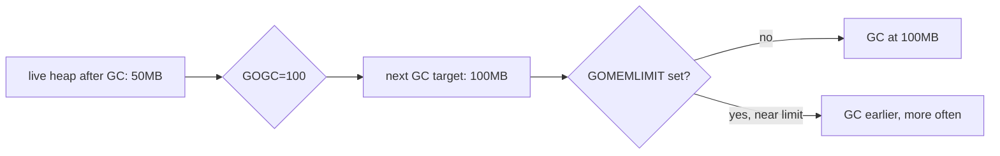
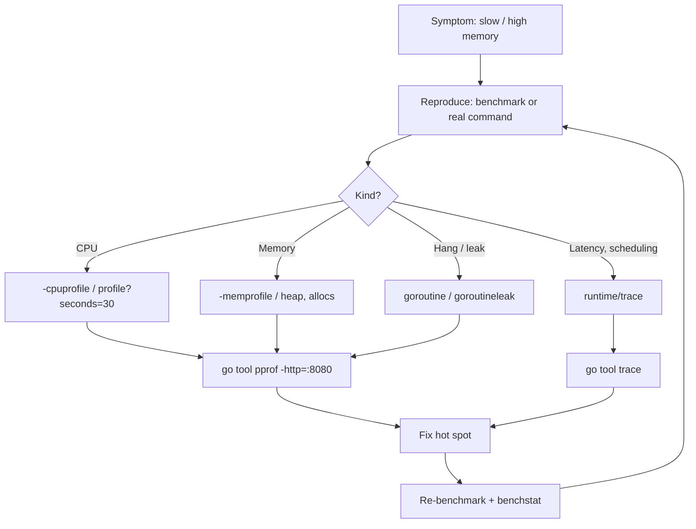
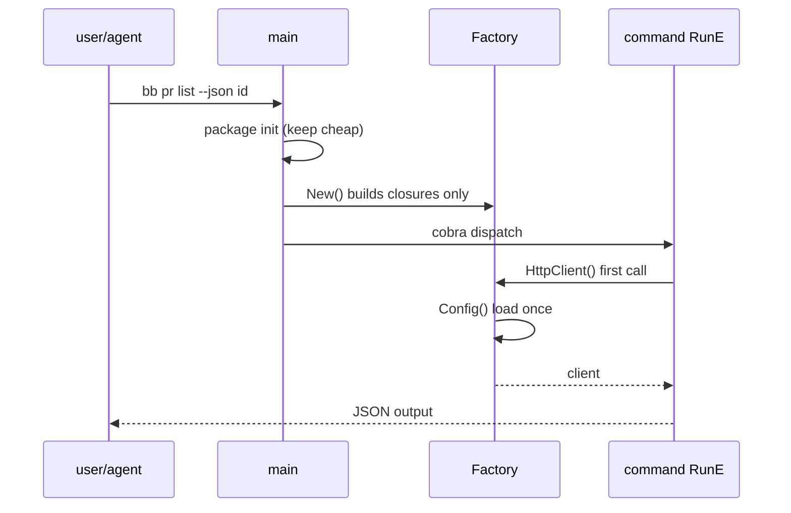

# 05 — Runtime nâng cao & hiệu năng

> Phạm vi: escape analysis, stack vs heap, GC (`GOGC`, `GOMEMLIMIT`, Green Tea), giảm allocation, `strings.Builder`, `sync.Pool`, profiling (pprof, benchmark, `b.Loop`, benchstat), tracing (`runtime/trace`, flight recorder), PGO, kích thước binary, build tags & cross-compile, `CGO_ENABLED=0`, `embed`, reflection & `unsafe`, `go:generate`, tối ưu thời gian khởi động CLI.
>
> Phiên bản tham chiếu: Go **1.27.3** / **1.26.10** (stable trên go.dev/dl, 2026-11-09).

## Tại sao quan trọng cho dự án CLI

Một CLI cho agent khác với web server ở chỗ **latency khởi động chiếm phần lớn thời gian chạy**. Agent có thể gọi `bb pr list --json ...` hàng trăm lần trong một phiên; mỗi lần mất 300 ms thay vì 30 ms là cộng dồn thành phút. Các ưu tiên theo thứ tự:

1. **Startup time**: không làm việc nặng trong `init()`, lazy Factory, không parse config/khởi tạo client k8s khi lệnh không cần.
2. **Network**: đa số thời gian là chờ API — concurrency (chương 04) và tái sử dụng kết nối quan trọng hơn micro-optimization.
3. **Phân phối**: binary tĩnh (`CGO_ENABLED=0`), cross-compile cho darwin/linux/windows × amd64/arm64, kích thước hợp lý.
4. **Bộ nhớ** chỉ quan trọng với MCP server chạy lâu và lệnh xử lý dữ liệu lớn (log hàng trăm MB, list hàng nghìn pod).

Nguyên tắc: **đo trước, tối ưu sau**. Mọi mục dưới đây đều bắt đầu bằng công cụ đo.

---

## 1. Stack vs heap và escape analysis

Compiler quyết định biến nằm trên **stack** (rẻ, tự giải phóng khi hàm return) hay **heap** (GC phải quản lý). Biến "escape" lên heap khi nó có thể sống lâu hơn frame của hàm: trả về pointer, lưu vào interface, capture bởi closure chạy trong goroutine, gửi qua channel, kích thước không biết lúc compile, hoặc quá lớn.

```go
func newOpts() *ListOptions {
    o := ListOptions{Limit: 30} // escapes: pointer returned
    return &o
}

func sum(xs []int) int {
    total := 0 // stays on stack
    for _, x := range xs {
        total += x
    }
    return total
}

func logIt(v any) { fmt.Println(v) } // passing a value as `any` often forces it to the heap
```

Xem quyết định của compiler:

```bash
go build -gcflags='-m' ./internal/bitbucket 2>&1 | grep -E 'escapes|moved to heap'
go build -gcflags='-m=2' ./internal/bitbucket   # more detail: why it escapes
```

Ghi chú:

- "Trả về pointer cho nhanh" thường sai: struct nhỏ trả theo giá trị thường rẻ hơn vì không alloc.
- Interface (`any`, `io.Writer`, `error`) là nguồn escape phổ biến nhất — trong hot path, ưu tiên kiểu cụ thể.
- Đừng tối ưu escape khi chưa thấy hàm đó trong heap profile.

---

## 2. Garbage collector

Go dùng GC concurrent, tri-color mark-sweep, không di chuyển object (non-moving), không phân thế hệ. Từ **Go 1.26**, **Green Tea GC** được bật mặc định (experiment ở Go 1.25 với `GOEXPERIMENT=greenteagc`): cải thiện locality khi mark/scan object nhỏ; release notes kỳ vọng giảm 10–40% chi phí GC cho chương trình dùng GC nhiều. Opt-out: `GOEXPERIMENT=nogreenteagc` — release notes 1.26 nói opt-out này dự kiến bị gỡ ở Go 1.27; kiểm tra lại https://go.dev/doc/go1.27 trước khi dựa vào nó.

### 2.1 GOGC và GOMEMLIMIT

| Núm | Ý nghĩa | Mặc định |
|---|---|---|
| `GOGC` | heap được tăng bao nhiêu % so với live heap trước khi chạy GC tiếp | `100` |
| `GOMEMLIMIT` (**Go 1.19+**) | soft limit tổng bộ nhớ runtime; GC chạy dày hơn khi gần chạm | không giới hạn |
| `GOGC=off` + `GOMEMLIMIT=X` | chỉ GC khi gần chạm limit | — |

```bash
GOGC=200 bb pr list --json   # less GC, more memory: fine for short-lived CLIs
GOMEMLIMIT=400MiB ./bb-mcp   # MCP server in a pod with a 512Mi limit
```

Thiết lập trong code (ví dụ khi MCP server đọc limit từ cgroup):

```go
import "runtime/debug"

func init() {
    // Leave headroom below the container limit (~80%).
    debug.SetMemoryLimit(400 << 20)
}
```

Cũng có thể đặt bằng directive `//go:debug` hoặc `godebug` trong `go.mod` cho các GODEBUG setting — nhưng `GOGC`/`GOMEMLIMIT` là biến môi trường hoặc API `runtime/debug`.

Chẩn đoán GC:

```bash
GODEBUG=gctrace=1 ./bb-mcp 2>&1 | head
```



### 2.2 Container-aware GOMAXPROCS (Go 1.25+)

Trên Linux, `GOMAXPROCS` mặc định tôn trọng cgroup CPU limit (không xét CPU request) và được cập nhật định kỳ. Tắt bằng `GODEBUG=containermaxprocs=0` / `updatemaxprocs=0`. Với MCP server trong k8s, có thể bỏ `go.uber.org/automaxprocs` nếu `go.mod` đã ở 1.25+.

### 2.3 Cải tiến runtime khác đáng biết

- **Go 1.24**: map dùng Swiss Tables; `runtime.AddCleanup` (thay `SetFinalizer`), package `weak`.
- **Go 1.26**: heap base address randomization trên 64-bit; overhead gọi cgo giảm ~30%; metric scheduler mới trong `runtime/metrics` (`/sched/goroutines`…).
- **Go 1.27** (theo release notes): allocation chuyên biệt theo kích thước cho một số object < 80 byte (rẻ hơn tới ~30%, binary thêm ~60 KB; opt-out `GOEXPERIMENT=nosizespecializedmalloc`).

---

## 3. Giảm allocation

Các kỹ thuật theo thứ tự hiệu quả/công sức:

### 3.1 Cấp phát trước dung lượng

```go
prs := make([]PR, 0, len(page.Values)) // one allocation instead of log2(n)
index := make(map[string]*PR, len(page.Values))
```

### 3.2 `strings.Builder` và `bytes.Buffer`

```go
func renderTable(rows []Row) string {
    var b strings.Builder
    b.Grow(len(rows) * 64) // estimate to avoid regrowth
    for _, r := range rows {
        b.WriteString(r.Name)
        b.WriteByte('\t')
        b.WriteString(r.Status)
        b.WriteByte('\n')
    }
    return b.String() // no copy: Builder hands over its buffer
}
```

- `s += x` trong vòng lặp ⇒ O(n²) bytes copy.
- `fmt.Sprintf` tiện nhưng alloc; trong hot path dùng `strconv.AppendInt`, `fmt.Appendf` (Go 1.19) vào buffer có sẵn.
- Nhưng: **output của CLI ghi thẳng vào `io.Writer`** (`IOStreams.Out`) — đừng build string khổng lồ rồi mới in; dùng `bufio.Writer` bọc stdout khi in nhiều dòng.

### 3.3 Stream JSON thay vì đọc toàn bộ

```go
// Bad: io.ReadAll + json.Unmarshal doubles peak memory for large payloads.
// Better: decode straight from the body.
func decodePage(resp *http.Response, v any) error {
    defer resp.Body.Close()
    return json.NewDecoder(resp.Body).Decode(v)
}
```

Go 1.26: `io.ReadAll` nhanh hơn ~2x và dùng ~một nửa bộ nhớ, nhưng decode trực tiếp vẫn tốt hơn với payload lớn. Go 1.27 (theo release notes) chuyển `encoding/json` sang hiện thực v2 với Unmarshal nhanh hơn đáng kể.

### 3.4 `sync.Pool`

Pool tái sử dụng object tạm (buffer) giữa các lần dùng, giảm áp lực GC. Pool có thể bị xả bất kỳ lúc nào ở GC — **không phải cache**.

```go
var bufPool = sync.Pool{
    New: func() any { return new(bytes.Buffer) },
}

func encodeNDJSON(w io.Writer, v any) error {
    buf := bufPool.Get().(*bytes.Buffer)
    buf.Reset()
    defer func() {
        if buf.Cap() <= 64<<10 { // don't keep huge buffers alive
            bufPool.Put(buf)
        }
    }()
    if err := json.NewEncoder(buf).Encode(v); err != nil {
        return err
    }
    _, err := w.Write(buf.Bytes())
    return err
}
```

Trong CLI chạy ngắn, `sync.Pool` hiếm khi đáng; trong MCP server xử lý nhiều request thì có thể. Chỉ thêm khi heap profile chỉ ra.

### 3.5 Các mẹo khác

- `strings.Cut`, `strings.Fields`, `bytes.*` tránh tạo slice trung gian.
- Chuyển `[]byte` ↔ `string` có copy; compiler tối ưu một số trường hợp (`m[string(b)]`, so sánh).
- `unique.Make` (Go 1.23) để intern chuỗi lặp lại nhiều (ví dụ tên namespace/label khi xử lý hàng chục nghìn object k8s).

---

## 4. Profiling với pprof



### 4.1 Profile trong benchmark/test

```bash
go test -run='^$' -bench=BenchmarkRenderTable -benchmem \
  -cpuprofile=cpu.out -memprofile=mem.out ./internal/render
go tool pprof -http=:8080 cpu.out        # web UI; flame graph is default since Go 1.26
go tool pprof -sample_index=alloc_space mem.out
```

Lệnh tương tác hay dùng: `top`, `top -cum`, `list FuncName`, `web`, `peek`.

### 4.2 Profile CLI thật bằng flag ẩn

```go
// Hidden flag on the root command: bb --cpuprofile=cpu.out pr list ...
func startProfiling(path string) (stop func(), err error) {
    f, err := os.Create(path)
    if err != nil {
        return nil, err
    }
    if err := pprof.StartCPUProfile(f); err != nil { // runtime/pprof
        f.Close()
        return nil, err
    }
    return func() { pprof.StopCPUProfile(); f.Close() }, nil
}
```

### 4.3 Profile server chạy lâu (MCP server)

```go
import _ "net/http/pprof" // registers /debug/pprof/* on http.DefaultServeMux

go func() {
    // Bind to localhost only; never expose pprof publicly.
    _ = http.ListenAndServe("127.0.0.1:6060", nil)
}()
```

Vì `net/http/pprof` đăng ký handler lên `http.DefaultServeMux`, transport HTTP của chính MCP server phải dùng mux riêng (`http.NewServeMux()`), nếu không pprof sẽ bị lộ cùng địa chỉ public của server.

```bash
go tool pprof -http=:8080 http://127.0.0.1:6060/debug/pprof/profile?seconds=30
go tool pprof http://127.0.0.1:6060/debug/pprof/heap
curl -s 'http://127.0.0.1:6060/debug/pprof/goroutine?debug=2' | less
```

Các profile: `profile` (CPU), `heap` (in-use, sample), `allocs` (tổng allocation), `goroutine`, `block`, `mutex` (cần `runtime.SetBlockProfileRate`/`SetMutexProfileFraction`), `threadcreate`, và `goroutineleak` (experimental ở **Go 1.26** với `GOEXPERIMENT=goroutineleakprofile`, GA ở **Go 1.27** theo release notes).

Từ **Go 1.27** (module `go 1.27`+), traceback in kèm goroutine labels của `runtime/pprof` (tắt bằng `GODEBUG=tracebacklabels=0`) — gắn label `command=pr.list` giúp đọc crash dump dễ hơn.

---

## 5. Benchmark

```go
func BenchmarkRenderTable(b *testing.B) {
    rows := makeRows(1000) // setup runs once with b.Loop
    for b.Loop() {         // Go 1.24+
        _ = renderTable(rows)
    }
}
```

`b.Loop` (**Go 1.24**): hàm benchmark chạy đúng một lần mỗi `-count`, nên setup không bị lặp; tham số/kết quả trong thân vòng được giữ sống để compiler không loại bỏ code. **Go 1.26**: `b.Loop` không còn chặn inlining trong thân vòng ⇒ đo chính xác hơn. Kiểu cũ `for i := 0; i < b.N; i++` vẫn hoạt động nhưng cần `b.ResetTimer()` sau setup.

```bash
go test -run='^$' -bench=. -benchmem -count=10 ./internal/render > old.txt
# ...apply optimization...
go test -run='^$' -bench=. -benchmem -count=10 ./internal/render > new.txt
go run golang.org/x/perf/cmd/benchstat@latest old.txt new.txt
```

Đọc output: `ns/op`, `B/op`, `allocs/op`. benchstat cho biết khác biệt có ý nghĩa thống kê (`p=0.000 n=10`) hay chỉ là nhiễu (`~`). Đừng tin một lần chạy đơn lẻ; chạy trên máy yên tĩnh, `-count` ≥ 6.

Với Go 1.24+, có thể khai báo benchstat là tool của module: `go get -tool golang.org/x/perf/cmd/benchstat`, sau đó `go tool benchstat old.txt new.txt`.

---

## 6. Tracing

pprof cho biết *cái gì tốn*; trace cho biết *chuyện gì xảy ra theo thời gian*: goroutine chờ gì, GC pause, network block, độ song song thực tế của errgroup.

```bash
go test -trace=trace.out -run=TestFetchAllRepos ./internal/bitbucket
go tool trace trace.out   # Go 1.27: -http defaults to localhost only
```

Trong code, đánh dấu task/region để nhìn theo nghiệp vụ:

```go
ctx, task := trace.NewTask(ctx, "pr.list")
defer task.End()
trace.WithRegion(ctx, "fetch", func() { prs, err = fetchAll(ctx) })
trace.Log(ctx, "repos", strconv.Itoa(len(repos)))
```

### 6.1 Flight recorder (Go 1.25+)

Ghi trace liên tục vào ring buffer trong bộ nhớ; chỉ ghi ra file khi có sự kiện đáng chú ý — lý tưởng cho MCP server khi một request bất thường chậm.

```go
fr := trace.NewFlightRecorder(trace.FlightRecorderConfig{
    MinAge:   10 * time.Second, // keep at least the last 10s
    MaxBytes: 16 << 20,         // cap the buffer at ~16MB
})
if err := fr.Start(); err != nil {
    return err
}
defer fr.Stop()

// Later, in a request handler:
if elapsed > 5*time.Second {
    f, err := os.Create("slow-request.trace")
    if err == nil {
        _, _ = fr.WriteTo(f)
        f.Close()
    }
}
```

API đã kiểm tra trên pkg.go.dev: `NewFlightRecorder(cfg FlightRecorderConfig) *FlightRecorder`, `Start() error`, `Stop()`, `WriteTo(io.Writer) (int64, error)`, `Enabled() bool`. Trước 1.25, flight recorder chỉ có trong `golang.org/x/exp/trace`.

---

## 7. Profile-Guided Optimization (PGO)

PGO: compiler dùng CPU profile thực tế để inline/devirtualize mạnh hơn ở hot path. Preview ở **Go 1.20**, **GA ở Go 1.21** với `-pgo=auto` mặc định: nếu thư mục main package có file `default.pgo`, `go build` tự dùng. Release notes 1.21 báo cáo cải thiện 2–7% cho đa số chương trình mẫu.

```bash
# 1. Collect a representative CPU profile (production-like workload)
curl -o cpu.pprof 'http://127.0.0.1:6060/debug/pprof/profile?seconds=60'
# 2. Commit it next to main
cp cpu.pprof ./cmd/bb-mcp/default.pgo
# 3. Build as usual: -pgo=auto picks it up
go build ./cmd/bb-mcp
```

Với CLI chạy ngắn, bị chặn bởi network, PGO hầu như không đáng công. Với MCP server xử lý JSON/YAML nhiều thì đáng thử, kèm benchmark xác nhận. Có thể merge nhiều profile bằng `go tool pprof -proto a.pprof b.pprof > merged.pprof`.

---

## 8. Build: kích thước binary, build tags, cross-compile

### 8.1 Build release

```bash
CGO_ENABLED=0 go build \
  -trimpath \
  -ldflags="-s -w -X github.com/acme/bb/internal/build.Version=${VERSION} -X github.com/acme/bb/internal/build.Date=${DATE}" \
  -o dist/bb ./cmd/bb
```

| Flag | Tác dụng |
|---|---|
| `-ldflags=-s -w` | bỏ symbol table và DWARF ⇒ nhỏ hơn đáng kể; mất khả năng debug bằng delve (stack trace panic vẫn có tên hàm) |
| `-trimpath` | bỏ đường dẫn máy build khỏi binary ⇒ reproducible, không lộ `/Users/...` |
| `-X pkg.Var=value` | gán biến string lúc link (version, commit) |
| `CGO_ENABLED=0` | binary tĩnh, không phụ thuộc glibc, cross-compile không cần C toolchain |

Thay thế cho `-X`: `runtime/debug.ReadBuildInfo()` đọc module version và VCS info (`vcs.revision`, `vcs.time`, `vcs.modified`) được nhúng tự động khi build trong git repo.

```go
func Version() string {
    if info, ok := debug.ReadBuildInfo(); ok && info.Main.Version != "" && info.Main.Version != "(devel)" {
        return info.Main.Version // set when installed via `go install module@version`
    }
    return build.Version // fallback to -ldflags -X
}
```

Kiểm tra binary chứa gì: `go version -m dist/bb` (module, dependency, build settings). Phân tích kích thước theo package: công cụ bên thứ ba như `goweight` hoặc `go tool nm -size -sort size dist/bb | head`. Dependency nặng thường gặp: `k8s.io/client-go` (hàng chục MB) — cân nhắc chỉ import package typed cần thiết, hoặc tách binary k8s riêng.

Không khuyên dùng UPX: làm chậm startup (phải giải nén) và hay bị antivirus đánh dấu.

### 8.2 Cross-compile

```bash
for target in darwin/arm64 darwin/amd64 linux/amd64 linux/arm64 windows/amd64; do
  GOOS=${target%/*} GOARCH=${target#*/} CGO_ENABLED=0 \
    go build -trimpath -ldflags="-s -w" -o "dist/bb_${target%/*}_${target#*/}" ./cmd/bb
done
go tool dist list   # all supported GOOS/GOARCH pairs
```

Thực tế nên dùng **GoReleaser** (giống `gh`): build matrix, archive, checksum, Homebrew tap, SBOM, ký.

### 8.3 Build tags

```go
//go:build integration

package bitbucket_test // only compiled with: go test -tags=integration ./...
```

```go
//go:build windows

package iostreams // file-level platform split; also implied by _windows.go suffix
```

Cú pháp `//go:build` thay thế `// +build` từ Go 1.17; `gofmt` tự đồng bộ. Hậu tố tên file `_linux.go`, `_arm64.go`, `_test.go` là build constraint ngầm.

---

## 9. `embed` (Go 1.16+)

Nhúng file tĩnh vào binary: template help, JSON schema cho MCP tool, shell completion, default config.

```go
import "embed"

//go:embed schemas/*.json
var schemaFS embed.FS

//go:embed templates/pr_view.tmpl
var prViewTmpl string

func toolSchema(name string) ([]byte, error) {
    return schemaFS.ReadFile("schemas/" + name + ".json")
}
```

Lưu ý: pattern không thể chứa `..`; file bắt đầu bằng `.` hoặc `_` bị bỏ qua trừ khi dùng tiền tố `all:`; biến phải ở package level. Mọi thứ embed làm tăng kích thước binary.

---

## 10. Reflection và `unsafe` — khi nào KHÔNG dùng

**Reflection** (`reflect`): chậm, mất type safety, lỗi lúc runtime. Chấp nhận được trong thư viện tổng quát (encoding/json, cobra flag binding, `--jq` trên dữ liệu động). Trong code nghiệp vụ, ưu tiên generics (Go 1.18) hoặc interface.

Một chỗ hợp lý trong CLI kiểu `gh`: liệt kê field được phép cho `--json fields` từ struct tag — làm **một lần** và cache:

```go
var prFields = sync.OnceValue(func() []string {
    var out []string
    t := reflect.TypeFor[PR]() // reflect.TypeFor: Go 1.22
    for f := range t.Fields() { // reflect.Type.Fields iterator: Go 1.26
        if tag, _, _ := strings.Cut(f.Tag.Get("json"), ","); tag != "" && tag != "-" {
            out = append(out, tag)
        }
    }
    return out
})
```

(Nếu `go.mod` dưới 1.26, dùng vòng `for i := range t.NumField()` với `t.Field(i)`.)

**`unsafe`**: phá vỡ đảm bảo của memory model và GC; dễ hỏng giữa các phiên bản Go. Một CLI DevOps gần như **không bao giờ** cần. Nếu thấy trong dependency, đó là lựa chọn của thư viện, không phải lý do để bạn dùng. Go 1.20 thêm `unsafe.String`/`unsafe.StringData`/`unsafe.SliceData` để chuyển đổi không copy một cách "chính thống" hơn — chỉ dùng khi profile chứng minh cần.

---

## 11. `go:generate`

`go generate ./...` chạy các lệnh khai báo bằng comment `//go:generate`. Không chạy tự động trong `go build`; output phải được commit.

```go
//go:generate go tool stringer -type=Tier
type Tier int

const (
    TierRead Tier = iota
    TierWrite
    TierAdmin
)
```

Từ **Go 1.24**, khai báo tool trong `go.mod` bằng directive `tool` (`go get -tool golang.org/x/tools/cmd/stringer`) và chạy bằng `go tool stringer` — version được pin, không còn file `tools.go` với blank import.

Ứng dụng trong dự án: sinh mock, sinh docs markdown cho mọi command (`cobra/doc`), sinh JSON schema cho MCP tool từ struct Options, sinh client từ OpenAPI của Bitbucket. CI nên chạy `go generate ./... && git diff --exit-code` để bắt code sinh bị lỗi thời.

---

## 12. Tối ưu thời gian khởi động CLI

Đo trước:

```bash
hyperfine --warmup 3 'bb --version' 'bb pr list --repo x --json id'   # wall-clock
GODEBUG=inittrace=1 bb --version 2>&1 | sort -k5 -n -r | head          # cost of each package init
```

`GODEBUG=inittrace=1` in thời gian và allocation của `init` từng package — cách nhanh nhất tìm dependency nặng.

Kỹ thuật:

1. **Không làm I/O trong `init()`** (đọc config, gọi mạng, đọc keyring). Chuyển vào Factory lazy (`sync.OnceValues`).
2. **Không khởi tạo biến global đắt** (`regexp.MustCompile` hàng trăm pattern, parse template lớn) ở package level — bọc trong `sync.OnceValue`.
3. **Cây cobra rẻ**: tạo `*cobra.Command` là rẻ, nhưng đừng để constructor `NewCmdX` làm I/O; mọi việc nặng ở `RunE`.
4. **Dependency nặng cô lập**: `client-go` có `init()` đăng ký scheme lớn. Chỉ import nó trong package của lệnh k8s; nếu cả binary chịu phí, cân nhắc binary riêng.
5. **Update check / telemetry chạy nền** với timeout ngắn (chương 04), tắt khi không phải TTY.
6. **Completion nhanh**: `__complete` được shell gọi mỗi lần nhấn Tab — không gọi API trừ khi thật cần, và có timeout.

```go
// Bad: runs on every invocation, even `bb --version`.
var cfg = mustLoadConfig()

// Good: runs only when a command asks for it.
var loadCfg = sync.OnceValues(loadConfig)
```



---

## Lỗi thường gặp

| Lỗi | Hậu quả | Cách sửa |
|---|---|---|
| Tối ưu mà không profile | thời gian vô ích, code khó đọc | pprof/benchmark trước |
| Benchmark một lần, so bằng mắt | kết luận sai do nhiễu | `-count=10` + benchstat |
| Benchmark kiểu cũ quên `ResetTimer` sau setup | số đo bao gồm setup | dùng `b.Loop` (1.24) |
| I/O hoặc parse nặng trong `init()` | mọi lệnh đều chậm | lazy `sync.OnceValue(s)` |
| `io.ReadAll` body lớn rồi `Unmarshal` | đỉnh bộ nhớ gấp đôi | `json.NewDecoder(body)` |
| Dùng `sync.Pool` như cache | dữ liệu mất sau GC | dùng map + mutex/LRU |
| Đưa buffer khổng lồ trở lại Pool | giữ bộ nhớ lớn mãi | giới hạn cap trước khi `Put` |
| Expose `net/http/pprof` trên `0.0.0.0` | lộ thông tin, DoS | bind `127.0.0.1` |
| Không đặt `GOMEMLIMIT` cho server trong container | OOMKilled | ~80–90% memory limit |
| Release build quên `-trimpath` | lộ đường dẫn, không reproducible | thêm `-trimpath` |
| Build với cgo vô tình (`net`, `os/user`) | binary phụ thuộc glibc, lỗi trên Alpine | `CGO_ENABLED=0` |
| `//go:embed` với đường dẫn `..` | lỗi compile | đặt file trong thư mục package |
| Dùng `unsafe` để "nhanh hơn" | crash khó tái hiện | không dùng trừ khi profile chứng minh |

---

## Checklist

- [ ] `hyperfine 'bb --version'` < ~50 ms; `GODEBUG=inittrace=1` không có package lạ tốn nhiều.
- [ ] Không có I/O ở package level / `init()`; Factory lazy.
- [ ] Benchmark dùng `b.Loop` + `-benchmem`; so sánh bằng benchstat.
- [ ] Flag ẩn `--cpuprofile` cho CLI; pprof localhost cho MCP server.
- [ ] MCP server: `GOMEMLIMIT` theo container limit; cân nhắc flight recorder cho request chậm.
- [ ] Release: `CGO_ENABLED=0 -trimpath -ldflags="-s -w -X ..."`, GoReleaser cho matrix OS/arch.
- [ ] `go version -m` kiểm tra dependency trong binary.
- [ ] Integration test dùng build tag `integration`.
- [ ] Code sinh bởi `go:generate` được commit; CI kiểm tra `git diff --exit-code`.
- [ ] Tool dev (stringer, benchstat) pin bằng `tool` directive (Go 1.24).
- [ ] Chỉ cân nhắc PGO cho MCP server CPU-bound, có benchmark chứng minh.

---

## Tài liệu tham khảo

- A Guide to the Go Garbage Collector — https://go.dev/doc/gc-guide
- Diagnostics — https://go.dev/doc/diagnostics
- Profile-guided optimization — https://go.dev/doc/pgo
- `runtime/pprof` — https://pkg.go.dev/runtime/pprof
- `net/http/pprof` — https://pkg.go.dev/net/http/pprof
- `runtime/trace` (FlightRecorder) — https://pkg.go.dev/runtime/trace
- Flight recorder blog — https://go.dev/blog/flight-recorder
- More predictable benchmarking with testing.B.Loop — https://go.dev/blog/testing-b-loop
- benchstat — https://pkg.go.dev/golang.org/x/perf/cmd/benchstat
- `embed` — https://pkg.go.dev/embed
- Build constraints — https://pkg.go.dev/cmd/go#hdr-Build_constraints
- `runtime/debug` (SetMemoryLimit, ReadBuildInfo) — https://pkg.go.dev/runtime/debug
- Go 1.19 release notes (GOMEMLIMIT) — https://go.dev/doc/go1.19
- Go 1.21 release notes (PGO GA) — https://go.dev/doc/go1.21
- Go 1.24 release notes (b.Loop, tool directive, Swiss maps) — https://go.dev/doc/go1.24
- Go 1.25 release notes (flight recorder, Green Tea experiment, GOMAXPROCS) — https://go.dev/doc/go1.25
- Go 1.26 release notes (Green Tea default, goroutineleak) — https://go.dev/doc/go1.26
- Go 1.27 release notes — https://go.dev/doc/go1.27
- GoReleaser — https://goreleaser.com
- hyperfine — https://github.com/sharkdp/hyperfine
