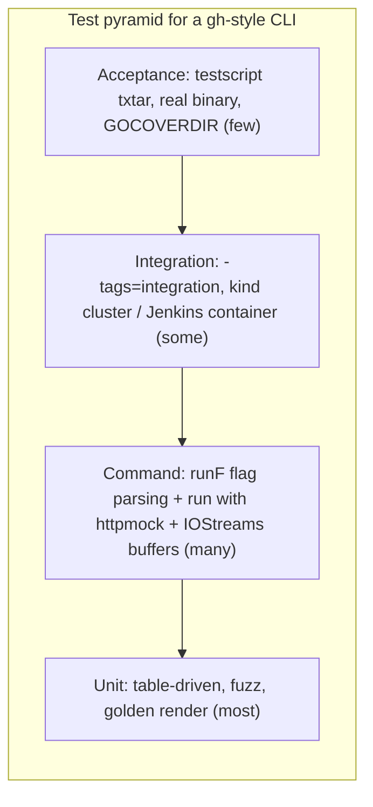

# 06 — Testing & chất lượng code

> Phạm vi: package `testing`, table-driven test, subtest, `t.Parallel`, `t.Cleanup`, `t.Context`, helper, testify vs std + go-cmp, `httptest` và registry httpmock kiểu `gh` cho `http.RoundTripper`, golden file, fuzzing, `testing/synctest`, testscript cho acceptance test CLI, test cobra command qua `runF` + IOStreams test buffer, coverage (kể cả integration với `GOCOVERDIR`), benchmark, golangci-lint v2, staticcheck, govulncheck, CI GitHub Actions với `-race`.
>
> Phiên bản tham chiếu: Go **1.27.3** / **1.26.10** (stable trên go.dev/dl, 2026-11-09).

## Tại sao quan trọng cho dự án CLI

CLI cho agent là một **hợp đồng**: tên flag, exit code, schema `--json`, thông báo lỗi trên stderr. Agent không "đọc hiểu" khi output thay đổi — nó gãy. Vì vậy test phải khóa chặt hợp đồng đó:

- **Unit test** cho logic thuần (parse, filter, render) — nhanh, nhiều.
- **Command test** cho từng `cobra.Command`: flag → `Options` đúng chưa (qua `runF`), và `run(opts)` cho ra stdout/stderr/exit code đúng với HTTP được mock.
- **Acceptance test** (testscript) chạy binary thật như agent sẽ chạy.
- **Permission gate** (read/write/admin tier) phải có test riêng: lệnh write tuyệt đối không được chạy khi tier là read.
- **Không bao giờ** gọi Bitbucket/Jenkins/k8s thật trong unit test: mock ở tầng `http.RoundTripper`.



---

## 1. Package `testing` cơ bản

```go
// file: internal/render/duration_test.go
package render

import "testing"

func TestFuzzyAgo(t *testing.T) {
    got := FuzzyAgo(90 * time.Minute)
    if got != "about 1 hour ago" {
        t.Errorf("FuzzyAgo(90m) = %q, want %q", got, "about 1 hour ago")
    }
}
```

- `t.Errorf` báo lỗi và chạy tiếp; `t.Fatalf` dừng test hiện tại (phải gọi từ goroutine của test, không từ goroutine con).
- Message chuẩn: `Func(input) = got, want want`.
- `package render` (white-box) vs `package render_test` (black-box, chỉ dùng API export). Dùng `_test` package cho test hành vi công khai.

Chạy:

```bash
go test ./...                       # all packages
go test -run 'TestFuzzyAgo$' -v ./internal/render
go test -run 'TestPRList/closed' ./pkg/cmd/pr/list   # a single subtest
go test -count=1 ./...              # bypass test cache
go test -shuffle=on ./...           # random order: reveals hidden coupling
```

---

## 2. Table-driven test & subtest

```go
func TestParseRepo(t *testing.T) {
    tests := []struct {
        name    string
        in      string
        want    Repo
        wantErr string
    }{
        {name: "workspace/slug", in: "acme/api", want: Repo{Workspace: "acme", Slug: "api"}},
        {name: "url", in: "https://bitbucket.org/acme/api", want: Repo{Workspace: "acme", Slug: "api"}},
        {name: "missing slug", in: "acme", wantErr: `expected "WORKSPACE/REPO"`},
    }
    for _, tt := range tests {
        t.Run(tt.name, func(t *testing.T) {
            t.Parallel() // safe: tt is per-iteration since Go 1.22
            got, err := ParseRepo(tt.in)
            if tt.wantErr != "" {
                if err == nil || !strings.Contains(err.Error(), tt.wantErr) {
                    t.Fatalf("ParseRepo(%q) error = %v, want containing %q", tt.in, err, tt.wantErr)
                }
                return
            }
            if err != nil {
                t.Fatalf("ParseRepo(%q) unexpected error: %v", tt.in, err)
            }
            if got != tt.want {
                t.Errorf("ParseRepo(%q) = %+v, want %+v", tt.in, got, tt.want)
            }
        })
    }
}
```

Mẹo: dùng field `name` rõ ràng (hiện trong `-run`), đặt case lỗi cạnh case thành công, map `map[string]struct{...}` cũng được nhưng thứ tự ngẫu nhiên.

---

## 3. `t.Parallel`, `t.Cleanup`, `t.Context` và bạn bè

| API | Phiên bản | Dùng cho |
|---|---|---|
| `t.Cleanup(f)` | 1.14 | dọn dẹp theo thứ tự LIFO, chạy cả khi `Fatal` |
| `t.TempDir()` | 1.15 | thư mục tạm tự xóa |
| `t.Setenv(k, v)` | 1.17 | đặt env, tự khôi phục — **panic nếu test (hoặc test cha) đã gọi `t.Parallel`** |
| `t.Context()` | **1.24** | context bị hủy *ngay trước* khi các Cleanup chạy |
| `t.Chdir(dir)` | **1.24** | đổi working dir trong test; không dùng chung với `t.Parallel` |
| `t.Attr(k, v)`, `t.Output()` | **1.25** | gắn attribute vào log test / `io.Writer` ghi vào log test |
| `t.ArtifactDir()` | **1.26** | thư mục chứa artifact; giữ lại với `go test -artifacts` |

```go
func TestWatchPods(t *testing.T) {
    ctx := t.Context() // Go 1.24: canceled when the test ends
    srv := newFakeAPIServer(t)
    t.Cleanup(srv.Close)

    events := make(chan watch.Event, 10)
    go func() { _ = watchPods(ctx, srv.Client(), "default", events) }()
    // ... assertions; the goroutine exits when ctx is canceled
}
```

`t.Parallel()`: test song song chỉ chạy sau khi các test tuần tự trong cùng package xong; giới hạn bởi `-parallel` (mặc định `GOMAXPROCS`). Test dùng `t.Setenv`, `t.Chdir`, hoặc state global (config dir) **không** được parallel — đó là lý do kiến trúc `gh` truyền mọi thứ qua Factory thay vì đọc env/global trực tiếp.

### Helper

```go
func newTestFactory(t *testing.T) (*cmdutil.Factory, *httpmock.Registry, *testIO) {
    t.Helper() // failures point at the caller's line, not here
    reg := &httpmock.Registry{}
    t.Cleanup(func() { reg.Verify(t) })
    tio := newTestIO()
    f := &cmdutil.Factory{
        IOStreams:  tio.IOStreams,
        HttpClient: func() (*http.Client, error) { return &http.Client{Transport: reg}, nil },
        Config:     func() (config.Config, error) { return config.NewBlank(), nil },
    }
    return f, reg, tio
}
```

---

## 4. testify vs std + go-cmp

| | std + `go-cmp` | `testify` (assert/require) |
|---|---|---|
| Phụ thuộc | `github.com/google/go-cmp` | `github.com/stretchr/testify` |
| Phong cách | `if diff := cmp.Diff(want, got); diff != "" {...}` | `assert.Equal(t, want, got)` |
| Diff struct lồng nhau | rất tốt, có `cmpopts` (bỏ field, sort slice) | tốt |
| Unexported field | phải khai báo option rõ ràng (an toàn) | so sánh bằng reflect |
| `gh` dùng | — | testify |

Cả hai đều chấp nhận được; chọn **một** cho cả repo. Chương này dùng std + go-cmp; ví dụ testify ngắn ở cuối mục.

```go
func TestFilterOpenPRs(t *testing.T) {
    got := FilterOpen(fixturePRs())
    want := []PR{{ID: 1, State: "OPEN"}, {ID: 3, State: "OPEN"}}
    // Ignore volatile fields; order-insensitive comparison.
    opts := []cmp.Option{
        cmpopts.IgnoreFields(PR{}, "UpdatedOn"),
        cmpopts.SortSlices(func(a, b PR) bool { return a.ID < b.ID }),
    }
    if diff := cmp.Diff(want, got, opts...); diff != "" {
        t.Errorf("FilterOpen() mismatch (-want +got):\n%s", diff)
    }
}
```

```go
// testify equivalent
require.NoError(t, err)          // stops the test (like Fatal)
assert.Equal(t, want, got)       // continues (like Error)
assert.JSONEq(t, `{"id":1}`, out.String())
```

Kiểm tra lỗi theo kiểu: `errors.Is(err, ErrNotFound)`; `errors.As`, hoặc **`errors.AsType[*HTTPError](err)` (Go 1.26)** — generic, type-safe.

---

## 5. Mock HTTP: `httptest` và registry kiểu `gh`

### 5.1 `httptest.Server` — server thật trên localhost

Hợp với test client cấp thấp (retry, pagination, header):

```go
func TestRetryOn429(t *testing.T) {
    var calls atomic.Int32
    srv := httptest.NewServer(http.HandlerFunc(func(w http.ResponseWriter, r *http.Request) {
        if calls.Add(1) == 1 {
            w.Header().Set("Retry-After", "0")
            w.WriteHeader(http.StatusTooManyRequests)
            return
        }
        fmt.Fprint(w, `{"values":[]}`)
    }))
    t.Cleanup(srv.Close)

    c := &http.Client{Transport: &retryTransport{next: http.DefaultTransport, maxRetries: 3}}
    resp, err := c.Get(srv.URL + "/2.0/repositories/acme")
    if err != nil {
        t.Fatal(err)
    }
    resp.Body.Close()
    if resp.StatusCode != http.StatusOK || calls.Load() != 2 {
        t.Fatalf("status=%d calls=%d, want 200 and 2", resp.StatusCode, calls.Load())
    }
}
```

`httptest.NewRecorder()` để test `http.Handler` (ví dụ MCP server transport HTTP) không cần mạng.

### 5.2 Registry httpmock (mô phỏng `cli/cli/pkg/httpmock`)

Với command test, mock ở tầng `RoundTripper` nhanh hơn, không mở socket, và **bắt buộc** mọi stub phải được dùng. Đoạn dưới là phiên bản tối giản *mô phỏng theo* `github.com/cli/cli/v2/pkg/httpmock` — package đó là internal của `gh`, không phải API ổn định để import; nên tự viết trong `internal/httpmock`.

```go
package httpmock

type Matcher func(*http.Request) bool
type Responder func(*http.Request) (*http.Response, error)

type stub struct {
    match   Matcher
    respond Responder
    matched bool
}

type Registry struct {
    mu       sync.Mutex
    stubs    []*stub
    Requests []*http.Request
}

func (r *Registry) Register(m Matcher, resp Responder) {
    r.mu.Lock()
    defer r.mu.Unlock()
    r.stubs = append(r.stubs, &stub{match: m, respond: resp})
}

// RoundTrip makes *Registry an http.RoundTripper.
func (r *Registry) RoundTrip(req *http.Request) (*http.Response, error) {
    r.mu.Lock()
    var s *stub
    for _, candidate := range r.stubs {
        if !candidate.matched && candidate.match(req) {
            s = candidate
            break
        }
    }
    if s == nil {
        r.mu.Unlock()
        return nil, fmt.Errorf("httpmock: no stub for %s %s", req.Method, req.URL)
    }
    s.matched = true // each stub answers once
    r.Requests = append(r.Requests, req)
    r.mu.Unlock()
    return s.respond(req)
}

// Verify fails the test if any stub was never used.
func (r *Registry) Verify(t testing.TB) {
    t.Helper()
    r.mu.Lock()
    defer r.mu.Unlock()
    for _, s := range r.stubs {
        if !s.matched {
            t.Errorf("httpmock: unmatched stub")
        }
    }
}

func REST(method, path string) Matcher {
    return func(req *http.Request) bool {
        return req.Method == method && req.URL.Path == path
    }
}

func StringResponse(status int, body string) Responder {
    return func(req *http.Request) (*http.Response, error) {
        return &http.Response{
            StatusCode: status,
            Header:     http.Header{"Content-Type": []string{"application/json"}},
            Body:       io.NopCloser(strings.NewReader(body)),
            Request:    req,
        }, nil
    }
}

func JSONResponse(v any) Responder {
    b, _ := json.Marshal(v)
    return StringResponse(http.StatusOK, string(b))
}
```

Vì mọi middleware (auth header, rate limit, retry 429) được ghép quanh `Transport`, có thể test chúng bằng cách bọc `Registry` làm `next`.

---

## 6. Test cobra command: `runF` + IOStreams test buffer

Kiến trúc `gh`: `NewCmdList(f *cmdutil.Factory, runF func(*ListOptions) error) *cobra.Command`. Production truyền `runF = nil` ⇒ gọi `listRun(opts)`. Test truyền `runF` để **bắt Options** và kiểm tra parse flag mà không chạy logic.

### 6.1 IOStreams test (tối giản, mô phỏng `iostreams.Test()` của gh)

```go
type testIO struct {
    *iostreams.IOStreams
    In, Out, ErrOut *bytes.Buffer
}

func newTestIO() *testIO {
    in, out, errOut := &bytes.Buffer{}, &bytes.Buffer{}, &bytes.Buffer{}
    ios := &iostreams.IOStreams{In: io.NopCloser(in), Out: out, ErrOut: errOut}
    return &testIO{IOStreams: ios, In: in, Out: out, ErrOut: errOut}
}
```

IOStreams thật có `SetStdoutTTY(bool)` để giả lập terminal: test cả hai nhánh TTY (bảng màu cho người) và non-TTY (tab-separated/JSON cho agent).

### 6.2 Test phần parse flag

```go
func TestNewCmdList_flags(t *testing.T) {
    tests := []struct {
        name    string
        args    string
        want    ListOptions
        wantErr string
    }{
        {name: "defaults", args: "", want: ListOptions{State: "OPEN", Limit: 30}},
        {name: "state and limit", args: "--state merged -L 5", want: ListOptions{State: "MERGED", Limit: 5}},
        {name: "invalid limit", args: "-L 0", wantErr: "invalid value for --limit"},
    }
    for _, tt := range tests {
        t.Run(tt.name, func(t *testing.T) {
            f, _, _ := newTestFactory(t)
            var got *ListOptions
            cmd := NewCmdList(f, func(o *ListOptions) error { got = o; return nil })

            argv, err := shlex.Split(tt.args) // github.com/google/shlex, as in gh
            if err != nil {
                t.Fatal(err)
            }
            cmd.SetArgs(argv)
            cmd.SetIn(&bytes.Buffer{})
            cmd.SetOut(io.Discard)
            cmd.SetErr(io.Discard)

            _, err = cmd.ExecuteC()
            if tt.wantErr != "" {
                if err == nil || !strings.Contains(err.Error(), tt.wantErr) {
                    t.Fatalf("error = %v, want containing %q", err, tt.wantErr)
                }
                return
            }
            if err != nil {
                t.Fatal(err)
            }
            if diff := cmp.Diff(tt.want, *got,
                cmpopts.IgnoreFields(ListOptions{}, "IO", "HttpClient", "BaseRepo")); diff != "" {
                t.Errorf("options mismatch (-want +got):\n%s", diff)
            }
        })
    }
}
```

### 6.3 Test phần `run` với HTTP mock

```go
func TestListRun_JSON(t *testing.T) {
    f, reg, tio := newTestFactory(t)
    reg.Register(
        httpmock.REST("GET", "/2.0/repositories/acme/api/pullrequests"),
        httpmock.StringResponse(200, `{"values":[{"id":7,"title":"Fix CI","state":"OPEN"}]}`),
    )

    opts := &ListOptions{
        IO:         tio.IOStreams,
        HttpClient: f.HttpClient,
        BaseRepo:   func() (Repo, error) { return Repo{"acme", "api"}, nil },
        State:      "OPEN",
        Limit:      30,
        JSONFields: []string{"id", "title"},
    }
    if err := listRun(t.Context(), opts); err != nil {
        t.Fatal(err)
    }
    assertJSONEq(t, `[{"id":7,"title":"Fix CI"}]`, tio.Out.String())
    if tio.ErrOut.Len() != 0 {
        t.Errorf("unexpected stderr: %q", tio.ErrOut.String())
    }
}
```

### 6.4 Test permission gate

```go
func TestGate_BlocksWriteInReadTier(t *testing.T) {
    f, reg, _ := newTestFactory(t) // no stubs registered: any HTTP call fails the test
    _ = reg
    cmd := NewCmdMerge(f, nil)
    cmd.SetArgs([]string{"7"})
    ctx := gate.WithTier(t.Context(), gate.TierRead)

    err := cmd.ExecuteContext(ctx)
    var denied *gate.DeniedError
    if !errors.As(err, &denied) || denied.Required != gate.TierWrite {
        t.Fatalf("err = %v, want DeniedError requiring write tier", err)
    }
}
```

---

## 7. Golden file

Cho output dài (bảng, help text, `--json` lớn): so với file trong `testdata/`, cập nhật bằng flag `-update`.

```go
var update = flag.Bool("update", false, "update golden files")

func assertGolden(t *testing.T, name string, got []byte) {
    t.Helper()
    path := filepath.Join("testdata", name+".golden")
    if *update {
        if err := os.WriteFile(path, got, 0o644); err != nil {
            t.Fatal(err)
        }
    }
    want, err := os.ReadFile(path)
    if err != nil {
        t.Fatalf("read golden (run with -update?): %v", err)
    }
    if diff := cmp.Diff(string(want), string(got)); diff != "" {
        t.Errorf("%s mismatch (-want +got):\n%s", path, diff)
    }
}
```

```bash
go test ./pkg/cmd/pr/view -update   # regenerate, then review the git diff carefully
```

`testdata/` bị toolchain bỏ qua khi build; luôn review diff golden trong PR — đó chính là thay đổi hợp đồng output.

---

## 8. Fuzzing (Go 1.18+)

Fuzz rất hợp cho parser nhận input từ agent/user: `ParseRepo`, parse URL Jenkins, biểu thức `--jq`, selector k8s.

```go
func FuzzParseRepo(f *testing.F) {
    for _, seed := range []string{"acme/api", "https://bitbucket.org/acme/api", "", "a/b/c"} {
        f.Add(seed)
    }
    f.Fuzz(func(t *testing.T, in string) {
        r, err := ParseRepo(in)
        if err != nil {
            return
        }
        // Property: a parsed repo must round-trip.
        r2, err := ParseRepo(r.String())
        if err != nil || r2 != r {
            t.Errorf("round-trip failed: %q -> %+v -> %q -> %+v (%v)", in, r, r.String(), r2, err)
        }
    })
}
```

```bash
go test -run='^$' -fuzz=FuzzParseRepo -fuzztime=30s ./internal/repo
```

Input gây lỗi được lưu vào `testdata/fuzz/FuzzParseRepo/` và trở thành regression test chạy trong `go test` thường — commit chúng. Chỉ fuzz một target mỗi lần chạy `-fuzz`.

---

## 9. `testing/synctest` — test code phụ thuộc thời gian

Lịch sử: **Go 1.24** experimental (`GOEXPERIMENT=synctest`, API `synctest.Run`); **Go 1.25 GA** với `synctest.Test(t, func(t *testing.T))` và `synctest.Wait()`; API cũ bị gỡ ở 1.26; **Go 1.27** thêm `synctest.Sleep(d)` (= `time.Sleep` + `Wait`).

Trong "bubble", `time` dùng đồng hồ giả: thời gian chỉ trôi khi mọi goroutine trong bubble đều bị block — test poll 2 phút chạy trong vài micro giây, không flaky.

```go
func TestWaitForBuildStart_Timeout(t *testing.T) {
    synctest.Test(t, func(t *testing.T) {
        // Assumes waitForBuildStart takes a small interface (GetJSON) instead of *jenkins.Client,
        // so an in-process fake can be injected. This one never starts the build.
        c := fakeJenkins{queue: queueItem{Why: "Waiting for next available executor"}}
        ctx, cancel := context.WithTimeout(t.Context(), 2*time.Minute)
        defer cancel()

        start := time.Now()
        _, err := waitForBuildStart(ctx, c, "/queue/item/42/")
        if !errors.Is(err, context.DeadlineExceeded) {
            t.Fatalf("err = %v, want DeadlineExceeded", err)
        }
        if elapsed := time.Since(start); elapsed != 2*time.Minute {
            t.Errorf("elapsed = %v, want exactly 2m (fake clock)", elapsed)
        }
    })
}
```

Hạn chế quan trọng (pkg.go.dev): network I/O, syscall và **mutex** không được coi là "durably blocked" — goroutine đang chờ socket thật làm bubble không bao giờ idle. Vì vậy fake client phải in-process (interface, `net.Pipe`, hoặc RoundTripper giả), **không** dùng `httptest.NewServer` thật bên trong bubble. **Go 1.27** thêm `httptest.NewTestServer(t testing.TB, handler http.Handler) *Server` — mặc định dùng mạng in-memory, nên dùng được trong bubble synctest (đã kiểm tra trên pkg.go.dev). Trong `f` không được gọi `t.Run`, `t.Parallel`, `t.Deadline`.

---

## 10. Acceptance test với testscript

`github.com/rogpeppe/go-internal/testscript` chạy script dạng txtar: lệnh shell-like, assert stdout/stderr, file. Đây là cách test CLI "như agent dùng" — đáng tin cho hợp đồng exit code và JSON.

```go
// file: cmd/bb/main_test.go
package main

import (
    "os"
    "testing"

    "github.com/rogpeppe/go-internal/testscript"
)

func TestMain(m *testing.M) {
    // Main's command map takes func() (current API); the command may call os.Exit.
    testscript.Main(m, map[string]func(){
        "bb": func() { os.Exit(mainRun()) },
    })
}

func TestScripts(t *testing.T) {
    testscript.Run(t, testscript.Params{
        Dir: "testdata/script",
        Setup: func(env *testscript.Env) error {
            env.Setenv("BB_CONFIG_DIR", env.WorkDir+"/.config") // isolate config
            env.Setenv("BB_NO_UPDATE_NOTIFIER", "1")
            return nil
        },
        RequireExplicitExec: true,
    })
}
```

```txtar
# testdata/script/pr_list_json.txtar
# Unauthenticated call must fail (`! exec` only asserts a non-zero exit, not a specific code).
! exec bb pr list --repo acme/api --json id
stderr 'authentication required'
! stdout .

# Read tier must refuse a write command.
env BB_TIER=read
! exec bb pr merge 7 --repo acme/api
stderr 'requires the write permission tier'

-- .config/hosts.yml --
bitbucket.org:
  user: ci-bot
```

Để test với API, `Setup` có thể khởi động một `httptest.Server` (ngoài synctest) và set `BB_API_URL=srv.URL`. `UpdateScripts: true` tự cập nhật phần expected trong txtar (giống golden).

---

## 11. Coverage

```bash
go test -cover ./...
go test -race -coverprofile=cover.out ./...   # with -race, covermode defaults to atomic
go tool cover -html=cover.out
go tool cover -func=cover.out | tail -1
go test -coverpkg=./... -coverprofile=cover.out ./...      # count cross-package coverage
```

### Integration coverage với `GOCOVERDIR` (Go 1.20+)

Build binary có instrument, chạy (testscript, e2e), rồi gộp dữ liệu:

```bash
go build -cover -coverpkg=./... -o bin/bb-cover ./cmd/bb
mkdir -p covdata/e2e
GOCOVERDIR=covdata/e2e ./scripts/e2e.sh    # runs bin/bb-cover many times
go tool covdata percent -i=covdata/e2e
go tool covdata textfmt -i=covdata/e2e,covdata/unit -o=cover-all.out   # merge dirs
```

Unit test cũng có thể ghi dạng binary: `go test -cover ./... -args -test.gocoverdir=$PWD/covdata/unit`. Coverage là công cụ tìm vùng chưa test, không phải mục tiêu: 100% dòng không đảm bảo đúng hợp đồng `--json`.

---

## 12. Benchmark (tóm tắt — chi tiết ở chương 05)

```go
func BenchmarkRenderJSON(b *testing.B) {
    prs := fixturePRs(500)
    for b.Loop() { // Go 1.24
        var buf bytes.Buffer
        _ = renderJSON(&buf, prs, []string{"id", "title", "state"})
    }
}
```

`go test -run='^$' -bench=. -benchmem -count=10 > new.txt` rồi `benchstat old.txt new.txt`. Không đặt benchmark vào CI gating (nhiễu); chạy khi tối ưu.

---

## 13. Static analysis

### 13.1 `go vet`

Chạy tự động một phần khi `go test`. Analyzer đáng chú ý: `copylocks`, `lostcancel`, `printf`, `tests` (**1.24**), `waitgroup` và `hostport` (**1.25**), `stdversion` chạy mặc định trong `go test` từ **1.27** (theo release notes).

### 13.2 golangci-lint v2

v2 (2025) đổi format config: bắt buộc `version: "2"`, formatter (gofmt/goimports/gofumpt) tách sang mục `formatters`, `linters.default` thay cho `enable-all/disable-all`.

```yaml
# .golangci.yml
version: "2"
run:
  timeout: 5m
linters:
  default: standard        # errcheck, govet, ineffassign, staticcheck, unused
  enable:
    - bodyclose            # unclosed http response bodies
    - contextcheck
    - errorlint            # %w and errors.Is/As usage
    - gosec
    - misspell
    - noctx                # http requests without context
    - revive
    - testifylint          # only if you use testify
    - usetesting           # prefer t.Context/t.TempDir/t.Setenv
  settings:
    errcheck:
      check-type-assertions: true
  exclusions:
    presets: [comments, std-error-handling]
    rules:
      - path: _test\.go
        linters: [gosec]
formatters:
  enable: [gofumpt, goimports]
  settings:
    goimports:
      local-prefixes: [github.com/acme/bb]
```

Migrate từ v1: `golangci-lint migrate`. Kiểm tra config: `golangci-lint config verify`.

### 13.3 staticcheck

Đã nằm trong golangci-lint v2 (staticcheck + gosimple + stylecheck được gộp thành linter `staticcheck`). Có thể chạy riêng: `go run honnef.co/go/tools/cmd/staticcheck@latest ./...`.

### 13.4 govulncheck

Chỉ báo lỗ hổng mà code **thực sự gọi tới** (phân tích call graph), ít nhiễu hơn scanner theo dependency list.

```bash
go run golang.org/x/vuln/cmd/govulncheck@latest ./...
go run golang.org/x/vuln/cmd/govulncheck@latest -mode=binary dist/bb   # scan a built binary
```

Pin version tool bằng directive `tool` trong `go.mod` (Go 1.24): `go get -tool golang.org/x/vuln/cmd/govulncheck` ⇒ `go tool govulncheck ./...`.

---

## 14. CI: GitHub Actions

```yaml
# .github/workflows/ci.yml
name: ci
on:
  push: { branches: [main] }
  pull_request:

permissions:
  contents: read

jobs:
  test:
    strategy:
      matrix:
        os: [ubuntu-latest, macos-latest, windows-latest]
    runs-on: ${{ matrix.os }}
    steps:
      - uses: actions/checkout@v5
      - uses: actions/setup-go@v6
        with:
          go-version-file: go.mod      # single source of truth for the Go version
      - run: go mod download
      - name: Unit tests (race)
        run: go test -race -shuffle=on -covermode=atomic -coverprofile=cover.out ./...
      - name: Acceptance tests
        if: runner.os == 'Linux'
        run: go test -run TestScripts ./cmd/bb

  lint:
    runs-on: ubuntu-latest
    steps:
      - uses: actions/checkout@v5
      - uses: actions/setup-go@v6
        with: { go-version-file: go.mod }
      - uses: golangci/golangci-lint-action@v9
        with:
          version: v2.12          # pin explicitly; bump deliberately
      - name: Generated code is up to date
        run: go generate ./... && git diff --exit-code
      - name: go mod tidy check
        run: go mod tidy -diff    # Go 1.23+: prints diff, non-zero exit if untidy
      - name: Vulnerabilities
        run: go run golang.org/x/vuln/cmd/govulncheck@latest ./...
```

Ghi chú:

- `-race` cần cgo trên Linux/Windows (runner có sẵn C toolchain); trên macOS không cần từ Go 1.20.
- Pin action theo commit SHA nếu chính sách bảo mật yêu cầu; kiểm tra version mới nhất của các action khi dựng repo (thông tin ở đây: `golangci-lint-action` dòng v9 hiện hành, ví dụ docs pin `v2.12`).
- Tách job integration (`-tags=integration`, kind cluster, Jenkins container) chạy theo lịch hoặc label, không chặn mọi PR.

---

## Lỗi thường gặp

| Lỗi | Hậu quả | Cách sửa |
|---|---|---|
| Gọi API thật trong unit test | flaky, chậm, lộ token | httpmock registry ở tầng RoundTripper |
| Command đọc `os.Getenv`/global trực tiếp | không parallel được, test rò state | truyền qua Factory/Options |
| `t.Setenv` cùng `t.Parallel` | panic | bỏ parallel hoặc inject env |
| `t.Fatal` từ goroutine con | hành vi không xác định | gửi lỗi về goroutine test, hoặc `t.Error` |
| Không `Verify` stub HTTP | test pass dù code không gọi API | `t.Cleanup(func(){ reg.Verify(t) })` |
| Chỉ test nhánh TTY | output cho agent (non-TTY/JSON) bị vỡ | test cả `SetStdoutTTY(true/false)` |
| `time.Sleep` trong test polling | chậm, flaky | `synctest` (1.25) hoặc inject clock |
| Dùng `httptest.NewServer` trong bubble synctest | bubble không bao giờ idle | fake in-process |
| Cập nhật golden mà không review | vô tình đổi hợp đồng `--json` | review diff `testdata/` trong PR |
| Đặt tường minh `-covermode=set`/`count` cùng `-race` | `go test` báo lỗi | bỏ flag (mặc định `atomic` khi có `-race`) hoặc dùng `atomic` |
| Config golangci-lint v1 với binary v2 | lỗi config | `golangci-lint migrate` |
| `version: latest` trong lint action | CI đỏ bất ngờ khi có linter mới | pin `v2.x` |
| Không chạy `-race` trong CI | data race lọt vào MCP server | `go test -race ./...` |
| Bỏ quên fuzz corpus | mất regression | commit `testdata/fuzz/` |

---

## Checklist

- [ ] Mỗi command có test flag-parsing (qua `runF`) và test `run` (httpmock + IOStreams buffer).
- [ ] Test cả TTY và non-TTY; `--json` được khóa bằng golden hoặc `JSONEq`.
- [ ] Permission gate có test: tier thấp hơn ⇒ lỗi typed, **không có request HTTP**.
- [ ] Registry httpmock gọi `Verify` trong `t.Cleanup`.
- [ ] Dùng `t.Context()` (1.24), `t.TempDir()`, `t.Cleanup()` thay vì tự dọn.
- [ ] Code polling/retry/backoff test bằng `synctest` (1.25+).
- [ ] Parser nhận input ngoài có fuzz test; corpus được commit.
- [ ] testscript cho luồng end-to-end chính, exit code và stderr.
- [ ] Integration coverage bằng `go build -cover` + `GOCOVERDIR`.
- [ ] CI: `go test -race -shuffle=on`, golangci-lint v2 (pin), govulncheck, `go mod tidy -diff`, `go generate` diff.
- [ ] Ma trận OS (linux/macos/windows) cho phần iostreams/đường dẫn file.

---

## Tài liệu tham khảo

- `testing` — https://pkg.go.dev/testing
- `testing/synctest` — https://pkg.go.dev/testing/synctest
- Testing concurrent code with testing/synctest (blog) — https://go.dev/blog/synctest
- `net/http/httptest` — https://pkg.go.dev/net/http/httptest
- Go Fuzzing — https://go.dev/doc/security/fuzz/
- Coverage for Go applications (GOCOVERDIR) — https://go.dev/doc/build-cover
- Go 1.20 release notes (integration coverage) — https://go.dev/doc/go1.20
- Go 1.24 release notes (T.Context, B.Loop, T.Chdir, synctest experiment, tool directive) — https://go.dev/doc/go1.24
- Go 1.25 release notes (synctest GA, T.Attr/Output, vet waitgroup/hostport) — https://go.dev/doc/go1.25
- Go 1.26 release notes (T.ArtifactDir, errors.AsType) — https://go.dev/doc/go1.26
- Go 1.27 release notes (synctest.Sleep, httptest.NewTestServer, stdversion vet) — https://go.dev/doc/go1.27
- go-cmp — https://pkg.go.dev/github.com/google/go-cmp/cmp
- testify — https://github.com/stretchr/testify
- testscript — https://pkg.go.dev/github.com/rogpeppe/go-internal/testscript
- GitHub CLI httpmock & iostreams (reference implementation) — https://github.com/cli/cli/tree/trunk/pkg/httpmock , https://github.com/cli/cli/tree/trunk/pkg/iostreams
- golangci-lint v2 configuration — https://golangci-lint.run/usage/configuration/
- golangci-lint migration guide — https://golangci-lint.run/product/migration-guide/
- golangci-lint-action — https://github.com/golangci/golangci-lint-action
- staticcheck — https://staticcheck.dev
- govulncheck — https://pkg.go.dev/golang.org/x/vuln/cmd/govulncheck
- goleak — https://pkg.go.dev/go.uber.org/goleak
