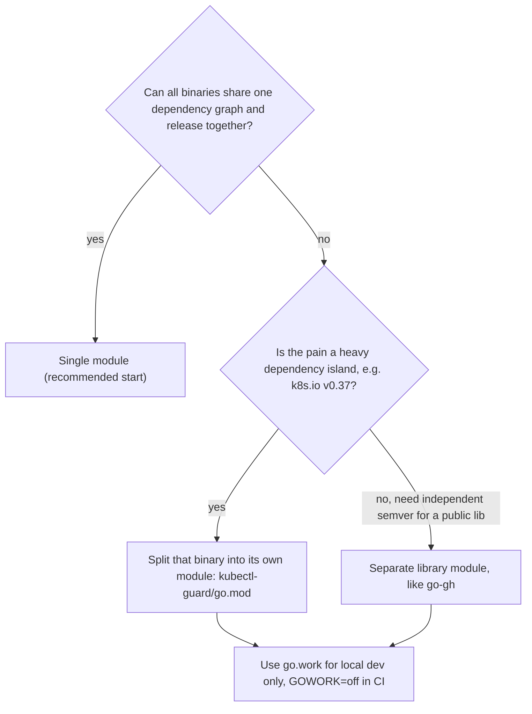
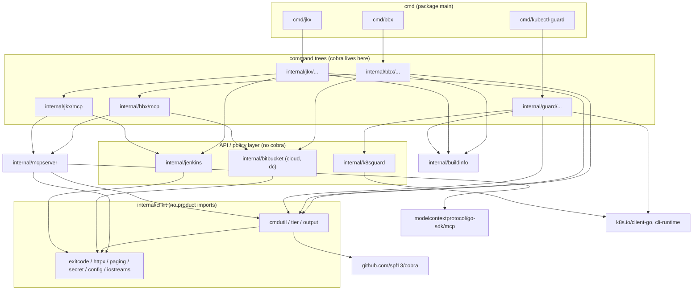
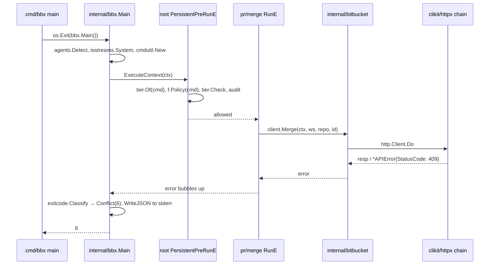

# 07 — Cấu trúc dự án Go: package, module, `internal/`, monorepo

> Phạm vi: package và module khác nhau thế nào, ý nghĩa `internal/`, `cmd/`, khi nào được dùng `pkg/`, hướng dẫn chính thức "Organizing a Go module" so với golang-standards/project-layout, single module vs multi-module vs `go.work`, quy tắc chiều phụ thuộc, quy ước đặt tên, cách `gh` tổ chức repo, và **cây thư mục cụ thể** cho dự án `bbx` / `jkx` / `kubectl-guard` + MCP.
>
> Phiên bản tham chiếu: Go **1.27.3** (go.dev/dl, 2026-11-09). Module path ví dụ trong cả handbook: `example.com/devx`.

## Tại sao quan trọng

Với một CLI nhỏ, cấu trúc thư mục là chuyện thẩm mỹ. Với dự án này thì không: **ba binary + một MCP server cùng dùng chung một lõi**, và lõi đó chứa các bất biến an toàn (tier gate, audit, exit code). Cấu trúc sai sẽ dẫn đến:

- **Gate bị bỏ qua**: một package API tự import `cobra` và tự đăng ký command, lách qua `PersistentPreRunE`.
- **Vòng import** (`import cycle not allowed`): Go cấm import vòng ở mức compile, và chỉ phát hiện khi đã viết xong nửa code.
- **Lộ API ngoài ý muốn**: thứ gì nằm ngoài `internal/` thì người khác có thể import, và từ đó bạn phải giữ tương thích.
- **Phụ thuộc lan**: `k8s.io/client-go` kéo hàng chục module. Nếu không cô lập thì `bbx` cũng phải "đi theo" mỗi lần nâng Kubernetes.

Go không có framework áp đặt layout. Compiler chỉ biết bốn khái niệm: **module**, **package**, **`internal/`** và **`main`**. Mọi thứ còn lại (`cmd/`, `pkg/`, `tools/`) là quy ước. Chương này giải thích bốn khái niệm đó rồi áp dụng vào dự án.

---

## 1. Package vs module

| Khái niệm | Là gì | Đơn vị của |
|---|---|---|
| **Package** | Một thư mục chứa các file `.go` có cùng mệnh đề `package x` | Biên dịch, phạm vi truy cập (exported/unexported), import |
| **Module** | Một cây thư mục có `go.mod` ở gốc, gồm nhiều package | Versioning, phát hành, quản lý dependency (MVS) |
| **Workspace** | File `go.work` gom nhiều module để phát triển local | Dev local, không phải phát hành |

Các quy tắc cốt lõi:

1. **Một thư mục = một package** (ngoại lệ duy nhất: package `x_test` cho black-box test nằm cùng thư mục).
2. **Import path = module path + đường dẫn thư mục**: package ở `internal/clikit/tier` của module `example.com/devx` có import path `example.com/devx/internal/clikit/tier`.
3. **Tên package nên trùng tên thư mục cuối** (`tier`). Compiler không bắt buộc, nhưng mọi tool và mọi người đọc đều giả định như vậy.
4. **Exported = viết hoa chữ đầu.** Không có `public/private/protected`. Biên giới "chỉ dùng nội bộ" ở mức nhiều package được thể hiện bằng `internal/`.
5. **Không có import vòng.** Nếu `A` import `B` thì `B` không được import `A`, kể cả gián tiếp.
6. **Major version ≥ 2 nằm trong path**: `github.com/cli/go-gh/v2`, `charm.land/lipgloss/v2`. `v1` và `v2` là hai module khác nhau và có thể cùng tồn tại trong một build.

```go
// go.mod
module example.com/devx

go 1.27

require (
	github.com/spf13/cobra v1.10.2
	github.com/itchyny/gojq v0.12.20
	github.com/zalando/go-keyring v0.2.8
	github.com/modelcontextprotocol/go-sdk v1.8.0
	golang.org/x/term v0.47.0
)
```

> `go 1.27` là phiên bản ngôn ngữ **tối thiểu**. Dòng `toolchain go1.27.3` (tùy chọn) chỉ định toolchain ưu tiên khi `GOTOOLCHAIN=auto`. `gh` dùng đúng cặp này: `go 1.27.0` + `toolchain go1.27.3`.

---

## 2. `internal/`: rào chắn duy nhất mà compiler kiểm tra

Quy tắc: package có path chứa phần tử `internal` chỉ được import bởi code nằm **trong cây có gốc là thư mục cha của `internal`**.

```text
example.com/devx/
├── internal/clikit/tier        ← import được từ mọi package trong example.com/devx/...
├── internal/bbx/internal/fmt   ← chỉ import được từ example.com/devx/internal/bbx/...
└── cmd/bbx                     ← import được internal/clikit/tier
```

Một module khác (`example.com/other`) import `example.com/devx/internal/clikit/tier` sẽ nhận lỗi compile:

```text
use of internal package example.com/devx/internal/clikit/tier not allowed
```

Hệ quả thực tế:

- **Mặc định hãy đặt mọi thứ vào `internal/`.** Bạn được tự do refactor, đổi tên, xóa mà không phá ai.
- Có thể **lồng `internal/`** để giới hạn hẹp hơn: `internal/bitbucket/internal/wire` chỉ có `internal/bitbucket/...` dùng được. Cách này hợp để giấu struct JSON thô của API.
- `internal/` **không** giấu được với chính module của bạn. Muốn cấm `internal/bitbucket` import `cobra` thì cần linter (mục 7).

---

## 3. `cmd/`: mỗi thư mục là một binary

Quy ước được dùng rộng rãi (gh, Kubernetes, go.dev) là: mỗi binary có một thư mục `cmd/<tên-binary>/` chứa `package main`. Tên thư mục chính là tên file thực thi mà `go build ./cmd/bbx` và `go install .../cmd/bbx@latest` tạo ra.

`main` phải **mỏng**. `gh` làm đúng như vậy:

```go
// cmd/gh/main.go (gh, nguyên văn)
package main

import (
	"os"

	"github.com/cli/cli/v2/internal/ghcmd"
)

func main() {
	code := ghcmd.Main()
	os.Exit(int(code))
}
```

Lý do: `package main` không import được, nên không test trực tiếp được. Đặt logic vào `internal/ghcmd` (`internal/bbx` ở dự án này) để test được hàm `Main() int`, và để `os.Exit` chỉ gọi **một lần** ở ngoài cùng, sau khi mọi `defer` đã chạy xong.

> Với kubectl plugin, tên binary **bắt buộc** có dạng `kubectl-<name>`. Thư mục phải là `cmd/kubectl-guard/` để `go build` sinh đúng tên. kubectl chuyển `_` trong tên file thành `-` trong lệnh: `kubectl-foo_bar` → `kubectl foo-bar`.

---

## 4. `pkg/`: khi nào được dùng

`pkg/` **không có ý nghĩa gì với compiler**. Nó chỉ là tín hiệu cho người đọc rằng "đây là code mà module khác được phép import".

| Tình huống | Khuyến nghị |
|---|---|
| Ứng dụng/CLI, không có người dùng ngoài import code | **Không dùng `pkg/`**. Dùng `internal/`. |
| Cần cho bên thứ ba viết extension/plugin bằng Go | Tạo **module riêng** (như `github.com/cli/go-gh/v2`), có semver và cam kết tương thích |
| Repo lớn, lịch sử đã có `pkg/` (Kubernetes, gh) | Giữ nguyên, nhưng ghi rõ "không phải API ổn định" |

`gh` là ví dụ để học: `pkg/cmd/...`, `pkg/cmdutil`, `pkg/iostreams` về kỹ thuật thì ai cũng import được, nhưng **API công khai thật sự** lại là module tách riêng `github.com/cli/go-gh/v2` (v2.17.0, 2026-10-20). Bài học: đặt code dưới `pkg/` không biến nó thành thư viện ổn định. Ổn định đến từ một module riêng có versioning.

---

## 5. Hướng dẫn chính thức vs golang-standards/project-layout

### 5.1 "Organizing a Go module" (go.dev/doc/modules/layout)

Tài liệu chính thức mô tả các bố cục theo mức độ tăng dần:

1. **Package cơ bản**: mọi file ở thư mục gốc.
2. **Lệnh cơ bản**: `main.go` ở gốc.
3. **Package/lệnh kèm package hỗ trợ**: thêm `internal/`.
4. **Nhiều package**: thư mục con, phần nội bộ đặt dưới `internal/`.
5. **Nhiều lệnh**: `cmd/<name>/`.
6. **Package và lệnh trong cùng repo**: package công khai ở gốc hoặc thư mục con, lệnh ở `cmd/`, phần nội bộ ở `internal/`.
7. **Server project**: gần như toàn bộ nằm trong `internal/`, binary nằm ở `cmd/`.

Tài liệu không nhắc đến `pkg/`, `src/`, `api/` hay `web/`. Thông điệp chính: **bắt đầu đơn giản, chỉ thêm cấu trúc khi có nhu cầu.**

### 5.2 golang-standards/project-layout và tranh cãi quanh nó

Repo `golang-standards/project-layout` có rất nhiều sao và hay bị hiểu nhầm là "chuẩn của Go". Nó **không phải**:

- Tên tổ chức `golang-standards` không liên quan đến Go team. Russ Cox đã mở issue #117 ("this is not a standard Go project layout") giải thích rằng thứ duy nhất mang tính chuẩn là `cmd/` và `internal/`, trong đó `internal/` được compiler cưỡng chế.
- README của chính repo đó cũng đã ghi "this is NOT an official standard defined by the core Go dev team".
- Các thư mục như `/pkg`, `/api`, `/web`, `/configs`, `/init`, `/build`, `/deployments`, `/assets`, `/vendor` (thủ công) phần lớn là **thừa** đối với CLI. Chúng khiến người mới dựng 15 thư mục rỗng trước khi viết dòng code đầu tiên.

Cách tiếp cận thực dụng là học **cấu trúc của các CLI thật đang chạy tốt** (gh, kubectl, goreleaser) và tuân theo tài liệu go.dev.

| Thư mục | go.dev | project-layout | Dự án này |
|---|---|---|---|
| `cmd/` | Có | Có | **Có**: 3 binary |
| `internal/` | Có (compiler cưỡng chế) | Có | **Có**: gần như toàn bộ code |
| `pkg/` | Không nhắc | Có | **Không** |
| `api/` (OpenAPI spec) | Không | Có | Không. Spec để trong `internal/<api>/testdata` nếu cần |
| `tools/` | Không | Có (nghĩa khác) | **Có**: chương trình dev do mình viết |
| `test/`, `acceptance/` | Không | `test/` | **Có**: `acceptance/` cho testscript |
| `docs/` | Không | Có | Có (doc sinh tự động + handbook) |

---

## 6. Single module, multi-module hay `go.work`

### 6.1 Ba lựa chọn



**Single module** (một `go.mod` ở gốc):

- `go test ./...`, `go vet ./...`, `golangci-lint run` chạy trên toàn bộ.
- Refactor `clikit` và sửa mọi caller trong **một commit**, không cần tag hay `replace`.
- Release: một tag `v1.4.0` cho cả ba binary. goreleaser build nhiều `builds:` từ cùng module.
- Nhược điểm: **chung một đồ thị MVS**. Go chọn phiên bản cao nhất mà bất kỳ module nào yêu cầu (Minimal Version Selection), nên khi `k8s.io/client-go v0.37.2` đòi `golang.org/x/net` mới hơn, `bbx` cũng phải dùng bản đó.

> Binary size **không** bị ảnh hưởng: linker chỉ link những package thực sự được import từ `cmd/bbx`. Thứ bị ảnh hưởng là `go.mod`/`go.sum`, thời gian `go mod download`, bề mặt `govulncheck` (báo theo symbol thực sự được gọi, nên vẫn chính xác) và tần suất phải nâng phiên bản.

**Multi-module** (nhiều `go.mod`):

```text
devx/
├── go.mod                    # example.com/devx: clikit, bbx, jkx
└── kubectl-guard/
    └── go.mod                # example.com/devx/kubectl-guard: requires example.com/devx
```

- Phải tag theo **prefix thư mục**: `kubectl-guard/v1.4.0`.
- Module con phụ thuộc module gốc **theo version**, nên mỗi lần đổi `clikit` lại phải tag gốc rồi bump con. Nếu không, bạn sẽ phải dùng `replace example.com/devx => ../`, và `replace` không có tác dụng khi người khác `go install`.
- Chỉ đáng làm khi đau thật: k8s ép nâng phiên bản liên tục, hoặc một module cần chu kỳ release riêng.

**`go.work`** (Go ≥ 1.18):

```bash
go work init . ./kubectl-guard   # creates go.work listing both modules
go work sync                     # pushes workspace versions back into each go.mod
GOWORK=off go test ./...         # what CI must run: test each module as released
```

- Dùng cho **dev local** khi có nhiều module, để không phải viết `replace`.
- Thường **không commit** `go.work` và `go.work.sum` (thêm vào `.gitignore`). Nếu có commit thì CI vẫn phải chạy thêm với `GOWORK=off` để chắc từng module build được độc lập.

### 6.2 Khuyến nghị cho dự án này

1. **Bắt đầu với single module** `example.com/devx`.
2. Cô lập k8s **bằng package**: chỉ `internal/k8sguard` và `internal/guard` được import `k8s.io/...`, và lint chặn mọi chỗ khác.
3. Chỉ tách `kubectl-guard/go.mod` khi việc nâng k8s bắt đầu chặn release của `bbx`/`jkx`. Nhờ bước 2, việc tách lúc đó chỉ là chuyển thư mục.

### 6.3 Dev tool: directive `tool` thay cho `tools.go`

Từ Go 1.24, `go.mod` có directive `tool`, nên **không cần** hack `tools.go` với `//go:build tools` nữa. Để dependency của linter không làm bẩn `go.mod` chính, hãy dùng file modfile riêng:

```bash
# Pin tools in a separate modfile so their deps never enter the main go.mod
go mod init -modfile=tools.mod example.com/devx/tools
go get -tool -modfile=tools.mod golang.org/x/vuln/cmd/govulncheck@v1.9.0
go get -tool -modfile=tools.mod github.com/goreleaser/goreleaser/v2@v2.20.0

go tool -modfile=tools.mod govulncheck ./...
```

> golangci-lint khuyến nghị cài **binary release** (hoặc dùng GitHub Action chính thức) thay vì build từ source qua `go tool`/`go install`, vì build từ source chịu ảnh hưởng của dependency và phiên bản Go. Pin `v2.15.0` trong CI.

---

## 7. Quy tắc chiều phụ thuộc

Đây là phần quan trọng nhất của chương. Mũi tên chỉ đi **từ ngoài vào trong**, từ cụ thể sang trừu tượng:

```text
cmd/<bin>  →  internal/<bin> (cobra tree)  →  internal/clikit/*  →  stdlib + few libs
                     │                              ▲
                     └──→  internal/<api> (bitbucket, jenkins, k8sguard)  ─┘ (only paging/exitcode-free)
```

| Package | Được import | **Không được** import |
|---|---|---|
| `cmd/*` | `internal/<bin>` | mọi thứ khác (giữ main 3 dòng) |
| `internal/bbx/...` (command tree) | `clikit/*`, `internal/bitbucket`, cobra | `internal/jenkins`, `internal/jkx` |
| `internal/bitbucket`, `internal/jenkins` (API) | stdlib, `clikit/paging` | **cobra, pflag, `clikit/iostreams`, `clikit/output`, `clikit/tier`**, `os.Exit`, `fmt.Print*` |
| `internal/k8sguard` (policy) | client-go, apimachinery | cobra, cli-runtime (cli-runtime chỉ ở `internal/guard`) |
| `internal/clikit/*` | stdlib, cobra (chỉ `cmdutil`, `tier`, `output`), gojq, keyring | **bất kỳ package sản phẩm nào** (`bitbucket`, `bbx`...) |
| `internal/mcpserver` | `clikit/tier`, `clikit/exitcode`, `go-sdk/mcp` | cobra (MCP không chạy qua cobra) |

Vì sao API package **không được** import cobra hay iostreams:

1. **Tái sử dụng**: MCP server gọi `bitbucket.Client.MergePullRequest` trực tiếp, không qua cobra. Nếu API package in ra stdout thì sẽ làm hỏng giao thức stdio của MCP, vốn dùng stdout cho JSON-RPC.
2. **Testability**: API package test bằng `httptest` thuần, không cần dựng command tree.
3. **Gate không bị bypass**: chỉ command tree mới tạo được `*cobra.Command`, và mọi `*cobra.Command` đều đi qua root `PersistentPreRunE`.
4. **Lỗi mang dữ liệu, không mang exit code**: API trả `*bitbucket.APIError` có method `StatusCode() int`. `clikit/exitcode.Classify` nhận diện lỗi qua interface, nên `bitbucket` không cần import `exitcode`.

### 7.1 Cưỡng chế bằng golangci-lint v2 (depguard)

```yaml
# .golangci.yml
version: "2"
linters:
  enable:
    - depguard
  settings:
    depguard:
      rules:
        api-layer-is-cli-free:
          files:
            - "**/internal/bitbucket/**"
            - "**/internal/jenkins/**"
            - "**/internal/k8sguard/**"
          deny:
            - pkg: "github.com/spf13/cobra"
              desc: "API packages must not depend on the CLI framework"
            - pkg: "github.com/spf13/pflag"
              desc: "API packages must not parse flags"
            - pkg: "example.com/devx/internal/clikit/iostreams"
              desc: "API packages return data; commands render it"
            - pkg: "example.com/devx/internal/clikit/tier"
              desc: "tier is enforced at the command/MCP boundary"
        clikit-is-product-free:
          files:
            - "**/internal/clikit/**"
          deny:
            - pkg: "example.com/devx/internal/bitbucket"
              desc: "clikit must not know about products"
            - pkg: "example.com/devx/internal/jenkins"
              desc: "clikit must not know about products"
            - pkg: "k8s.io"
              desc: "keep the k8s dependency island inside internal/k8sguard and internal/guard"
```

### 7.2 Cưỡng chế bằng test (không cần linter)

```go
// internal/archtest/deps_test.go
package archtest

import (
	"os/exec"
	"strings"
	"testing"
)

// TestAPILayerDoesNotImportCobra uses `go list -deps` so transitive imports count too.
func TestAPILayerDoesNotImportCobra(t *testing.T) {
	for _, pkg := range []string{
		"example.com/devx/internal/bitbucket/...",
		"example.com/devx/internal/jenkins/...",
	} {
		out, err := exec.Command("go", "list", "-deps", pkg).CombinedOutput()
		if err != nil {
			t.Fatalf("go list %s: %v\n%s", pkg, err, out)
		}
		for _, dep := range strings.Fields(string(out)) {
			if strings.HasPrefix(dep, "github.com/spf13/cobra") {
				t.Errorf("%s transitively imports %s", pkg, dep)
			}
		}
	}
}
```

`depguard` chỉ chặn import trực tiếp, còn test này bắt cả import gián tiếp. Nên dùng cả hai.

---

## 8. Quy ước đặt tên

| Đối tượng | Quy ước | Ví dụ tốt | Tránh |
|---|---|---|---|
| Package | ngắn, chữ thường, một từ, không `_` | `tier`, `httpx`, `paging` | `tier_gate`, `TierGate`, `utils`, `common`, `helpers`, `models` |
| Tránh lặp tên (stutter) | caller đọc `pkg.Name` | `bitbucket.Client`, `tier.Check` | `bitbucket.BitbucketClient`, `tier.TierCheck` |
| Constructor | `New`, `NewXxx` | `cmdutil.New`, `view.NewCmdView` | `CreateNewViewCommand` |
| Interface 1 method | `-er` | `Exporter`, `Fetcher` | `IExporter`, `ExporterInterface` |
| File | `snake_case.go`, hậu tố platform | `json_flags.go`, `console_windows.go` | `jsonFlags.go` |
| Test | `x_test.go`; black-box: `package x_test` | `view_test.go` | |
| Testdata | thư mục `testdata/` (go tool bỏ qua) | `testdata/pr_view.golden` | `fixtures/` lẫn với code |
| Command package | theo `noun/verb` như gh | `internal/bbx/pr/merge` | `internal/bbx/prmerge` |
| Import alias | khi trùng tên | `prCmd "…/pr"`, `viewCmd "…/pr/view"` | alias vô cớ |
| Viết tắt | giữ hoa nguyên khối | `HTTPClient`, `URL`, `ID`, `JSON` | `HttpClient`, `Url`, `Id` |

> `gh` có `Factory.HttpClient` (không theo initialism). Đây là di sản lịch sử. Code mới nên viết `HTTPClient`. Handbook giữ `HttpClient` trong ví dụ Factory để dễ đối chiếu với `gh`.

Thư mục bỏ qua: Go tool bỏ qua thư mục bắt đầu bằng `.` hoặc `_` và thư mục tên `testdata`. Hãy dùng `testdata/` cho golden file và txtar.

---

## 9. `gh` tổ chức repo ra sao

Kết quả khảo sát từ `/tmp/ghcli-analysis/repo` (module `github.com/cli/cli/v2`):

```text
cli/cli/
├── cmd/
│   ├── gh/main.go              # 3 lines: os.Exit(int(ghcmd.Main()))
│   └── gen-docs/main.go        # man pages + markdown from the cobra tree
├── internal/
│   ├── ghcmd/cmd.go            # Main(): config, iostreams, factory, Execute, error → exit code
│   ├── agents/detect.go        # AI agent detection from env vars
│   ├── build/build.go          # Version/Date set by -ldflags
│   ├── config/  keyring/  authflow/  prompter/  browser/  tableprinter/  text/ ...
├── pkg/
│   ├── cmd/
│   │   ├── root/root.go        # NewCmdRoot: groups, PersistentPreRunE auth check
│   │   ├── factory/default.go  # factory.New: wires lazy funcs
│   │   └── pr/view/view.go     # one package per verb: Options + NewCmdView(f, runF) + viewRun
│   ├── cmdutil/                # Factory struct, json_flags.go (Exporter), errors, auth_check
│   ├── iostreams/              # TTY, color, pager, spinner; Test() buffers
│   └── httpmock/               # Registry RoundTripper for tests
├── api/                        # GitHub API client + http_client.go (transport chain)
├── git/  context/  utils/      # historical top-level packages
├── acceptance/                 # testscript-based end-to-end tests
├── script/build.go             # builds with -ldflags -X internal/build.Version=...
└── skills/                     # agent skills shipped with gh
```

Những điểm nên học:

- **`cmd/` mỏng, `internal/ghcmd` dày**, và exit code được map ở **đúng một chỗ** (`ghcmd.Main`).
- **Một package cho mỗi động từ** (`pkg/cmd/pr/view`). Mỗi package có `Options`, `NewCmdXxx(f, runF)`, `xxxRun(opts)`. Test nằm cạnh đó, nên thêm lệnh mới không đụng chạm lệnh cũ.
- **`cmdutil.Factory` là "container" DI** nhận các hàm lazy, được nối dây ở `pkg/cmd/factory/default.go`, tách khỏi định nghĩa struct để tránh import vòng.
- **`api/` là tầng API**, test bằng `pkg/httpmock`.

Những điểm **không nên** chép:

- `pkg/` cho code không có ý định công khai, và các package top-level (`git/`, `context/`, `utils/`) là kết quả lịch sử của một repo đã 6 năm tuổi.
- `api/` trong `gh` import `internal/gh/ghtelemetry`, tức là tầng API biết về telemetry. Với dự án này, hãy giữ tầng API thuần hơn.

---

## 10. Cây thư mục đề xuất cho dự án

```text
devx/                                   # module example.com/devx (single go.mod)
├── go.mod  go.sum                      # go 1.27; toolchain go1.27.3
├── tools.mod  tools.sum                # `tool` directives: govulncheck, goreleaser (pinned)
├── cmd/
│   ├── bbx/main.go                     # func main() { os.Exit(bbx.Main()) }
│   ├── jkx/main.go
│   └── kubectl-guard/main.go           # binary name = kubectl plugin name
├── internal/
│   ├── buildinfo/                      # Version, Commit, Date (-ldflags -X)
│   ├── clikit/                         # SHARED CORE: knows CLIs, not products
│   │   ├── agents/                     # Detect(): AI_AGENT, CLAUDECODE, CODEX_*, ...
│   │   ├── audit/                      # append-only JSONL audit of WRITE+ calls
│   │   ├── cmdutil/                    # Factory (lazy funcs), UsageArgs, AddDryRunFlag
│   │   ├── config/                     # profiles (host, kind, max_tier), XDG paths
│   │   ├── exitcode/                   # Code 0..8, *Error, Classify, WriteJSON
│   │   ├── httpx/                      # RoundTripper chain: UA, retry, auth, debug
│   │   ├── iostreams/                  # TTY, NO_COLOR, pager, spinner, Test()
│   │   ├── output/                     # --json/--jq/--template exporter, tables
│   │   ├── paging/                     # iter.Seq2 for Bitbucket Cloud/DC, Jenkins
│   │   ├── prompt/                     # confirm/select; refuses when !CanPrompt
│   │   ├── secret/                     # env token → OS keyring
│   │   ├── tier/                       # READ/WRITE/DESTRUCTIVE/ADMIN, gate, manifest
│   │   └── clitest/                    # httpmock Registry, golden helpers (test-only)
│   ├── bitbucket/                      # API LAYER (no cobra, no stdout)
│   │   ├── bitbucket.go                # domain types + Client interface + APIError
│   │   ├── cloud/                      # api.bitbucket.org/2.0, "next" paging
│   │   └── dc/                         # /rest/api/1.0, start/limit paging
│   ├── jenkins/                        # API LAYER: crumb, queue item → build, logs
│   ├── k8sguard/                       # POLICY LAYER over client-go (no cobra)
│   ├── mcpserver/                      # generic MCP adapter: tier→annotations, gated()
│   ├── bbx/                            # bbx COMMAND TREE
│   │   ├── main.go                     # Main() int: factory, ExecuteContext, exit codes
│   │   ├── root/                       # NewCmdRoot, groups, --profile/--yes, gate hook
│   │   ├── auth/{login,logout,status}/
│   │   ├── pr/{list,view,create,merge,decline}/
│   │   ├── pipeline/{list,run,logs}/
│   │   └── mcp/                        # `bbx mcp serve`: registers bbx tools on mcpserver
│   ├── jkx/                            # same shape: root/, job/, build/, queue/, mcp/
│   ├── guard/                          # kubectl-guard tree on k8s.io/cli-runtime flags
│   └── archtest/                       # dependency-direction tests (go list -deps)
├── tools/                              # OUR dev programs (package main, same module)
│   ├── gen-docs/                       # man pages + markdown for each binary
│   └── gen-manifest/                   # commands.json per binary; CI diffs it
├── acceptance/                         # testscript suites (build tag: acceptance)
│   └── testdata/{bbx,jkx,guard}/*.txtar
├── skills/                             # agent skills shipped in release archives
│   ├── skills.go                       # package skills: //go:embed */SKILL.md → var FS
│   ├── bbx/SKILL.md
│   ├── jkx/SKILL.md
│   └── kubectl-guard/SKILL.md
├── docs/                               # generated reference + this handbook
├── .github/workflows/{ci,release}.yml
├── .golangci.yml                       # v2 config incl. depguard rules (section 7.1)
├── .goreleaser.yaml                    # 3 builds, archives, checksums, cosign v3 bundle
└── Makefile                            # build, test, lint, docs, manifest
```

### 10.1 Giải thích từng thư mục

- **`cmd/<bin>/`**: chỉ có `main()`. `go install example.com/devx/cmd/bbx@v1.4.0` hoạt động nhờ cấu trúc này (xem chương 11 về version khi không có ldflags).
- **`internal/buildinfo/`**: nằm ngoài `clikit` vì goreleaser và Makefile tham chiếu path cố định `example.com/devx/internal/buildinfo.Version`. Path đó không nên đổi khi refactor `clikit`.
- **`internal/clikit/`**: tương ứng với `pkg/cmdutil` + `pkg/iostreams` + `api/http_client.go` của gh, gộp lại và tách theo trách nhiệm. Chương 10 gọi khối này là "shared core (`pkg/core`)". Trong cây này, nó là `internal/clikit` cộng với registry trong `tier`. Không đặt dưới `pkg/` vì không có người dùng ngoài.
  - Chỉ `cmdutil`, `tier`, `output` được import cobra. `exitcode`, `httpx`, `paging`, `secret`, `config` dùng stdlib (và keyring), nên MCP server dùng lại được mà không kéo cobra theo.
  - `clitest/` là package thường (không phải `_test.go`) để test của mọi package dùng chung được. Chỉ test import nó, và có thể kiểm bằng archtest.
- **`internal/bitbucket/`**: interface chung `bitbucket.Client` với hai implementation `cloud` và `dc`. Command chọn implementation theo `profile.Kind`. Các struct JSON thô (`links.html.href`...) được map sang domain type ngay trong tầng này.
- **`internal/jenkins/`**: xử lý CSRF crumb, `Location` header của queue item, poll để lấy build number. Trả `exitcode.Pending` (qua lỗi có `StatusCode()==202` hoặc một sentinel) khi build còn trong hàng đợi.
- **`internal/k8sguard/`**: logic "lệnh nào nguy hiểm trên namespace nào" dựa trên client-go/apimachinery. Không biết gì về flag hay terminal.
- **`internal/guard/`**: cobra tree cho `kubectl-guard`, dùng `genericclioptions.ConfigFlags` của cli-runtime để có sẵn `--kubeconfig`, `--context`, `-n` giống kubectl.
- **`internal/mcpserver/`**: adapter chung. Mỗi binary có `internal/<bin>/mcp` khai báo tool **theo workflow**, tái dùng API layer và cùng tier policy (chi tiết ở chương 10).
- **`tools/`**: chương trình **do mình viết** để sinh artifact (man page, manifest). Tool bên thứ ba thì pin trong `tools.mod`, không đặt ở đây.
- **`acceptance/`**: testscript chạy binary thật như cách agent sẽ gọi (chương 06).
- **`skills/`**: SKILL.md hướng dẫn agent dùng `bbx --json`, các exit code và tier. goreleaser đóng gói chúng vào archive (`gh` cũng có `skills/`).

### 10.2 Đồ thị import



> `BB --> EX` ở đây chỉ gồm `clikit/paging` (iterator thuần stdlib). `bitbucket` **không** import `exitcode`, `iostreams` hay `tier`. Vì `MS --> CU` chỉ cần `tier` (để map tier sang annotations), có thể tách `tier` thành hai phần, `tier` (types, Check) và `tier/cobratier` (Set/Of trên `*cobra.Command`), nếu muốn `mcpserver` hoàn toàn không kéo cobra theo.

### 10.3 Vòng đời một lệnh qua các tầng



---

## 11. Thêm một lệnh mới (ví dụ `bbx pr merge`)

1. Tạo `internal/bbx/pr/merge/merge.go` với `Options`, `NewCmdMerge(f, runF)`, `run(ctx, opts)`.
2. Gắn `tier.Set(cmd, tier.Destructive)` và `cmdutil.AddDryRunFlag`.
3. Thêm method `Merge` vào `bitbucket.Client` (cả `cloud` và `dc`). API layer test bằng `httptest`.
4. Đăng ký trong `internal/bbx/pr/pr.go`: `cmd.AddCommand(merge.NewCmdMerge(f, nil))`.
5. Chạy `go test ./internal/bbx/...`. `TestEveryCommandHasTier` sẽ fail nếu quên bước 2.
6. Chạy `go run ./tools/gen-manifest`. CI so sánh `commands.json` để reviewer thấy ngay "có thêm một lệnh DESTRUCTIVE".
7. Nếu muốn agent dùng qua MCP: thêm tool trong `internal/bbx/mcp`, dùng cùng `bitbucket.Client.Merge`.

---

## Lỗi thường gặp

1. **Đặt mọi thứ vào `pkg/` "cho chuyên nghiệp"**: mất sự bảo vệ của `internal/` mà không thu được lợi ích gì.
2. **`utils/`, `common/`, `helpers/`**: package không có trách nhiệm rõ ràng sẽ hút mọi thứ vào và trở thành tâm của vòng import. Hãy đặt tên theo việc nó làm: `paging`, `httpx`, `redact`.
3. **API package in ra stdout hoặc gọi `os.Exit`**: làm hỏng MCP stdio, và làm `defer` (flush audit log, dừng pager) không chạy.
4. **Import vòng giữa `cmdutil` và `factory`**: gh tách struct `Factory` (`pkg/cmdutil`) khỏi phần nối dây (`pkg/cmd/factory`) chính vì lý do này. Struct đặt ở package thấp, wiring đặt ở package cao.
5. **Chia multi-module quá sớm**: phải tag theo prefix, phải `replace`, CI phức tạp gấp đôi, trong khi chưa có lợi ích nào.
6. **Commit `go.work` rồi CI chỉ chạy trong workspace**: build qua được trên CI nhưng `go install` của người dùng lại fail. CI luôn phải chạy thêm `GOWORK=off`.
7. **Dùng `tools.go` + `//go:build tools`** trên Go ≥ 1.24: thay bằng `tool` directive (nên dùng modfile riêng).
8. **Tên binary không khớp tên thư mục**: `cmd/guard/` sinh ra binary `guard`, kubectl không nhận làm plugin. Phải là `cmd/kubectl-guard/`.
9. **Stutter**: `bitbucket.BitbucketPullRequest`. Caller đã có prefix `bitbucket.` rồi.
10. **Lẫn `k8s.io/...` vào `clikit`**: kéo cả hệ k8s vào `bbx`/`jkx`. depguard rule `clikit-is-product-free` chặn lỗi này.
11. **Đổi path `internal/buildinfo`** mà quên sửa `-ldflags -X`: linker **không báo lỗi**, version âm thầm thành `DEV`.

---

## Checklist

- [ ] Một `go.mod` ở gốc, `go 1.27`, module path ổn định (`example.com/devx`).
- [ ] `cmd/{bbx,jkx,kubectl-guard}/main.go`, mỗi file ≤ 10 dòng, `os.Exit` chỉ xuất hiện ở đây.
- [ ] Toàn bộ code còn lại nằm dưới `internal/`. Không có `pkg/`.
- [ ] `internal/clikit` không import package sản phẩm hay `k8s.io/...` (depguard).
- [ ] `internal/bitbucket`, `internal/jenkins`, `internal/k8sguard` không import cobra/pflag/iostreams/tier (depguard + `archtest`).
- [ ] Mỗi command là một package `noun/verb` với `Options` + `NewCmdXxx(f, runF)` + `run`.
- [ ] Dev tool bên thứ ba được pin bằng `tool` directive trong `tools.mod`. Không có `tools.go`.
- [ ] `go.work` (nếu có) nằm trong `.gitignore`. CI chạy `GOWORK=off`.
- [ ] `tools/gen-manifest` sinh `commands.json`, CI diff file này.
- [ ] `skills/<bin>/SKILL.md` được goreleaser đóng gói kèm binary.
- [ ] Tên package ngắn, không stutter, initialism viết hoa (`HTTPClient`, `ID`).

---

## Tài liệu tham khảo

- Organizing a Go module: https://go.dev/doc/modules/layout
- Go Modules Reference (MVS, `tool`, `go.work`): https://go.dev/ref/mod
- Internal packages (Go 1.4 design): https://go.dev/s/go14internal
- Tutorial: multi-module workspaces: https://go.dev/doc/tutorial/workspaces
- Go 1.24 release notes (tool directives): https://go.dev/doc/go1.24#tools
- Effective Go — Names: https://go.dev/doc/effective_go#names
- Go Code Review Comments (initialisms, package names): https://go.dev/wiki/CodeReviewComments
- Package names (Go blog): https://go.dev/blog/package-names
- golang-standards/project-layout và issue #117 của Russ Cox: https://github.com/golang-standards/project-layout/issues/117
- gh CLI source: https://github.com/cli/cli (`cmd/gh`, `internal/ghcmd`, `pkg/cmd`, `pkg/cmdutil`)
- go-gh (thư viện công khai tách module): https://github.com/cli/go-gh
- kubectl plugins (naming): https://kubernetes.io/docs/tasks/extend-kubectl/kubectl-plugins/
- golangci-lint depguard: https://golangci-lint.run/docs/linters/configuration/#depguard
- Chương liên quan: [06 — Testing](06-testing-quality.md), [08 — Xây dựng CLI](08-building-cli-tools.md), [10 — MCP server](10-mcp-server-go.md), [11 — Build & release](11-build-release-ship.md)
