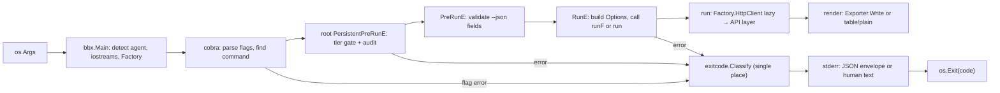
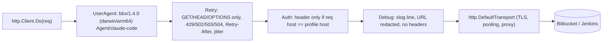
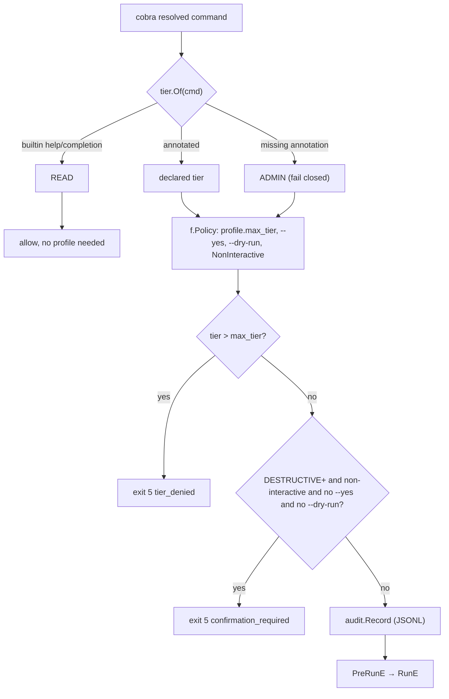

# 08 — Xây dựng CLI kiểu `gh` từng bước

> Phạm vi: cobra root/subcommand/group, flag (pflag), Factory với hàm lazy, pattern `Options` + `runF` + `run`, iostreams (TTY, `NO_COLOR`, pager, spinner tắt khi có agent), exporter `--json/--jq/--template`, config + keyring profile, HTTP client với chuỗi `RoundTripper` (auth theo host, User-Agent kèm agent, retry/429, debug log có redaction), pagination Bitbucket Cloud/DC, typed error → exit code ở **một chỗ**, tier gate (Annotations + `PersistentPreRunE` + `commands --json` + test duyệt cây lệnh), quy tắc `--dry-run`/`--yes`, phát hiện agent, completion và man page, version qua ldflags.
>
> Phiên bản: Go 1.27.3, cobra v1.10.2, pflag v1.1.0, gojq v0.12.20, go-keyring v0.2.8, x/term v0.47.0. **Các skeleton trong chương này đã được `go vet` + `go test` với Go 1.27.3** trong một module thử nghiệm `example.com/devx` (cấu trúc theo [chương 07](07-project-structure.md)). Một số đoạn được rút gọn phần import.

## Tại sao quan trọng

Người dùng chính của `bbx`/`jkx`/`kubectl-guard` là **agent**, con người chỉ là người dùng thứ hai. Agent không đọc màn hình. Nó đọc **hợp đồng**:

| Hợp đồng | Vì sao agent cần |
|---|---|
| stdout chỉ chứa dữ liệu (`--json`), không màu, không spinner, không pager | parse được, không bị treo chờ `less` |
| stderr chứa lỗi dạng JSON `{"error":{"code","kind","message","hint","retryable"}}` | quyết định retry, hỏi người hay đổi tham số |
| exit code ổn định: 0 ok, 1 lỗi, 2 usage, 3 not found, 4 auth, 5 tier bị từ chối, 6 conflict, 7 transient, 8 pending | rẽ nhánh mà không phải parse văn bản |
| mỗi lệnh có tier READ/WRITE/DESTRUCTIVE/ADMIN, xuất qua `commands --json` | biết trước lệnh nào an toàn |
| `--dry-run` cho mọi lệnh ghi, `--yes` bắt buộc cho lệnh phá hủy khi không có TTY | không bao giờ "lỡ tay" |

`gh` đã giải quyết phần lớn các bài toán này. Chương này đi lại con đường đó và bổ sung tier gate cùng JSON error.



---

## Bước 0: Khởi tạo

```bash
mkdir devx && cd devx
go mod init example.com/devx
go get github.com/spf13/cobra@v1.10.2 github.com/itchyny/gojq@v0.12.20 \
       github.com/zalando/go-keyring@v0.2.8 golang.org/x/term@v0.47.0
```

Các file chính trong chương này:

```text
cmd/bbx/main.go
internal/buildinfo/buildinfo.go
internal/bbx/main.go                      # Main() int
internal/bbx/root/root.go                 # NewCmdRoot + gate + commands --json
internal/bbx/pr/view/view.go              # Options + runF + run
internal/bitbucket/bitbucket.go           # API layer
internal/clikit/{exitcode,tier,iostreams,cmdutil,config,secret,httpx,paging,output,agents}/
```

---

## Bước 1: Exit code và typed error, map ở đúng một chỗ

Định nghĩa hợp đồng **trước tiên**, vì mọi tầng khác đều trả lỗi theo nó.

```go
// internal/clikit/exitcode/exitcode.go
package exitcode

import (
	"context"
	"encoding/json"
	"errors"
	"fmt"
	"io"
	"net"
	"net/http"
)

type Code int

const (
	OK        Code = 0
	Failure   Code = 1 // generic error
	Usage     Code = 2 // bad flags / args / unknown command
	NotFound  Code = 3
	Auth      Code = 4 // missing or invalid credentials
	Denied    Code = 5 // permission tier gate or HTTP 403
	Conflict  Code = 6 // HTTP 409/412, merge conflict, stale version
	Transient Code = 7 // 429, 5xx, timeouts: safe to retry later
	Pending   Code = 8 // operation accepted but not finished (queued build)
)

// Error is the typed error every layer may return. Kind is a stable,
// machine-readable identifier that agents can branch on.
type Error struct {
	Code    Code
	Kind    string
	Message string
	Hint    string
	Err     error
}

func (e *Error) Error() string {
	if e.Err != nil && e.Message == "" {
		return e.Err.Error()
	}
	return e.Message
}

func (e *Error) Unwrap() error { return e.Err }

func New(code Code, kind, msg string) *Error {
	return &Error{Code: code, Kind: kind, Message: msg}
}

// Usagef builds a usage error (exit 2).
func Usagef(format string, a ...any) *Error {
	return &Error{Code: Usage, Kind: "usage", Message: fmt.Sprintf(format, a...)}
}

// statusError is implemented by API-layer errors (e.g. bitbucket.APIError)
// without those packages importing exitcode.
type statusError interface {
	error
	StatusCode() int
}

// FromHTTPStatus maps an HTTP status to an exit code.
func FromHTTPStatus(status int) Code {
	switch {
	case status == http.StatusUnauthorized:
		return Auth
	case status == http.StatusForbidden:
		return Denied
	case status == http.StatusNotFound:
		return NotFound
	case status == http.StatusConflict, status == http.StatusPreconditionFailed:
		return Conflict
	case status == http.StatusTooManyRequests, status >= 500:
		return Transient
	case status == http.StatusAccepted:
		return Pending
	case status >= 400:
		return Failure
	}
	return OK
}

// Classify turns any error into *Error. Call it once, in main.
func Classify(err error) *Error {
	if err == nil {
		return nil
	}
	if e, ok := errors.AsType[*Error](err); ok {
		return e
	}
	if se, ok := errors.AsType[statusError](err); ok {
		code := FromHTTPStatus(se.StatusCode())
		return &Error{Code: code, Kind: kindOf(code), Message: se.Error(), Err: err}
	}
	if errors.Is(err, context.DeadlineExceeded) {
		return &Error{Code: Transient, Kind: "timeout", Message: err.Error(), Err: err}
	}
	if ne, ok := errors.AsType[net.Error](err); ok && ne.Timeout() {
		return &Error{Code: Transient, Kind: "timeout", Message: err.Error(), Err: err}
	}
	if errors.Is(err, context.Canceled) {
		return &Error{Code: Failure, Kind: "canceled", Message: "operation canceled", Err: err}
	}
	return &Error{Code: Failure, Kind: "error", Message: err.Error(), Err: err}
}

// kindOf maps Code → "usage" | "not_found" | "auth" | "denied" | ... (plain switch, omitted)

// WriteJSON writes the stable error envelope to w (stderr).
func WriteJSON(w io.Writer, e *Error) error {
	type body struct {
		Code      int    `json:"code"`
		Kind      string `json:"kind"`
		Message   string `json:"message"`
		Hint      string `json:"hint,omitempty"`
		Retryable bool   `json:"retryable"`
	}
	return json.NewEncoder(w).Encode(map[string]body{"error": {
		Code: int(e.Code), Kind: e.Kind, Message: e.Message, Hint: e.Hint,
		Retryable: e.Code == Transient,
	}})
}
```

Ghi chú:

- `errors.AsType[T]` (Go 1.26+) là bản generic của `errors.As`: type-safe, nhanh hơn, và `gh` đã dùng trong `internal/ghcmd/cmd.go`. Nó nhận được cả interface (`statusError`), vì ràng buộc duy nhất là `T` phải implement `error`.
- **Khác `gh`**: `gh` dùng exit 2 cho *user cancel*, còn dự án này dùng 2 cho *usage*. Hủy prompt trả `Failure` với kind `canceled`. Tín hiệu SIGINT/SIGTERM trả **130** theo quy ước shell, nằm ngoài bảng 0–8.
- `Pending` không hẳn là "lỗi". `jkx build trigger` vẫn in `{"queueUrl":...}` lên stdout rồi trả `exitcode.New(exitcode.Pending, "queued", ...)` để agent biết cần poll.

---

## Bước 2: `main` mỏng, `Main() int` dày

```go
// cmd/bbx/main.go
package main

import (
	"os"

	"example.com/devx/internal/bbx"
)

func main() { os.Exit(bbx.Main()) }
```

```go
// internal/bbx/main.go
// Package bbx wires the bbx binary; cmd/bbx/main.go only calls Main.
package bbx

import (
	"context"
	"errors"
	"fmt"
	"os"
	"os/signal"
	"strings"
	"syscall"

	"example.com/devx/internal/bbx/root"
	"example.com/devx/internal/buildinfo"
	"example.com/devx/internal/clikit/agents"
	"example.com/devx/internal/clikit/cmdutil"
	"example.com/devx/internal/clikit/exitcode"
	"example.com/devx/internal/clikit/iostreams"
	"github.com/spf13/cobra"
)

func init() {
	// Without this, a child PersistentPreRunE silently replaces the root one
	// and bypasses the tier gate.
	cobra.EnableTraverseRunHooks = true
}

func Main() int {
	agent := agents.Detect()
	ios := iostreams.System("BBX", agent)
	f := cmdutil.New("bbx", buildinfo.Version, agent, ios)

	ctx, stop := signal.NotifyContext(context.Background(), os.Interrupt, syscall.SIGTERM)
	defer stop()

	rootCmd := root.NewCmdRoot(f)
	err := rootCmd.ExecuteContext(ctx)
	if err == nil {
		return int(exitcode.OK)
	}
	if ctx.Err() != nil && errors.Is(err, context.Canceled) {
		return 130 // interrupted by signal: shell convention, outside the 0-8 contract
	}
	// cobra returns plain errors for unknown commands; normalise to usage.
	if strings.HasPrefix(err.Error(), "unknown command ") {
		err = exitcode.Usagef("%v", err)
	}
	e := exitcode.Classify(err)
	// JSON is the contract. Text is only a TTY rendering of the same envelope;
	// DEVX_ERROR_FORMAT=json forces JSON (e.g. an undetected agent behind a PTY).
	format := os.Getenv("DEVX_ERROR_FORMAT")
	if format == "" && (!ios.IsStderrTTY() || agent != "") {
		format = "json"
	}
	if format != "json" {
		fmt.Fprintf(ios.ErrOut, "error: %s\n", e.Message)
		if e.Hint != "" {
			fmt.Fprintf(ios.ErrOut, "hint: %s\n", e.Hint)
		}
	} else {
		_ = exitcode.WriteJSON(ios.ErrOut, e)
	}
	return int(e.Code)
}
```

Kết quả chạy thật:

```text
$ bbx nope 2>&1; echo $?
{"error":{"code":2,"kind":"usage","message":"unknown command \"nope\" for \"bbx\"","retryable":false}}
2
```

Định dạng lỗi: **JSON envelope là hợp đồng**. Bản text (`error:` / `hint:`) chỉ là cách hiển thị cùng các field đó cho người dùng trên TTY. Agent không bị phát hiện mà chạy sau PTY có thể đặt `DEVX_ERROR_FORMAT=json` (hoặc `AI_AGENT=<name>`) để luôn nhận JSON.

Cobra trả về lỗi usage ở dạng `error` thường, không có kiểu riêng. Có ba nguồn cần chuẩn hóa:

1. **Flag sai** (`--bogus`, `--limit abc`): dùng `root.SetFlagErrorFunc`. Subcommand kế thừa hàm này.
2. **Sai số lượng positional args**: bọc validator bằng `cmdutil.UsageArgs(cobra.ExactArgs(1))`.
3. **Unknown command**: kiểm tra prefix `"unknown command "`. `gh` cũng làm vậy trong `printError`.

---

## Bước 3: iostreams, TTY, màu, pager, spinner

```go
// internal/clikit/iostreams/iostreams.go (core parts)
package iostreams

type IOStreams struct {
	In     io.Reader
	Out    io.Writer
	ErrOut io.Writer

	stdinTTY, stdoutTTY, stderrTTY bool
	colorEnabled                   bool
	spinnerDisabled                bool
	neverPrompt                    bool
	pagerCmd                       string
	pagerProc                      *exec.Cmd
	origOut                        io.Writer
}

func isTTY(f *os.File) bool { return term.IsTerminal(int(f.Fd())) }

// System builds streams for the real process. agent is the detected agent name.
func System(appPrefix, agent string) *IOStreams {
	s := &IOStreams{
		In: os.Stdin, Out: os.Stdout, ErrOut: os.Stderr,
		stdinTTY: isTTY(os.Stdin), stdoutTTY: isTTY(os.Stdout), stderrTTY: isTTY(os.Stderr),
	}
	_, noColor := os.LookupEnv("NO_COLOR") // https://no-color.org
	s.colorEnabled = s.stdoutTTY && !noColor && os.Getenv("TERM") != "dumb"
	if v := os.Getenv("CLICOLOR_FORCE"); v != "" && v != "0" {
		s.colorEnabled = true
	}
	s.pagerCmd = firstNonEmpty(os.Getenv(appPrefix+"_PAGER"), os.Getenv("PAGER"))
	if agent != "" {
		// Agents read raw bytes: no spinner, no pager, no prompts, no color.
		s.spinnerDisabled, s.neverPrompt, s.pagerCmd, s.colorEnabled = true, true, "", false
	}
	if os.Getenv(appPrefix+"_PROMPT_DISABLED") != "" {
		s.neverPrompt = true
	}
	return s
}

// Test returns streams backed by buffers; all TTY flags false.
func Test() (*IOStreams, *bytes.Buffer, *bytes.Buffer, *bytes.Buffer) {
	in, out, errOut := &bytes.Buffer{}, &bytes.Buffer{}, &bytes.Buffer{}
	return &IOStreams{In: in, Out: out, ErrOut: errOut}, in, out, errOut
}

func (s *IOStreams) IsStdoutTTY() bool     { return s.stdoutTTY }
func (s *IOStreams) CanPrompt() bool       { return s.stdinTTY && s.stdoutTTY && !s.neverPrompt }
func (s *IOStreams) SpinnerDisabled() bool { return s.spinnerDisabled || !s.stderrTTY }

// StartPager pipes Out through $PAGER when stdout is a TTY.
func (s *IOStreams) StartPager() error {
	if !s.stdoutTTY || s.pagerCmd == "" || s.pagerCmd == "cat" {
		return nil
	}
	args := strings.Fields(s.pagerCmd)
	cmd := exec.Command(args[0], args[1:]...)
	cmd.Env = append(os.Environ(), "LESS=FRX") // quit if one screen, keep colors
	cmd.Stdout, cmd.Stderr = s.Out, s.ErrOut
	w, err := cmd.StdinPipe()
	if err != nil {
		return err
	}
	if err := cmd.Start(); err != nil {
		return err
	}
	s.origOut, s.Out, s.pagerProc = s.Out, w, cmd
	return nil
}

func (s *IOStreams) StopPager() {
	if s.pagerProc == nil {
		return
	}
	_ = s.Out.(io.Closer).Close()
	_ = s.pagerProc.Wait()
	s.Out, s.pagerProc = s.origOut, nil
}
```

Quy tắc trình bày (giống `gh`):

| Điều kiện | Màu | Spinner | Pager | Prompt | Lỗi stderr |
|---|---|---|---|---|---|
| TTY, người dùng | có (trừ khi `NO_COLOR`) | có | có (`BBX_PAGER` > `PAGER`) | có | text |
| stdout bị pipe (`bbx pr list \| jq`) | không | chỉ khi stderr là TTY | không | không | text nếu stderr là TTY |
| Phát hiện agent | không | **không** | **không** | **không** | **JSON** |
| CI (không TTY) | không | không | không | không | JSON |

`gh` làm đúng như thế trong `newIOStreams`: `else if invokingAgent != "" { io.SetSpinnerDisabled(true) }`. Spinner có animation dùng `github.com/briandowns/spinner` (gh dùng), và chỉ ghi lên **stderr**.

> `NO_COLOR`: theo no-color.org, màu bị tắt khi biến này **có mặt và khác rỗng**. Code trên tắt màu ngay khi biến tồn tại, kể cả khi rỗng. Cách này an toàn hơn, nhưng hãy ghi rõ trong tài liệu.

---

## Bước 4: Phát hiện agent

```go
// internal/clikit/agents/detect.go
package agents

var valid = regexp.MustCompile(`^[a-zA-Z0-9_-]+$`)

// Detect returns a header-safe agent name or "" (adapted from gh internal/agents).
func Detect() string { return detect(os.LookupEnv) }

func detect(lookup func(string) (string, bool)) string {
	set := func(k string) bool { v, ok := lookup(k); return ok && v != "" }
	if v, ok := lookup("AI_AGENT"); ok && valid.MatchString(v) {
		return v
	}
	switch {
	case set("CLAUDECODE") || set("CLAUDE_CODE"):
		return "claude-code"
	case set("CODEX_SANDBOX") || set("CODEX_THREAD_ID"):
		return "codex"
	case set("GEMINI_CLI"):
		return "gemini-cli"
	case set("COPILOT_CLI"):
		return "copilot-cli"
	case set("CURSOR_AGENT"):
		return "cursor-cli"
	}
	return ""
}
```

- `detect` nhận `lookup` để test được mà không cần `os.Setenv`.
- Regex bảo đảm giá trị **an toàn khi đưa vào HTTP header** (User-Agent). `gh` cũng làm vậy trong `parseAgentName`.
- Bản của `gh` (`internal/agents/detect.go`) nhận diện thêm Amp, Cowork, opencode, Goose..., và thứ tự kiểm tra được sắp cẩn thận (Amp cũng đặt `CLAUDECODE`, nên phải kiểm tra Amp trước). Khi cần độ đầy đủ, hãy chép logic đó.
- Agent chỉ ảnh hưởng **cách trình bày** và User-Agent, **không bao giờ** nâng quyền. Ngược lại, có agent thì `NonInteractive=true`, gate chặt hơn.

---

## Bước 5: Config profile và keyring

```go
// internal/clikit/config/config.go
type Profile struct {
	Name    string `json:"-"`
	Kind    string `json:"kind"` // "bitbucket-cloud" | "bitbucket-dc" | "jenkins"
	Host    string `json:"host"` // api.bitbucket.org, bitbucket.corp.example
	User    string `json:"user,omitempty"`
	MaxTier string `json:"max_tier"` // READ by default
}

type Config struct {
	Active   string             `json:"active"`
	Profiles map[string]Profile `json:"profiles"`
}

// Resolve picks --profile, then $DEVX_PROFILE, then the active profile.
func (c *Config) Resolve(flag string) (Profile, error) {
	name := flag
	if name == "" {
		name = os.Getenv("DEVX_PROFILE")
	}
	if name == "" {
		name = c.Active
	}
	p, ok := c.Profiles[name]
	if !ok {
		return Profile{}, fmt.Errorf("profile %q not found; run `auth login`", name)
	}
	p.Name = name
	if p.MaxTier == "" {
		p.MaxTier = "READ" // fail safe
	}
	return p, nil
}
```

`Load(app)` đọc `os.UserConfigDir()/devx/<app>.json` (biến `DEVX_CONFIG` ghi đè được). File không tồn tại thì trả config rỗng, không báo lỗi.

```go
// internal/clikit/secret/secret.go
package secret

import (
	"errors"
	"os"
	"strings"

	"github.com/zalando/go-keyring"
)

// Token returns the token for profile under service (e.g. "devx:bbx").
// envVar is e.g. BBX_TOKEN; it wins so CI never touches a keyring.
func Token(service, profile, envVar string) (string, error) {
	if v := os.Getenv(envVar); v != "" {
		return strings.TrimSpace(v), nil
	}
	tok, err := keyring.Get(service, profile)
	if errors.Is(err, keyring.ErrNotFound) {
		return "", errors.New("no token found: set " + envVar + " or run `auth login`")
	}
	return tok, err
}

func Store(service, profile, token string) error { return keyring.Set(service, profile, token) }
func Forget(service, profile string) error       { return keyring.Delete(service, profile) }
```

Nguyên tắc:

- **Secret không bao giờ nằm trong file config.** File chỉ chứa host, kind, user và `max_tier`.
- **`max_tier` mặc định là `READ`.** Muốn ghi thì phải cố ý tạo profile `prod-write` với `max_tier: WRITE`.
- Thứ tự ưu tiên: `--profile` > `DEVX_PROFILE` > `active`. Token: `BBX_TOKEN` > keyring.
- Trên Linux headless (CI, container), go-keyring cần Secret Service qua D-Bus. Nếu không có, nó trả lỗi. Đó là lý do biến môi trường phải được kiểm tra trước.
- **Bitbucket Cloud**: app password đã bị deprecate để chuyển sang **API token**. User API token dùng Basic `email:token`, còn workspace/repository access token dùng Bearer. Hãy kiểm tra trạng thái hiện hành trên tài liệu Atlassian khi viết `auth login`. **Bitbucket DC** dùng HTTP access token (Bearer). Vì vậy middleware `Auth` ở bước 7 nhận **toàn bộ giá trị header**, không chỉ token.

---

## Bước 6: Factory với hàm lazy

```go
// internal/clikit/cmdutil/factory.go
// Factory is built once in main. Expensive things are funcs so they are only
// evaluated by commands that need them (`bbx version` never reads the keyring).
type Factory struct {
	AppName       string // "bbx"
	AppVersion    string
	InvokingAgent string
	IOStreams     *iostreams.IOStreams
	Logger        *slog.Logger

	ProfileFlag string // bound to root --profile

	Config     func() (*config.Config, error)
	Profile    func() (config.Profile, error)
	HttpClient func() (*http.Client, error)
}

// New wires the lazy, memoised providers.
func New(app, version, agent string, ios *iostreams.IOStreams) *Factory {
	f := &Factory{AppName: app, AppVersion: version, InvokingAgent: agent, IOStreams: ios}

	level := slog.LevelInfo
	if os.Getenv("DEVX_DEBUG") != "" {
		level = slog.LevelDebug
	}
	f.Logger = slog.New(slog.NewTextHandler(ios.ErrOut, &slog.HandlerOptions{Level: level}))

	f.Config = sync.OnceValues(func() (*config.Config, error) { return config.Load(app) })
	// Profile must be resolved after flag parsing, so do not memoise it eagerly.
	f.Profile = func() (config.Profile, error) {
		cfg, err := f.Config()
		if err != nil {
			return config.Profile{}, err
		}
		p, err := cfg.Resolve(f.ProfileFlag)
		if err != nil {
			return p, &exitcode.Error{Code: exitcode.Auth, Kind: "no_profile", Message: err.Error()}
		}
		return p, nil
	}
	f.HttpClient = func() (*http.Client, error) {
		p, err := f.Profile()
		if err != nil {
			return nil, err
		}
		ua := fmt.Sprintf("%s/%s (%s/%s)", app, version, runtime.GOOS, runtime.GOARCH)
		if agent != "" {
			ua += " Agent/" + agent
		}
		header := func() (string, error) {
			tok, err := secret.Token("devx:"+app, p.Name, strings.ToUpper(app)+"_TOKEN")
			if err != nil {
				return "", &exitcode.Error{Code: exitcode.Auth, Kind: "no_token", Message: err.Error()}
			}
			return "Bearer " + tok, nil
		}
		return &http.Client{
			Timeout: 60 * time.Second,
			Transport: httpx.Chain(http.DefaultTransport,
				httpx.UserAgent(ua),                  // outermost: applies to every attempt
				httpx.Retry(4, 500*time.Millisecond), // wraps auth so each attempt is re-signed
				httpx.Auth(p.Host, header),
				httpx.Debug(f.Logger), // innermost: one log line per attempt
			),
		}, nil
	}
	return f
}
```

Vì sao dùng **hàm** chứ không dùng giá trị (`gh` cũng giải thích điều này trong comment của `pkg/cmdutil/factory.go`):

- `bbx --help`, `bbx completion zsh`, `bbx commands` phải chạy được **khi chưa có config hay token**.
- `--profile` chỉ có giá trị **sau khi cobra parse flag**, trong khi Factory được tạo **trước** đó.
- Test có thể thay từng hàm, ví dụ `f.HttpClient = func() (*http.Client, error) { return fake, nil }`.

`sync.OnceValues` (Go 1.21) memoize cả giá trị lẫn lỗi. `*exitcode.Error` trả từ `header()` bị `http.Client` bọc trong `*url.Error`. Vì `*url.Error` có `Unwrap`, `errors.AsType` trong `main` vẫn tìm thấy nó, nên chương trình exit 4.

---

## Bước 7: HTTP client, chuỗi RoundTripper



```go
// internal/clikit/httpx/httpx.go
package httpx

type RoundTripFunc func(*http.Request) (*http.Response, error)

func (f RoundTripFunc) RoundTrip(r *http.Request) (*http.Response, error) { return f(r) }

type Middleware func(http.RoundTripper) http.RoundTripper

// Chain applies mws so that mws[0] is the OUTERMOST layer.
func Chain(base http.RoundTripper, mws ...Middleware) http.RoundTripper {
	for i := len(mws) - 1; i >= 0; i-- {
		base = mws[i](base)
	}
	return base
}

// UserAgent sets e.g. "bbx/1.4.0 (darwin/arm64) Agent/claude-code".
func UserAgent(ua string) Middleware {
	return func(next http.RoundTripper) http.RoundTripper {
		return RoundTripFunc(func(r *http.Request) (*http.Response, error) {
			r = r.Clone(r.Context()) // RoundTrippers must not mutate the caller's request
			r.Header.Set("User-Agent", ua)
			return next.RoundTrip(r)
		})
	}
}

// Auth attaches the Authorization header ONLY when the request targets host,
// so following a "next" URL or a redirect to another host never leaks it.
// header returns the full value: "Bearer <tok>" (Bitbucket access tokens, DC
// HTTP tokens) or "Basic <b64(email:api_token)>" (Bitbucket Cloud user API tokens).
func Auth(host string, header func() (string, error)) Middleware {
	return func(next http.RoundTripper) http.RoundTripper {
		return RoundTripFunc(func(r *http.Request) (*http.Response, error) {
			if !strings.EqualFold(r.URL.Hostname(), host) || r.Header.Get("Authorization") != "" {
				return next.RoundTrip(r)
			}
			h, err := header() // lazy: commands that never call the API never touch the keyring
			if err != nil {
				return nil, err
			}
			r = r.Clone(r.Context())
			r.Header.Set("Authorization", h)
			return next.RoundTrip(r)
		})
	}
}

func idempotent(m string) bool {
	return m == http.MethodGet || m == http.MethodHead || m == http.MethodOptions
}

func retryable(status int) bool {
	return status == http.StatusTooManyRequests || status == http.StatusBadGateway ||
		status == http.StatusServiceUnavailable || status == http.StatusGatewayTimeout
}

// Retry retries idempotent requests on 429/502/503/504 and network errors,
// honouring Retry-After. POST/PUT/DELETE are never retried here: a retried
// Jenkins "build" POST would queue a second build.
func Retry(maxAttempts int, base time.Duration) Middleware {
	return func(next http.RoundTripper) http.RoundTripper {
		return RoundTripFunc(func(r *http.Request) (*http.Response, error) {
			if !idempotent(r.Method) {
				return next.RoundTrip(r)
			}
			for attempt := 1; ; attempt++ {
				resp, err := next.RoundTrip(r)
				if attempt >= maxAttempts || r.Context().Err() != nil {
					return resp, err
				}
				if err == nil && !retryable(resp.StatusCode) {
					return resp, nil
				}
				wait := backoff(base, attempt)
				if resp != nil {
					if d, ok := retryAfter(resp.Header.Get("Retry-After")); ok {
						wait = d
					}
					_, _ = io.Copy(io.Discard, io.LimitReader(resp.Body, 64<<10)) // allow conn reuse
					resp.Body.Close()
				}
				if err := sleep(r.Context(), wait); err != nil {
					return nil, err
				}
			}
		})
	}
}

func backoff(base time.Duration, attempt int) time.Duration {
	d := base << (attempt - 1)
	return d/2 + rand.N(d/2+1) // jitter in [d/2, d]; math/rand/v2
}

func retryAfter(v string) (time.Duration, bool) {
	if v == "" {
		return 0, false
	}
	if secs, err := strconv.Atoi(v); err == nil {
		return time.Duration(secs) * time.Second, true
	}
	if t, err := http.ParseTime(v); err == nil {
		return time.Until(t), true
	}
	return 0, false
}

func sleep(ctx context.Context, d time.Duration) error {
	t := time.NewTimer(d)
	defer t.Stop()
	select {
	case <-ctx.Done():
		return ctx.Err()
	case <-t.C:
		return nil
	}
}

// Debug logs one line per request; headers are never logged and query
// params that look like secrets are redacted.
func Debug(log *slog.Logger) Middleware {
	return func(next http.RoundTripper) http.RoundTripper {
		return RoundTripFunc(func(r *http.Request) (*http.Response, error) {
			start := time.Now()
			resp, err := next.RoundTrip(r)
			attrs := []any{"method", r.Method, "url", Redact(r.URL), "dur", time.Since(start)}
			if resp != nil {
				attrs = append(attrs, "status", resp.StatusCode)
			}
			if err != nil {
				attrs = append(attrs, "err", err)
			}
			log.Debug("http", attrs...)
			return resp, err
		})
	}
}

// Redact hides user-info and sensitive query parameters.
func Redact(u *url.URL) string {
	c := *u
	c.User = nil
	q := c.Query()
	for k := range q {
		switch strings.ToLower(k) {
		case "token", "access_token", "password", "secret", "signature":
			q.Set(k, "REDACTED")
		}
	}
	c.RawQuery = q.Encode()
	return c.String()
}
```

Các điểm then chốt:

- **Không mutate request** trong RoundTripper (đây là hợp đồng của `net/http`). Luôn `r.Clone` trước khi sửa.
- **Retry chỉ áp dụng cho method idempotent.** Retry POST "trigger build" vào Jenkins sẽ tạo build thứ hai. Retry `POST /merge` có thể nhận 409 ở lần thứ hai và khiến agent tưởng là thất bại. Muốn retry lệnh ghi thì làm ở tầng API, kèm idempotency key hoặc kiểm tra trạng thái trước.
- `Retry-After` có thể là số giây hoặc một HTTP-date. Bitbucket Cloud trả 429 khi vượt rate limit.
- Sau lần thử cuối, response 429/5xx được trả nguyên. Tầng API chuyển nó thành `*APIError{Status: 503}`, và `Classify` map ra **exit 7** với `retryable: true`.
- `gh` dùng `go-gh/v2/pkg/api` cùng `httpretty` để in debug log (`GH_DEBUG=api` in cả header và body). Nếu làm giống vậy, **bắt buộc** redact `Authorization`, `Cookie` và `Jenkins-Crumb`.
- Có thể thay `Retry` bằng `hashicorp/go-retryablehttp` (xem [chương 09](09-key-libraries.md)). Tự viết thì code ngắn hơn và kiểm soát được chính sách idempotent.

---

## Bước 8: API layer và pagination

API layer **không biết cobra**. Nó chỉ trả dữ liệu hoặc lỗi có method `StatusCode()`.

```go
// internal/bitbucket/bitbucket.go
package bitbucket

type PullRequest struct {
	ID     int    `json:"id"`
	Title  string `json:"title"`
	State  string `json:"state"`
	Author string `json:"author"`
	URL    string `json:"url"`
}

// APIError implements StatusCode() so clikit/exitcode can classify it.
type APIError struct {
	Status  int
	Method  string
	URL     string
	Message string
}

func (e *APIError) Error() string {
	return fmt.Sprintf("%s %s: HTTP %d: %s", e.Method, e.URL, e.Status, e.Message)
}
func (e *APIError) StatusCode() int { return e.Status }

// CloudClient talks to https://api.bitbucket.org/2.0.
type CloudClient struct {
	HTTP    *http.Client
	BaseURL string
}

func (c *CloudClient) GetJSON(ctx context.Context, rawURL string, v any) error {
	req, err := http.NewRequestWithContext(ctx, http.MethodGet, rawURL, nil)
	if err != nil {
		return err
	}
	req.Header.Set("Accept", "application/json")
	resp, err := c.HTTP.Do(req)
	if err != nil {
		return err
	}
	defer resp.Body.Close()
	if resp.StatusCode >= 300 {
		body, _ := io.ReadAll(io.LimitReader(resp.Body, 4<<10))
		return &APIError{Status: resp.StatusCode, Method: req.Method, URL: rawURL, Message: string(body)}
	}
	return json.NewDecoder(resp.Body).Decode(v)
}

func (c *CloudClient) PullRequest(ctx context.Context, workspace, repo string, id int) (*PullRequest, error) {
	var raw struct {
		ID     int    `json:"id"`
		Title  string `json:"title"`
		State  string `json:"state"`
		Author struct {
			DisplayName string `json:"display_name"`
		} `json:"author"`
		Links struct {
			HTML struct {
				Href string `json:"href"`
			} `json:"html"`
		} `json:"links"`
	}
	u := fmt.Sprintf("%s/repositories/%s/%s/pullrequests/%d",
		c.BaseURL, url.PathEscape(workspace), url.PathEscape(repo), id)
	if err := c.GetJSON(ctx, u, &raw); err != nil {
		return nil, err
	}
	return &PullRequest{ID: raw.ID, Title: raw.Title, State: raw.State,
		Author: raw.Author.DisplayName, URL: raw.Links.HTML.Href}, nil
}
```

Pagination dùng **range-over-func iterator** (`iter.Seq2`, Go 1.23):

| | Bitbucket Cloud 2.0 | Bitbucket Data Center REST 1.0 |
|---|---|---|
| Request | URL đầu tiên, sau đó đi theo `next` | `?start=N&limit=M` |
| Response | `{"values":[...],"next":"https://...","pagelen":..}` | `{"values":[...],"isLastPage":false,"nextPageStart":25}` |
| Dừng khi | không còn `next` | `isLastPage == true` |
| Bẫy | `next` là URL tuyệt đối, nên phải giữ kiểm tra host ở `Auth` | server giới hạn giá trị `limit` tối đa |

```go
// internal/clikit/paging/paging.go
package paging

// Fetch GETs rawURL and decodes JSON into v. API packages supply it, so
// paging stays independent of auth and error mapping.
type Fetch func(ctx context.Context, rawURL string, v any) error

type cloudPage[T any] struct {
	Values []T    `json:"values"`
	Next   string `json:"next"`
}

// Cloud follows the opaque "next" URL until it is empty or limit is reached (0 = no limit).
func Cloud[T any](ctx context.Context, fetch Fetch, firstURL string, limit int) iter.Seq2[T, error] {
	return func(yield func(T, error) bool) {
		n, next := 0, firstURL
		for next != "" {
			var p cloudPage[T]
			if err := fetch(ctx, next, &p); err != nil {
				var zero T
				yield(zero, err)
				return
			}
			for _, v := range p.Values {
				if !yield(v, nil) {
					return
				}
				if n++; limit > 0 && n >= limit {
					return
				}
			}
			next = p.Next
		}
	}
}

type dcPage[T any] struct {
	Values        []T  `json:"values"`
	IsLastPage    bool `json:"isLastPage"`
	NextPageStart int  `json:"nextPageStart"`
}

func DC[T any](ctx context.Context, fetch Fetch, baseURL string, pageSize, limit int) iter.Seq2[T, error] {
	return func(yield func(T, error) bool) {
		u, err := url.Parse(baseURL)
		if err != nil {
			var zero T
			yield(zero, err)
			return
		}
		n, start := 0, 0
		for {
			q := u.Query()
			q.Set("start", strconv.Itoa(start))
			q.Set("limit", strconv.Itoa(pageSize))
			u.RawQuery = q.Encode()
			var p dcPage[T]
			if err := fetch(ctx, u.String(), &p); err != nil {
				var zero T
				yield(zero, err)
				return
			}
			for _, v := range p.Values {
				if !yield(v, nil) {
					return
				}
				if n++; limit > 0 && n >= limit {
					return
				}
			}
			if p.IsLastPage {
				return
			}
			start = p.NextPageStart
		}
	}
}
```

Dùng ở tầng API: `for pr, err := range paging.Cloud[rawPR](ctx, c.GetJSON, u, opts.Limit) { ... }`. Method value `c.GetJSON` khớp đúng kiểu `Fetch`. `--limit` mặc định nên là 30 như `gh`, vì agent hay quên giới hạn và kéo về 10.000 PR.

---

## Bước 9: Exporter `--json` / `--jq` / `--template`

`gh` gắn các flag này bằng `cmdutil.AddJSONFlags(cmd, &opts.Exporter, fields)`, validate tên field trong `PreRunE`, và ghi danh sách field vào annotation `help:json-fields`. Bản dưới đây dùng `itchyny/gojq` trực tiếp. `gh` dùng `go-gh/v2/pkg/jq`, bên trong cũng là gojq.

```go
// internal/clikit/output/exporter.go
package output

type Exporter struct {
	Fields   []string
	JQ       string
	Template string
}

// AddJSONFlags registers --json fields, --jq and --template on cmd. *target
// stays nil unless --json was passed, so run code does `if opts.Exporter != nil`.
func AddJSONFlags(cmd *cobra.Command, target **Exporter, fields []string) {
	var e Exporter
	f := cmd.Flags()
	f.StringSliceVar(&e.Fields, "json", nil, "Output JSON with the specified `fields`")
	f.StringVarP(&e.JQ, "jq", "q", "", "Filter JSON output using a jq `expression`")
	f.StringVarP(&e.Template, "template", "t", "", "Format JSON output using a Go template")

	_ = cmd.RegisterFlagCompletionFunc("json", func(*cobra.Command, []string, string) ([]string, cobra.ShellCompDirective) {
		return fields, cobra.ShellCompDirectiveNoSpace
	})
	if cmd.Annotations == nil {
		cmd.Annotations = map[string]string{}
	}
	cmd.Annotations["help:json-fields"] = strings.Join(fields, ",")

	prev := cmd.PreRunE
	cmd.PreRunE = func(c *cobra.Command, args []string) error {
		if prev != nil {
			if err := prev(c, args); err != nil {
				return err
			}
		}
		if !c.Flags().Changed("json") {
			if e.JQ != "" || e.Template != "" {
				return exitcode.Usagef("--jq and --template require --json")
			}
			return nil
		}
		for _, name := range e.Fields {
			if !slices.Contains(fields, name) {
				return exitcode.Usagef("unknown JSON field %q; available: %s", name, strings.Join(fields, ", "))
			}
		}
		*target = &e
		return nil
	}
}

// Write projects data onto the requested fields, then applies jq or template.
func (e *Exporter) Write(ios *iostreams.IOStreams, data any) error {
	raw, err := json.Marshal(data)
	if err != nil {
		return err
	}
	var v any
	if err := json.Unmarshal(raw, &v); err != nil {
		return err
	}
	v = project(v, e.Fields) // keep only requested keys of each object

	switch {
	case e.JQ != "":
		return runJQ(ios, e.JQ, v)
	case e.Template != "":
		t, err := template.New("out").Option("missingkey=zero").Parse(e.Template)
		if err != nil {
			return exitcode.Usagef("invalid template: %v", err)
		}
		return t.Execute(ios.Out, v)
	}
	enc := json.NewEncoder(ios.Out)
	enc.SetEscapeHTML(false)
	if ios.IsStdoutTTY() {
		enc.SetIndent("", "  ")
	}
	return enc.Encode(v)
}

func runJQ(ios *iostreams.IOStreams, expr string, v any) error {
	q, err := gojq.Parse(expr)
	if err != nil {
		return exitcode.Usagef("invalid jq expression: %v", err)
	}
	code, err := gojq.Compile(q, gojq.WithEnvironLoader(func() []string { return nil })) // no env leak via $ENV
	if err != nil {
		return exitcode.Usagef("invalid jq expression: %v", err)
	}
	iter := code.RunWithContext(context.Background(), v)
	for {
		r, ok := iter.Next()
		if !ok {
			return nil
		}
		if err, ok := r.(error); ok {
			return fmt.Errorf("jq: %w", err)
		}
		if s, ok := r.(string); ok { // raw strings like `jq -r`
			fmt.Fprintln(ios.Out, s)
			continue
		}
		var buf bytes.Buffer
		enc := json.NewEncoder(&buf)
		enc.SetEscapeHTML(false)
		if err := enc.Encode(r); err != nil {
			return err
		}
		_, _ = ios.Out.Write(buf.Bytes())
	}
}
```

- gojq chỉ nhận input là kiểu JSON "thuần" (`map[string]any`, `[]any`, `float64`, `string`...). Vì vậy dữ liệu phải round-trip qua `json.Marshal/Unmarshal`. Đưa thẳng struct vào sẽ gây lỗi `invalid type`.
- `WithEnvironLoader` trả rỗng để biểu thức `$ENV.BBX_TOKEN` không lấy được token. Điều này quan trọng vì agent tự viết `--jq`.
- `SetEscapeHTML(false)` giữ nguyên `<`, `>`, `&` trong URL và markdown.
- Tên field là **hợp đồng**: đổi tên là breaking change. Danh sách field có mặt trong manifest (bước 11), nên CI phát hiện được thay đổi.

---

## Bước 10: Một lệnh hoàn chỉnh, pattern `Options` + `runF` + `run`

Lấy từ `pkg/cmd/pr/view/view.go` của `gh`:

```go
// internal/bbx/pr/view/view.go
package view

// Options holds everything run needs: inputs + injected dependencies.
type Options struct {
	IO       *iostreams.IOStreams
	Client   func() (*bitbucket.CloudClient, error)
	Exporter *output.Exporter

	Workspace string
	Repo      string
	ID        int
}

var fields = []string{"id", "title", "state", "author", "url"}

// NewCmdView follows gh's pattern: runF lets tests intercept parsed Options.
func NewCmdView(f *cmdutil.Factory, runF func(context.Context, *Options) error) *cobra.Command {
	opts := &Options{
		IO: f.IOStreams,
		Client: func() (*bitbucket.CloudClient, error) {
			hc, err := f.HttpClient()
			if err != nil {
				return nil, err
			}
			return &bitbucket.CloudClient{HTTP: hc, BaseURL: "https://api.bitbucket.org/2.0"}, nil
		},
	}
	cmd := &cobra.Command{
		Use:   "view <id>",
		Short: "View a pull request",
		Example: `  bbx pr view 42 -w acme -R api
  bbx pr view 42 -w acme -R api --json id,state --jq .state`,
		Args: cmdutil.UsageArgs(cobra.ExactArgs(1)),
		RunE: func(cmd *cobra.Command, args []string) error {
			id, err := strconv.Atoi(args[0])
			if err != nil || id <= 0 {
				return exitcode.Usagef("invalid pull request id %q", args[0])
			}
			opts.ID = id
			if opts.Workspace == "" || opts.Repo == "" {
				return exitcode.Usagef("--workspace and --repo are required")
			}
			if runF != nil {
				return runF(cmd.Context(), opts)
			}
			return run(cmd.Context(), opts)
		},
	}
	cmd.Flags().StringVarP(&opts.Workspace, "workspace", "w", "", "Workspace slug")
	cmd.Flags().StringVarP(&opts.Repo, "repo", "R", "", "Repository slug")
	output.AddJSONFlags(cmd, &opts.Exporter, fields)
	return tier.Set(cmd, tier.Read)
}

func run(ctx context.Context, opts *Options) error {
	c, err := opts.Client()
	if err != nil {
		return err
	}
	pr, err := c.PullRequest(ctx, opts.Workspace, opts.Repo, opts.ID)
	if err != nil {
		return err
	}
	if opts.Exporter != nil {
		return opts.Exporter.Write(opts.IO, pr)
	}
	if !opts.IO.IsStdoutTTY() { // stable, tab-separated, no color for pipes
		fmt.Fprintf(opts.IO.Out, "%d\t%s\t%s\t%s\n", pr.ID, pr.State, pr.Author, pr.Title)
		return nil
	}
	fmt.Fprintf(opts.IO.Out, "#%d %s\n%s by %s\n%s\n", pr.ID, pr.Title, pr.State, pr.Author, pr.URL)
	return nil
}
```

Ba phần được tách ra để test độc lập:

| Phần | Trách nhiệm | Cách test |
|---|---|---|
| `NewCmdXxx` | flag → `Options`, validate usage | truyền `runF` để bắt `Options`, không gọi HTTP |
| `run` | gọi API, render kết quả | `opts.Client` trỏ tới `httptest.Server`, kiểm tra buffer `Out` |
| tầng API | HTTP ↔ domain type | `httptest`, không cần cobra |

```go
// internal/bbx/pr/view/view_test.go
func TestNewCmdView_ParsesFlags(t *testing.T) {
	ios, _, _, _ := iostreams.Test()
	f := cmdutil.New("bbx", "test", "", ios)
	var got *Options
	cmd := NewCmdView(f, func(_ context.Context, o *Options) error { got = o; return nil })
	cmd.SetArgs([]string{"42", "-w", "acme", "-R", "api", "--json", "id,state"})
	if err := cmd.Execute(); err != nil {
		t.Fatal(err)
	}
	if got.ID != 42 || got.Repo != "api" || got.Exporter == nil {
		t.Fatalf("unexpected options: %+v", got)
	}
}

func TestRun_NonTTY(t *testing.T) {
	srv := httptest.NewServer(http.HandlerFunc(func(w http.ResponseWriter, r *http.Request) {
		if r.URL.Path != "/repositories/acme/api/pullrequests/42" {
			http.NotFound(w, r)
			return
		}
		w.Write([]byte(`{"id":42,"title":"Fix","state":"OPEN","author":{"display_name":"An"},"links":{"html":{"href":"u"}}}`))
	}))
	defer srv.Close()

	ios, _, out, _ := iostreams.Test()
	opts := &Options{IO: ios, Workspace: "acme", Repo: "api", ID: 42,
		Client: func() (*bitbucket.CloudClient, error) {
			return &bitbucket.CloudClient{HTTP: srv.Client(), BaseURL: srv.URL}, nil
		}}
	if err := run(context.Background(), opts); err != nil {
		t.Fatal(err)
	}
	if want := "42\tOPEN\tAn\tFix\n"; out.String() != want {
		t.Fatalf("got %q want %q", out.String(), want)
	}
}
```

Registry kiểu `pkg/httpmock` của `gh`, golden file và testscript được trình bày ở [chương 06](06-testing-quality.md).

---

## Bước 11: Root command, group và tier gate

### 11.1 Package `tier`

```go
// internal/clikit/tier/tier.go
package tier

type Tier int

const (
	Read Tier = iota + 1
	Write
	Destructive
	Admin
)

// AnnotationKey is the cobra.Command.Annotations key holding the tier.
const AnnotationKey = "devx.tier"

var names = map[Tier]string{Read: "READ", Write: "WRITE", Destructive: "DESTRUCTIVE", Admin: "ADMIN"}

func (t Tier) String() string { return names[t] }

func Parse(s string) (Tier, bool) {
	for t, n := range names {
		if strings.EqualFold(n, s) {
			return t, true
		}
	}
	return 0, false
}

// Set annotates cmd with its tier. Use it in every NewCmdXxx constructor.
func Set(cmd *cobra.Command, t Tier) *cobra.Command {
	if cmd.Annotations == nil {
		cmd.Annotations = map[string]string{}
	}
	cmd.Annotations[AnnotationKey] = t.String()
	return cmd
}

// IsBuiltin reports cobra-generated commands (help, completion, __complete).
func IsBuiltin(cmd *cobra.Command) bool {
	for c := cmd; c != nil; c = c.Parent() {
		switch c.Name() {
		case "help", "completion", cobra.ShellCompRequestCmd, cobra.ShellCompNoDescRequestCmd:
			return true
		}
	}
	return false
}

// Declared returns the tier and whether it was explicitly annotated.
func Declared(cmd *cobra.Command) (Tier, bool) {
	t, ok := Parse(cmd.Annotations[AnnotationKey])
	return t, ok
}

// Of returns the effective tier: built-ins are READ, unannotated is ADMIN (fail closed).
func Of(cmd *cobra.Command) Tier {
	if IsBuiltin(cmd) {
		return Read
	}
	if t, ok := Declared(cmd); ok {
		return t
	}
	return Admin
}

// Policy is resolved from the active profile, env and flags.
type Policy struct {
	Max            Tier // highest tier this profile/session may run
	Yes            bool // --yes was given
	DryRun         bool // --dry-run was given
	NonInteractive bool // no TTY or an agent is driving
}

// Check is called from the root PersistentPreRunE.
func Check(cmd *cobra.Command, p Policy) error {
	t := Of(cmd)
	if t > p.Max {
		return &exitcode.Error{
			Code:    exitcode.Denied,
			Kind:    "tier_denied",
			Message: fmt.Sprintf("%q requires tier %s, profile allows up to %s", cmd.CommandPath(), t, p.Max),
			Hint:    "use a profile with a higher max_tier or ask a human operator",
		}
	}
	// Destructive work must be explicit when nobody can be prompted.
	if t >= Destructive && p.NonInteractive && !p.Yes && !p.DryRun {
		return &exitcode.Error{
			Code:    exitcode.Denied,
			Kind:    "confirmation_required",
			Message: fmt.Sprintf("%q is %s and needs --yes in non-interactive mode", cmd.CommandPath(), t),
			Hint:    "run again with --dry-run to preview, then with --yes",
		}
	}
	return nil
}

// Entry is one row of the `commands --json` manifest.
type Entry struct {
	Path       string   `json:"path"`
	Tier       string   `json:"tier"`
	Short      string   `json:"short"`
	JSONFields []string `json:"jsonFields,omitempty"`
}

// Walk visits every command depth-first.
func Walk(c *cobra.Command, fn func(*cobra.Command)) {
	fn(c)
	for _, child := range c.Commands() {
		Walk(child, fn)
	}
}

// Manifest lists runnable, non-builtin commands with their tier.
func Manifest(root *cobra.Command) []Entry {
	var out []Entry
	Walk(root, func(c *cobra.Command) {
		if !c.Runnable() || c.Hidden || IsBuiltin(c) {
			return
		}
		e := Entry{Path: c.CommandPath(), Tier: Of(c).String(), Short: c.Short}
		if f := c.Annotations["help:json-fields"]; f != "" {
			e.JSONFields = strings.Split(f, ",")
		}
		out = append(out, e)
	})
	return out
}
```

### 11.2 Root

```go
// internal/bbx/root/root.go
func NewCmdRoot(f *cmdutil.Factory) *cobra.Command {
	root := &cobra.Command{
		Use:           "bbx <command> <subcommand> [flags]",
		Short:         "Bitbucket CLI for humans and agents",
		Version:       f.AppVersion,
		SilenceErrors: true, // main prints errors exactly once
		SilenceUsage:  true, // never dump usage on runtime errors
		PersistentPreRunE: func(cmd *cobra.Command, args []string) error {
			// READ (incl. help/completion builtins) is always allowed and must
			// work without a profile; everything else needs a resolved policy.
			if tier.Of(cmd) == tier.Read {
				return nil
			}
			p, err := f.Policy(cmd)
			if err != nil {
				return err
			}
			if err := tier.Check(cmd, p); err != nil {
				return err
			}
			// audit.Record(cmd, p) goes here: append-only JSONL, before any side effect.
			return nil
		},
	}
	root.SetFlagErrorFunc(func(_ *cobra.Command, err error) error {
		return exitcode.Usagef("%v", err) // unknown flag, bad value -> exit 2
	})
	root.PersistentFlags().StringVar(&f.ProfileFlag, "profile", "", "Profile to use (env: DEVX_PROFILE)")
	root.PersistentFlags().Bool("yes", false, "Skip confirmation for DESTRUCTIVE commands")

	root.AddGroup(&cobra.Group{ID: "core", Title: "Core commands"})
	pr := &cobra.Command{Use: "pr", Short: "Work with pull requests", GroupID: "core"}
	pr.AddCommand(view.NewCmdView(f, nil))
	root.AddCommand(pr)
	root.AddCommand(newCmdCommands(f, root))
	return root
}

// newCmdCommands exports the manifest agents/MCP use to discover tiers.
func newCmdCommands(f *cmdutil.Factory, root *cobra.Command) *cobra.Command {
	cmd := &cobra.Command{
		Use:   "commands",
		Short: "List all commands with their permission tier as JSON",
		Args:  cmdutil.UsageArgs(cobra.NoArgs),
		RunE: func(cmd *cobra.Command, args []string) error {
			enc := json.NewEncoder(f.IOStreams.Out)
			enc.SetIndent("", "  ")
			return enc.Encode(tier.Manifest(root))
		},
	}
	return tier.Set(cmd, tier.Read)
}
```

`Factory.Policy` ghép profile với các flag `--yes`/`--dry-run`:

```go
// internal/clikit/cmdutil/factory.go (continued)
func (f *Factory) Policy(cmd *cobra.Command) (tier.Policy, error) {
	p, err := f.Profile()
	if err != nil {
		return tier.Policy{}, err
	}
	maxTier, ok := tier.Parse(p.MaxTier)
	if !ok {
		return tier.Policy{}, exitcode.Usagef("profile %q: invalid max_tier %q", p.Name, p.MaxTier)
	}
	yes, _ := cmd.Flags().GetBool("yes")
	dry, _ := cmd.Flags().GetBool("dry-run")
	return tier.Policy{
		Max: maxTier, Yes: yes, DryRun: dry,
		NonInteractive: !f.IOStreams.CanPrompt() || f.InvokingAgent != "",
	}, nil
}

// AddDryRunFlag must be added to every WRITE+ command.
func AddDryRunFlag(cmd *cobra.Command, target *bool) {
	cmd.Flags().BoolVar(target, "dry-run", false, "Show what would change without changing anything")
}

// UsageArgs wraps a cobra.PositionalArgs so violations exit with code 2.
func UsageArgs(v cobra.PositionalArgs) cobra.PositionalArgs {
	return func(cmd *cobra.Command, args []string) error {
		if err := v(cmd, args); err != nil {
			return exitcode.Usagef("%v", err)
		}
		return nil
	}
}
```



Kết quả thật của `bbx commands`:

```json
[
  { "path": "bbx commands", "tier": "READ", "short": "List all commands with their permission tier as JSON" },
  { "path": "bbx pr view", "tier": "READ", "short": "View a pull request",
    "jsonFields": ["id", "title", "state", "author", "url"] }
]
```

### 11.3 Test bắt buộc trong CI

```go
// internal/bbx/root/root_test.go
// TestEveryCommandHasTier fails CI when a runnable command lacks a tier
// annotation (it would otherwise silently default to ADMIN).
func TestEveryCommandHasTier(t *testing.T) {
	ios, _, _, _ := iostreams.Test()
	root := NewCmdRoot(cmdutil.New("bbx", "test", "", ios))
	root.InitDefaultHelpCmd() // builtins are added lazily at Execute time
	root.InitDefaultCompletionCmd()

	tier.Walk(root, func(c *cobra.Command) {
		if !c.Runnable() || tier.IsBuiltin(c) {
			return
		}
		if _, ok := tier.Declared(c); !ok {
			t.Errorf("%q has no %s annotation", c.CommandPath(), tier.AnnotationKey)
		}
	})
}

func TestNoChildOverridesPersistentPreRun(t *testing.T) {
	ios, _, _, _ := iostreams.Test()
	root := NewCmdRoot(cmdutil.New("bbx", "test", "", ios))
	tier.Walk(root, func(c *cobra.Command) {
		if c != root && (c.PersistentPreRunE != nil || c.PersistentPreRun != nil) {
			t.Errorf("%q defines PersistentPreRun; gate relies on EnableTraverseRunHooks", c.CommandPath())
		}
	})
}
```

Ba bẫy của cobra liên quan đến gate:

1. **`PersistentPreRunE` của command con che mất hook của cha.** Mặc định cobra chỉ chạy hook persistent *gần nhất*. Cần đặt `cobra.EnableTraverseRunHooks = true` (có từ v1.8) **và** có test cấm con tự định nghĩa hook persistent.
2. **Lệnh builtin** (`help`, `completion`, `__complete`) được thêm lazy lúc `Execute`. Nếu không exempt chúng, quy tắc "unannotated = ADMIN" sẽ chặn cả tab completion. Test phải gọi `InitDefaultHelpCmd`/`InitDefaultCompletionCmd` trước khi duyệt cây.
3. **Lệnh nhóm** (như `bbx pr`, không có `RunE`) không `Runnable()`. Chỉ kiểm tra các lệnh lá.

Thêm bước này vào CI: `go run ./tools/gen-manifest > commands.json && git diff --exit-code commands.json`. Reviewer sẽ thấy ngay PR nào thêm lệnh mới hoặc nâng tier.

---

## Bước 12: Quy tắc `--dry-run` / `--yes`

| Tier | `--dry-run` | Không TTY hoặc agent, thiếu `--yes` | TTY, người dùng |
|---|---|---|---|
| READ | không cần | chạy | chạy |
| WRITE | **bắt buộc có flag** (`cmdutil.AddDryRunFlag`) | chạy (đã qua kiểm tra `max_tier`) | chạy |
| DESTRUCTIVE | bắt buộc có flag | **exit 5 `confirmation_required`** | hỏi xác nhận (gõ lại tên repo/branch) |
| ADMIN | bắt buộc có flag | exit 5 | hỏi xác nhận, và cần `max_tier: ADMIN` |

Mẫu `run` cho lệnh ghi (ví dụ `bbx pr merge`):

```go
func run(ctx context.Context, opts *Options) error {
	plan, err := opts.Client.PlanMerge(ctx, opts.Workspace, opts.Repo, opts.ID) // read-only preflight
	if err != nil {
		return err
	}
	if opts.DryRun {
		return opts.Exporter.Write(opts.IO, plan) // same JSON shape the real call would act on
	}
	if opts.IO.CanPrompt() && !opts.Yes {
		ok, err := opts.Prompter.Confirm(fmt.Sprintf("Merge PR #%d into %s?", plan.ID, plan.Target))
		if err != nil || !ok {
			return exitcode.New(exitcode.Failure, "canceled", "merge canceled")
		}
	}
	res, err := opts.Client.Merge(ctx, plan) // POST: never auto-retried by httpx
	if err != nil {
		return err // 409 → exit 6 via Classify
	}
	return opts.Exporter.Write(opts.IO, res)
}
```

- `--dry-run` **không** được gọi bất kỳ API ghi nào, và phải in ra **cùng schema** với lệnh thật để agent so sánh trước/sau.
- Preflight (plan) phát hiện sớm conflict, thiếu quyền hay PR đã đóng, và trả exit 3/5/6 **trước** khi có tác dụng phụ.
- Prompt chỉ được hiện khi `CanPrompt()`. **Không bao giờ** chờ stdin khi là agent, vì agent sẽ treo đến timeout.

---

## Bước 13: Completion, man page, version

**Completion.** cobra tự thêm lệnh `completion [bash|zsh|fish|powershell]`. Completion động cho đối số:

```go
cmd.ValidArgsFunction = func(cmd *cobra.Command, args []string, toComplete string) ([]string, cobra.ShellCompDirective) {
	if len(args) > 0 {
		return nil, cobra.ShellCompDirectiveNoFileComp
	}
	// Must be fast and offline-safe: read a local cache, never prompt or print.
	return []string{"42\tFix login", "43\tBump deps"}, cobra.ShellCompDirectiveNoFileComp
}
```

`__complete` cũng chạy qua root `PersistentPreRunE`. Vì `IsBuiltin` coi nó là READ, completion vẫn hoạt động khi chưa có profile.

**Man page và markdown** (`tools/gen-docs`, tương tự `cmd/gen-docs` của `gh`):

```go
// tools/gen-docs/main.go
package main

import (
	"flag"
	"log"
	"os"

	"example.com/devx/internal/bbx/root"
	"example.com/devx/internal/clikit/cmdutil"
	"example.com/devx/internal/clikit/iostreams"
	"github.com/spf13/cobra/doc"
)

func main() {
	dir := flag.String("out", "share/man/man1", "output directory")
	flag.Parse()
	ios, _, _, _ := iostreams.Test()
	cmd := root.NewCmdRoot(cmdutil.New("bbx", "docs", "", ios))
	cmd.DisableAutoGenTag = true // reproducible output, no date line
	if err := os.MkdirAll(*dir, 0o755); err != nil {
		log.Fatal(err)
	}
	hdr := &doc.GenManHeader{Title: "BBX", Section: "1"}
	if err := doc.GenManTree(cmd, hdr, *dir); err != nil {
		log.Fatal(err)
	}
}
```

`doc.GenMarkdownTree(cmd, dir)` sinh markdown cho `docs/`. goreleaser chạy `go run ./tools/gen-docs` trong `before.hooks`, rồi đóng gói `share/man` cùng completion script (chi tiết ở [chương 11](11-build-release-ship.md)).

**Version qua ldflags**:

```go
// internal/buildinfo/buildinfo.go
package buildinfo

import "runtime/debug"

// Overridden by: -ldflags "-X example.com/devx/internal/buildinfo.Version=v1.2.3 ..."
var (
	Version = "DEV"
	Commit  = ""
	Date    = "" // YYYY-MM-DD
)

func init() {
	if Version != "DEV" {
		return
	}
	// `go install example.com/devx/cmd/bbx@v1.2.3` embeds the module version.
	if info, ok := debug.ReadBuildInfo(); ok && info.Main.Version != "" && info.Main.Version != "(devel)" {
		Version = info.Main.Version
	}
}
```

```bash
go build -trimpath -ldflags "-s -w \
  -X example.com/devx/internal/buildinfo.Version=v1.4.0 \
  -X example.com/devx/internal/buildinfo.Commit=$(git rev-parse HEAD)" \
  -o bin/bbx ./cmd/bbx
```

`-X` chỉ có tác dụng với biến **`string` ở package level** (không áp dụng cho `const`) và cần **import path đầy đủ**. Nếu path sai, linker im lặng bỏ qua.

---

## Bước 14: MCP mode dùng chung lõi (xem trước)

`bbx mcp serve` không gọi tool qua cobra. Nó gọi thẳng API layer và **dùng chung `tier.Policy`**. Tier được map sang annotations của go-sdk v1.8.0. Lưu ý kiểu dữ liệu: `DestructiveHint` là `*bool`, còn `ReadOnlyHint` là `bool`.

```go
// internal/mcpserver/annotations.go
func Annotations(t tier.Tier) *mcp.ToolAnnotations {
	destructive := t >= tier.Destructive
	return &mcp.ToolAnnotations{
		ReadOnlyHint:    t == tier.Read,
		DestructiveHint: &destructive,
		IdempotentHint:  t == tier.Read,
	}
}
```

Annotations chỉ là **gợi ý** cho client. Server vẫn phải tự kiểm tra tier trong mọi handler. Chi tiết ở [chương 10](10-mcp-server-go.md).

---

## Lỗi thường gặp

1. **Quên `SilenceErrors`/`SilenceUsage`**: cobra in lỗi một lần, `main` in thêm lần nữa, kèm usage 40 dòng cho một lỗi mạng.
2. **`os.Exit` trong `RunE`**: các `defer` (dừng pager, flush audit, đóng file) không chạy. Exit code cũng thoát khỏi chỗ map duy nhất, và test chết theo process.
3. **Command con định nghĩa `PersistentPreRunE` mà không bật `EnableTraverseRunHooks`**: gate bị bỏ qua hoàn toàn, không có lỗi nào được báo.
4. **Retry POST/DELETE**: Jenkins queue thêm build, Bitbucket trả 409 ở lần thử thứ hai. Chỉ retry method idempotent.
5. **Gắn token vào mọi request**: khi theo `next` URL hoặc redirect sang host khác, token bị lộ. Phải kiểm tra `r.URL.Hostname()`.
6. **Log header khi debug**: `Authorization` hoặc `Jenkins-Crumb` lọt vào log CI. Chỉ log method, URL đã redact, status và thời gian.
7. **Spinner/pager khi stdout bị pipe hoặc có agent**: `\r` và mã ANSI làm hỏng JSON, còn `less` chờ phím khiến agent treo.
8. **In thông báo tiến độ lên stdout** ("Fetching..."): làm bẩn dữ liệu. Thông báo đi stderr, dữ liệu đi stdout.
9. **Đổi tên field `--json` mà không coi là breaking change**: script của agent gãy âm thầm.
10. **Lỗi cobra ra exit 1**: flag sai phải ra 2. Cần `SetFlagErrorFunc`, `UsageArgs` và kiểm tra prefix `unknown command`.
11. **Đọc keyring ngay khi khởi động**: `bbx --help` treo hoặc fail trên Linux không có D-Bus. Giữ lazy trong `Factory`.
12. **Đưa struct thẳng vào gojq**: lỗi `invalid type`. Phải round-trip qua JSON.
13. **`--jq` đọc được `$ENV`**: agent có thể lỡ in token ra. Tắt bằng `WithEnvironLoader`.
14. **Prompt khi không có TTY**: luôn kiểm tra `CanPrompt()` và trả exit 5 `confirmation_required` thay vì chờ.

---

## Checklist

- [ ] `cmd/<bin>/main.go` chỉ gọi `os.Exit(x.Main())`. Exit code được map ở **một** chỗ, qua `exitcode.Classify`.
- [ ] Có `SilenceErrors`, `SilenceUsage`, `SetFlagErrorFunc`, `UsageArgs`, và `unknown command` → exit 2.
- [ ] Lỗi trên stderr là JSON envelope (`code`, `kind`, `message`, `hint`, `retryable`) khi không có TTY, khi có agent, hoặc khi `DEVX_ERROR_FORMAT=json`. Text chỉ là cách hiển thị envelope đó trên TTY.
- [ ] `cobra.EnableTraverseRunHooks = true`, kèm test cấm command con định nghĩa `PersistentPreRun*`.
- [ ] Mọi lệnh lá đều gọi `tier.Set`. `TestEveryCommandHasTier` chạy trong CI. Thiếu annotation = ADMIN.
- [ ] `commands --json` xuất tier + jsonFields. CI diff `commands.json`.
- [ ] Mọi lệnh WRITE+ có `--dry-run` với cùng schema output. DESTRUCTIVE+ cần `--yes` khi không tương tác.
- [ ] Factory dùng hàm lazy. `--help` và `completion` chạy được khi chưa có config/token.
- [ ] Token lấy theo thứ tự env > keyring, không bao giờ nằm trong file config. `max_tier` mặc định READ.
- [ ] HTTP: UA có `Agent/<name>`, Auth kiểm tra host, Retry chỉ cho idempotent và tôn trọng `Retry-After`, Debug có redact.
- [ ] Pagination có `--limit` mặc định (30), có iterator cho Cloud (`next`) và DC (`start/limit`).
- [ ] `--json/--jq/--template` validate field trong `PreRunE`. gojq tắt `$ENV`.
- [ ] iostreams xử lý `NO_COLOR` và `TERM=dumb`, chỉ bật pager khi có TTY, tắt spinner/prompt khi có agent.
- [ ] Man page, markdown và completion sinh bằng `tools/gen-docs`. Version qua `-ldflags -X .../buildinfo.Version`.

---

## Tài liệu tham khảo

- cobra user guide: https://github.com/spf13/cobra/blob/main/site/content/user_guide.md
- cobra package variables (`EnableTraverseRunHooks`): https://pkg.go.dev/github.com/spf13/cobra#pkg-variables
- cobra shell completion: https://github.com/spf13/cobra/blob/main/site/content/completions/_index.md
- cobra/doc (man, markdown): https://pkg.go.dev/github.com/spf13/cobra/doc
- pflag: https://pkg.go.dev/github.com/spf13/pflag
- gh source (`internal/ghcmd/cmd.go`, `pkg/cmd/root/root.go`, `pkg/cmdutil/factory.go`, `pkg/cmd/factory/default.go`, `pkg/cmd/pr/view/view.go`, `pkg/cmdutil/json_flags.go`, `pkg/iostreams`, `api/http_client.go`, `internal/agents/detect.go`): https://github.com/cli/cli
- gojq: https://pkg.go.dev/github.com/itchyny/gojq
- go-keyring: https://github.com/zalando/go-keyring
- `errors.AsType` (Go 1.26): https://pkg.go.dev/errors#AsType
- `iter` và range-over-func: https://pkg.go.dev/iter — https://go.dev/blog/range-functions
- Hợp đồng `http.RoundTripper`: https://pkg.go.dev/net/http#RoundTripper
- NO_COLOR: https://no-color.org — CLICOLOR: https://bixense.com/clicolors/
- Command Line Interface Guidelines: https://clig.dev
- Bitbucket Cloud REST, pagination: https://developer.atlassian.com/cloud/bitbucket/rest/intro/#pagination
- Bitbucket Data Center REST: https://developer.atlassian.com/server/bitbucket/rest/
- Bitbucket Cloud API tokens: https://support.atlassian.com/bitbucket-cloud/docs/api-tokens/
- MCP go-sdk `ToolAnnotations`: https://pkg.go.dev/github.com/modelcontextprotocol/go-sdk/mcp#ToolAnnotations
- Chương liên quan: [06](06-testing-quality.md), [07](07-project-structure.md), [09](09-key-libraries.md), [10](10-mcp-server-go.md), [11](11-build-release-ship.md)
