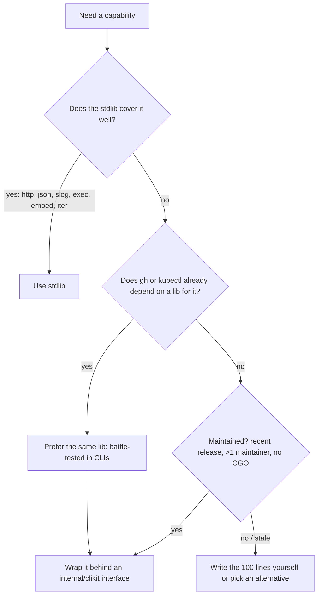
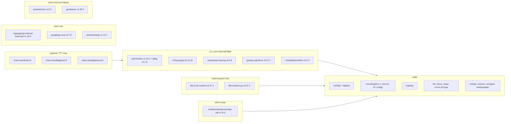

# 09 — Thư viện then chốt: catalog có chọn lọc

> Phạm vi: standard library trước (net/http, encoding/json và trạng thái json/v2, log/slog, context, errors, io/fs, embed, os/exec, os/signal, text/template, testing, slices/maps/cmp/iter), sau đó đến thư viện bên thứ ba theo nhóm: CLI, go-gh, terminal UI (Charm), keyring, jq, HTTP, Kubernetes, MCP, testing, lint/security, release, logging/observability.
>
> **Phiên bản được xác minh ngày 2026-11-09** bằng `proxy.golang.org/<module>/@latest`, go.dev/dl, release notes Go 1.26/1.27, `go.mod` của `gh` (`/tmp/ghcli-analysis/repo`) và Context7 (go-sdk, goreleaser). Trước khi pin, hãy chạy lại `go list -m -versions <module>`.

## Tại sao quan trọng

Ba binary + MCP server của dự án sẽ sống nhiều năm. Mỗi dependency kéo theo:

- **Bề mặt bảo mật**: `govulncheck` báo lỗ hổng theo symbol thực sự được gọi, nhưng càng ít module thì càng ít việc phải theo dõi.
- **Chi phí nâng cấp**: các module có major version trong path (`/v2`, `/v3`) đòi sửa import khi lên major mới. Charm đã đổi hẳn domain sang `charm.land`.
- **Kích thước và thời gian build**: `k8s.io/client-go` kéo cả hệ sinh thái Kubernetes vào.
- **Hợp đồng với agent**: thư viện nào tự in ra stdout, tự đổi màu, hay tự mở pager đều có thể phá output.

Triết lý của Go là **stdlib trước**. `gh` (một CLI rất lớn) chỉ có khoảng 50 dependency trực tiếp, và phần lớn dành cho các tính năng chuyên biệt (codespaces, attestation).



Ký hiệu độ trưởng thành dùng trong chương: **Stable** (API ổn định, dùng rộng rãi), **Active** (đang phát triển nhanh, có thể breaking giữa các minor), **Maintenance** (ít thay đổi, chủ yếu sửa lỗi), **Stale** (lâu không có release, nên tránh cho code mới).

---

## Phần A — Standard library

Go hiện tại: **1.27.3** (go.dev/dl). Go 1.26 vẫn được hỗ trợ security. Trong `go.mod`, đặt `go 1.27` thì có thể dùng mọi API bên dưới.

### A.1 `net/http`

| | |
|---|---|
| Mục đích | HTTP client/server, `RoundTripper` middleware, `httptest` |
| Import | `net/http`, `net/http/httptest`, `net/http/httputil` |
| Trưởng thành | Stable |
| Dùng khi | Luôn luôn. Client của Bitbucket/Jenkins là `*http.Client` với chuỗi `RoundTripper` (xem [08 — bước 7](08-building-cli-tools.md)) |
| Tránh | `http.DefaultClient` (không có timeout); mutate `*http.Request` trong RoundTripper |

Một số điểm đáng chú ý gần đây: `http.Request.Pattern` và routing theo method/wildcard trong `ServeMux` (Go 1.22) đủ dùng cho MCP Streamable HTTP mà không cần router ngoài. `httptest.NewServer` là công cụ test chính.

### A.2 `encoding/json` và `encoding/json/v2`

| | |
|---|---|
| Import | `encoding/json` (v1), **`encoding/json/v2`** và **`encoding/json/jsontext`** (Go 1.27) |
| Trưởng thành | v1: Stable. **v2: GA từ Go 1.27** (Go 1.25–1.26 chỉ có sau `GOEXPERIMENT=jsonv2`) |
| Dùng khi | Code mới cần hành vi chặt (từ chối key trùng lặp, từ chối UTF-8 sai), streaming lớn, option theo từng lời gọi |
| Tránh | Trộn v1 và v2 tùy tiện trong cùng một package. Dùng tag option `inline` (đã đổi tên thành `embed`) hoặc `format:` và `unknown` (đã bị gỡ trước GA) |

Từ Go 1.27, **v1 chạy trên implementation của v2**: hành vi được giữ nguyên, chỉ text của error message có thể khác, và unmarshal nhanh hơn đáng kể. Nếu gặp vấn đề tương thích thì có thể build với `GOEXPERIMENT=nojsonv2`, nhưng tùy chọn opt-out này sẽ bị gỡ trong tương lai. **Đừng assert nguyên văn error message của `encoding/json` trong test.**

```go
import (
	jsonv2 "encoding/json/v2"
	"encoding/json/jsontext"
)

// Strict decode of a config file: unknown keys are an error, not silently ignored.
func decodeStrict(b []byte, v any) error {
	return jsonv2.Unmarshal(b, v, jsonv2.RejectUnknownMembers(true))
}

// Stable output for golden files and `--json` on a TTY.
func encodePretty(v any) ([]byte, error) {
	return jsonv2.Marshal(v, jsonv2.Deterministic(true), jsontext.WithIndent("  "))
}
```

Khuyến nghị cho dự án: tầng API và exporter vẫn dùng **v1** (đơn giản, tương thích với gojq và go-sdk). Dùng **v2** cho việc đọc config/profile (`RejectUnknownMembers` bắt lỗi gõ sai `max_teir`) và golden file (`Deterministic`).

### A.3 `log/slog`

| | |
|---|---|
| Import | `log/slog` |
| Trưởng thành | Stable (Go 1.21). `slog.DiscardHandler` (1.24), **`slog.NewMultiHandler`** (1.26) |
| Dùng khi | Debug log (`DEVX_DEBUG=1`), audit log JSONL, log của MCP server |
| Tránh | Log ra **stdout** (đó là kênh dữ liệu, và là kênh JSON-RPC của MCP stdio); log ra secret |

```go
// Debug log to stderr, audit trail to a JSONL file, one call site.
func newLogger(stderr io.Writer, audit *os.File, debug bool) *slog.Logger {
	lvl := slog.LevelWarn
	if debug {
		lvl = slog.LevelDebug
	}
	return slog.New(slog.NewMultiHandler(
		slog.NewTextHandler(stderr, &slog.HandlerOptions{Level: lvl}),
		slog.NewJSONHandler(audit, &slog.HandlerOptions{Level: slog.LevelInfo}),
	))
}
```

Hãy redact bằng kiểu có `LogValue()` (`type Token string; func (Token) LogValue() slog.Value { return slog.StringValue("REDACTED") }`). Như vậy secret không thể lọt vào log dù ai đó lỡ log nó.

### A.4 `context`, `os/signal`

- `context`: mọi hàm I/O đều nhận `ctx` làm tham số đầu. `cmd.Context()` trong cobra lấy được ctx truyền từ `ExecuteContext`. `context.WithoutCancel` (1.21) dùng cho audit flush sau khi bị hủy. `context.AfterFunc` (1.21) dùng để dọn dẹp.
- `os/signal.NotifyContext`: từ **Go 1.26**, context bị hủy với `CancelCauseFunc`, và `context.Cause(ctx)` cho biết tín hiệu nào đã đến. Dùng để phân biệt SIGINT (exit 130) với SIGTERM.

### A.5 `errors`

- `errors.Is`, `errors.As`, `errors.Join` (1.20), và **`errors.AsType[T]`** (1.26), bản generic, type-safe và nhanh hơn `As`. `gh` đã chuyển sang dùng nó.
- Mẫu cho dự án: lỗi tầng API có method `StatusCode()`, rồi `exitcode.Classify` gọi `errors.AsType[statusError]` ở một chỗ duy nhất.

### A.6 `io/fs`, `embed`

```go
// skills/skills.go: the embedding package must live ABOVE the files,
// because //go:embed patterns are relative to the source dir and cannot use "..".
package skills

import "embed"

//go:embed */SKILL.md
var FS embed.FS // fs.FS: works with fs.ReadFile, fs.WalkDir, template.ParseFS
```

```go
// internal/bbx/skill/install.go: `bbx skills install` / `bbx skills print`
data, err := fs.ReadFile(skills.FS, "bbx/SKILL.md")
```

Dùng `embed` cho SKILL.md, JSON schema của tool MCP (đặt ở thư mục `schemas/`, **không** đặt trong `testdata/`, vì `testdata/` có nghĩa là chỉ dùng cho test) và template help. Hãy nhận tham số `fs.FS` thay vì đường dẫn, để test truyền được `fstest.MapFS`. Từ Go 1.24 có thêm `os.Root` (truy cập file giới hạn trong một thư mục). Dùng nó khi đọc file do agent chỉ định, để chặn `../../etc/passwd`.

### A.7 `os/exec`

```go
cmd := exec.CommandContext(ctx, "git", "rev-parse", "--abbrev-ref", "HEAD")
cmd.Cancel = func() error { return cmd.Process.Signal(os.Interrupt) } // graceful first (1.20)
cmd.WaitDelay = 5 * time.Second                                        // then kill
out, err := cmd.Output()
```

- **Không bao giờ** truyền chuỗi do agent cung cấp vào `sh -c`. Luôn truyền argv dạng slice.
- Trên Windows, `exec.LookPath` có thể tìm ra binary nằm trong thư mục hiện tại. `gh` dùng `github.com/cli/safeexec` vì lý do này. Từ Go 1.19, stdlib trả `exec.ErrDot`, nên hãy xử lý lỗi đó thay vì bỏ qua.
- `kubectl-guard` gọi lại `kubectl` thật qua `os/exec` sau khi policy cho phép. Hãy dùng `LookPath` một lần và log đường dẫn tuyệt đối.

### A.8 `text/template`

Dùng cho `--template` (giống `gh`) và cho template help. Dùng `Option("missingkey=zero")` để tránh panic khi field không tồn tại. Tuyệt đối **không** dùng `html/template` cho output terminal, vì nó escape `&`, `<`. `go-gh/v2/pkg/template` có thêm helper `tablerow`, `timeago`, `color` nếu muốn tương thích cú pháp với `gh`.

### A.9 `testing`

- `t.Context()` (1.24), `t.Chdir()` (1.24), `b.Loop()` (1.24), `testing/synctest` (GA 1.25) để test retry/backoff mà không chờ thật, `T.ArtifactDir()` (1.26) để lưu output test khi chạy với `-artifacts`.
- `net/http/httptest` + `testing/fstest` + `iotest` đủ cho phần lớn nhu cầu. Chi tiết ở [chương 06](06-testing-quality.md).

### A.10 `slices`, `maps`, `cmp`, `iter`

```go
fields = slices.Sorted(maps.Keys(byName))                    // deterministic --json field list
slices.SortFunc(prs, func(a, b PR) int { return cmp.Compare(a.ID, b.ID) })
if !slices.Contains(allowed, name) { /* usage error */ }

// iter.Seq2 for pagination (Go 1.23 range-over-func), see chapter 08 step 8
for pr, err := range paging.Cloud[PR](ctx, c.GetJSON, url, 30) { _ = pr; _ = err }
```

Từ Go 1.21 không còn cần `golang.org/x/exp/slices`. Hãy xóa nó nếu còn sót lại.

### A.11 Bảng tóm tắt stdlib

| Package | Dùng cho | Có từ |
|---|---|---|
| `net/http`, `httptest` | API client, RoundTripper, MCP HTTP | 1.0 |
| `encoding/json` / `json/v2` | output, config, API | 1.0 / **1.27** |
| `log/slog` | debug/audit log | 1.21 (MultiHandler 1.26) |
| `errors.AsType` | phân loại lỗi → exit code | 1.26 |
| `iter`, range-over-func | pagination | 1.23 |
| `os.Root` | đọc file an toàn theo đường dẫn agent đưa | 1.24 |
| `testing/synctest` | test retry/timeout | 1.25 |
| `embed` | SKILL.md, schema, template | 1.16 |
| `sync.OnceValues` | Factory lazy | 1.21 |
| `math/rand/v2` | jitter backoff | 1.22 |

---

## Phần B — Thư viện bên thứ ba

### B.1 CLI framework

| Thư viện | Import path | Phiên bản | Trưởng thành | Dùng khi | Tránh khi |
|---|---|---|---|---|---|
| **cobra** | `github.com/spf13/cobra` | v1.10.2 (2025-12) | Stable | Cây lệnh `noun verb`, completion, man page; gh, kubectl, helm đều dùng | CLI một lệnh vài flag (dùng `flag` của stdlib) |
| **pflag** | `github.com/spf13/pflag` | v1.1.0 (2026-10) | Stable | Flag kiểu POSIX/GNU, đi kèm cobra | |
| urfave/cli v3 | `github.com/urfave/cli/v3` | v3.14.0 | Active | Thích API khai báo, hỗ trợ `context` sẵn | Cần completion/man page sâu như cobra |
| kong | `github.com/alecthomas/kong` | v1.17.0 | Active | Định nghĩa CLI bằng struct tag, code gọn | Cần hook tùy biến như `PersistentPreRunE` để gắn tier gate |
| viper | `github.com/spf13/viper` | v1.21.0 (2025-09) | Maintenance | App cần merge config nhiều nguồn (file/env/remote) | **CLI cho agent** (xem bên dưới) |

**Chọn cobra + pflag.** Lý do: cùng hệ với gh/kubectl/cli-runtime (`kubectl-guard` buộc phải dùng pflag qua `genericclioptions`); `Annotations` cho tier; `EnableTraverseRunHooks`; `cobra/doc` sinh man page; completion động.

**Vì sao nhiều dự án tránh viper** (gh không dùng viper):

- Key không phân biệt hoa thường và được ghép ngầm từ flag + env + file, nên khó biết giá trị thực đến từ đâu. Đó là điều tối kỵ khi cần audit "ai cho phép `max_tier: ADMIN`".
- Dùng global singleton (`viper.Get`), khó test song song.
- Kéo theo nhiều dependency (nhiều parser định dạng, fsnotify...).
- Thay thế: struct `config.Profile` + `encoding/json` (hoặc json/v2 với `RejectUnknownMembers`) + thứ tự ưu tiên viết tường minh như [08 — bước 5](08-building-cli-tools.md).

### B.2 go-gh

| | |
|---|---|
| Import | `github.com/cli/go-gh/v2` |
| Phiên bản | v2.17.0 (2026-10-20), chính bản `gh` đang dùng |
| Trưởng thành | Stable |
| Dùng khi | Viết **gh extension**, hoặc muốn dùng lại các package độc lập của nó: `pkg/jq` (gojq có màu và indent), `pkg/template` (helper `tablerow`, `timeago`), `pkg/tableprinter`, `pkg/term`, `pkg/browser` |
| Tránh | Dùng `pkg/api`/`pkg/auth` cho Bitbucket/Jenkins, vì chúng gắn chặt với host và auth của GitHub |

Gợi ý: import có chọn lọc `github.com/cli/go-gh/v2/pkg/jq` và `pkg/tableprinter` để có hành vi `--jq`/bảng giống hệt `gh` mà không phải tự viết. Những package này không kéo phần GitHub API vào.

### B.3 Terminal UI: Charm (module path mới `charm.land`)

Charm đã chuyển các thư viện v2 sang **vanity domain `charm.land`**. Import path cũ `github.com/charmbracelet/...` chỉ còn cho v1. `gh` đã chuyển sang path mới.

| Thư viện | Import path (v2) | Phiên bản | Dùng cho |
|---|---|---|---|
| lipgloss | `charm.land/lipgloss/v2` | v2.0.6 | style, màu, layout bảng/khung cho output TTY |
| bubbletea | `charm.land/bubbletea/v2` | v2.1.1 | TUI tương tác (Elm architecture) |
| bubbles | `charm.land/bubbles/v2` | v2.2.1 | component: spinner, list, table, viewport |
| huh | `charm.land/huh/v2` | v2.0.3 | form/prompt (confirm, select, input), có chế độ accessible |
| glamour | `charm.land/glamour/v2` | v2.0.1 | render markdown trong terminal (PR description) |

Quy tắc cho CLI phục vụ agent:

- **Chỉ dùng khi `ios.IsStdoutTTY() && ios.CanPrompt()`.** Không có TTY hoặc có agent thì đi nhánh plain/JSON. bubbletea **không bao giờ** được khởi động trong MCP mode.
- `huh` cho confirm của lệnh DESTRUCTIVE (gõ lại tên repo). Nhớ bật accessible mode khi có screen reader. `gh` có `GH_ACCESSIBLE_PROMPTER`.
- lipgloss tự dò màu nền và profile màu. Hãy để `iostreams` quyết định bật/tắt màu (`NO_COLOR`) rồi truyền xuống, đừng để từng thư viện tự quyết.
- Trưởng thành: **Active**. v2 vừa ổn định, có thể thay đổi nhỏ giữa các minor, nên hãy pin chính xác.
- Thay thế nhẹ hơn cho spinner: `github.com/briandowns/spinner` v1.23.2 (gh dùng), ghi lên stderr.

### B.4 Keyring

| | |
|---|---|
| Import | `github.com/zalando/go-keyring` |
| Phiên bản | v0.2.8 (2026-03), `gh` đang dùng |
| Trưởng thành | Maintenance (API nhỏ, ổn định: `Set`, `Get`, `Delete`, `DeleteAll`, `ErrNotFound`) |
| Dùng khi | Lưu token trên máy dev: macOS Keychain, Windows Credential Manager, Linux Secret Service (D-Bus) |
| Tránh | Phụ thuộc vào nó trong CI hoặc container: không có D-Bus thì lỗi. Luôn để **env var trước keyring** |

Lưu ý: macOS có thể hiện hộp thoại cấp quyền khi binary đổi chữ ký. Đặt timeout cho thao tác keyring (gh bọc lời gọi trong goroutine có timeout) để agent không bị treo. Có `keyring.MockInit()` cho test.

Thay thế: `github.com/99designs/keyring` hỗ trợ nhiều backend hơn (file mã hóa, pass, KWallet), nhưng ít được bảo trì hơn. Chỉ dùng khi cần fallback file mã hóa.

### B.5 jq

| | |
|---|---|
| Import | `github.com/itchyny/gojq` |
| Phiên bản | v0.12.20 (2026-11-01) |
| Trưởng thành | Stable (v0.x nhưng API ổn định nhiều năm, là lõi của `go-gh/pkg/jq`) |
| API | `gojq.Parse(src)` → `gojq.Compile(q, opts...)` → `code.RunWithContext(ctx, v)` → `iter.Next()` trả `(any, bool)`, lỗi được trả như một value |
| Lưu ý | Input phải là kiểu JSON thuần (`map[string]any`, `[]any`, `float64`...). Tắt `$ENV` bằng `gojq.WithEnvironLoader(func() []string { return nil })`. Dùng `RunWithContext` để `--jq` vô hạn bị cắt khi hết timeout |

### B.6 HTTP

| Thư viện | Import | Phiên bản | Trưởng thành | Ghi chú |
|---|---|---|---|---|
| **stdlib** | `net/http` | — | Stable | Mặc định. Tự viết middleware như chương 08 |
| go-retryablehttp | `github.com/hashicorp/go-retryablehttp` | v0.7.8 (2025-06) | Maintenance | `retryablehttp.NewClient().StandardClient()` trả `*http.Client`. Có `CheckRetry`/`Backoff` tùy biến. **Mặc định retry cả POST** nếu body rewind được, nên phải viết `CheckRetry` riêng để chặn lệnh ghi |
| cenkalti/backoff | `github.com/cenkalti/backoff/v5` | v5.0.3 | Stable | Thuật toán backoff thuần (gh dùng v4 và v5), hợp cho poll Jenkins queue |
| httpretty | `github.com/henvic/httpretty` | — | Maintenance | Log request/response đẹp cho debug (go-gh dùng). Nhớ cấu hình redact header |

Khuyến nghị: dùng **stdlib + middleware tự viết** cho retry (kiểm soát chính sách idempotent, `Retry-After`), và **backoff/v5** cho việc poll trạng thái Jenkins build hay pipeline Bitbucket (exit 8 nếu hết thời gian chờ).

### B.7 Kubernetes

Tất cả các module `k8s.io/*` dùng cùng một nhịp: **v0.37.x ↔ Kubernetes 1.37**. Phải nâng **đồng bộ**.

| Module | Import | Phiên bản | Dùng cho |
|---|---|---|---|
| apimachinery | `k8s.io/apimachinery` | v0.37.2 | `metav1`, `schema.GroupVersionResource`, `runtime`, `labels`, errors (`apierrors.IsNotFound`) |
| client-go | `k8s.io/client-go` | v0.37.2 | `kubernetes.Clientset`, `dynamic` client, `discovery`, RESTMapper |
| **cli-runtime** | `k8s.io/cli-runtime` | v0.37.2 | `genericclioptions.ConfigFlags` (`--kubeconfig`, `--context`, `-n`...), `resource.Builder`, printers. **Nền tảng của kubectl plugin** |
| controller-runtime | `sigs.k8s.io/controller-runtime` | v0.25.2 | Viết controller/operator. **Không cần** cho `kubectl-guard` |

```go
// internal/guard/root.go: kubectl-compatible flags in three lines
flags := genericclioptions.NewConfigFlags(true)
flags.AddFlags(rootCmd.PersistentFlags())      // --kubeconfig, --context, --namespace, ...
restCfg, err := flags.ToRESTConfig()            // same resolution rules as kubectl
```

- `kubectl-guard` cần: cli-runtime (flag, tìm config), client-go `discovery` + `dynamic` (dry-run phía server: `DryRun: []string{metav1.DryRunAll}`), apimachinery. Không cần controller-runtime.
- Server-side dry-run của Kubernetes chính là cơ chế `--dry-run` cho tier WRITE/DESTRUCTIVE: API server chạy admission nhưng không lưu.
- Giữ toàn bộ import `k8s.io/...` trong `internal/k8sguard` và `internal/guard` (depguard, [chương 07](07-project-structure.md)).
- Trưởng thành: **Stable**, nhưng chỉ hỗ trợ khoảng 3 bản minor gần nhất. Hãy nâng theo lịch release Kubernetes.

### B.8 MCP

| Thư viện | Import | Phiên bản | Trưởng thành | Ghi chú |
|---|---|---|---|---|
| **Official go-sdk** | `github.com/modelcontextprotocol/go-sdk/mcp` | **v1.8.0** (2026-09-04) | Stable (v1, đảm bảo tương thích) | Do MCP org và Google cùng bảo trì. `mcp.NewServer`, generic `mcp.AddTool[In, Out]` suy ra JSON Schema từ struct, `StdioTransport`, Streamable HTTP, OAuth |
| mark3labs/mcp-go | `github.com/mark3labs/mcp-go` | v1.5.0 | Active | Có trước SDK chính thức, cộng đồng lớn. Chỉ chọn nếu cần tính năng mà go-sdk chưa có |

```go
type ViewIn struct {
	Workspace string `json:"workspace" jsonschema:"Bitbucket workspace slug"`
	Repo      string `json:"repo" jsonschema:"repository slug"`
	ID        int    `json:"id" jsonschema:"pull request id"`
}

server := mcp.NewServer(&mcp.Implementation{Name: "bbx", Version: buildinfo.Version}, nil)
mcp.AddTool(server, &mcp.Tool{
	Name:        "bitbucket_pr_view",
	Description: "Show one pull request",
	Annotations: mcpserver.Annotations(tier.Read), // ReadOnlyHint bool, DestructiveHint *bool
}, func(ctx context.Context, req *mcp.CallToolRequest, in ViewIn) (*mcp.CallToolResult, bitbucket.PullRequest, error) {
	// Out is a value struct so the inferred output schema is a plain "object".
	pr, err := client.PullRequest(ctx, in.Workspace, in.Repo, in.ID)
	if err != nil {
		return nil, bitbucket.PullRequest{}, err
	}
	return nil, *pr, nil
})
err := server.Run(ctx, &mcp.StdioTransport{})
```

`ToolAnnotations` trong v1.8.0: `ReadOnlyHint bool`, `IdempotentHint bool`, `DestructiveHint *bool`, `OpenWorldHint *bool`, `Title string`. Chi tiết ở [chương 10](10-mcp-server-go.md).

### B.9 Testing

| Thư viện | Import | Phiên bản | Trưởng thành | Dùng / tránh |
|---|---|---|---|---|
| testify | `github.com/stretchr/testify` | v1.12.1 (2026-08) | Stable | `assert`/`require` gọn (gh dùng). Tránh `suite` và `mock` sinh code nặng; ưu tiên fake viết tay |
| go-cmp | `github.com/google/go-cmp/cmp` | v0.7.0 | Stable | So sánh struct có diff dễ đọc, `cmpopts.IgnoreFields`. Tốt hơn `reflect.DeepEqual` |
| **testscript** | `github.com/rogpeppe/go-internal/testscript` | v1.16.0 (2026-07) | Stable | Acceptance test dạng `.txtar`: chạy binary thật, kiểm tra stdout/stderr/exit code. Rất hợp với hợp đồng agent. gh dùng bản fork `github.com/cli/go-internal` |
| gock | `github.com/h2non/gock` | v1.2.0 (**2022-10**) | **Stale** | Chặn HTTP qua `http.DefaultTransport`. **Tránh cho code mới**: dùng `httptest` hoặc một registry RoundTripper kiểu `gh/pkg/httpmock` (~150 dòng, xem [chương 06](06-testing-quality.md)) |

```text
# acceptance/testdata/bbx/tier_denied.txtar
env DEVX_CONFIG=$WORK/cfg.json
env BBX_TOKEN=dummy
! exec bbx pr merge 42 -w acme -R api --yes
stderr '"kind":"tier_denied"'
! stdout .

-- cfg.json --
{"active":"ro","profiles":{"ro":{"kind":"bitbucket-cloud","host":"api.bitbucket.org","max_tier":"READ"}}}
```

Lệnh `exec` trong testscript không kiểm tra trực tiếp exit code cụ thể. Dùng `! exec` cho exit ≠ 0, và kiểm tra `"code":5` trong stderr JSON để khóa đúng giá trị.

### B.10 Lint và bảo mật

| Công cụ | Cài / chạy | Phiên bản | Ghi chú |
|---|---|---|---|
| **golangci-lint v2** | binary release hoặc `golangci/golangci-lint-action` | v2.15.0 (2026-10) | Config phải có `version: "2"`. Cấu trúc mới gồm `linters.enable`, `linters.settings`, `formatters` (gofmt/goimports tách ra khỏi linters). Dùng `golangci-lint migrate` để chuyển config v1 |
| staticcheck | đã có trong golangci-lint, hoặc `honnef.co/go/tools/cmd/staticcheck` | 2026.2.2 (module v0.8.2) | Bộ phân tích chuẩn mực. Trong golangci-lint v2, `gosimple` và `stylecheck` đã gộp vào `staticcheck` |
| **govulncheck** | `go tool -modfile=tools.mod govulncheck ./...` | v1.9.0 (2026-10) | Chỉ báo lỗ hổng **thực sự reachable** từ code. Chạy cả trên binary: `govulncheck -mode=binary bin/bbx` |
| gosec | đã có trong golangci-lint (`gosec`), hoặc `github.com/securego/gosec/v2` | v2.30.0 (2026-10) | G204 (exec với biến), G107 (URL từ biến), G304 (đọc file theo đường dẫn biến). Hữu ích nhưng nhiều false positive. Dùng `//nolint:gosec // reason` có kèm lý do |
| depguard | trong golangci-lint | — | Cưỡng chế chiều phụ thuộc ([chương 07](07-project-structure.md)) |

```yaml
# .golangci.yml (minimal v2)
version: "2"
linters:
  default: standard        # errcheck, govet, ineffassign, staticcheck, unused
  enable: [gosec, depguard, errorlint, bodyclose, noctx, misspell]
formatters:
  enable: [gofmt, goimports]
```

`bodyclose` và `noctx` đặc biệt quan trọng cho client HTTP (quên đóng body, quên `context`). `errorlint` bắt lỗi so sánh `err == ErrX` thay vì dùng `errors.Is`.

### B.11 Release và supply chain

| Công cụ | Phiên bản | Trưởng thành | Dùng cho |
|---|---|---|---|
| **goreleaser** | v2.20.0 (2026-11-04) | Stable | Build chéo 3 binary, archive kèm man page/completion/SKILL.md, checksum, Homebrew tap, SBOM, ký. Config cần `version: 2` |
| ko | v0.19.1 | Stable | Build image container cho Go **không cần Dockerfile** (distroless, reproducible). Hợp cho MCP server chạy remote (Streamable HTTP) |
| **cosign** | v3.1.4 (module `github.com/sigstore/cosign/v3`) | Stable | Ký keyless (OIDC của GitHub Actions). Từ v3, dùng `--bundle` sinh `.sigstore.json` thay cho cặp `.sig` + `.pem` |
| syft | — | Stable | SBOM (goreleaser gọi qua `sboms:`) |

```yaml
# .goreleaser.yaml (signing excerpt, cosign v3)
version: 2
checksum:
  name_template: checksums.txt
signs:
  - cmd: cosign
    signature: "${artifact}.sigstore.json"
    args: ["sign-blob", "--bundle=${signature}", "${artifact}", "--yes"]
    artifacts: checksum
```

Người dùng xác minh như sau: `cosign verify-blob --bundle checksums.txt.sigstore.json --certificate-identity '<workflow>@refs/tags/v1.4.0' --certificate-oidc-issuer https://token.actions.githubusercontent.com checksums.txt`. Cấu hình đầy đủ (3 `builds`, ldflags, archives) ở [chương 11](11-build-release-ship.md).

### B.12 Logging và observability

| Thư viện | Import | Phiên bản | Ghi chú |
|---|---|---|---|
| **slog** (stdlib) | `log/slog` | Go 1.27 | Mặc định cho mọi log. Không cần zap/zerolog cho một CLI |
| OpenTelemetry Go | `go.opentelemetry.io/otel` | v1.47.0 | Trace và metric cho **MCP server chạy remote**. Có bridge `go.opentelemetry.io/contrib/bridges/otelslog` để nối slog vào OTel logs |
| otelhttp | `go.opentelemetry.io/contrib/instrumentation/net/http/otelhttp` | theo contrib | Bọc `http.RoundTripper`/handler. Đặt như một middleware trong chuỗi `httpx.Chain` |
| zap / zerolog | `go.uber.org/zap`, `github.com/rs/zerolog` | — | Chỉ cân nhắc khi đo được slog là nút thắt, điều gần như không xảy ra với CLI |

Khuyến nghị: CLI **không** bật OTel mặc định, vì nó tốn thời gian khởi động và phải xử lý exporter. Chỉ bật khi có `OTEL_EXPORTER_OTLP_ENDPOINT`, hoặc trong mode `mcp serve --http`. Nếu có telemetry, phải có cách tắt rõ ràng: `gh` có `gh config set telemetry disabled` và tự tắt khi không đọc được config.

---

## Phần C — Bộ dependency đề xuất cho dự án



| Nhóm | Chọn | Không chọn (và lý do) |
|---|---|---|
| CLI | cobra + pflag | viper (nguồn config ngầm, global state), kong/urfave (không có `Annotations` + hook chain như cobra) |
| Output | stdlib json + gojq + text/template | thư viện jq chạy qua CGO hoặc gọi `jq` binary qua exec (thêm phụ thuộc runtime) |
| HTTP | stdlib + middleware tự viết + backoff/v5 | go-retryablehttp (mặc định retry POST), gock (stale) |
| Secret | env > go-keyring | lưu token trong file config |
| TUI | huh (confirm), lipgloss (khi TTY) | bubbletea full-screen trong lệnh mà agent có thể gọi |
| k8s | cli-runtime + client-go | controller-runtime (dành cho operator) |
| MCP | official go-sdk v1 | tự viết JSON-RPC |
| Test | testscript + httptest + go-cmp (+ testify assert) | gock, mock sinh tự động |
| Lint | golangci-lint v2 (staticcheck, gosec, depguard, bodyclose, noctx) + govulncheck | chạy từng linter riêng lẻ |
| Release | goreleaser v2 + cosign v3 (+ ko cho image MCP) | script shell tự viết |

---

## Lỗi thường gặp

1. **Import `github.com/charmbracelet/lipgloss` rồi `go get` lên v2**: v2 nằm ở `charm.land/lipgloss/v2`. Path cũ chỉ còn v1, nên dễ trộn hai major trong cùng một build.
2. **Assert nguyên văn error message của `encoding/json`**: text đã thay đổi từ Go 1.27 (v1 chạy trên v2). Chỉ assert kiểu lỗi hoặc một phần thông điệp.
3. **Dùng tag json/v2 lấy từ blog cũ** (`inline`, `format:`, `unknown`): tên đã đổi (`embed`) hoặc đã bị gỡ trước GA.
4. **go-retryablehttp với cấu hình mặc định cho lệnh ghi**: retry POST, gây trigger Jenkins build hai lần.
5. **Nâng `k8s.io/client-go` mà không nâng `apimachinery`/`cli-runtime` cùng lúc**: lỗi compile khó hiểu hoặc hành vi lệch. Phải nâng cả bộ v0.37.x.
6. **Kéo controller-runtime vào một kubectl plugin**: tăng dependency mà không thu được lợi ích gì.
7. **gock trong test song song**: nó thay `http.DefaultTransport` toàn cục, nên các test đua nhau. Hãy inject `*http.Client`.
8. **Config golangci-lint v1 với binary v2**: lỗi parse. Thêm `version: "2"` hoặc chạy `golangci-lint migrate`.
9. **`go install golangci-lint` hoặc thêm vào `tool` trong `go.mod` chính**: dependency của linter lẫn vào module. Dùng binary release hoặc `tools.mod`.
10. **Ký bằng cosign v3 với args của v2** (`--output-signature`, `--output-certificate`): đổi sang `--bundle`.
11. **viper đọc `BBX_MAX_TIER` từ env một cách ngầm**: agent có thể tự nâng quyền. Tier chỉ được lấy từ profile, không lấy từ env hay flag.
12. **Log bằng `fmt.Println` trong MCP server**: làm hỏng JSON-RPC trên stdout. Dùng slog ghi ra stderr.

---

## Checklist

- [ ] Mỗi dependency trực tiếp đều trả lời được: "stdlib có làm được không?", "gh/kubectl dùng gì?", "release gần nhất là khi nào?".
- [ ] `go 1.27` trong `go.mod`. Dùng `errors.AsType`, `iter.Seq2`, `slog.NewMultiHandler`, `sync.OnceValues`.
- [ ] json/v2 chỉ dùng có chủ đích (config strict, golden deterministic). Test không phụ thuộc text lỗi JSON.
- [ ] cobra v1.10.2 + pflag v1.1.0. Không có viper.
- [ ] Charm v2 import từ `charm.land/...`, chỉ dùng trên nhánh TTY.
- [ ] go-keyring đứng sau env var, có timeout, dùng `keyring.MockInit()` trong test.
- [ ] gojq tắt `$ENV` và chạy với context có timeout.
- [ ] Bộ `k8s.io/*` cùng phiên bản v0.37.x, chỉ xuất hiện trong `internal/k8sguard` và `internal/guard`.
- [ ] MCP dùng `github.com/modelcontextprotocol/go-sdk` v1.8.0. Annotations suy ra từ tier.
- [ ] Test: testscript cho hợp đồng CLI, httptest/registry cho HTTP. Không có gock.
- [ ] CI: golangci-lint v2.15.0 (`version: "2"`), govulncheck v1.9.0 (source + binary), gosec có lý do cho mỗi `nolint`.
- [ ] Release: goreleaser v2 (`version: 2`), cosign v3 `--bundle`, SBOM. Image MCP dùng ko.
- [ ] Tool pin trong `tools.mod`. CI chạy `go tool -modfile=tools.mod ...`.

---

## Tài liệu tham khảo

- Go release notes: https://go.dev/doc/go1.27 — https://go.dev/doc/go1.26 — https://go.dev/doc/go1.25 — https://go.dev/doc/go1.24
- encoding/json/v2: https://pkg.go.dev/encoding/json/v2 — jsontext: https://pkg.go.dev/encoding/json/jsontext — proposal: https://go.dev/issue/71497
- log/slog: https://pkg.go.dev/log/slog — guide: https://go.dev/blog/slog
- errors.AsType: https://pkg.go.dev/errors#AsType — iter: https://pkg.go.dev/iter — os.Root: https://pkg.go.dev/os#Root
- testing/synctest: https://pkg.go.dev/testing/synctest
- cobra: https://github.com/spf13/cobra — pflag: https://github.com/spf13/pflag — viper: https://github.com/spf13/viper
- urfave/cli v3: https://cli.urfave.org — kong: https://github.com/alecthomas/kong
- go-gh: https://github.com/cli/go-gh — gh go.mod: https://github.com/cli/cli/blob/trunk/go.mod
- Charm (charm.land): https://charm.land — lipgloss: https://github.com/charmbracelet/lipgloss — bubbletea: https://github.com/charmbracelet/bubbletea — huh: https://github.com/charmbracelet/huh — glamour: https://github.com/charmbracelet/glamour
- go-keyring: https://github.com/zalando/go-keyring
- gojq: https://github.com/itchyny/gojq
- go-retryablehttp: https://github.com/hashicorp/go-retryablehttp — backoff: https://github.com/cenkalti/backoff
- client-go: https://github.com/kubernetes/client-go — cli-runtime: https://github.com/kubernetes/cli-runtime — sample-cli-plugin: https://github.com/kubernetes/sample-cli-plugin — controller-runtime: https://github.com/kubernetes-sigs/controller-runtime
- MCP Go SDK: https://github.com/modelcontextprotocol/go-sdk — pkg.go.dev: https://pkg.go.dev/github.com/modelcontextprotocol/go-sdk/mcp — mcp-go: https://github.com/mark3labs/mcp-go
- testify: https://github.com/stretchr/testify — go-cmp: https://github.com/google/go-cmp — testscript: https://pkg.go.dev/github.com/rogpeppe/go-internal/testscript — gock: https://github.com/h2non/gock
- golangci-lint v2: https://golangci-lint.run — migration: https://golangci-lint.run/docs/product/migration-guide/
- staticcheck: https://staticcheck.dev — govulncheck: https://go.dev/doc/security/vuln/ — gosec: https://github.com/securego/gosec
- goreleaser: https://goreleaser.com — signing: https://goreleaser.com/customization/sign/ — cosign v3 notes: https://goreleaser.com/blog/cosign-v3/
- ko: https://ko.build — cosign: https://github.com/sigstore/cosign
- OpenTelemetry Go: https://opentelemetry.io/docs/languages/go/ — otelslog bridge: https://pkg.go.dev/go.opentelemetry.io/contrib/bridges/otelslog
- Chương liên quan: [06](06-testing-quality.md), [07](07-project-structure.md), [08](08-building-cli-tools.md), [10](10-mcp-server-go.md), [11](11-build-release-ship.md)
