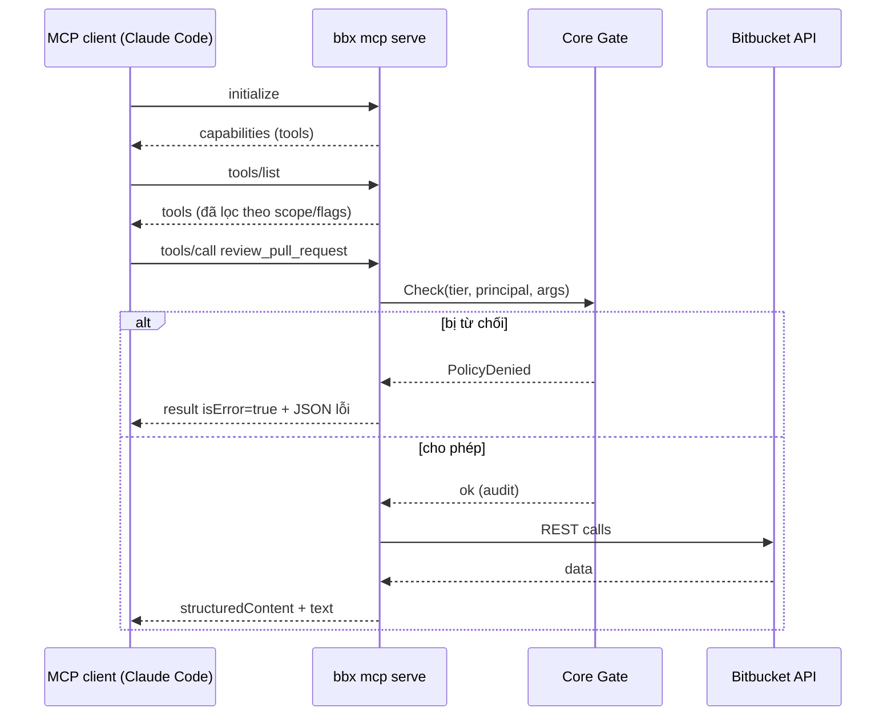
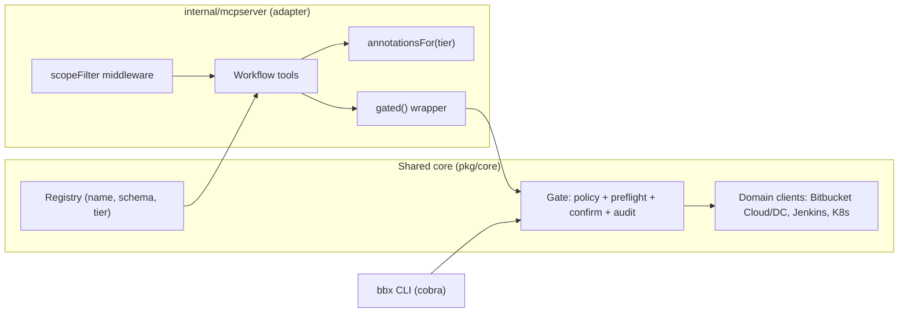

# 10. Xây MCP server bằng Go (official go-sdk)

> Phạm vi: đưa shared core (registry + Gate + domain clients) ra bề mặt **MCP** cho `bbx`, `jkx`, `kubectl-guard`.
> SDK: `github.com/modelcontextprotocol/go-sdk` (v1.x, bài này đối chiếu **v1.8.0**). Spec MCP: revision **2026-07-28**.
> Cập nhật: 2026-11-09.

CLI là bề mặt cho người và cho agent chạy shell. MCP là bề mặt cho agent **không** có shell, hoặc cho agent cần schema đầy đủ, structured output và auth theo từng người dùng. Nguyên tắc xuyên suốt của handbook vẫn giữ nguyên: **MCP chỉ là một adapter mỏng**. Mọi logic quyền hạn, preflight, confirm và audit đều nằm trong core. MCP server không được tự viết lại các luật đó.

Mục lục:

1. MCP trong 5 phút
2. Kiến trúc: registry → MCP adapter
3. Server tối thiểu với go-sdk
4. Typed tool handler và suy luận JSON Schema
5. Tool annotations suy ra từ tier
6. Gate trong mọi handler
7. Lỗi: tool result hay protocol error
8. Workflow-level tools thay vì endpoint-level tools
9. Kiểm soát kích thước response
10. Transport: stdio và Streamable HTTP
11. Auth: env credentials (stdio) và OAuth (remote)
12. `tools/list` lọc theo scope
13. Wiring `bbx mcp serve`
14. Test bằng in-memory transport
15. Học từ các reference server
16. Lỗi thường gặp, Checklist, Tài liệu tham khảo

---

## 1. MCP trong 5 phút

MCP (Model Context Protocol) là giao thức JSON-RPC 2.0 giữa **client** (Claude Code, Claude Desktop, IDE, agent framework) và **server** (chương trình của bạn). Server công bố ba loại primitive:

| Primitive | Ai điều khiển | Dùng cho `bbx`/`jkx` |
|---|---|---|
| **Tools** | Model quyết định gọi | `review_pull_request`, `get_build_log`, `rollout_status` |
| **Resources** | Ứng dụng/người dùng chọn đưa vào context | `bbx://repo/{ws}/{slug}/README`, build log dạng tài liệu |
| **Prompts** | Người dùng chọn (slash command) | "Review PR theo checklist của team" |

Vài điểm của revision 2026-07-28 ảnh hưởng trực tiếp tới thiết kế:

- **Tool annotations** (`readOnlyHint`, `destructiveHint`, `idempotentHint`, `openWorldHint`) chỉ là **gợi ý không tin cậy**. Client dùng chúng để hiển thị UI và hỏi xác nhận. Server **không** được coi chúng là cơ chế enforcement.
- `tools/list` **MAY** trả về danh sách khác nhau tùy scope đã cấp. Nhờ vậy ta có thể ẩn tool WRITE với token chỉ có scope `read`.
- Server stdio **SHOULD NOT** dùng OAuth. Credential lấy từ môi trường (env, keychain, file config).
- Server remote dùng **OAuth 2.1 + PKCE**. Server đóng vai *resource server* và công bố **Protected Resource Metadata (RFC 9728)** để client tìm ra authorization server.



---

## 2. Kiến trúc: registry → MCP adapter

Core đã có registry, mỗi `Command` mang `Name`, schema, `Tier` và hàm `Run`. Adapter MCP làm bốn việc:

1. Chọn **một tập con** command để public thành tool. Không phải command nào cũng nên thành tool.
2. Gắn annotations theo tier.
3. Bọc handler bằng Gate (cùng instance Gate với CLI).
4. Định dạng output theo `detail` và giới hạn kích thước.



Cấu trúc thư mục gợi ý:

```text
bbx/
  cmd/bbx/main.go            # cobra root, includes "mcp serve"
  internal/mcpserver/
    server.go                # NewServer(deps, opts) *mcp.Server
    annotations.go           # tier -> ToolAnnotations
    gated.go                 # Gate wrapper + error mapping
    tools_pr.go              # review_pull_request, list_pull_requests...
    filter.go                # scope-based tools/list filter
    server_test.go           # in-memory transport tests
  pkg/core/                  # registry, gate, errors (shared with jkx, kubectl-guard)
```

---

## 3. Server tối thiểu với go-sdk

API chính (đã đối chiếu README và pkg.go.dev của v1.8.0):

- `mcp.NewServer(impl *mcp.Implementation, opts *mcp.ServerOptions) *mcp.Server`
- `mcp.AddTool[In, Out any](s *mcp.Server, t *mcp.Tool, h mcp.ToolHandlerFor[In, Out])`
- `(*mcp.Server).Run(ctx, transport)` để chạy tới khi client ngắt kết nối
- `&mcp.StdioTransport{}` cho stdio

```go
package main

import (
	"context"
	"log"

	"github.com/modelcontextprotocol/go-sdk/mcp"
)

type PingInput struct {
	Message string `json:"message" jsonschema:"text to echo back"`
}

type PingOutput struct {
	Echo string `json:"echo" jsonschema:"the echoed text"`
}

func ping(ctx context.Context, req *mcp.CallToolRequest, in PingInput) (*mcp.CallToolResult, PingOutput, error) {
	// Returning a nil result lets the SDK fill StructuredContent and a text fallback.
	return nil, PingOutput{Echo: in.Message}, nil
}

func main() {
	server := mcp.NewServer(&mcp.Implementation{Name: "bbx", Version: "v0.1.0"}, nil)
	mcp.AddTool(server, &mcp.Tool{Name: "ping", Description: "Echo a message"}, ping)
	if err := server.Run(context.Background(), &mcp.StdioTransport{}); err != nil {
		log.Fatal(err)
	}
}
```

`ServerOptions` có các trường như `Instructions` (hướng dẫn chung gửi cho client lúc initialize), `Logger *slog.Logger`, `PageSize` (phân trang cho các lệnh `*/list`), `KeepAlive`. Nên đặt `Instructions` ngắn gọn, ví dụ: "Prefer review_pull_request over raw diff tools; destructive tools require --allow-destructive."

---

## 4. Typed tool handler và suy luận JSON Schema

Chữ ký handler:

```go
type ToolHandlerFor[In, Out any] func(ctx context.Context, req *mcp.CallToolRequest, in In) (*mcp.CallToolResult, Out, error)
```

Khi gọi `mcp.AddTool`, SDK sẽ:

- Suy ra `InputSchema` từ `In` nếu `Tool.InputSchema == nil`. `In` phải là struct hoặc map.
- Suy ra `OutputSchema` từ `Out` nếu `Out` không phải `any`.
- **Validate** arguments theo input schema trước khi gọi handler. Arguments sai trả về tool error, handler không chạy.
- Marshal `Out` vào `StructuredContent`, đồng thời thêm một `TextContent` chứa JSON làm fallback nếu `Content` đang trống.
- Validate output theo output schema.

Quy tắc struct tag (thư viện schema là `github.com/google/jsonschema-go`):

- Tag `json:"..."` đặt tên field. Field **có** `omitempty` là optional, field **không có** `omitempty` là required.
- Tag `jsonschema:"..."` **chỉ là chuỗi description**. Đừng viết kiểu `jsonschema:"required,description=..."` như thư viện invopop, vì SDK sẽ hiểu cả chuỗi đó là description.

```go
package mcpserver

// ReviewPRInput is the input of the review_pull_request tool.
type ReviewPRInput struct {
	Workspace string `json:"workspace" jsonschema:"Bitbucket Cloud workspace or Data Center project key"`
	Repo      string `json:"repo" jsonschema:"repository slug"`
	PRID      int    `json:"pr_id" jsonschema:"pull request id"`
	Detail    string `json:"detail,omitempty" jsonschema:"concise (default) or detailed"`
	MaxFiles  int    `json:"max_files,omitempty" jsonschema:"cap on files included in the diff summary (default 30)"`
}

// ReviewPROutput is returned as structuredContent.
type ReviewPROutput struct {
	Title       string        `json:"title"`
	State       string        `json:"state"`
	Author      string        `json:"author"`
	Checks      []CheckStatus `json:"checks"`
	Files       []FileSummary `json:"files"`
	Truncated   bool          `json:"truncated"`
	NextCursor  string        `json:"next_cursor,omitempty"`
	SuggestNext []string      `json:"suggest_next,omitempty" jsonschema:"follow-up tool calls the agent may consider"`
}

type CheckStatus struct {
	Name  string `json:"name"`
	State string `json:"state"`
}

type FileSummary struct {
	Path      string `json:"path"`
	Additions int    `json:"additions"`
	Deletions int    `json:"deletions"`
}
```

Khi cần ràng buộc mà tag không diễn đạt được (ví dụ `enum`), sinh schema bằng `jsonschema.For[T]`, sửa lại rồi gán vào `Tool.InputSchema`. SDK chỉ tự suy luận khi trường này đang `nil`:

```go
import "github.com/google/jsonschema-go/jsonschema"

func reviewPRSchema() (*jsonschema.Schema, error) {
	s, err := jsonschema.For[ReviewPRInput](nil)
	if err != nil {
		return nil, err
	}
	if p, ok := s.Properties["detail"]; ok {
		p.Enum = []any{"concise", "detailed"}
	}
	return s, nil
}
```

> Mẹo: bản thân schema cũng tốn token. Mô tả field nên ngắn, có ví dụ giá trị và **không** lặp lại tên field.

---

## 5. Tool annotations suy ra từ tier

`mcp.ToolAnnotations` trong v1.8.0 có kiểu trộn lẫn:

| Field | Kiểu Go | Default theo spec |
|---|---|---|
| `ReadOnlyHint` | `bool` | false |
| `IdempotentHint` | `bool` | false |
| `DestructiveHint` | `*bool` | true |
| `OpenWorldHint` | `*bool` | true |
| `Title` | `string` | |

SDK không export helper tạo `*bool`, nên ta tự viết `boolPtr`. Mapping tier được quy định một lần, ở một chỗ duy nhất:

```go
package mcpserver

import (
	"github.com/modelcontextprotocol/go-sdk/mcp"

	"example.com/devx/pkg/core"
)

func boolPtr(b bool) *bool { return &b }

// annotationsFor maps a core tier to MCP hints. Hints are advisory only;
// enforcement happens in the Gate.
func annotationsFor(c core.Command) *mcp.ToolAnnotations {
	a := &mcp.ToolAnnotations{
		Title:          c.Title,
		IdempotentHint: c.Idempotent,
		OpenWorldHint:  boolPtr(true), // every tool talks to an external system
	}
	switch c.Tier {
	case core.TierRead:
		a.ReadOnlyHint = true
		a.DestructiveHint = boolPtr(false)
	case core.TierWrite:
		a.DestructiveHint = boolPtr(false) // additive: comment, approve, trigger build
	case core.TierDestructive, core.TierAdmin:
		a.DestructiveHint = boolPtr(true) // delete branch, decline PR, scale to zero
	}
	return a
}
```

Hai điều cần nhớ:

1. Annotations để **client** hiển thị cảnh báo và quyết định có hỏi người dùng hay không. Client khôn ngoan sẽ **không tin** annotations từ server lạ. Server của bạn cũng không được dựa vào việc client "sẽ hỏi".
2. Cho phép người dùng tắt cả nhóm tool theo tier. Xem mục 15, các reference server đều làm như vậy.

---

## 6. Gate trong mọi handler

Đây là phần quan trọng nhất của bài. Dù tool đã bị ẩn khỏi `tools/list`, client vẫn có thể gửi `tools/call` với đúng tên tool đó. Vì vậy **mọi** handler phải đi qua Gate. Cách gọn nhất là một wrapper generic:

```go
package mcpserver

import (
	"context"

	"github.com/modelcontextprotocol/go-sdk/mcp"

	"example.com/devx/pkg/core"
)

// gated wraps a core-level function with the same Gate the CLI uses.
func gated[In, Out any](d *Deps, cmd core.Command, run func(context.Context, In) (Out, error)) mcp.ToolHandlerFor[In, Out] {
	return func(ctx context.Context, req *mcp.CallToolRequest, in In) (*mcp.CallToolResult, Out, error) {
		var zero Out
		gr := core.GateRequest{
			Command:   cmd.Name,
			Tier:      cmd.Tier,
			Surface:   core.SurfaceMCP,
			Principal: principalFrom(req),
			Args:      in,
			// MCP has no interactive TTY: confirmation must come from server
			// flags (e.g. --allow-destructive) or an explicit "confirm" arg.
			Interactive: false,
		}
		if err := d.Gate.Check(ctx, gr); err != nil {
			return nil, zero, toolError(err)
		}
		out, err := run(ctx, in)
		d.Gate.Audit(ctx, gr, err)
		if err != nil {
			return nil, zero, toolError(err)
		}
		return nil, out, nil
	}
}

// principalFrom is nil-safe: over stdio there is no TokenInfo.
func principalFrom(req *mcp.CallToolRequest) core.Principal {
	if req == nil || req.Extra == nil || req.Extra.TokenInfo == nil {
		return core.LocalPrincipal() // identity comes from env credentials
	}
	ti := req.Extra.TokenInfo
	return core.Principal{Subject: ti.UserID, Scopes: ti.Scopes}
}
```

Đăng ký tool:

```go
func registerPRTools(s *mcp.Server, d *Deps) error {
	cmd := d.Registry.MustGet("pr.review") // tier READ
	schema, err := reviewPRSchema()
	if err != nil {
		return err
	}
	mcp.AddTool(s, &mcp.Tool{
		Name:        "review_pull_request",
		Description: "Summarize a PR for review: metadata, CI checks, changed files, open tasks. Read-only.",
		InputSchema: schema,
		Annotations: annotationsFor(cmd),
	}, gated(d, cmd, d.PR.Review))
	return nil
}
```

Về **confirmation**: CLI hỏi `[y/N]` qua TTY, còn MCP không có TTY. Có ba lựa chọn, theo thứ tự nên dùng:

1. **Mặc định từ chối** tier DESTRUCTIVE/ADMIN, trừ khi server khởi động với `--allow-destructive`. Tool sẽ không được đăng ký, và Gate vẫn chặn nếu có ai gọi.
2. Tool nhận tham số `confirm: "<resource-name>"` (gõ lại đúng tên resource). Gate so sánh giá trị này, giống `kubectl delete --confirm`.
3. Dùng elicitation. Go-sdk v1.8 có `mcp.InputRequiredError` / `InputRequests` (multi round-trip) để hỏi người dùng qua client. Mức hỗ trợ của client còn khác nhau, nên chỉ coi đây là lớp UX bổ sung, không thay cho (1) và (2).

---

## 7. Lỗi: tool result hay protocol error

Typed handler trong go-sdk xử lý `error` như sau (theo source `toolForErr` của v1.8.0):

- Trả về **error thường** → SDK bọc thành `CallToolResult{IsError: true}`, text là `err.Error()`. Model **thấy** lỗi này và có thể tự sửa.
- Trả về `*jsonrpc.Error` (package `github.com/modelcontextprotocol/go-sdk/jsonrpc`) → SDK trả về **protocol error** JSON-RPC. Model thường không thấy, client coi đây là lỗi hệ thống.

| Tình huống | Loại | Lý do |
|---|---|---|
| Gate từ chối (policy, tier, scope) | Tool result `isError` | Model cần biết để đổi hướng hoặc báo người dùng |
| PR không tồn tại, 404 | Tool result `isError` | Model sửa được tham số |
| Rate limit 429 | Tool result `isError` + `retryable` | Model có thể chờ rồi thử lại |
| Tool name không tồn tại, params sai cấu trúc | Protocol error | SDK tự xử lý |
| Bug nội bộ, panic | Protocol error (hoặc tool error chung chung) | Không lộ stack trace |

Để model đọc được lỗi có cấu trúc, cho `Error()` trả về JSON đúng định dạng error envelope của CLI (`--json`):

```go
package mcpserver

import (
	"encoding/json"
	"errors"

	"example.com/devx/pkg/core"
)

type toolErr struct{ body string }

func (e *toolErr) Error() string { return e.body }

// toolError renders a core error with the same JSON envelope the CLI prints.
func toolError(err error) error {
	var ce *core.Error
	if !errors.As(err, &ce) {
		ce = &core.Error{Code: "internal", Message: "unexpected error"}
	}
	b, mErr := json.Marshal(map[string]any{"error": ce})
	if mErr != nil {
		return errors.New(ce.Message)
	}
	return &toolErr{body: string(b)}
}
```

Kết quả model nhận được, ví dụ:

```json
{"error":{"code":"policy_denied","message":"tier DESTRUCTIVE disabled on this server","hint":"restart with --allow-destructive or ask a human to run: bbx branch delete ...","retryable":false}}
```

`hint` rất đáng giá với agent. Hãy chỉ ra **hành động tiếp theo** thay vì chỉ nói lỗi.

---

## 8. Workflow-level tools thay vì endpoint-level tools

Sai lầm phổ biến nhất là sinh 1 tool cho mỗi REST endpoint (`get_pr`, `get_pr_diff`, `get_pr_comments`, `get_pr_statuses`...). Hậu quả:

- Hàng chục tool chiếm context và làm model chọn sai tool.
- Model phải tự ghép 4–6 lệnh gọi, mỗi lần lại tốn token cho JSON thô.
- Mỗi lệnh gọi lại phải qua Gate và audit, dẫn tới audit log rất nhiễu.

Thay vào đó, hãy thiết kế theo **việc người dùng muốn làm**:

| Workflow tool | Gộp từ các command core | Tier |
|---|---|---|
| `review_pull_request` | pr.get + pr.diffstat + pr.statuses + pr.tasks | READ |
| `list_my_work` | pr.list(author/reviewer=me) + build.failing | READ |
| `comment_on_pull_request` | pr.comment (inline hoặc general) | WRITE |
| `approve_pull_request` | pr.approve (preflight: CI xanh) | WRITE |
| `diagnose_build` (`jkx`) | build.get + build.log tail + test report | READ |
| `rerun_build` (`jkx`) | build.replay (preflight: không chạy trên branch protected) | WRITE |
| `rollout_status` (`kubectl-guard`) | deploy + rs + pods + events | READ |
| `restart_deployment` (`kubectl-guard`) | rollout restart (preflight: PDB, replicas ≥ 2) | DESTRUCTIVE |

Quy tắc chọn: một tool nên trả lời trọn một câu hỏi, hoặc thực hiện trọn một hành động có ý nghĩa với người dùng. Các command chi tiết vẫn có trong CLI. Agent có shell thì dùng CLI, agent chỉ có MCP thì dùng workflow tool.

Nhóm tool thành **toolsets** (`pr`, `pipelines`, `repos`, `admin`) để người dùng bật/tắt bằng flag, giống `--toolsets` của github-mcp-server.

---

## 9. Kiểm soát kích thước response

Output lớn (diff, build log, danh sách pod) là thứ đốt context nhanh nhất. Bốn kỹ thuật:

1. **`detail: concise | detailed`**. `concise` trả ID, trạng thái và tóm tắt. `detailed` trả thêm trường phụ. Mặc định luôn là `concise`.
2. **Phân trang bằng cursor**. Trả `next_cursor` opaque (base64 của offset/page token upstream), không trả số trang.
3. **Cắt có báo hiệu**. Có `truncated: true` kèm gợi ý cách lấy thêm, ví dụ "call get_build_log with from_line=2000".
4. **Ngân sách byte**. Giới hạn cứng trước khi trả, áp dụng cho mọi tool.

```go
const maxResultBytes = 24 << 10 // ~24 KiB per tool result

// clampFiles keeps the response under budget and marks truncation.
func clampFiles(files []FileSummary, limit int) ([]FileSummary, bool) {
	if limit <= 0 {
		limit = 30
	}
	if len(files) <= limit {
		return files, false
	}
	return files[:limit], true
}
```

Với log, nên trả **tail** cùng các dòng khớp regex lỗi (`ERROR|FAIL|Exception`), không trả toàn bộ. Nội dung log, comment PR và mô tả PR là **dữ liệu không tin cậy**: chúng có thể chứa prompt injection. Đánh dấu rõ trong description của tool, và không bao giờ để nội dung đó ảnh hưởng tới quyết định của Gate.

---

## 10. Transport: stdio và Streamable HTTP

| | stdio | Streamable HTTP |
|---|---|---|
| Ai khởi chạy | Client spawn process (`bbx mcp serve`) | Server chạy lâu dài (hosted) |
| Danh tính | Người dùng local, credential từ env/keychain | Từng người dùng qua OAuth token |
| Auth | **Không dùng OAuth** | OAuth 2.1 + PKCE, RFC 9728 |
| Đa người dùng | Không | Có |
| Triển khai | Đi kèm binary | Container + ingress + TLS |
| Ưu tiên | Làm trước | Làm sau, khi có nhu cầu team/org |

Streamable HTTP với go-sdk:

```go
package mcpserver

import (
	"net/http"

	"github.com/modelcontextprotocol/go-sdk/mcp"
)

func httpHandler(s *mcp.Server) http.Handler {
	// getServer is called to create or look up the server for new sessions;
	// returning the same server each time is fine.
	return mcp.NewStreamableHTTPHandler(func(r *http.Request) *mcp.Server {
		return s
	}, &mcp.StreamableHTTPOptions{
		Stateless: true, // no Mcp-Session-Id; one temporary session per request
	})
}
```

`Stateless: true` dễ scale ngang (không cần sticky session), nhưng server **không** gửi được request ngược về client. Với protocol 2026-07-28, elicitation/sampling đi theo mẫu multi round-trip: handler trả `InputRequests`, middleware phía **client** tự hỏi người dùng rồi gọi lại tool, nên vẫn chạy được ở chế độ stateless. Chỉ client dùng protocol cũ mới cần đường server→client (`ServerSession.Elicit`), và đường đó cần session stateful. Khi chạy stateful, hãy đặt `TokenInfo.UserID` để SDK gắn session với đúng người dùng (chống session hijacking).

---

## 11. Auth

### 11.1 stdio: credential từ môi trường

```go
// loadLocalCreds resolves credentials for stdio mode. Never log the values.
func loadLocalCreds() (core.Credentials, error) {
	// Order: explicit env -> OS keychain (set by `bbx auth login`) -> config file.
	if tok := os.Getenv("BBX_TOKEN"); tok != "" {
		return core.Credentials{Token: tok, Source: "env"}, nil
	}
	return core.KeychainCredentials("bbx")
}
```

Cấu hình client (Claude Code `.mcp.json`):

```json
{
  "mcpServers": {
    "bbx": {
      "command": "bbx",
      "args": ["mcp", "serve", "--toolsets", "pr,pipelines", "--read-only"],
      "env": { "BBX_PROFILE": "work" }
    }
  }
}
```

Nên trỏ tới profile (`BBX_PROFILE`), không nhét token thẳng vào `.mcp.json`, vì file này thường được commit.

### 11.2 Remote: OAuth resource server

Go-sdk có package `github.com/modelcontextprotocol/go-sdk/auth`:

- `auth.RequireBearerToken(verifier auth.TokenVerifier, opts *auth.RequireBearerTokenOptions)` là HTTP middleware. Nó kiểm tra header `Authorization`, hạn token và `Scopes`. Nếu `ResourceMetadataURL` được đặt và token sai, middleware set header `WWW-Authenticate` theo RFC 9728.
- `auth.TokenVerifier` có chữ ký `func(ctx context.Context, token string, req *http.Request) (*auth.TokenInfo, error)`. Khi lỗi phải trả error wrap `auth.ErrInvalidToken`.
- `auth.ProtectedResourceMetadataHandler(*oauthex.ProtectedResourceMetadata)` phục vụ `/.well-known/oauth-protected-resource`.
- Trong tool handler, `req.Extra.TokenInfo` chứa token info. Trong HTTP handler thì dùng `auth.TokenInfoFromContext(ctx)`.

```go
package mcpserver

import (
	"context"
	"fmt"
	"net/http"

	"github.com/modelcontextprotocol/go-sdk/auth"
	"github.com/modelcontextprotocol/go-sdk/mcp"
	"github.com/modelcontextprotocol/go-sdk/oauthex"

	"example.com/devx/pkg/core"
)

// RemoteMux serves the MCP endpoint plus RFC 9728 metadata.
func RemoteMux(s *mcp.Server, verify auth.TokenVerifier, baseURL string) *http.ServeMux {
	meta := &oauthex.ProtectedResourceMetadata{
		Resource:             baseURL + "/mcp",
		AuthorizationServers: []string{"https://login.example.com"},
		ScopesSupported:      []string{"bbx:read", "bbx:write", "bbx:destructive"},
	}
	mux := http.NewServeMux()
	mux.Handle("/.well-known/oauth-protected-resource", auth.ProtectedResourceMetadataHandler(meta))

	requireAuth := auth.RequireBearerToken(verify, &auth.RequireBearerTokenOptions{
		Scopes:              []string{"bbx:read"}, // minimum to connect at all
		ResourceMetadataURL: baseURL + "/.well-known/oauth-protected-resource",
	})
	mux.Handle("/mcp", requireAuth(httpHandler(s)))
	return mux
}

// jwtVerifier sketches a verifier; validate signature, issuer and audience
// (the audience MUST be this server, to prevent token passthrough).
func jwtVerifier(v *core.JWTValidator) auth.TokenVerifier {
	return func(ctx context.Context, token string, _ *http.Request) (*auth.TokenInfo, error) {
		claims, err := v.Validate(ctx, token)
		if err != nil {
			return nil, fmt.Errorf("%w: %v", auth.ErrInvalidToken, err)
		}
		return &auth.TokenInfo{
			Scopes:     claims.Scopes,
			Expiration: claims.ExpiresAt,
			UserID:     claims.Subject,
		}, nil
	}
}
```

Lưu ý bảo mật cho remote:

- **Không chuyển tiếp (passthrough)** token MCP sang Bitbucket/Jenkins. Token MCP có audience là server của bạn. Để gọi upstream, hãy dùng credential riêng: OAuth consumer / app password của Bitbucket, Jenkins API token gắn với service account, hoặc token exchange theo từng người dùng.
- Bitbucket Cloud và Data Center có mô hình auth khác nhau (OAuth consumer với workspace access token, so với HTTP access token / PAT). Domain client trong core trừu tượng hóa phần này. MCP layer chỉ biết `Principal`.
- Ánh xạ scope → tier trong core, ví dụ `bbx:read` → READ, `bbx:write` → WRITE, `bbx:destructive` → DESTRUCTIVE. ADMIN không bao giờ được cấp qua remote MCP.

---

## 12. `tools/list` lọc theo scope

Spec cho phép `tools/list` khác nhau theo scope. Go-sdk cung cấp middleware ở tầng method: `(*mcp.Server).AddReceivingMiddleware(...mcp.Middleware)`, trong đó `mcp.Middleware` là `func(mcp.MethodHandler) mcp.MethodHandler`. Interface `mcp.Request` có `GetExtra() *mcp.RequestExtra`, nên middleware đọc được `TokenInfo`.

```go
package mcpserver

import (
	"context"
	"slices"

	"github.com/modelcontextprotocol/go-sdk/mcp"

	"example.com/devx/pkg/core"
)

// scopeFilter hides tools whose tier is not covered by the caller's scopes.
// This is UX only; the Gate inside each handler is the real enforcement.
func scopeFilter(tierOf map[string]core.Tier) mcp.Middleware {
	return func(next mcp.MethodHandler) mcp.MethodHandler {
		return func(ctx context.Context, method string, req mcp.Request) (mcp.Result, error) {
			res, err := next(ctx, method, req)
			if err != nil || method != "tools/list" {
				return res, err
			}
			ltr, ok := res.(*mcp.ListToolsResult)
			extra := req.GetExtra()
			if !ok || extra == nil || extra.TokenInfo == nil {
				return res, nil // stdio: server flags already decided what is registered
			}
			allowed := core.TiersForScopes(extra.TokenInfo.Scopes)
			kept := make([]*mcp.Tool, 0, len(ltr.Tools))
			for _, t := range ltr.Tools {
				if slices.Contains(allowed, tierOf[t.Name]) {
					kept = append(kept, t)
				}
			}
			ltr.Tools = kept
			return ltr, nil
		}
	}
}
```

Lưu ý:

- Nếu đặt `ServerOptions.PageSize`, việc lọc diễn ra trên từng trang, nên một trang có thể ít tool hơn `PageSize`. Điều này hợp lệ vì client đi theo `nextCursor`.
- Cách khác là dựng **server riêng theo principal** trong callback `getServer` của `NewStreamableHTTPHandler`, đọc `auth.TokenInfoFromContext(r.Context())`. Callback này chạy khi tạo session mới, và với `Stateless: true` thì mỗi request là một session tạm. Cách này đơn giản hơn khi số tool ít, nhưng tốn chi phí dựng server mỗi lần.
- Với stdio, bộ lọc nằm ở **lúc đăng ký**: các flag `--read-only`, `--toolsets` và `--allow-destructive` quyết định có gọi `mcp.AddTool` hay không. Gate vẫn kiểm tra lại khi tool được gọi.

---

## 13. Wiring `bbx mcp serve`

```go
package cli

import (
	"fmt"
	"log/slog"
	"net/http"
	"os"

	"github.com/modelcontextprotocol/go-sdk/mcp"
	"github.com/spf13/cobra"

	"example.com/devx/internal/mcpserver"
)

func newMCPServeCmd(deps *Deps) *cobra.Command {
	var opts mcpserver.Options
	var httpAddr string
	cmd := &cobra.Command{
		Use:   "serve",
		Short: "Run bbx as an MCP server (stdio by default)",
		RunE: func(cmd *cobra.Command, _ []string) error {
			// stdout belongs to JSON-RPC in stdio mode: log to stderr only.
			opts.Logger = slog.New(slog.NewJSONHandler(os.Stderr, nil))
			s, err := mcpserver.New(deps.Core, opts)
			if err != nil {
				return err
			}
			if httpAddr == "" {
				return s.Run(cmd.Context(), &mcp.StdioTransport{})
			}
			fmt.Fprintf(os.Stderr, "listening on %s\n", httpAddr)
			return http.ListenAndServe(httpAddr, mcpserver.RemoteMux(s, deps.Verifier, opts.BaseURL))
		},
	}
	f := cmd.Flags()
	f.BoolVar(&opts.ReadOnly, "read-only", false, "register READ tier tools only")
	f.StringSliceVar(&opts.Toolsets, "toolsets", []string{"pr", "pipelines"}, "toolsets to enable")
	f.BoolVar(&opts.AllowDestructive, "allow-destructive", false, "register DESTRUCTIVE tier tools")
	f.StringVar(&httpAddr, "http", "", "serve Streamable HTTP on this address instead of stdio")
	f.StringVar(&opts.BaseURL, "base-url", "", "public base URL (required with --http)")
	return cmd
}
```

`mcpserver.New` dựng `mcp.NewServer`, duyệt danh sách workflow tool, và với mỗi tool kiểm tra theo thứ tự: toolset có được bật không, `ReadOnly` có loại tool này không, tier DESTRUCTIVE có được cho phép không (ADMIN không bao giờ đăng ký qua MCP). Sau đó mới gọi `mcp.AddTool` và cuối cùng là `s.AddReceivingMiddleware(scopeFilter(...))`.

Lưu ý dùng `http.Server` có timeout thay cho `http.ListenAndServe` trần khi chạy production. Ở đây viết gọn cho dễ đọc.

---

## 14. Test bằng in-memory transport

`mcp.NewInMemoryTransports()` trả về cặp transport nối với nhau, dùng để test end-to-end không cần process hay port:

```go
package mcpserver_test

import (
	"context"
	"strings"
	"testing"

	"github.com/modelcontextprotocol/go-sdk/mcp"

	"example.com/devx/internal/mcpserver"
)

func connect(t *testing.T, opts mcpserver.Options) *mcp.ClientSession {
	t.Helper()
	ctx := context.Background()
	srv, err := mcpserver.New(fakeCore(t), opts)
	if err != nil {
		t.Fatal(err)
	}
	ct, st := mcp.NewInMemoryTransports()
	if _, err := srv.Connect(ctx, st, nil); err != nil {
		t.Fatal(err)
	}
	client := mcp.NewClient(&mcp.Implementation{Name: "test", Version: "v0"}, nil)
	cs, err := client.Connect(ctx, ct, nil)
	if err != nil {
		t.Fatal(err)
	}
	t.Cleanup(func() { cs.Close() })
	return cs
}

func TestReadOnlyHidesWriteTools(t *testing.T) {
	cs := connect(t, mcpserver.Options{ReadOnly: true, Toolsets: []string{"pr"}})
	res, err := cs.ListTools(context.Background(), &mcp.ListToolsParams{})
	if err != nil {
		t.Fatal(err)
	}
	for _, tool := range res.Tools {
		if tool.Annotations == nil || !tool.Annotations.ReadOnlyHint {
			t.Errorf("tool %q is not read-only", tool.Name)
		}
	}
}

func TestGateDenialIsToolError(t *testing.T) {
	cs := connect(t, mcpserver.Options{Toolsets: []string{"pr"}})
	res, err := cs.CallTool(context.Background(), &mcp.CallToolParams{
		Name:      "approve_pull_request",
		Arguments: map[string]any{"workspace": "acme", "repo": "api", "pr_id": 42},
	})
	if err != nil {
		t.Fatalf("expected a tool result, got protocol error: %v", err)
	}
	if !res.IsError {
		t.Fatal("expected isError=true when CI is red")
	}
	text := res.Content[0].(*mcp.TextContent).Text
	if !strings.Contains(text, `"code":"preflight_failed"`) {
		t.Errorf("unexpected error body: %s", text)
	}
}
```

Bộ test nên phủ:

- **Contract snapshot**: dump `tools/list` (name, description, schema, annotations) ra golden file. Mọi thay đổi bề mặt MCP sẽ hiện rõ trong diff của PR.
- **Ma trận tier × flag**: `--read-only`, `--allow-destructive`, `--toolsets`.
- **Gọi trực tiếp tool đã bị ẩn** vẫn phải bị Gate chặn. Đây là test quan trọng nhất.
- **Kích thước**: mọi tool trả về < `maxResultBytes` với fixture lớn.
- **Parity với CLI**: cùng input, `bbx pr review --json` và `review_pull_request` cho cùng `structuredContent`.

Để debug thủ công, dùng MCP Inspector: `npx @modelcontextprotocol/inspector bbx mcp serve`.

---

## 15. Học từ các reference server

Cả ba server dưới đây đều dùng `github.com/modelcontextprotocol/go-sdk` (go.mod hiện tại khai báo v1.8.0):

| Server | Read-only | Chọn nhóm tool | Điều đáng học |
|---|---|---|---|
| [github/github-mcp-server](https://github.com/github/github-mcp-server) | `--read-only` (ưu tiên hơn cả `--tools`) | `--toolsets`, `--tools` | Toolsets theo domain. Read-only thắng mọi cấu hình khác. `--lockdown-mode` lọc nội dung public do người không có quyền push viết (chống prompt injection) |
| [containers/kubernetes-mcp-server](https://github.com/containers/kubernetes-mcp-server) | `read_only` trong config TOML | `toolsets`, `enabled_tools`, `disabled_tools`, `disable_destructive`, `denied_resources` | Docs nói thẳng các tùy chọn này là **best-effort guardrails**: chúng *gỡ đăng ký* tool, nhưng không thay đổi quyền RBAC của identity. Quyền thực vẫn là RBAC |
| [grafana/mcp-grafana](https://github.com/grafana/mcp-grafana) | `--disable-write` | `--enabled-tools`, `--disable-<category>`, `--enable-write-tools` (cho phép lại từng write tool) | Mở lại có chọn lọc từng tool write khi đang ở chế độ read-only |

Rút ra cho `bbx` / `jkx` / `kubectl-guard`:

1. Có `--read-only` và nó **thắng** mọi flag khác.
2. Có `--toolsets` theo domain, mặc định chỉ bật những gì phổ biến.
3. Tier destructive **tắt mặc định**, bật bằng flag riêng.
4. Gỡ đăng ký chỉ là guardrail. Quyền thực nằm ở credential upstream (service account Jenkins ít quyền, RBAC K8s, Bitbucket token theo scope) **và** ở Gate.
5. Coi nội dung do người dùng tạo (PR description, comment, log) là untrusted.

> Flag và config thay đổi nhanh. Kiểm tra README hiện tại trước khi trích dẫn.

---

## Lỗi thường gặp

1. **Ghi log ra stdout ở chế độ stdio.** Một `fmt.Println` là đủ làm hỏng framing JSON-RPC, và client báo "connection closed". Mọi log phải ra stderr, kể cả update notifier và banner.
2. **Dùng annotations làm enforcement.** `destructiveHint` chỉ là gợi ý cho client. Nếu Gate không chặn thì tool vẫn chạy.
3. **Chỉ ẩn tool ở `tools/list` mà không kiểm tra trong handler.** Client vẫn gọi được bằng tên.
4. **Viết tag kiểu invopop** (`jsonschema:"required,description=..."`). Kết quả là description bị sai, còn tính required thì vẫn do `omitempty` quyết định.
5. **Gán `bool` cho `DestructiveHint`/`OpenWorldHint`.** Hai trường này là `*bool`, nên code không compile.
6. **Không nil-check `req.Extra.TokenInfo`.** Ở stdio trường này nil, gây panic ngay lần gọi đầu tiên.
7. **Trả protocol error cho lỗi nghiệp vụ.** Model không thấy lỗi nên không tự sửa được. Hãy trả tool error có `code` và `hint`.
8. **Một tool cho mỗi endpoint.** Tool sẽ phình ra tới 80+, model chọn sai và tốn token.
9. **Trả nguyên diff hay log.** Context bị tràn. Luôn có `detail`, cursor và byte budget.
10. **Token passthrough ở remote.** Đưa token MCP của người dùng thẳng sang Bitbucket là vi phạm spec và mở lỗ hổng confused deputy.
11. **Dùng OAuth cho stdio.** Spec khuyên không nên. Hãy dùng `bbx auth login` + keychain.
12. **Hai bản logic quyền hạn** (một cho CLI, một cho MCP). Hai bản sẽ trôi khỏi nhau sau vài release.

## Checklist

- [ ] `bbx mcp serve` chạy stdio mặc định, `--http` cho remote.
- [ ] Mọi log ra stderr, có test kiểm tra stdout chỉ chứa JSON-RPC.
- [ ] Workflow tools ≤ ~15 mỗi binary, chia theo toolsets.
- [ ] Annotations sinh từ tier qua **một** hàm `annotationsFor`.
- [ ] Mọi handler đi qua `gated(...)`, dùng cùng Gate và audit log với CLI.
- [ ] DESTRUCTIVE tắt mặc định, ADMIN không bao giờ có trên MCP.
- [ ] `--read-only` thắng `--toolsets` và `--allow-destructive`.
- [ ] Lỗi nghiệp vụ là tool error JSON (`code`, `message`, `hint`, `retryable`).
- [ ] Có `detail` concise/detailed, cursor pagination, byte budget, `truncated`.
- [ ] Remote: `RequireBearerToken` + Protected Resource Metadata + kiểm tra audience, không passthrough.
- [ ] `tools/list` lọc theo scope (UX), Gate kiểm tra lại (enforcement).
- [ ] Test qua `NewInMemoryTransports`: golden `tools/list`, ma trận flag, gọi tool bị ẩn, parity với CLI.
- [ ] Description tool nói rõ nội dung trả về là untrusted.

## Tài liệu tham khảo

- MCP specification (2026-07-28): https://modelcontextprotocol.io/specification/2026-07-28
- MCP tools (annotations, structured content): https://modelcontextprotocol.io/specification/2026-07-28/server/tools
- MCP authorization: https://modelcontextprotocol.io/specification/2026-07-28/basic/authorization
- Go SDK repo: https://github.com/modelcontextprotocol/go-sdk
- Go SDK package docs: https://pkg.go.dev/github.com/modelcontextprotocol/go-sdk/mcp
- Go SDK auth package: https://pkg.go.dev/github.com/modelcontextprotocol/go-sdk/auth
- Go SDK server guide: https://github.com/modelcontextprotocol/go-sdk/blob/main/docs/server.md
- Go SDK protocol guide (auth, transports): https://github.com/modelcontextprotocol/go-sdk/blob/main/docs/protocol.md
- JSON Schema for Go: https://github.com/google/jsonschema-go
- RFC 9728 OAuth Protected Resource Metadata: https://datatracker.ietf.org/doc/html/rfc9728
- github-mcp-server: https://github.com/github/github-mcp-server
- kubernetes-mcp-server configuration: https://github.com/containers/kubernetes-mcp-server/blob/main/docs/configuration.md
- mcp-grafana: https://github.com/grafana/mcp-grafana
- Anthropic, "Writing effective tools for agents": https://www.anthropic.com/engineering/writing-tools-for-agents
- MCP Inspector: https://github.com/modelcontextprotocol/inspector
