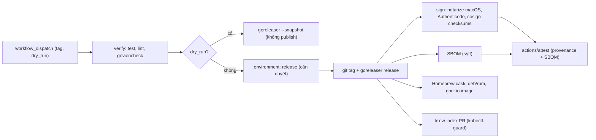

# 11. Build, release và ship binary Go

> Phạm vi: đưa `bbx`, `jkx`, `kubectl-guard` từ `git tag` tới tay người dùng (Homebrew, deb/rpm, container, krew, GitHub Releases), có chữ ký, SBOM và provenance kiểm chứng được.
> Cập nhật: 2026-11-09. GoReleaser v2.x, `actions/attest@v4`, `goreleaser/goreleaser-action@v7`.

Một CLI dành cho agent cần một release pipeline **đáng tin hơn** CLI bình thường. Agent sẽ chạy binary này với credential thật của người dùng trên Bitbucket, Jenkins và cluster Kubernetes. Người dùng (và đội security của họ) cần trả lời được ba câu hỏi:

1. Binary này **là phiên bản nào**? Đó là việc của version injection và `bbx version --json`.
2. Binary này **được build từ đâu**? Đó là việc của provenance attestation và reproducible build.
3. Binary này **chứa gì**? Đó là việc của SBOM và govulncheck.

Mục lục:

1. Version injection: `-ldflags -X` và `debug.ReadBuildInfo`
2. Reproducible builds
3. Ma trận cross-compile
4. GoReleaser v2: cấu hình đầy đủ
5. Ký binary: macOS, Windows, cosign
6. GitHub artifact attestations
7. SBOM
8. Container image: ko hoặc distroless
9. krew manifest cho `kubectl-guard`
10. Release workflow GitHub Actions (dispatch + approval + dry-run)
11. Update notifier
12. govulncheck và Dependabot
13. Lỗi thường gặp, Checklist, Tài liệu tham khảo



---

## 1. Version injection

### 1.1 `-ldflags -X`

`-X importpath.name=value` chỉ gán được cho biến **string** cấp package, không gán được cho hằng (`const`) và không gán được nếu biến được khởi tạo bằng lời gọi hàm. Với package khác `main`, phải dùng **import path đầy đủ**.

```go
// Package buildinfo holds values injected at link time.
package buildinfo

// Overridden via -ldflags "-X example.com/devx/internal/buildinfo.Version=..."
var (
	Version = "dev"
	Commit  = ""
	Date    = ""
)
```

```bash
go build -trimpath \
  -ldflags "-s -w \
    -X example.com/devx/internal/buildinfo.Version=v1.4.0 \
    -X example.com/devx/internal/buildinfo.Commit=$(git rev-parse HEAD) \
    -X example.com/devx/internal/buildinfo.Date=$(git log -1 --format=%cI)" \
  -o bin/bbx ./cmd/bbx
```

Dùng **thời gian commit** (`%cI`) chứ không dùng `date`. Thời gian hiện tại làm build không reproducible.

### 1.2 `debug.ReadBuildInfo` làm fallback

Khi người dùng cài bằng `go install example.com/devx/cmd/bbx@v1.4.0`, sẽ không có ldflags. Toolchain vẫn nhúng module version và (khi build trong repo git) các thông tin VCS. Từ Go 1.24, `go build` trong repo git còn tự đặt `Main.Version` từ tag/pseudo-version (kèm `+dirty` nếu working tree bẩn).

```go
package buildinfo

import (
	"runtime"
	"runtime/debug"
)

// Info is printed by `bbx version --json` and sent in the User-Agent header.
type Info struct {
	Version   string `json:"version"`
	Commit    string `json:"commit,omitempty"`
	Date      string `json:"date,omitempty"`
	Modified  bool   `json:"modified,omitempty"`
	GoVersion string `json:"go_version"`
	Platform  string `json:"platform"`
}

func Get() Info {
	info := Info{
		Version:   Version,
		Commit:    Commit,
		Date:      Date,
		GoVersion: runtime.Version(),
		Platform:  runtime.GOOS + "/" + runtime.GOARCH,
	}
	bi, ok := debug.ReadBuildInfo()
	if !ok {
		return info
	}
	if info.Version == "dev" && bi.Main.Version != "" && bi.Main.Version != "(devel)" {
		info.Version = bi.Main.Version
	}
	for _, s := range bi.Settings {
		switch s.Key {
		case "vcs.revision":
			if info.Commit == "" {
				info.Commit = s.Value
			}
		case "vcs.time":
			if info.Date == "" {
				info.Date = s.Value
			}
		case "vcs.modified":
			info.Modified = s.Value == "true"
		}
	}
	return info
}
```

`bbx version --json` là một phần của **contract với agent**: agent và hook (xem file 12) đọc version để biết manifest `commands --json` có những command nào. Đặt luôn version vào `User-Agent` khi gọi Bitbucket/Jenkins (`bbx/1.4.0 (+agent)`) để admin phía server nhìn thấy trong access log.

---

## 2. Reproducible builds

Mục tiêu: cùng commit và cùng toolchain thì cho ra cùng byte. Toolchain Go đã reproducible từ Go 1.21. Ta chỉ cần tránh tự đưa thêm yếu tố khác biệt vào:

| Nguồn sai khác | Cách khử |
|---|---|
| Đường dẫn tuyệt đối trên máy build | `-trimpath` |
| Build ID | Build ID của Go được suy ra từ nội dung, nên tự ổn định khi có `-trimpath` + cùng toolchain |
| Phiên bản Go khác nhau | `go.mod`: `go 1.25` + `toolchain go1.25.x`; CI dùng `go-version-file: go.mod` |
| cgo / libc của host | `CGO_ENABLED=0` |
| Thời gian build trong ldflags | Dùng thời gian commit |
| Dependency trôi | `go.sum` + `GOFLAGS=-mod=readonly`; GoReleaser `gomod.proxy: true` |
| mtime trong archive | `mod_timestamp` / `SOURCE_DATE_EPOCH` |

Lưu ý: **compiler Go không đọc `SOURCE_DATE_EPOCH`**. Biến này chỉ có ý nghĩa với công cụ đóng gói (tar, nfpm, GoReleaser archives) để cố định mtime của file trong archive. Mtime của binary thì dùng `mod_timestamp: "{{ .CommitTimestamp }}"`.

Kiểm tra nhanh:

```bash
export SOURCE_DATE_EPOCH=$(git log -1 --format=%ct)
goreleaser build --clean --snapshot --single-target -o /tmp/a/bbx --id bbx
goreleaser build --clean --snapshot --single-target -o /tmp/b/bbx --id bbx
sha256sum /tmp/a/bbx /tmp/b/bbx   # hashes must match
```

---

## 3. Ma trận cross-compile

Go cross-compile chỉ cần `GOOS`/`GOARCH` khi `CGO_ENABLED=0`. Ma trận đề xuất:

| Binary | linux amd64/arm64 | darwin amd64/arm64 | windows amd64/arm64 | Ghi chú |
|---|---|---|---|---|
| `bbx` | có | có | có (amd64), arm64 tùy chọn | dev laptop + CI runner |
| `jkx` | có | có | có (amd64) | agent Jenkins thường là Linux |
| `kubectl-guard` | có | có | có (amd64) | phải khớp platform của krew |

Không cần `386` hay `arm` (32-bit) trừ khi có người dùng thật yêu cầu. Mỗi target thêm vào là thêm thời gian ký, thêm artifact và thêm bề mặt hỗ trợ.

---

## 4. GoReleaser v2: cấu hình đầy đủ

Mấy điểm đổi mới gần đây cần biết (đã đối chiếu docs GoReleaser):

- `version: 2` ở đầu file là bắt buộc với v2.
- `archives[].formats` (dạng list) thay cho `format`. `format_overrides[].formats` cũng vậy.
- `nfpms[].ids` thay cho `builds` (từ v2.8).
- **`homebrew_casks` thay cho `brews`** (brews deprecated từ v2.10). Hook cask dùng `install_steps` (từ v2.19). Dạng Ruby `install` đã deprecated.
- Dry-run: `--snapshot` hoặc `--skip=publish` (không còn `--skip-publish`).

Monorepo `devx/` với ba binary:

```yaml
# .goreleaser.yaml
version: 2
project_name: devx

before:
  hooks:
    - go mod tidy -diff   # fail if go.mod/go.sum are not tidy
    - go generate ./...

gomod:
  proxy: true

builds:
  - &base
    id: bbx
    main: ./cmd/bbx
    binary: bbx
    env: [CGO_ENABLED=0]
    goos: [linux, darwin, windows]
    goarch: [amd64, arm64]
    ignore:
      - goos: windows
        goarch: arm64
    flags: [-trimpath]
    mod_timestamp: "{{ .CommitTimestamp }}"
    ldflags:
      - -s -w
      - -X example.com/devx/internal/buildinfo.Version={{ .Version }}
      - -X example.com/devx/internal/buildinfo.Commit={{ .FullCommit }}
      - -X example.com/devx/internal/buildinfo.Date={{ .CommitDate }}
    hooks:
      post:
        # Authenticode-sign Windows binaries; the script no-ops for other OSes.
        - cmd: ./scripts/sign-windows.sh "{{ .Path }}" "{{ .Os }}"
          output: true
  - <<: *base
    id: jkx
    main: ./cmd/jkx
    binary: jkx
  - <<: *base
    id: kubectl-guard
    main: ./cmd/kubectl-guard
    binary: kubectl-guard

archives:
  - id: bbx
    ids: [bbx]
    name_template: "bbx_{{ .Version }}_{{ .Os }}_{{ .Arch }}"
    formats: [tar.gz]
    format_overrides:
      - goos: windows
        formats: [zip]
    files:
      - LICENSE
      - README.md
      - src: completions/bbx.*
      - src: manpages/bbx*.1.gz
  - id: jkx
    ids: [jkx]
    name_template: "jkx_{{ .Version }}_{{ .Os }}_{{ .Arch }}"
    formats: [tar.gz]
    format_overrides:
      - goos: windows
        formats: [zip]
  - id: kubectl-guard
    ids: [kubectl-guard]
    # krew expects one archive per platform containing the binary + LICENSE.
    # Use the full tag (with "v") so the krew template can reuse .TagName as-is.
    name_template: "kubectl-guard_{{ .Tag }}_{{ .Os }}_{{ .Arch }}"
    formats: [tar.gz]
    format_overrides:
      - goos: windows
        formats: [zip]
    files: [LICENSE]

checksum:
  name_template: checksums.txt

sboms:
  - id: archive
    artifacts: archive   # syft is the default cmd
  - id: source
    artifacts: source

source:
  enabled: true

signs:
  - cmd: cosign
    signature: "${artifact}.sigstore.json"
    args: ["sign-blob", "--bundle=${signature}", "${artifact}", "--yes"]
    artifacts: checksum   # sign checksums.txt; it covers every archive

notarize:
  macos:
    - enabled: '{{ isEnvSet "MACOS_SIGN_P12" }}'
      ids: [bbx, jkx, kubectl-guard]
      sign:
        certificate: "{{ .Env.MACOS_SIGN_P12 }}"
        password: "{{ .Env.MACOS_SIGN_PASSWORD }}"
      notarize:
        issuer_id: "{{ .Env.MACOS_NOTARY_ISSUER_ID }}"
        key_id: "{{ .Env.MACOS_NOTARY_KEY_ID }}"
        key: "{{ .Env.MACOS_NOTARY_KEY }}"
        wait: true
        timeout: 20m   # hard cap enforced by GoReleaser

nfpms:
  - id: devx-linux
    package_name: devx
    ids: [bbx, jkx, kubectl-guard]
    vendor: Example Corp
    homepage: https://github.com/example/devx
    maintainer: Platform Team <platform@example.com>
    description: Agent-friendly DevOps CLIs for Bitbucket, Jenkins and Kubernetes.
    license: Apache-2.0
    formats: [deb, rpm, apk]
    bindir: /usr/bin
    contents:
      - src: ./completions/bbx.bash
        dst: /usr/share/bash-completion/completions/bbx
      - src: ./manpages/bbx.1.gz
        dst: /usr/share/man/man1/bbx.1.gz

# One cask per archive id: Homebrew pipes expect one archive per platform.
homebrew_casks:
  - name: jkx
    ids: [jkx]
    repository:
      owner: example
      name: homebrew-tap
      token: "{{ .Env.HOMEBREW_TAP_TOKEN }}"
    homepage: https://github.com/example/devx
    description: Agent-friendly Jenkins CLI.
    license: Apache-2.0
  - name: bbx
    ids: [bbx]
    repository:
      owner: example
      name: homebrew-tap
      token: "{{ .Env.HOMEBREW_TAP_TOKEN }}"
    homepage: https://github.com/example/devx
    description: Agent-friendly Bitbucket Cloud/Data Center CLI.
    license: Apache-2.0
    completions:
      bash: completions/bbx.bash
      zsh: completions/bbx.zsh
      fish: completions/bbx.fish
    # Only needed if binaries are NOT notarized:
    # hooks:
    #   post:
    #     install_steps: |
    #       on_macos do
    #         run "/usr/bin/xattr", args: ["-dr", "com.apple.quarantine", "{{ .StagedPath }}/bbx"]
    #       end

snapshot:
  version_template: "{{ incpatch .Version }}-devel+{{ .ShortCommit }}"

changelog:
  use: github
  filters:
    exclude: ["^docs:", "^test:", "^chore\\(deps\\):"]

release:
  draft: false
  prerelease: auto
  footer: |
    Verify: `gh attestation verify <file> --repo example/devx`
```

Ghi chú:

- Trong `ldflags`, mỗi phần tử list được nối bằng dấu cách, nên tách từng `-X` ra một dòng cho dễ đọc.
- `homebrew_casks.ids` lọc theo **archive id**. Mỗi cask chỉ được trỏ tới **một archive cho mỗi platform**, vì vậy mỗi binary có một cask riêng (`brew install --cask example/tap/bbx`). `kubectl-guard` phân phối qua krew (mục 9).
- Kiểm tra cấu hình bằng `goreleaser check`. Chạy thử local bằng `goreleaser release --snapshot --clean` (không ký, không publish).
- Với Homebrew: nếu binary **đã notarize** thì không cần hook xóa quarantine. Hook đó chỉ là đường lui cho bản chưa ký, và không nên là trạng thái mặc định của một công cụ cầm credential production.

---

## 5. Ký binary

### 5.1 macOS: codesign + notarize

Từ macOS Catalina trở đi, Gatekeeper chặn binary chưa notarize khi file có thuộc tính quarantine (tải qua trình duyệt, một số package manager). GoReleaser khối `notarize.macos` ký và notarize **từ runner Linux** (không cần máy Mac), bằng:

- Chứng chỉ **Developer ID Application** dạng `.p12` (base64) cùng mật khẩu.
- App Store Connect API key (`.p8`) gồm issuer ID và key ID.

Binary CLI đơn lẻ không staple được ticket (chỉ `.app`, `.dmg`, `.pkg` mới staple được). Gatekeeper sẽ tra online ở lần chạy đầu. Nếu người dùng nội bộ thường ở mạng kín, cân nhắc phát hành thêm `.pkg` qua `notarize.macos_native` (cần runner macOS).

### 5.2 Windows: Authenticode

GoReleaser OSS không có pipe Authenticode riêng. Cách phổ biến là gọi qua **build post hook** bằng một trong các công cụ sau:

- `jsign` (Java, chạy trên Linux, hỗ trợ cloud HSM như Azure Key Vault, Google Cloud KMS, AWS KMS).
- Azure Trusted/Artifact Signing (dịch vụ ký managed của Microsoft).
- `signtool.exe` trên runner Windows.

```bash
#!/usr/bin/env bash
# scripts/sign-windows.sh <path> <goos>
set -euo pipefail
path="$1"; goos="$2"
[[ "$goos" == "windows" ]] || exit 0
[[ -n "${WINDOWS_SIGN_KEYVAULT:-}" ]] || { echo "skip windows signing (no key)" >&2; exit 0; }
jsign --storetype AZUREKEYVAULT \
  --keystore "$WINDOWS_SIGN_KEYVAULT" \
  --alias "$WINDOWS_SIGN_CERT" \
  --storepass "$(az account get-access-token --resource https://vault.azure.net --query accessToken -o tsv)" \
  --tsaurl http://timestamp.digicert.com \
  "$path"
```

Ký **trước** khi GoReleaser tạo archive và checksum (post hook của build chạy đúng thời điểm này). Nếu ký sau, checksum sẽ sai.

### 5.3 cosign (Sigstore) cho checksums

Cấu hình `signs` ở trên ký `checksums.txt` bằng **keyless** (OIDC token của GitHub Actions) và tạo file bundle `checksums.txt.sigstore.json`. Người dùng kiểm tra:

```bash
cosign verify-blob checksums.txt \
  --bundle checksums.txt.sigstore.json \
  --certificate-identity-regexp '^https://github.com/example/devx/\.github/workflows/release\.yml@' \
  --certificate-oidc-issuer https://token.actions.githubusercontent.com
sha256sum --ignore-missing -c checksums.txt
```

---

## 6. GitHub artifact attestations

`actions/attest@v4` tạo attestation ký bởi Sigstore và lưu vào GitHub attestations API. Action này có ba chế độ: **provenance** (mặc định, SLSA build provenance), **SBOM** (khi có `sbom-path`) và **custom predicate**. Quyền cần có:

```yaml
permissions:
  id-token: write
  attestations: write
  artifact-metadata: write
  contents: write   # for creating the release itself
```

```yaml
- name: Attest build provenance
  uses: actions/attest@v4
  with:
    subject-checksums: dist/checksums.txt   # every archive listed there becomes a subject

- name: Compute version without the leading "v"
  id: ver
  run: echo "version=${TAG#v}" >> "$GITHUB_OUTPUT"

- name: Attest SBOM for the linux/amd64 bbx archive
  uses: actions/attest@v4
  with:
    subject-path: dist/bbx_${{ steps.ver.outputs.version }}_linux_amd64.tar.gz
    sbom-path: dist/bbx_${{ steps.ver.outputs.version }}_linux_amd64.tar.gz.sbom.json
```

Người dùng (hoặc script cài đặt nội bộ) kiểm tra:

```bash
gh attestation verify bbx_1.4.0_linux_amd64.tar.gz --repo example/devx
# For container images:
gh attestation verify oci://ghcr.io/example/bbx:1.4.0 --repo example/devx
```

Lưu ý về gói dịch vụ: attestations dùng được cho public repo với mọi gói. Private/internal repo cần GitHub Enterprise Cloud. **GitHub Enterprise Server không hỗ trợ**. Nếu tổ chức dùng GHES, hãy dùng cosign keyless với Sigstore public (nếu chính sách cho phép) hoặc cosign với key trong KMS.

---

## 7. SBOM

Có hai cách, chọn một và dùng nhất quán:

1. **GoReleaser `sboms`** (dùng syft, nên cần cài syft trên runner, ví dụ `anchore/sbom-action/download-syft`). Cách này tạo `*.sbom.json` cho mỗi archive và cho source.
2. **Tự chạy syft** trên binary: `syft scan file:dist/bbx_linux_amd64_v1/bbx -o spdx-json=bbx.spdx.json`.

Binary Go có nhúng module info, nên syft đọc được chính xác dependency **thực sự được link**, không chỉ những gì có trong `go.mod`. Có thể kiểm tra nhanh mà không cần công cụ ngoài:

```bash
go version -m ./bbx   # lists main module, deps with versions, build settings
```

Đưa SBOM vào attestation (mục 6) để người dùng tải SBOM gắn chặt với digest của artifact, không phụ thuộc một file lẻ trên trang Release.

---

## 8. Container image

Dùng cho: CI (Jenkins agent, Bitbucket Pipelines, GitHub Actions), MCP server remote, và chạy trong cluster cho `kubectl-guard`.

### 8.1 ko

`ko` build image từ Go source, không cần Dockerfile hay Docker daemon. Base image mặc định là `cgr.dev/chainguard/static`. ko hỗ trợ multi-arch và tự sinh SBOM:

```bash
export KO_DOCKER_REPO=ghcr.io/example
ko build ./cmd/bbx --bare --tags "1.4.0,latest" \
  --platform linux/amd64,linux/arm64 \
  --image-label org.opencontainers.image.source=https://github.com/example/devx
```

Để cấu hình ldflags cho ko, dùng `.ko.yaml` (`builds[].ldflags` có template `{{.Env.VERSION}}`). GoReleaser cũng có pipe `kos` nếu muốn mọi thứ nằm trong một file cấu hình.

### 8.2 Dockerfile distroless (khi cần kiểm soát hơn)

```dockerfile
# syntax=docker/dockerfile:1
FROM --platform=$BUILDPLATFORM golang:1.25 AS build
WORKDIR /src
COPY go.mod go.sum ./
RUN go mod download
COPY . .
ARG TARGETOS TARGETARCH VERSION=dev
RUN CGO_ENABLED=0 GOOS=$TARGETOS GOARCH=$TARGETARCH \
    go build -trimpath -ldflags "-s -w -X example.com/devx/internal/buildinfo.Version=${VERSION}" \
    -o /out/bbx ./cmd/bbx

FROM gcr.io/distroless/static-debian12:nonroot
COPY --from=build /out/bbx /usr/local/bin/bbx
USER nonroot:nonroot
ENTRYPOINT ["/usr/local/bin/bbx"]
```

Nguyên tắc: chạy với user nonroot, không có shell, pin base image bằng digest trong production, và ký image bằng `cosign sign` hoặc attest bằng `actions/attest` với `subject-name` + `subject-digest`.

---

## 9. krew manifest cho `kubectl-guard`

Binary `kubectl-guard` tự động thành plugin `kubectl guard` khi nằm trong `PATH`. Để phân phối qua krew, plugin cần một manifest. **Tên plugin là `guard`**, còn binary là `kubectl-guard`.

```yaml
# .krew.yaml (template rendered by krew-release-bot on each release)
apiVersion: krew.googlecontainertools.github.com/v1alpha2
kind: Plugin
metadata:
  name: guard
spec:
  version: {{ .TagName }}
  homepage: https://github.com/example/devx
  shortDescription: Tier-gated, audited kubectl operations for humans and agents
  description: |
    kubectl-guard wraps common kubectl operations with permission tiers
    (read/write/destructive/admin), preflight checks (PDB, replicas, context),
    confirmation and an audit log. Designed to be safe for AI agents.
  platforms:
    - selector:
        matchLabels: {os: linux, arch: amd64}
      {{addURIAndSha "https://github.com/example/devx/releases/download/{{ .TagName }}/kubectl-guard_{{ .TagName }}_linux_amd64.tar.gz" .TagName }}
      bin: kubectl-guard
    - selector:
        matchLabels: {os: darwin, arch: arm64}
      {{addURIAndSha "https://github.com/example/devx/releases/download/{{ .TagName }}/kubectl-guard_{{ .TagName }}_darwin_arm64.tar.gz" .TagName }}
      bin: kubectl-guard
    - selector:
        matchLabels: {os: windows, arch: amd64}
      {{addURIAndSha "https://github.com/example/devx/releases/download/{{ .TagName }}/kubectl-guard_{{ .TagName }}_windows_amd64.zip" .TagName }}
      bin: kubectl-guard.exe
```

Sau khi render, mỗi platform có `uri` và `sha256`. Liệt kê đủ cả `linux/arm64` và `darwin/amd64` (bị lược bớt ở trên cho gọn).

- Lần đầu tiên: mở PR thủ công vào `kubernetes-sigs/krew-index` và tuân theo [plugin naming guide](https://krew.sigs.k8s.io/docs/developer-guide/develop/naming-guide/). Tên `guard` có thể bị reviewer yêu cầu cụ thể hơn, nên chuẩn bị phương án dự phòng.
- Các release sau: `rajatjindal/krew-release-bot` tự mở PR cập nhật version.
- Trước khi gửi, test local: `kubectl krew install --manifest=guard.yaml --archive=dist/kubectl-guard_..._linux_amd64.tar.gz`.
- Nếu tổ chức cần kênh riêng, dùng **custom krew index** (một repo git chứa `plugins/guard.yaml`): `kubectl krew index add example https://github.com/example/krew-index`.

---

## 10. Release workflow GitHub Actions

Mô hình lấy từ `cli/cli` (`.github/workflows/deployment.yml`): release được kích hoạt **thủ công** bằng `workflow_dispatch`, có input `tag` và cờ dry-run, và job publish chạy trong một **environment có required reviewers**. Lợi ích: không ai lỡ tay đẩy tag mà tạo release, mọi release đều có người duyệt, và secret ký chỉ được mở trong environment đó.

```yaml
# .github/workflows/release.yml
name: release
on:
  workflow_dispatch:
    inputs:
      tag:
        description: "Tag to release, e.g. v1.4.0"
        required: true
        type: string
      dry_run:
        description: "Build everything but publish nothing"
        type: boolean
        default: true

permissions:
  contents: read

concurrency:
  group: release
  cancel-in-progress: false

jobs:
  verify:
    runs-on: ubuntu-latest
    steps:
      - uses: actions/checkout@v7
      - uses: actions/setup-go@v7
        with:
          go-version-file: go.mod
      - run: go vet ./... && go test -race ./...
      - uses: golang/govulncheck-action@v1
        with:
          go-version-file: go.mod

  release:
    needs: verify
    runs-on: ubuntu-latest
    # Approval gate only for real releases; dry runs need no reviewer.
    environment: ${{ inputs.dry_run && 'release-dry-run' || 'release' }}
    permissions:
      contents: write
      packages: write
      id-token: write
      attestations: write
      artifact-metadata: write
    env:
      TAG: ${{ inputs.tag }}
    steps:
      - uses: actions/checkout@v7
        with:
          fetch-depth: 0
      - uses: actions/setup-go@v7
        with:
          go-version-file: go.mod
      - uses: sigstore/cosign-installer@v4
      - uses: anchore/sbom-action/download-syft@v0

      - name: Validate tag
        run: |
          [[ "$TAG" =~ ^v[0-9]+\.[0-9]+\.[0-9]+(-[0-9A-Za-z.]+)?$ ]] || { echo "bad tag: $TAG"; exit 1; }

      - name: Create tag (real release only)
        if: ${{ !inputs.dry_run }}
        run: |
          git tag "$TAG"
          git push origin "$TAG"

      - name: GoReleaser
        uses: goreleaser/goreleaser-action@v7
        with:
          distribution: goreleaser
          version: "~> v2"
          args: ${{ inputs.dry_run && 'release --clean --snapshot' || 'release --clean' }}
        env:
          GITHUB_TOKEN: ${{ secrets.GITHUB_TOKEN }}
          HOMEBREW_TAP_TOKEN: ${{ secrets.HOMEBREW_TAP_TOKEN }}
          MACOS_SIGN_P12: ${{ secrets.MACOS_SIGN_P12 }}
          MACOS_SIGN_PASSWORD: ${{ secrets.MACOS_SIGN_PASSWORD }}
          MACOS_NOTARY_ISSUER_ID: ${{ secrets.MACOS_NOTARY_ISSUER_ID }}
          MACOS_NOTARY_KEY_ID: ${{ secrets.MACOS_NOTARY_KEY_ID }}
          MACOS_NOTARY_KEY: ${{ secrets.MACOS_NOTARY_KEY }}

      - name: Attest provenance
        if: ${{ !inputs.dry_run }}
        uses: actions/attest@v4
        with:
          subject-checksums: dist/checksums.txt

      - name: Upload dry-run artifacts
        if: ${{ inputs.dry_run }}
        uses: actions/upload-artifact@v4
        with:
          name: dist-snapshot
          path: dist/
          retention-days: 3
```

Ghi chú vận hành:

- Environment `release` cấu hình trong Settings → Environments: bật **Required reviewers**, giới hạn **deployment branches** chỉ cho `main`, và đặt secret ký **ở cấp environment** (không đặt ở cấp repo).
- `HOMEBREW_TAP_TOKEN` nên là token của GitHub App (`actions/create-github-app-token`) chỉ có quyền `contents: write` trên repo tap. Tránh PAT cá nhân.
- **Pin actions bằng commit SHA** (giữ comment version) cho mọi action bên thứ ba trong workflow release. Dependabot vẫn cập nhật được các SHA này.
- Bitbucket là nơi code của người dùng, nhưng repo phát hành tool có thể nằm trên GitHub để tận dụng attestations. Nếu bắt buộc phát hành từ Bitbucket Pipelines: GoReleaser vẫn chạy được, còn provenance thì dùng cosign + KMS key thay cho `actions/attest`.

---

## 11. Update notifier

Mẫu của `gh`: kiểm tra phiên bản mới **bất đồng bộ**, tối đa một lần mỗi 24 giờ, cache kết quả, và in ra **stderr** sau khi lệnh chính đã xong. Với tool cho agent, notifier phải **câm hoàn toàn** trong các ngữ cảnh máy đọc.

```go
package update

import (
	"os"

	"golang.org/x/term"
)

// ShouldCheck reports whether an update notice may be shown.
// It must stay silent for agents, CI and machine-readable output.
func ShouldCheck(jsonOutput, mcpMode bool) bool {
	switch {
	case jsonOutput, mcpMode:
		return false
	case os.Getenv("BBX_NO_UPDATE_NOTIFIER") != "":
		return false
	case os.Getenv("CI") != "" || os.Getenv("BUILD_NUMBER") != "" || os.Getenv("BITBUCKET_BUILD_NUMBER") != "":
		return false // GitHub Actions/most CI, Jenkins, Bitbucket Pipelines
	case !term.IsTerminal(int(os.Stderr.Fd())):
		return false
	}
	return true
}
```

```go
// In root command: start early, report late, never block.
func runWithNotifier(ctx context.Context, run func() error, jsonOut, mcpMode bool) error {
	notice := make(chan string, 1)
	if update.ShouldCheck(jsonOut, mcpMode) {
		go func() {
			ctx, cancel := context.WithTimeout(ctx, 2*time.Second)
			defer cancel()
			notice <- update.CheckCached(ctx, buildinfo.Get().Version) // "" if none or cached recently
		}()
	} else {
		notice <- ""
	}
	err := run()
	select {
	case msg := <-notice:
		if msg != "" {
			fmt.Fprintln(os.Stderr, msg)
		}
	default: // check not finished: skip, never delay the user
	}
	return err
}
```

`CheckCached` đọc và ghi `os.UserCacheDir()/bbx/update.json` (thời điểm check gần nhất cùng version mới nhất), gọi `GET https://api.github.com/repos/example/devx/releases/latest`, và so sánh bằng `golang.org/x/mod/semver.Compare`. Thông báo nên gợi ý **đúng lệnh nâng cấp** theo cách cài: phát hiện qua đường dẫn binary (`/opt/homebrew/` thì gợi ý `brew upgrade`, krew thì gợi ý `kubectl krew upgrade guard`).

Không bao giờ tự cập nhật binary (self-update) với tool cầm credential production. Hãy để package manager làm việc đó, vì như vậy chuỗi chữ ký và attestation vẫn được giữ nguyên.

---

## 12. govulncheck và Dependabot

### 12.1 govulncheck

`govulncheck` chỉ báo các lỗ hổng mà **code của bạn thực sự gọi tới** (dựa trên call graph), nên ít nhiễu hơn hẳn so với quét theo `go.mod`.

```yaml
# .github/workflows/ci.yml (excerpt)
  vuln:
    runs-on: ubuntu-latest
    steps:
      - uses: actions/checkout@v7
      - uses: golang/govulncheck-action@v1
        with:
          go-version-file: go.mod
```

Chạy thêm một job theo lịch (`schedule: cron: "0 3 * * 1"`), vì lỗ hổng mới được công bố cả khi code không đổi. Có thể quét binary đã phát hành: `govulncheck -mode=binary ./bbx`.

### 12.2 Dependabot

```yaml
# .github/dependabot.yml
version: 2
updates:
  - package-ecosystem: gomod
    directory: /
    schedule: {interval: weekly}
    groups:
      go-minor-patch:
        update-types: [minor, patch]
  - package-ecosystem: github-actions
    directory: /
    schedule: {interval: weekly}
    groups:
      actions:
        patterns: ["*"]
  - package-ecosystem: docker
    directory: /
    schedule: {interval: weekly}
```

Lưu ý riêng cho go-sdk MCP: SDK đang cập nhật nhanh theo spec. Hãy để Dependabot mở PR, và CI chạy **golden test `tools/list`** (file 10) để phát hiện thay đổi bề mặt (ví dụ cách serialize annotations thay đổi ở v1.7).

---

## Lỗi thường gặp

1. **`-X` không có tác dụng**: biến là `const`, không phải string, hoặc thiếu import path đầy đủ (`-X buildinfo.Version` thay vì `-X example.com/devx/internal/buildinfo.Version`). Linker không báo lỗi, chỉ lặng lẽ bỏ qua.
2. **Dùng `date` lúc build trong ldflags** làm mất tính reproducible. Hãy dùng `{{ .CommitDate }}`.
3. **Nghĩ rằng `SOURCE_DATE_EPOCH` ảnh hưởng tới `go build`.** Nó không ảnh hưởng. Biến này chỉ dành cho công cụ đóng gói.
4. **Vẫn dùng `brews:`** trong GoReleaser v2 gần đây, nên bị cảnh báo deprecated. Hãy chuyển sang `homebrew_casks`.
5. **Hook quarantine `install` dạng Ruby** đã deprecated. Hãy dùng `install_steps`, hoặc tốt hơn là notarize để khỏi cần hook.
6. **Ký Windows sau khi tạo checksum**, khiến checksum không khớp file. Hãy ký trong build post hook.
7. **Thiếu `id-token: write`** nên cosign keyless và `actions/attest` thất bại. Thiếu `artifact-metadata: write` cũng làm attest v4 báo lỗi.
8. **Release theo `on: push: tags`** mà không có người duyệt, khiến ai có quyền push tag đều phát hành được. Hãy dùng `workflow_dispatch` cùng environment approval.
9. **Update notifier in ra stdout** hoặc in khi `--json`/MCP, làm vỡ JSON mà agent đang parse, hoặc vỡ JSON-RPC.
10. **Archive krew đổi tên giữa các release**, làm template krew-release-bot hỏng. Hãy cố định `name_template`.
11. **`fetch-depth` mặc định (1)**, khiến GoReleaser không tính được changelog hay tag trước đó.
12. **Secret ký đặt ở cấp repo**, nên mọi workflow (kể cả trong PR từ branch) đều đọc được. Hãy đặt ở cấp environment.

## Checklist

- [ ] `internal/buildinfo` có `Version/Commit/Date` cùng fallback `debug.ReadBuildInfo`, và `bbx version --json`.
- [ ] Build: `CGO_ENABLED=0`, `-trimpath`, `mod_timestamp`, toolchain pin trong `go.mod`.
- [ ] Hai lần build snapshot cho cùng hash.
- [ ] `.goreleaser.yaml` có `version: 2`, `goreleaser check` xanh.
- [ ] Archives `formats`, nfpms `ids`, `homebrew_casks` (không còn `brews`).
- [ ] macOS notarize, Windows Authenticode, cosign bundle cho `checksums.txt`.
- [ ] `actions/attest@v4` cho provenance (và SBOM), có hướng dẫn `gh attestation verify` trong release notes.
- [ ] SBOM bằng syft cho từng archive.
- [ ] Image nonroot (ko hoặc distroless), multi-arch, ký hoặc attest.
- [ ] krew manifest `guard` + krew-release-bot. Đã test `krew install --manifest`.
- [ ] Workflow release: `workflow_dispatch`, `dry_run` mặc định true, environment có reviewer, actions pin SHA.
- [ ] Update notifier: async, cache 24h, stderr, câm khi CI/`--json`/MCP/non-TTY.
- [ ] govulncheck trên PR và theo lịch. Dependabot cho gomod, actions, docker.

## Tài liệu tham khảo

- Go command, build flags: https://pkg.go.dev/cmd/go
- Link flags (`-X`): https://pkg.go.dev/cmd/link
- `runtime/debug.ReadBuildInfo`: https://pkg.go.dev/runtime/debug#ReadBuildInfo
- Reproducible Go toolchains: https://go.dev/blog/rebuild
- GoReleaser docs: https://goreleaser.com/customization/
- GoReleaser Homebrew casks: https://goreleaser.com/customization/publish/homebrew_casks/
- GoReleaser deprecations: https://goreleaser.com/resources/deprecations/
- GoReleaser notarize: https://goreleaser.com/customization/sign/notarize/
- GoReleaser sign / SBOM: https://goreleaser.com/customization/sign/sign/ , https://goreleaser.com/customization/sbom/
- GoReleaser reproducible builds: https://goreleaser.com/blog/reproducible-builds/
- actions/attest: https://github.com/actions/attest
- Artifact attestations: https://docs.github.com/en/actions/security-for-github-actions/using-artifact-attestations
- `gh attestation verify`: https://cli.github.com/manual/gh_attestation_verify
- cosign: https://docs.sigstore.dev/cosign/
- syft: https://github.com/anchore/syft
- ko: https://ko.build/
- distroless: https://github.com/GoogleContainerTools/distroless
- krew developer guide: https://krew.sigs.k8s.io/docs/developer-guide/
- krew-release-bot: https://github.com/rajatjindal/krew-release-bot
- gh CLI deployment workflow: https://github.com/cli/cli/blob/trunk/.github/workflows/deployment.yml
- govulncheck: https://go.dev/doc/security/vuln/ , https://github.com/golang/govulncheck-action
- Dependabot options: https://docs.github.com/en/code-security/dependabot/working-with-dependabot/dependabot-options-reference
- jsign: https://ebourg.github.io/jsign/
