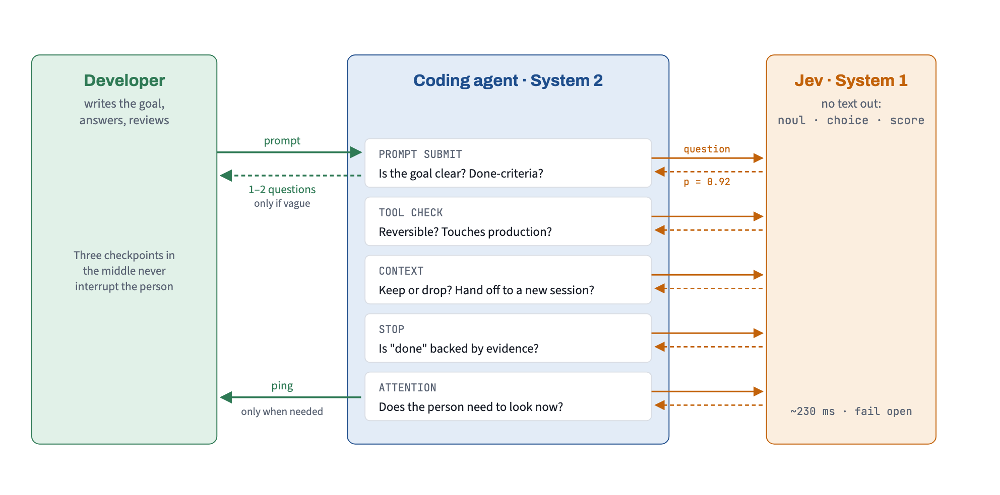

# q-advisor

> Part of [q-harness](../../README.md), a collection of Claude Code plugins by [**phuquocchamp**](https://github.com/phuquocchamp)

**Is this still the right model, the right session, and enough room in the context?** q-advisor watches the session and, at the moment it matters, suggests one thing: compact with a focus, start fresh for a new task, or switch model. It also focuses Claude Code's own autocompact on the plan, the decisions and the changed files. The numbers come from rules over the session; the judgement calls come from TypeSafe's **Jev** (the "System 1" of the harness), with Haiku as the fallback when there is no Jev key.

**Status** Built, starts in shadow mode (it logs every verdict and shows no advice until you switch it on) · **Version** 0.1.0 · **Author** phuquocchamp

<picture>
  <source media="(prefers-color-scheme: dark)" srcset="images/supervision-loop-dark.png">
  
</picture>

## Why

Three things quietly go wrong in long sessions:

| Problem | What it costs you |
|---------|-------------------|
| The context fills up, autocompact fires mid-task and keeps the wrong things | Claude forgets the plan, the files it changed, the decision you made an hour ago |
| A new task starts in an old session | Every turn pays for (and is distracted by) unrelated history |
| The model doesn't fit the task: Opus for renaming a variable, Haiku for an architecture call | Money and rate limit, or quality |

Claude Code shows the raw numbers (`/context`, `/cost`, the status line) but leaves the decision to you, at a time you are not looking. q-advisor makes the decision visible at the right moment and leaves the action one key away.

## What it ships

| Component | What it is |
|-----------|------------|
| **Mod** (`hooks/register.tsx`, helpers in `hooks/lib/`) | The advice engine, the focused autocompact, the band above the prompt, `/q-advisor` and the shadow log |

## Install

```text
/plugin install q-advisor --marketplace phuquocchamp/q-harness
```

## Settings

Set them in `/plugin` (or under `pluginConfigs["q-advisor"].options` in your user settings).

| Option | Default | What it does |
|--------|---------|--------------|
| `jevApiKey` | empty | TypeSafe Jev API key. Stored as sensitive and sent only in the `Authorization` header to `api.typesafe.ai`. When empty, `TYPESAFE_API_KEY` from the environment is used; when that is unset too, Haiku makes the calls. |
| `mode` | `shadow` | `shadow`: log every verdict, show no advice. `on`: show advice at turn boundaries. `off`: do nothing. `/q-advisor on\|shadow\|off` overrides it (saved). |
| `focusCompact` | `on` | `on`: when Claude Code compacts on its own, add focus instructions. `off`: leave autocompact untouched. |

More keys are set with `/q-advisor config <key> <value>`:

| Key | Default | Meaning |
|-----|---------|---------|
| `compactAt` | `60` | Context % from which "compact now" is advised, if the task is finished |
| `urgentAt` | `80` | Context % from which "compact before autocompact" is advised |
| `focusAt` | `70` | Context % from which the focus text is prepared in advance |
| `newTaskAt` | `30` | Context % below which a new task is not worth a `/clear` |
| `freshAfter` | `3` | Compactions after which a fresh session is advised |
| `rateLimitAt` | `80` | Rate-limit % from which the cheaper model is advised |
| `quietTurns` | `3` | Minimum turns between two pieces of advice |
| `minPromptChars` | `25` | Shorter prompts are never sent to Jev |
| `jev` | `on` | `off`: nothing leaves the machine; rules only |
| `jevModel` | `jev-latest` | The Jev model name |
| `thresholds.relation` `.size` `.finished` `.keep` | `0.9` `0.7` `0.7` `0.5` | Probability a verdict must reach before it may drive advice (from live probes) |

`/q-advisor config <key> reset` restores one key. `/q-advisor config` lists every value and where it came from.

## How it decides

Rules decide the numbers; Jev makes the judgements; Haiku writes the text. Jev cannot generate text.

| Who | Decides |
|-----|---------|
| **Rules** (`$.session.usage`) | Context %, rate limits, compaction count, turns |
| **Jev** (`api.typesafe.ai/v1/systemone`) | `relation` (continuation, new task or side question), `size` (trivial, routine or deep), `finished` (is the task done), and a keep-score for each candidate item of the focus |
| **Haiku** (`$.model.complete`, standalone, no history) | The focus text for compact and the handoff note for `/clear` |

When Jev is off or fails, Haiku classifies instead. Its answers carry p 0.5, so they are logged but never drive advice. Background work runs through `$.clock.after(0)`, so a prompt is never delayed.

## Features

| Feature | What it does |
|---------|--------------|
| **Focused autocompact** | When Claude Code compacts on its own (trigger `auto`, main conversation only), the stored focus is added as instructions. It never vetoes the compaction and only uses a focus prepared earlier. |
| **`/q-advisor compact`** | A one-step focused compact through `$.session.compact`. Works even where the hook does not run (see [Limits](#limits)). |
| **Compact advice** | `compact-now` at `compactAt` when the task is finished; `compact-urgent` at `urgentAt` mid-task |
| **New task** | Jev says the prompt is a new task: suggests `/clear` and writes a handoff note first. Needs at least 2 turns. The note is injected after `/clear` through `classic.SessionStart`, or as context on the first prompt after `/clear` when that hook does not run. |
| **Side-question guard** | A side question is not treated as a new task, so it never triggers `/clear` advice |
| **Fresh session** | After `freshAfter` compactions, suggests a fresh session with a handoff note |
| **Rate limit and model fit** | Jev sorts the prompt by size; a mismatch two steps away (deep task on Haiku, trivial task on Opus) suggests `/model`. Cache-aware: it says so instead of switching when the cache is warm and the context large. Above `rateLimitAt` it suggests the cheaper model for routine work. |
| **Missed compaction** | A context drop of more than 50% that q-advisor did not see coming is counted as a compaction |
| **Band above the prompt** | The advice with its reason and numbers, an action button and Dismiss. The command is also offered as a Tab suggestion. |
| **Shadow log** | Every verdict (source, label, p, latency) and every piece of advice is stored; `/q-advisor stats` summarises it |

The model-fit table:

| Task size | Examples | Fits |
|-----------|----------|------|
| trivial | rename, typo, format, a one-line question | Haiku |
| routine | a feature in known code, tests, a bug with a clear stack trace | Sonnet |
| deep | architecture, an unclear bug, a large refactor, security review, a plan | Opus |

## Commands

| Command | What it does |
|---------|--------------|
| `/q-advisor` | The session report and the advice for now |
| `/q-advisor on\|shadow\|off` | Set the mode (saved) |
| `/q-advisor stats` | Verdict and advice counts from the log |
| `/q-advisor focus` | Show the stored focus text |
| `/q-advisor compact` | Compact now, keeping the focus |
| `/q-advisor mute <kind>` / `unmute <kind>` | Stop or resume one kind: `compact-now`, `compact-urgent`, `new-task`, `fresh-session`, `model-fit`, `rate-limit` |
| `/q-advisor config [key value]` | Show the settings, or change one |
| `/q-advisor reset` | Delete the overrides, the log and the stored handoff |
| `/q-advisor help` | List the commands |

## How it works

| Hook | What q-advisor does |
|------|---------------------|
| `session.start` | Loads settings and prepares state |
| `prompt.submit` | Asks Jev about the new prompt in the background (relation, size); on the first prompt after `/clear`, adds the handoff note as context when `classic.SessionStart` did not |
| `turn.complete` | Reads the numbers, asks whether the task finished, decides the advice and prepares the focus |
| `session.compact` | Adds the stored focus to an automatic compaction; counts compactions |
| `classic.SessionStart` (`clear`) | Injects the handoff note into the fresh session |
| `command.run` | The `/q-advisor` command |
| `ui.render` (AbovePrompt) | The band: advice, action button, Dismiss |

## Limits

- **Managed Claude Code.** Where an organization manages Claude Code (remote managed settings, for example Claude Team), `session.compact` and `classic.SessionStart` do not run for plugins you install yourself; `claude plugin validate` warns about it, and a real `/compact` was confirmed not to reach the hook. Focused autocompact is then off, and the handoff uses the `prompt.submit` fallback. Use `/q-advisor compact` instead.
- **Data sent to Jev:** redacted summaries of recent work, the last reply, the todo state, the tool-error count, the new prompt and the candidate items. With `jev off`, nothing leaves the machine. Haiku calls go through Claude Code itself.
- **Not verified:** whether the focus measurably changes the engine's summary.
- A mod cannot switch the model or clear the session on its own; q-advisor suggests the command or runs it after a click, once the turn is over.
- Jev's labels are guesses. A wrong "new task" or "deep task" is cheap to dismiss, which is why everything is a suggestion.
- Cache warmth is estimated from the idle time; the engine does not report it directly.

## Develop

```bash
claude --plugin-dir ./plugins/q-advisor       # load from disk; saving a file reloads it
claude plugin validate ./plugins/q-advisor
claude plugin test ./plugins/q-advisor
```

Tests run against a fake host: 104 tests in 10 files. Live-tested in two real sessions with real Jev: the report, `on`, `config`, `stats`, `focus`, the band with live verdicts (p 0.79 to 0.98, 284 to 387 ms) and `/q-advisor compact`.
