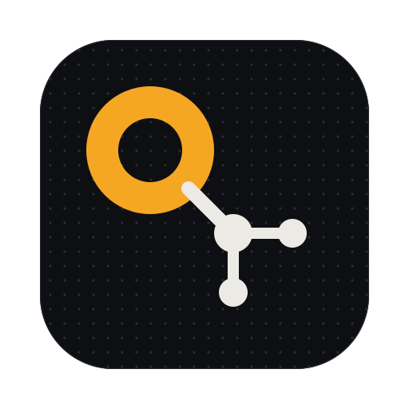

# q-graph

> Part of [q-harness](../../README.md), a collection of Claude Code plugins by [**phuquocchamp**](https://github.com/phuquocchamp)

**Which agents are running, which one is stuck, and which one is waiting for me?** q-graph records every agent loop of the session (the main loop, subagents and teammates), shows the live ones in a band above the prompt, warns you when one waits for an answer, and draws the whole tree in a pane with a dot moving along the edge of each running agent.

**Version** 0.1.1 · **Author** phuquocchamp · [Design and roadmap (artifact)](https://claude.ai/artifact/9r76tdnMNXSqDuBbkEND56)

## What it ships

| Feature | What you see | Use it when |
|---------|--------------|-------------|
| **Roster band** | A row above the prompt with one entry per live agent: `Explore ◐ Grep`, `Plan ⚠ needs you 42s`, `general-purpose ⏸ waiting`, `backend@auth ○ idle`, then a `graph` button. When they do not fit on one row, the rest fold into a `+N more` button: press it to list every agent on wrapped rows, and `show less` to fold them again. Finished agents stay 30 seconds. An agent that vanished from the engine's list and has been silent for 45 seconds shows `? lost`; any later hook event for it brings it back. The band hides when there are none. | Claude fans work out to subagents or a team and you want to see who is doing what. |
| **Needs-you alert** | A toast, and a native notification, when a subagent or teammate asks a question (AskUserQuestion) or waits for plan approval (ExitPlanMode), and when one fails. It stays raised while any such call is in flight, even when the agent runs other tools in parallel (calls are tracked by their tool-use id). An agent first seen already failed raises nothing, and an alert never delays the tool call. An agent the engine marks `waiting` on its own background work or on a child agent shows `⏸ waiting` and raises nothing. | You are in another window while agents run. |
| **Graph pane** | `/q-graph` opens a pane with the agent tree, left to right: main → subagents → their subagents. Each card is a rounded frame in the agent's colour (bright while it runs, quiet once it is done) with its name, model, time, status (or the tool it is running) and tokens. Edges are box-drawing lines at right angles: one trunk per parent and a `├──▸` branch to each child; a running child's branch takes its colour and a `●` moves along it. Dashed `┄` loops join agents that messaged each other, in their own columns right of the cards. A card that needs you says `! needs you`. When the tree is wider than the pane, the columns move closer, then the cards narrow, and levels that still do not fit are counted under the graph with a `show all in browser` button. | You want the whole picture of a session, or to find the agent that is stuck. |
| **Uses per agent** | Under each card, including main's, hangs the list of what that agent used, each with its own `├▸` branch: tools (`Bash ×17`), skills (`skill commit`), MCP servers (`mcp context7 ×2`) and the rules or CLAUDE.md files it loaded (`rule conventions.md`), each kind in its own colour. Two agents that both run Bash each get their own `Bash` row with their own count. A use fills while the agent runs it and for about a second after. Every use is listed, in the order the agent first used it; none is folded away, in the pane or in the browser viewer. A call that starts an agent is not listed: the child's card is that call. | You want to see what each agent actually did, and with which part of the harness. |
| **Harness card** | On top of the graph, the session's harness: settings hooks per event, the memory files the context carries (CLAUDE.md, rules), skills, MCP servers and custom agents. Read at session start and again at each prompt (MCP servers connect late). `/q-graph status` prints it as one line. | You want to know what is configured and loaded before you read what the agents did. |
| **Live browser viewer** | `/q-graph web` (or `/q-graph open --web`) starts a small local viewer and prints its link. The pane header always has an `↗ open in browser` button: it starts the viewer if needed and opens it in your default browser (`open` on macOS, `xdg-open` on Linux, `start` on Windows); while the viewer runs, its link is shown next to the button too. The page is an interactive React Flow canvas of the same graph, uses and harness card included: drag nodes (a card's uses move with it), the ⟲ button in the zoom controls puts every moved card back in the tree, zoom, a minimap (hidden below 760 px), moving dots on running edges and on the edge of a use while it runs. It opens top-left at a readable zoom (0.9 to 1) instead of fitting the whole tree. Each card shows the first line of its task under the name, `— tok` until the agent's first turn ends, and `waiting on N agents` when an idle agent has running children. It updates live while the session runs. An **All | Working** switch next to Graph | Timeline (remembered in this browser) hides the agents that are done, idle, stopped or lost, with their uses, and keeps main, every agent still running, starting, waiting or needing you, and the agents above them so the tree stays connected; it shows how many it hides (`Working · 12 hidden`). The detail sidebar on the right is pinned open by default and shows main until you click another node (see below). | You want to explore a big session with the mouse, keep the graph on a second screen, or see only what is still working once a large team has finished. |

In the terminal the graph is a `Raster`: a grid of cells, each with a character and colours. Text uses the terminal's own colour, so the graph reads on light and dark themes. On the desktop app, VS Code and mobile the pane shows the same tree as text.

## Commands

| Command | What it does |
|---------|--------------|
| `/q-graph` or `/q-graph open` | Open the graph pane |
| `/q-graph web` or `/q-graph open --web` | Start the live browser viewer and print its link (the same link while it runs) |
| `/q-graph web stop` | Stop the viewer |
| `/q-graph close` | Close it |
| `/q-graph status` | One line per agent: model, status, time, tokens, uses, task; then the harness line |
| `/q-graph band on\|off` | Show or hide the roster band |
| `/q-graph notify on\|off` | Send a native notification when an agent waits for you or fails (the toast always shows) |
| `/q-graph config` | Show the settings |
| `/q-graph help` | Usage |

Subcommands are case-insensitive. An unknown subcommand or argument (for example `web --stop`) prints the usage with exit code 2 and does nothing.

Settings are saved across sessions. The graph itself belongs to the session.

## Where the data comes from

| Hook or call | What q-graph records |
|--------------|----------------------|
| `agent.spawn` | A new node: agent type, model, task, parent agent, teammate address |
| `tool.call` (its `agentId`) | Uses per agent: the tool, or the skill (`Skill` call's `skill`), or the MCP server (`mcp__<server>__<tool>`); the call running now, and whether it is asking the person (AskUserQuestion, ExitPlanMode) |
| `classic.InstructionsLoaded` (its `agent_id`, absent for main) | A rule or CLAUDE.md file an agent loaded: at session start, for a path-matched rule, or for a nested CLAUDE.md |
| `$.settings.read()` and `$.session.usage({ breakdown: 'summary' })`, at session start and each prompt | The harness card: settings hooks per event, memory files, skills, MCP servers, custom agents. `summary` counts locally and sends no request. |
| `turn.complete` (its `agentId`) | Tokens (input, output and cache writes; cache reads are left out because every request re-reads the cached prefix); a subagent's turn finishes it (done, failed or stopped); main and teammates go idle |
| `session.send` | Messages between agents (SendMessage) |
| `prompt.submit` | The main loop starts working |
| `$.agent.list()`, once a second while an agent runs, waits or is starting | Statuses no hook raises: `waiting`, `idle`, and `failed` or `killed` for a teammate; agents no spawn hook saw (a forked skill's loop) are added. A spawn or a message starts the poll again. |

## How the live viewer works

The mod cannot run a server (no Node in a mod), so `/q-graph web` starts `viewer/server.mjs` with `$.process.spawn`, trying `node` and then `bun`. The server makes a private temp folder, listens on `127.0.0.1` on a free port, and prints `{ port, file, token }`. Every 300 ms the mod writes the graph to that file when it changed; the server pushes each new snapshot to the page over Server-Sent Events.

- Only this machine can reach it (127.0.0.1), and every request needs the random token in the link. A request whose `Host` is not `127.0.0.1:<port>` or `localhost:<port>` gets 403, which stops DNS rebinding.
- Every response carries a Content-Security-Policy (scripts only from the page, cdnjs and jsDelivr; images only from the page; connections only to the viewer), `X-Content-Type-Options: nosniff`, `Referrer-Policy: no-referrer` and `Cache-Control: no-store`. At most 16 tabs can be connected at once.
- The snapshot's `transcript` is used only when it is a `.jsonl` file under `~/.claude/projects`.
- The viewer stops with `/q-graph web stop`, when the session ends, when the plugin reloads, or when Claude Code exits (it checks its parent every 5 seconds). It deletes its temp folder on the way out, also after an uncaught error. A temp folder left behind by a killed viewer is swept by the next viewer once it is 24 hours old. The folder and the snapshot file are private to you (0700 and 0600).
- A failed snapshot write is retried on the next tick, and a missing transcript is looked up again every 5 seconds.
- The page loads React and React Flow from cdnjs and jsDelivr, so the browser needs internet access; the session data never leaves the machine. Each script tag has an SRI `integrity` hash, so bumping a library version means recomputing it.
- An open tab reloads itself when `viewer/index.html` changes on disk (the server watches the file and sends a `reload` event), so a page update shows without a manual refresh. A viewer process keeps the `server.mjs` it started with: after updating the plugin, run `/q-graph web stop` and `/q-graph web` once to pick up new server routes (the Timeline says so when its route is missing).
- Colours and fonts come from `viewer/q-theme.css`, a generated copy of the repo's shared design tokens (`--q-*`; edit `shared/ui/q-theme.css` and run `node scripts/sync-ui.mjs`). Light and dark follow the browser. Kind colours mark graph kinds only; links, focus and selection use the accent, and a running agent's status is the accent. Fonts are the system stacks, nothing is downloaded. The terminal pane uses the host theme's `success`, `warning` and `error` for status and one mid-tone hex set for kinds, so it reads on light and dark terminals.
- The link works in a terminal. Remote surfaces (the desktop and mobile apps) only open `https:` links.

### Timeline

The **Graph | Timeline** switch in the header (remembered in this browser) turns the canvas into a timeline of the whole session. Each agent is a lane: main on top, every subagent and teammate under the agent that spawned it. On each lane:

- a thin bar for the agent's lifetime;
- every tool, skill and MCP call as a block in its kind's colour (an Agent call takes the child's colour), with a red outline on errors and a moving stripe while it runs; calls that ran at the same time stack into extra rows;
- a link from each Agent call down to the lane it started;
- on main, a ◇ marker for each of your prompts.

Wheel scrolls, Ctrl/Cmd+wheel (or pinch) zooms around the pointer, and −, + and Fit zoom too. **Follow live** keeps "now" (the green line) in view. **Compress idle** (on by default) squeezes any stretch over 60 s with no activity on any lane into a hatched band labelled like "⋯ 16m idle". Hover a block for its tool, hint, start and duration. Click a block to open it in the detail sidebar with that call expanded (an Agent block opens the child agent), and click a lane's name to open the agent.

The lanes come from the transcripts, not from the graph: `GET /timeline` reads `<session>.jsonl` and every `<session>/subagents/agent-*.jsonl` with its `.meta.json`, finds each lane's parent through the meta's `toolUseId` (the Agent call that started it), and returns slim calls with no inputs or outputs. So agents that ran before the viewer opened still show. It keeps its own slim per-file index (no inputs or outputs), updated incrementally, so hundreds of subagents are parsed once, not on every poll. Both caches are bounded by size; the timeline keeps at most 5,000 calls per agent and the detail 2,000, and reports what it dropped in `truncated`. The page polls it at most every 2 seconds while something runs. The toolbar and the header both count agents including main.

### Node details

The sidebar on the right (a bottom sheet below 760 px wide) is **pinned** by default: it opens with the page showing main, and Escape or a click on the empty canvas goes back to main instead of closing it. Click any node to show that node. The ◉ button unpins it (then Escape and a canvas click close it, as before) and ○ pins it again; × closes it and unpins. The pin is remembered in this browser. Drag its left edge to make it wider or narrower (or focus the edge and use ←/→, Shift for bigger steps); the ⤢ button, a double-click on the edge, or Enter on it toggles between the normal width and 60% of the window. The width is remembered in this browser.

| Node | The sidebar shows |
|------|-------------------|
| Agent (main, subagent, teammate) | Type, model, status, time, tokens, parent, task, its uses and child agents (all clickable), its prompt and final result, and a timeline of every tool call |
| Tool, skill or MCP use | Its owner agent, the call count and every call of that use |
| Rule | The path (repo-relative or `~/…`, the full path on hover) and the agent that loaded it |
| Harness | The full lists: rule files, hooks per event, MCP servers, skill and agent counts |

Each call row shows the time, the tool, a one-line hint (command, file path, pattern), the duration and ✓, ✗ or … while it runs; click it for the full input and output. An Agent call row has a separate `→ child` link to the agent it started, and its "Async agent launched…" output shows as `spawned → <child>` (the raw text folds under it). The **calls** heading folds the whole list like prompt and result: it starts open, stays as you left it across nodes (remembered in this browser), and opens again when you click a call in the timeline.

An agent's prompt and result, and the prompt and result of an Agent call, are rendered as **markdown** (headings, lists, tables, code). The page renders them with [marked](https://marked.js.org) and sanitizes the HTML with [DOMPurify](https://github.com/cure53/DOMPurify), which also strips images, media, styles, frames and forms so transcript content cannot load anything from the web; links open in a new tab. The `md | raw` switch in a block's corner shows the rendered or the plain text, and the choice is remembered in this browser.

Other tools' inputs and outputs get the same toggle:

- An output that reads as markdown (two or more kinds of markdown syntax, such as a heading plus a table, as in `cat README.md`) is rendered first and follows the remembered choice. Any other output (plain logs, `ls`, diffs, line-numbered Read output) and every error starts raw, and its `md` button previews that block only.
- A JSON input (SendMessage, WebFetch, MCP tools…) has an `md` view that lists its fields: long text as markdown, short values as code, objects as JSON. It is rendered first when one of its fields reads as markdown.
- A one-field input (a Bash command, a file path, a Grep pattern) stays verbatim.

If either library fails to load from the CDN, every block shows plain text.

Nothing extra is stored: the details come from the transcripts Claude Code already writes, read when you click. The mod puts the main transcript's path in the snapshot (`transcript`, taken from a classic hook's `transcript_path`, else `~/.claude/projects/<project>/<session>.jsonl`). On a click the page calls `GET /detail?agent=<id>[&use=<key>]`; the server reads `<session>.jsonl` for main and `<session>/subagents/agent-<id>.jsonl` for a subagent or teammate, pairs each `tool_use` with its `tool_result` by id, follows outputs Claude Code saved to `tool-results/`, and caps long strings (input 4,000 and output 8,000 characters; a saved output file is read only up to that cap). A transcript replaced by a new file (new inode) is re-read from the start. It keeps one index per file and reads only the bytes appended since the last request, so a 20 MB transcript costs about 40 ms once, then a few ms. While the selected agent runs, the sidebar refreshes at most every 2 seconds.

The transcript format is Claude Code's own and not a documented API: the parser skips anything it does not know, so a format change shows less detail rather than breaking the viewer. Transcripts are kept for Claude Code's `cleanupPeriodDays` (30 days by default).

## Limits

- Tokens are counted when an agent's turn ends, so a running subagent shows no tokens until it finishes (`—` in the browser viewer, blank on the pane card, 0 in `/q-graph status`).
- An agent becomes `lost` only when it is missing from a non-empty `$.agent.list()`, has no call in flight and no hook named it for 45 seconds. Workflow agents are never listed, so for them only the silence counts. Only `turn.complete` finishes an agent; a late tool call does not restart a finished subagent.
- A hook event from an agent seen before its spawn creates a stub card (type `unknown`) that the spawn fills in.
- The notification is sent whether or not the terminal has the focus; your notification channel decides what to do with it. Turn it off with `/q-graph notify off` (the toast stays).
- Agents started by a workflow are not in `$.agent.list()`; q-graph only sees what its hooks see of them.
- A teammate running in its own terminal pane reports only `running` or `idle`, not its tool calls.
- The moving dots repaint about 7 times a second while an agent runs, waits or is starting and the pane is shown, and an unchanged frame is not sent again.
- Characters a terminal cell cannot hold in one column (emoji, CJK) are drawn as `?`, one `?` per run; combining marks, joiners and variation selectors are dropped. Cut text ends in `…`. The status and arrow glyphs (`● ◐ ▸ ◂`) are ambiguous-width, so a terminal set to draw those wide (some CJK setups) misaligns the cards.
- One terminal Raster holds at most 512 columns by 256 rows, so a taller tree is drawn as several Rasters stacked in the pane. Past 4,096 rows, or a tree too deep for 512 columns, the agents that do not fit are counted under the graph (`+N agents too deep or too many to draw here`) with a `show all in browser` button that opens the live viewer, which has no size limit.
- Hooks are on the harness card only: the engine does not say which agent a hook fired for, and the hooks modules of plugins (mods like this one) cannot be listed, so the card counts settings hooks.
- Where an organization manages Claude Code, `classic.*` hooks of a plugin you installed yourself do not run, so the rule rows under each card are missing; the harness card still lists the memory files.
- A subagent started without CLAUDE.md loads none, so it shows no rule rows.

## Roadmap

See the [design artifact](https://claude.ai/artifact/9r76tdnMNXSqDuBbkEND56) for mockups.

| Version | Adds |
|---------|------|
| 0.2 | Team view with dagre layout, a time slider in the browser viewer, Mermaid export, an SVG + SMIL pane for the desktop app |
| 0.3 | Decision nodes from AskUserQuestion and ExitPlanMode written to `docs/adr/` |
| 0.4 | Draft decisions extracted by Haiku, decisions fed back through `prompt.compose`, cost per agent type, pixel images for kitty and Ghostty |

## Install

```text
/plugin install q-graph --marketplace phuquocchamp/q-harness
```

## Develop

```bash
claude --plugin-dir ./plugins/q-graph       # load from disk; saving a file reloads it
claude plugin validate ./plugins/q-graph
claude plugin test ./plugins/q-graph
```

`hooks/register.tsx` holds every hook, the state atoms and every helper that takes `$`. `hooks/lib/` holds pure helpers:

| File | Holds |
|------|-------|
| `graph.ts` | The session graph and its reducers (spawn, tool calls and their use keys, rules loaded, turn end, messages, sync with `$.agent.list()`), the harness card, status lines |
| `layout.ts` | The left-to-right tree layout in terminal cells: a band of rows per agent for its card and uses, the harness card on top |
| `raster.ts` | Draws a laid-out graph into `RasterProps.cells`: framed cards, box-drawing edges routed at right angles, the uses under each card, the harness card, moving dots; `splitFrame` cuts a tall frame into stacked tiles of at most 256 rows |
| `settings.ts` | Defaults, `/q-graph` toggles, usage text |

`viewer/` is the live browser viewer: `server.mjs` (Node 18+ or Bun, no dependencies), `transcript.mjs` (the transcript parser and incremental index behind `/detail` and `/timeline`), `index.html` (React Flow page, the timeline view and the detail sidebar; React, React Flow, marked and DOMPurify load from cdnjs and jsDelivr), `reactflow-base.css` (React Flow 11.11.4's base styles, MIT).

Session state (`types/index.d.ts`): `graph`, every agent and message of the session; `settings`, the only value saved across sessions.

Tests live in `tests/`: `lib-graph` and `lib-raster` for the pure helpers, `recorder` for the hooks, band, pane, alerts and commands, `web` for starting and stopping the live viewer and the snapshot's `transcript`; `host.ts` is the shared fake host. `viewer/transcript.test.mjs` and `viewer/server.test.mjs` run outside the plugin test kit (`claude plugin test` only runs `tests/`): `node --test viewer/*.test.mjs` (a bare directory argument fails).
